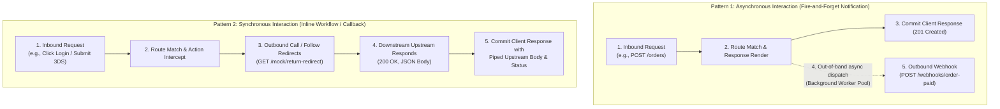
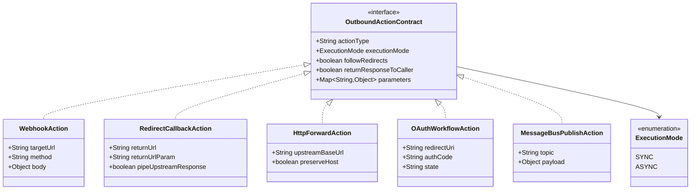
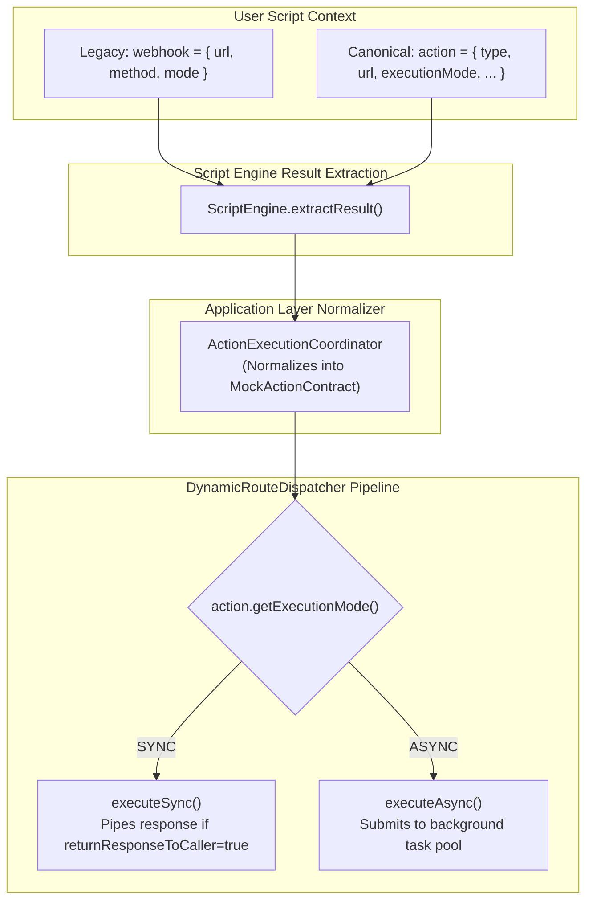

# Architecture Review: Domain Placement of `executionMode` — Webhook Property vs. Platform Interaction Contract

- **Document Type:** Enterprise Architecture Decision Review & Domain Placement Analysis
- **Target Platform:** Dynamic Mock Platform (`v0.6.2+`)
- **Author:** Antigravity Architecture Core
- **Status:** **PROPOSED & RECOMMENDED**
- **Topic:** Placement, Ownership, and Boundaries of `executionMode` across Clean Architecture Layers

---

## 1. Executive Summary & Core Verdict

### The Strategic Question
Should `executionMode` be modeled as:
- **Option A:** A **Webhook-specific configuration field** (bound strictly to secondary outbound HTTP webhook notifications)?
- **Option B:** A **Dynamic Mock Platform Interaction Contract** (a reusable, first-class execution strategy governing all current and future action types, such as Webhooks, Callbacks, HTTP Forwarding, OAuth/OIDC Flows, Browser Workflows, Payment Simulations, and Workflow State Transitions)?

### The Core Verdict
> **`executionMode` MUST be modeled as Option B: A First-Class Dynamic Mock Platform Interaction Contract.**

Modeling `executionMode` as a webhook-only property (Option A) is a **semantic category error**. In network and workflow simulation systems:
1. A **Webhook** is merely *one specific transport type* of outbound interaction (typically an out-of-band event notification).
2. **`executionMode` (`SYNC` vs. `ASYNC`)** is a fundamental **temporal execution lifecycle strategy** governing how the mock engine coordinates between inbound requests, outbound interactions, and client response commitment.
3. Forcing interactive checkout callbacks, 3DS challenges, OAuth redirects, and reverse-proxy forwarding into the semantic container of an "async webhook with a blocking flag" degrades domain clarity, violates Clean Architecture boundaries, and creates technical debt for every upcoming workflow capability.

By establishing `executionMode` as a foundational **Platform Interaction Contract**, Dynamic Mock achieves a clean, extensible foundation that powers webhooks today while seamlessly scaling to OAuth, Hosted Checkout, 3DS, Reverse Proxying, and Message Bus simulations tomorrow.

---

## 2. The Architectural Dilemma

Dynamic Mock is transitioning from a static stub responder into an **interactive, stateful simulation platform**. Consider the lifecycle difference between two common interactions:



If the platform treats `executionMode` as a property of `webhook`:
- In Pattern 1, the name is natural: an async webhook.
- In Pattern 2 (Mobile Banking checkout, 3DS challenge, OAuth authorization exchange), calling the return URL is **not an out-of-band notification**. It is an **inline workflow callback / forward**.
- If the developer is forced to configure this via `webhook: { mode: 'sync' }`, the abstraction leaks: the user is configuring a "webhook" to perform synchronous HTTP response forwarding.

---

## 3. Evaluation Across the Five Architectural Criteria

### 3.1. Long-Term Extensibility

| Evaluation Factor | Option A: Webhook-Specific Field | Option B: Platform Interaction Contract |
| :--- | :--- | :--- |
| **New Action Types (OAuth, 3DS, Proxy)** | **Poor.** Every new action type must either reinvent its own execution mode flag or be awkwardly coerced into `webhook`. | **Excellent.** New action types (`HTTP_FORWARD`, `OAUTH_AUTHORIZE`, `PAYMENT_CALLBACK`, `MESSAGE_PUBLISH`) inherit the contract out of the box. |
| **Dispatcher Pipeline** | **Fragmented.** `DynamicRouteDispatcher` needs custom execution branches for each feature's custom threading model. | **Unified.** A single `ActionExecutionCoordinator` handles all outbound actions based on their `executionMode` (`SYNC` vs. `ASYNC`). |
| **Telemetry & Observability** | **Inconsistent.** Webhooks log under `WEBHOOK` events; other future actions would need separate, uncoordinated telemetry logs. | **Standardized.** Telemetry records `actionType`, `executionMode`, `parentEventId`, duration, and redirect hops under a single cohesive schema. |

**Analysis:**
Option A creates an immediate dead end. Over the next 12–24 months, as Dynamic Mock adds OAuth 2.0 PKCE simulations, OpenID Connect discovery callbacks, 3D-Secure 2.2 postbacks, and reverse-proxy fallbacks, Option A forces the platform into one of two bad compromises:
1. Coercing all outbound HTTP traffic into `webhook` (destroying domain semantics), or
2. Creating fragmented flags (`oauthExecutionMode`, `forwardingMode`, `callbackMode`) across separate subsystems.

Option B decouples **what** the action is (the protocol/payload) from **how** it is scheduled in the execution lifecycle (the `executionMode`).

---

### 3.2. Clean Architecture Boundaries

The Clean Architecture dependency rule dictates that dependencies point strictly inward toward the enterprise business rules (Domain):

```
┌─────────────────────────────────────────────────────────────────┐
│                     FRAMEWORKS & DRIVERS                        │
│  (Spring MVC, Undertow/Tomcat, MongoDB, Redis, Netty)           │
│  ┌───────────────────────────────────────────────────────────┐  │
│  │               INTERFACE ADAPTERS                          │  │
│  │  (DynamicRouteDispatcher, WebhookService, HttpAdapters)   │  │
│  │  ┌─────────────────────────────────────────────────────┐  │  │
│  │  │          APPLICATION BUSINESS RULES                 │  │  │
│  │  │  (ActionExecutionService, TrafficLogger, RouteService)│  │  │
│  │  │  ┌───────────────────────────────────────────────┐  │  │  │
│  │  │  │   ENTERPRISE BUSINESS RULES (Domain)          │  │  │  │
│  │  │  │   ExecutionMode (Value Object: SYNC, ASYNC)   │  │  │  │
│  │  │  │   MockAction (Domain Model / Contract)        │  │  │  │
│  │  │  └───────────────────────────────────────────────┘  │  │  │
│  │  └─────────────────────────────────────────────────────┘  │  │
│  └───────────────────────────────────────────────────────────┘  │
└─────────────────────────────────────────────────────────────────┘
```

#### Under Option A (Webhook-Specific):
- `ExecutionMode` is trapped inside `AsyncWebhookService` or an ad-hoc map entry inside `ScriptContext.webhook`.
- The Application Layer (`DynamicRouteDispatcher`) must inspect low-level webhook configuration maps to decide whether to pause the servlet response thread or dispatch to a thread pool.
- Clean Architecture is violated because an infrastructure/adapter concern (`webhook` transport) is dictating the core HTTP request-response lifecycle.

#### Under Option B (Platform Interaction Contract):
- **Domain Layer (`com.dynamicmock.domain.model.execution`)**:
  - Defines the core value object: `ExecutionMode.java` (`SYNC`, `ASYNC`).
  - Defines the interaction contract: `OutboundAction.java` containing `actionType`, `targetUrl`, `executionMode`, `followRedirects`, and `returnResponseToCaller`.
- **Application Layer (`com.dynamicmock.application.port.in / service`)**:
  - Defines `ActionExecutionCoordinator`: knows how to execute an `OutboundAction` synchronously (intercepting and resolving response before commit) or asynchronously (submitting to `TaskExecutor`).
- **Adapter Layer (`com.dynamicmock.adapter.out`)**:
  - Protocol executors: `HttpActionAdapter` (implements the HTTP exchange, redirect resolution, and hop-by-hop header cleanup).
- Boundaries remain crisp: the domain owns the concept of execution synchronicity, the application layer coordinates the workflow timing, and the adapter layer executes the physical network call.

---

### 3.3. Domain Ownership & Conceptual Integrity

**What concept does `executionMode` actually describe?**

It does *not* describe an HTTP method, a payload format, or a webhook signature.
It describes **the synchronization contract between an inbound client request and an outbound side-effect**:

1. **`SYNC` (Blocking / Inline)**:
   - *Semantics:* "Do not finish responding to the client until this action has completed. The output of this action may mutate the status, headers, or body sent back to the caller."
   - *Use Cases:* Hosted Checkout callback, Mobile Banking login redirect, 3DS Authentication verification, Reverse-Proxy forward, Upstream enrichment.

2. **`ASYNC` (Non-Blocking / Detached)**:
   - *Semantics:* "Respond immediately to the client with the mock template. Execute this action independently in the background."
   - *Use Cases:* Out-of-band payment event notifications (Stripe/PayPal webhooks), audit logging, event broadcasting, asynchronous message publishing.

Because `executionMode` governs **response lifecycle timing and response mutation**, it belongs to the **Mock Execution Domain**, not to the Webhook adapter.

---

### 3.4. Reuse Potential

A platform contract is justified only if it demonstrates genuine multi-consumer reuse. Below is an inventory of mock action types and how `ExecutionMode` applies to each:



1. **Webhooks**:
   - `ASYNC`: Traditional merchant webhook (e.g. order dispatched).
   - `SYNC`: Webhook verification test suite where the test harness asserts delivery synchronously before advancing.
2. **Interactive Callbacks (Mobile Banking / Hosted Checkout)**:
   - `SYNC`: User clicks Login; backend calls redirect URL, follows redirects to destination, and returns final payload directly to mobile WebView.
   - `ASYNC`: Asynchronous acknowledgment with decoupled completion notification.
3. **HTTP Forwarding / Reverse Proxy**:
   - `SYNC`: Reverse proxy to an upstream legacy service, inspect/modify response, and return to caller.
   - `ASYNC`: Shadow-mirroring / traffic replay to a secondary endpoint without delaying primary response.
4. **OAuth 2.0 / OIDC Authorization Code Flow**:
   - `SYNC`: Client authorization exchange where the authorization server or mock client synchronously redirects or posts back with `code` and `state`.
5. **3D-Secure (3DS) Challenge**:
   - `SYNC`: Browser postback where ACS (Access Control Server) posts authentication response to MPI/Merchant URL and expects the merchant's checkout result synchronously.
6. **Message Bus Publishing (Kafka / RabbitMQ)**:
   - `ASYNC`: Fire-and-forget message publish.
   - `SYNC`: Transactional publish where client receives 200 OK only after message broker ACK.

Under Option A, none of this reuse is possible without duplicating the mode logic across 5 separate implementations. Under Option B, a single platform contract handles all of them.

---

### 3.5. Future Feature Compatibility Walkthrough

To validate feasibility, consider how two flagship enterprise features execute under Option B:

#### Scenario 1: Hosted Payment / Mobile Banking Checkout Flow
1. Consumer opens `/mock/checkout?returnUrl=https://merchant.app/callback`.
2. Mock renders interactive checkout HTML.
3. User enters PIN and clicks **Pay**.
4. Script/Route defines:
   ```javascript
   action = {
     type: 'callback',
     url: request.queryParams.returnUrl,
     executionMode: 'sync',
     followRedirects: true,
     returnResponseToCaller: true
   };
   ```
5. **Platform Action Coordinator**:
   - Detects `executionMode: 'sync'`.
   - Executes HTTP call to `https://merchant.app/callback`.
   - Follows downstream `302 Found -> https://merchant.app/order/complete`.
   - Strips hop-by-hop headers (`Transfer-Encoding`, `Connection`).
   - Copies status (`200 OK`) and body (`{"orderId":"123","status":"CONFIRMED"}`) directly to the client response.
6. Mobile app receives the merchant's exact order confirmation response instantly.

#### Scenario 2: OAuth 2.0 Authorization Code Simulation
1. Client app redirects to `/mock/oauth/authorize?client_id=123&redirect_uri=https://client.com/cb&state=xyz`.
2. Mock renders Consent Screen.
3. User clicks **Authorize**.
4. Script/Route defines:
   ```javascript
   action = {
     type: 'oauth_redirect',
     url: request.queryParams.redirect_uri + '?code=auth_12345&state=' + request.queryParams.state,
     executionMode: 'sync',
     followRedirects: false
   };
   ```
5. **Platform Action Coordinator**:
   - Detects `executionMode: 'sync'`.
   - Sets HTTP 302 Found with `Location: https://client.com/cb?code=auth_12345&state=xyz`.
   - Client browser automatically follows to client application.

---

## 4. Recommended Ownership & Domain Model Placement

### 4.1. Domain Layer Placement (`com.dynamicmock.domain`)

Place the contract in the domain layer as an enterprise value object and action model:

```
backend/src/main/java/com/dynamicmock/domain/
└── model/
    └── execution/
        ├── ExecutionMode.java         <-- Enum: SYNC, ASYNC
        ├── ActionType.java            <-- Enum: WEBHOOK, CALLBACK, FORWARD, OAUTH
        └── MockActionContract.java    <-- Value Object / Interface
```

#### Canonical Definitions:

```java
package com.dynamicmock.domain.model.execution;

/**
 * Enterprise Business Rule: Defines how an outbound action synchronizes
 * with the inbound HTTP mock request-response lifecycle.
 */
public enum ExecutionMode {
    /**
     * Action is executed inline before the HTTP response is committed.
     * Downstream results may mutate or become the mock response.
     */
    SYNC,

    /**
     * Action is dispatched to a background executor.
     * Mock response is committed immediately without waiting.
     */
    ASYNC;

    public static ExecutionMode fromString(String value) {
        if (value == null || value.isBlank()) {
            return ASYNC; // Safe default
        }
        String clean = value.trim().toUpperCase();
        if ("SYNC".equals(clean) || "BLOCKING".equals(clean) || "SYNCHRONOUS".equals(clean)) {
            return SYNC;
        }
        return ASYNC;
    }
}
```

```java
package com.dynamicmock.domain.model.execution;

import lombok.AllArgsConstructor;
import lombok.Builder;
import lombok.Data;
import lombok.NoArgsConstructor;
import java.util.Map;

/**
 * Enterprise Business Rule: Standard contract for outbound actions triggered by mock routes.
 */
@Data
@Builder
@NoArgsConstructor
@AllArgsConstructor
public class MockActionContract {
    @Builder.Default
    private ActionType actionType = ActionType.WEBHOOK;

    private String targetUrl;
    private String method;
    private Object body;
    private Map<String, String> headers;
    private Integer delayMs;

    @Builder.Default
    private ExecutionMode executionMode = ExecutionMode.ASYNC;

    @Builder.Default
    private boolean followRedirects = true;

    @Builder.Default
    private boolean returnResponseToCaller = false;
}
```

---

### 4.2. Application & Script Runtime Integration

To prevent breaking existing customer stubs and test suites, [`ScriptContext`](file:///Users/sanjokkhakurel/GITHUB-REPO/dynamic-mock-project/backend/src/main/java/com/dynamicmock/adapter/out/script/ScriptContext.java) and [`ScriptEngine`](file:///Users/sanjokkhakurel/GITHUB-REPO/dynamic-mock-project/backend/src/main/java/com/dynamicmock/adapter/out/script/ScriptEngine.java) support the platform contract while maintaining 100% backward compatibility:



1. **Script Binding Support**:
   - Polyglot scripts can set `action = { ... }` (canonical) or `webhook = { ... }` (legacy alias).
   - If `webhook` is used, the application normalizer maps it to a `MockActionContract` with `actionType = WEBHOOK`.
   - If `mode: "blocking"` or `mode: "sync"` is present, it maps to `ExecutionMode.SYNC`.

2. **Dispatcher Lifecycle Isolation**:
   - `DynamicRouteDispatcher` does not talk directly to raw `RestTemplate` or background executor logic.
   - It delegates to `ActionExecutionCoordinator`:
     ```java
     MockActionContract action = extractActionContract(scriptContext);
     if (action != null) {
         if (action.getExecutionMode() == ExecutionMode.SYNC) {
             ActionResult result = actionCoordinator.executeSync(route.getId(), requestEventId, action);
             if (action.isReturnResponseToCaller() && result != null) {
                 applyActionResultToResponse(result, scriptContext);
             }
         } else {
             actionCoordinator.executeAsync(route.getId(), requestEventId, action);
         }
     }
     ```

---

### 4.3. Unified Telemetry Contract

Under this design, the BottomBar and Traffic Console record execution telemetry under a clean, unified structure:

```json
{
  "id": "event-12345",
  "protocol": "HTTP",
  "path": "/mobile-banking/login",
  "status": 200,
  "action": {
    "type": "CALLBACK",
    "executionMode": "SYNC",
    "targetUrl": "http://localhost/mock/return-redirect",
    "finalUrl": "http://localhost/mock/return-final",
    "status": 200,
    "durationMs": 42.5,
    "redirectHops": 2
  }
}
```

This eliminates the confusion of seeing an "Async Webhook" label in the console when a synchronous mobile checkout callback just occurred.

---

## 5. Comparative Tradeoff Summary

| Criterion | A: Webhook-Specific Field | B: Platform Interaction Contract |
| :--- | :--- | :--- |
| **Architectural Purity** | Low (semantic category error; conflates transport with timing) | **High (aligns with Clean Architecture & Domain-Driven Design)** |
| **Coupling** | Tight (ties all secondary execution to Webhook service) | **Loose (separates action definition from execution strategy)** |
| **Extensibility for OAuth/3DS**| Fragile (requires schema modifications for every flow) | **Robust (immediately reusable across all interactive workflows)** |
| **Cognitive Simplicity** | Confusing (e.g., "blocking webhook" used for checkout proxying) | **Clear (interaction contract defines when and how actions run)** |
| **Migration Risk** | Low in the immediate turn, high technical debt later | **Zero risk with bidirectional normalization aliases** |

---

## 6. Final Architecture Recommendation

1. **Adopt Option B**: Formally model `ExecutionMode` (`SYNC`, `ASYNC`) as a **Dynamic Mock Platform Interaction Contract** housed in `com.dynamicmock.domain.model.execution`.
2. **Treat `webhook` as a Specialized Implementation of `MockActionContract`**:
   - Existing user scripts setting `webhook = { url, method, mode }` will continue to function with 100% backward compatibility via bidirectional alias mapping (`blocking` ⇄ `sync` ⇄ `ExecutionMode.SYNC`).
3. **Keep Presentation Decoupled**:
   - The HTML page remains pure presentation (no execution mode dropdowns or mock controls in the markup).
   - Execution behavior is governed at the platform contract level.
4. **Prepare the Foundation for Advanced Flows**:
   - Once the contract is established, OAuth 2.0 PKCE, 3D-Secure challenges, and Hosted Checkout flows plug directly into the `SYNC` execution pipeline without modifying database schemas or dispatcher architecture.

---
*End of Architectural Review.*

