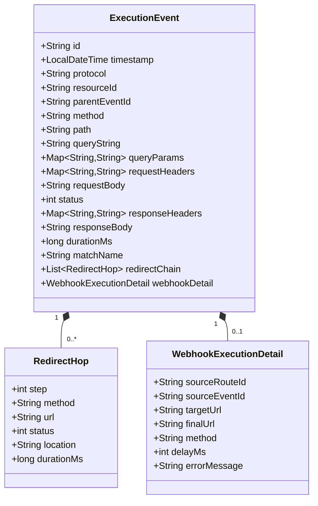
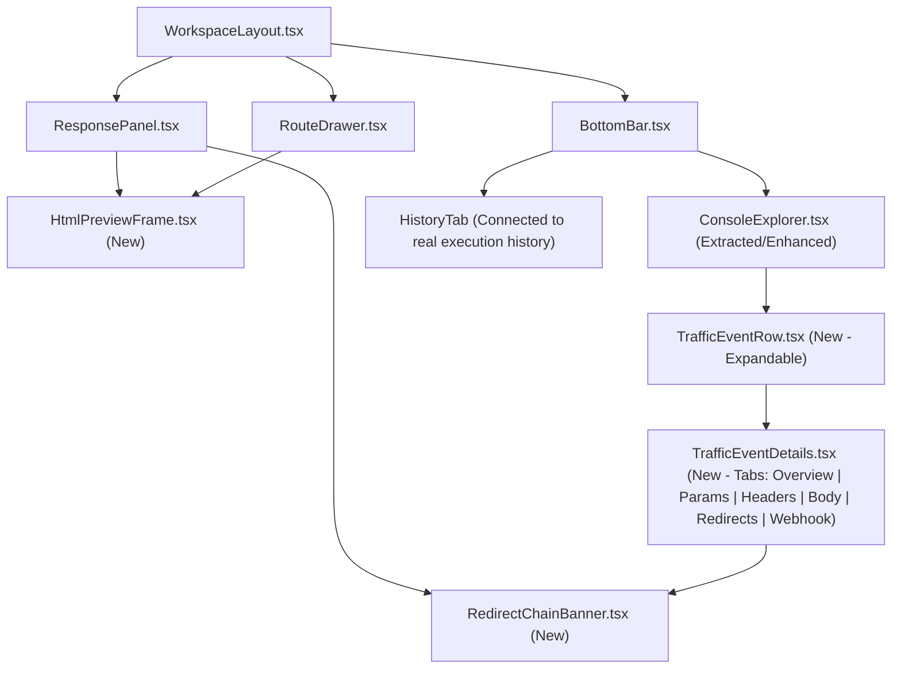

# Architecture Review: v0.6.1 — Interactive Simulation Experience

- **Document Type:** Formal Architecture & Security Review (No Implementation / No Code)
- **Target Release:** `v0.6.1`
- **Release Title:** Interactive Simulation Experience
- **Source Discovery:** [HTML_PREVIEW_DISCOVERY.md](file:///Users/sanjokkhakurel/GITHUB-REPO/dynamic-mock-project/HTML_PREVIEW_DISCOVERY.md)
- **Governance Alignment:** [AI_GOVERNANCE.md](file:///Users/sanjokkhakurel/GITHUB-REPO/dynamic-mock-project/AI_GOVERNANCE.md), [ROADMAP_AUTHORITY.md](file:///Users/sanjokkhakurel/GITHUB-REPO/dynamic-mock-project/ROADMAP_AUTHORITY.md), [MASTER_PRODUCT_ACTION_PLAN.md](file:///Users/sanjokkhakurel/GITHUB-REPO/dynamic-mock-project/MASTER_PRODUCT_ACTION_PLAN.md)

---

## 1. Executive Summary & Architectural Verdict

During the `v0.6.1` discovery phase ([HTML_PREVIEW_DISCOVERY.md](file:///Users/sanjokkhakurel/GITHUB-REPO/dynamic-mock-project/HTML_PREVIEW_DISCOVERY.md)), we validated the product need for rendering interactive `text/html` stubs (such as the Mobile Banking Login, OAuth2 consent, and 3DS challenge flows) directly inside the Dynamic Mock workspace.

However, a holistic architectural audit of the full **Interactive Simulation Lifecycle** reveals that visual HTML rendering is only **half** of the user experience. When a user interacts with a rendered HTML stub inside the preview (e.g., clicking **Login** in the Mobile Banking stub), the interaction triggers **secondary background traffic**:
1. An asynchronous `fetch()` from the iframe to `/mock/mobile-banking-login?action=login&returnUrl=...`
2. A polyglot Post-Script dispatching an asynchronous `WEBHOOK` to `/mock/return-url-redirector`
3. A `302 Found` HTTP redirect from `/mock/return-url-redirector` to `/mock/return-url-final-destination`

In the current `v0.6.0` codebase, those secondary requests do **not** update the Test Client's `lastResponse` — they are observable **only in the bottom Traffic Console** ([BottomBar.tsx](file:///Users/sanjokkhakurel/GITHUB-REPO/dynamic-mock-project/frontend/src/components/workspace/BottomBar.tsx)). Yet today's Traffic Console is a non-interactive, single-line log strip that strips query strings (`request.getRequestURI()`), truncates IDs to 8 characters (`substring(0, 8)`), discards request/response headers and bodies, hides `302` redirect hops, and omits webhook payload/response details.

### Architectural Verdict: **APPROVED WITH MANDATORY TELEMETRY ENRICHMENT**
To deliver a complete **Interactive Simulation Experience** in `v0.6.1`, the architecture must pair **Sandboxed HTML Preview** (`ResponsePanel` + `RouteDrawer`) with an **Interactive Console Explorer** (`BottomBar` + `TrafficLogger` + `AsyncWebhookService` + `TestClientController`), while strictly preserving Hexagonal Architecture and zero-trust iframe sandboxing.

---

## 2. Evaluation of Current Codebase Gaps Against the 9 Objectives

An audit of the current `v0.6.0` implementation identifies the exact architectural bottlenecks across the 9 objectives:

| # | Objective | Current `v0.6.0` Implementation | Architectural Gap Identified |
| :- | :--- | :--- | :--- |
| **1** | **HTML Response Preview** | [ResponsePanel.tsx](file:///Users/sanjokkhakurel/GITHUB-REPO/dynamic-mock-project/frontend/src/components/workspace/ResponsePanel.tsx) renders only `Body` and `Headers` tabs via `JsonHighlighter`. | No `Preview` tab, no `Content-Type: text/html` detection, and Download hardcodes `response.json`. |
| **2** | **Route Details Preview** | [RouteDrawer.tsx](file:///Users/sanjokkhakurel/GITHUB-REPO/dynamic-mock-project/frontend/src/components/workspace/RouteDrawer.tsx) (lines 234–244) renders a raw `<pre>` truncated at 300 chars (`slice(0, 300)`). | No `Preview \| Source` toggle for HTML routes; truncation cuts off inspection of longer templates. |
| **3** | **Console Explorer** | [BottomBar.tsx](file:///Users/sanjokkhakurel/GITHUB-REPO/dynamic-mock-project/frontend/src/components/workspace/BottomBar.tsx) renders static 1-line terminal text; `HistoryTab` is a stub hardcoded to `GET /mock/hello`. | No search/protocol filtering in Console, no interactive event selection, and broken History tab. |
| **4** | **Expandable Traffic Events** | `ConsoleTab` rows (`<div key={event.id}>`) have no click handler or expansion state. | Users cannot expand a traffic row to inspect what happened during that request. |
| **5** | **Query Parameter Visibility** | [DynamicRouteDispatcher.java](file:///Users/sanjokkhakurel/GITHUB-REPO/dynamic-mock-project/backend/src/main/java/com/dynamicmock/infrastructure/filter/DynamicRouteDispatcher.java) (line 47) logs `mockPath` from `request.getRequestURI()`, discarding `request.getQueryString()`. | `?action=login&returnUrl=...` is invisible in the Console; users cannot tell which query params were sent. |
| **6** | **Full Request IDs** | [BottomBar.tsx](file:///Users/sanjokkhakurel/GITHUB-REPO/dynamic-mock-project/frontend/src/components/workspace/BottomBar.tsx) (line 130) displays `resourceId.substring(0, 8)...` and never shows `event.id` (Request ID). | Neither the full Request ID (`event.id`) nor the full Route ID (`resourceId`) is visible or copyable. |
| **7** | **Request/Response Inspection** | [TrafficLogger.java](file:///Users/sanjokkhakurel/GITHUB-REPO/dynamic-mock-project/backend/src/main/java/com/dynamicmock/application/service/TrafficLogger.java) `ExecutionEvent` has only 9 summary scalar fields. | Request headers/body and response headers/body are discarded before WebSocket broadcast. |
| **8** | **Redirect Chain Visualization** | `SimpleClientHttpRequestFactory` (`HttpURLConnection`) follows `GET` `302` redirects silently or logs unlinked events. | Redirect hops (`302 Found` → `Location` header → `200 OK` final target) are not captured as a visual chain. |
| **9** | **Webhook Detail Inspection** | [AsyncWebhookService.java](file:///Users/sanjokkhakurel/GITHUB-REPO/dynamic-mock-project/backend/src/main/java/com/dynamicmock/application/service/AsyncWebhookService.java) (lines 114–122) logs only `method`, `url`, `status`, and `durationMs`. | Webhook request headers/body, response headers/body, redirect hops, and parent request correlation are lost. |

---

## 3. Deep-Dive Review: Sandboxed Iframe & HTML Preview Architecture

### 3.1 Zero-Trust Iframe Sandbox Security Model
Rendering user-authored HTML and JavaScript inside an authenticated administrative workspace requires a **hardware-grade browser origin boundary**.

```mermaid
flowchart TD
    subgraph ParentWindow["Parent Window: Dynamic Mock Workspace (Origin: http://localhost)"]
        Auth["AuthContext (In-Memory JWT)"]
        Storage["localStorage (Drafts & Theme)"]
        RP["ResponsePanel / RouteDrawer"]
        HPF["HtmlPreviewFrame Component"]
    end

    subgraph SandboxedIframe["<iframe sandbox='allow-scripts allow-forms allow-popups' srcdoc='...'>"]
        Origin["Effective Origin: null (Opaque)"]
        Shim["Injected Bootstrap Shim (<head>)"]
        DOM["Rendered HTML + CSS + Stub JS"]
    end

    subgraph Backend["Dynamic Mock Backend"]
        AdminAPI["/api/** (JWT Protected, Strict CORS)"]
        MockAPI["/mock/** (Public Simulation, CORS: *)"]
    end

    RP --> HPF
    HPF -->|srcdoc injection| SandboxedIframe
    DOM -->|fetch / XHR rewritten by Shim| MockAPI
    DOM -.->|window.parent / localStorage| Blocked1["❌ BLOCKED by Browser (SecurityError)"]
    DOM -.->|fetch('/api/**')| Blocked2["❌ BLOCKED by CORS + Missing JWT"]
```

#### Mandatory Security Invariants:
1. **`allow-same-origin` MUST NEVER BE ENABLED:**
   - Enabling both `allow-scripts` and `allow-same-origin` on an `<iframe>` hosted on the same origin allows code inside the iframe to access `window.parent.document`, read `localStorage`, and even remove its own `sandbox` attribute.
   - By configuring `sandbox="allow-scripts allow-forms allow-popups"` (**without** `allow-same-origin`), the browser forces the iframe into a unique **opaque origin (`Origin: null`)**:
     - `window.parent.document` throws `DOMException: Blocked a frame with origin "null" from accessing a cross-origin frame`.
     - `window.localStorage` and `document.cookie` throw `SecurityError`.
     - In-memory JWT tokens in `AuthContext` are 100% unreachable.
2. **`allow-top-navigation` MUST NEVER BE ENABLED:**
   - Prevents a stub script (`window.top.location.href = '...'`) from navigating the user away from the Dynamic Mock workspace.
3. **Content Security Policy & Referrer Isolation:**
   - Set `referrerPolicy="no-referrer"` on the `<iframe>` element.
4. **Static vs. Interactive Sandbox Mode:**
   - **Response Panel (`ResponsePanel.tsx`):** Uses interactive mode (`sandbox="allow-scripts allow-forms allow-popups"`) so users can test form submissions, buttons, and `fetch()` calls.
   - **Route Details (`RouteDrawer.tsx`):** Defaults to **safe static preview** (`sandbox=""` — pure HTML/CSS layout rendering with scripts disabled) with an optional toggle or "Test Interactive Preview" action, guaranteeing that merely opening the Route Details drawer never fires background scripts or webhooks unintentionally.

### 3.2 Avoiding Double Execution
A critical architectural requirement is **zero double execution**:
- When the user clicks **Execute** in `RequestPanel.tsx`, `useTestClient` sends `POST /api/test-client/execute` to the backend.
- That single execution evaluates Pre-Scripts, transitions Stateful Scenarios, renders Handlebars templates, runs Post-Scripts, triggers any immediate Webhooks, and returns `TestResponse` (`status`, `headers`, `body`, `durationMs`).
- **Why `<iframe src="/mock/...">` is prohibited as the default renderer:** Setting `src="/mock/..."` would cause the browser to issue a *second* `GET /mock/...` request immediately after `POST /api/test-client/execute`, double-incrementing scenario state and double-triggering webhooks!
- **How `srcdoc` solves this:** `HtmlPreviewFrame` feeds `lastResponse.body` directly into the `srcdoc` attribute. The initial render performs **zero network requests** to `/mock/**`. Network requests to `/mock/**` only happen when the user actively interacts with the rendered page (e.g., clicking the `#login-btn` submit button).

### 3.3 The `fetch` / `XHR` / Form Action Rewrite Strategy inside `srcdoc`
Because an `<iframe srcdoc="...">` document has URL `about:srcdoc` and `window.location.pathname === "srcdoc"`, scripts written for real browser pages (like `mobile-banking-login-stub.e2e.spec.ts` line 132) often construct callback URLs dynamically:

```javascript
// Pattern in mobile-banking-login-stub.e2e.spec.ts:
var triggerUrl = window.location.pathname + '?action=login&returnUrl=' + encodeURIComponent(returnUrl);
fetch(triggerUrl, { method: 'GET' });
```

Inside `about:srcdoc`, `window.location.pathname + '?action=login...'` evaluates to `"srcdoc?action=login..."` (or `"/srcdoc?action=login..."`), which fails to resolve without a context shim!

#### Architectural Solution — The `srcdoc` Context Bootstrap Shim:
Before passing `rawHtml` to `<iframe srcdoc={...}>`, a pure helper function `buildSandboxedSrcDoc(rawHtml: string, context: { targetUrl: string; mockPath: string; origin: string })` injects a compact `<script>` + `<base>` block at the start of `<head>` (or document start):

1. **`<base href="{origin}/mock/">` Injection:** Ensures relative asset/link URLs resolve against the mock server base.
2. **URL Normalization Function (`__dmResolveUrl(inputUrl)`):**
   - If `inputUrl` starts with `http://` or `https://`, leave as-is (or rewrite internal container hostnames like `http://localhost:8080/mock/...` to the browser-accessible origin if needed).
   - If `inputUrl` starts with `"srcdoc?"`, `"/srcdoc?"`, `"about:srcdoc?"`, or `"?"`, rewrite the path prefix to the executed mock endpoint URL (`{origin}/mock{mockPath}{queryString}`).
   - If `inputUrl` starts with `"/mock/"`, prefix with `{origin}`.
   - If `inputUrl` starts with `"/"` (e.g., `"/mobile-banking-login"`), prefix with `{origin}/mock`.
3. **`window.fetch` & `XMLHttpRequest.prototype.open` Interceptor:**
   - Wraps `window.fetch(input, init)` so string/URL inputs pass through `__dmResolveUrl(input)` before calling native `fetch`.
   - Wraps `XMLHttpRequest.prototype.open(method, url, ...)` similarly.
4. **CORS Support on `/mock/**` for `Origin: null`:**
   - Because the sandboxed iframe has `Origin: null`, cross-origin `fetch()` calls from the iframe to `{origin}/mock/**` require `/mock/**` responses to include:
     - `Access-Control-Allow-Origin: *`
     - `Access-Control-Allow-Methods: GET, POST, PUT, DELETE, PATCH, OPTIONS`
     - `Access-Control-Allow-Headers: *`
   - In [DynamicRouteDispatcher.java](file:///Users/sanjokkhakurel/GITHUB-REPO/dynamic-mock-project/backend/src/main/java/com/dynamicmock/infrastructure/filter/DynamicRouteDispatcher.java), `preHandle` (including `OPTIONS` preflight requests to `/mock/**`) and `sendResponse` must set `Access-Control-Allow-Origin: *` if the mock route has not explicitly overridden it. Note that this applies **strictly to `/mock/**` simulation endpoints**, never to `/api/**` administrative endpoints.

---

## 4. Deep-Dive Review: Traffic Event Model & Console Explorer Architecture

### 4.1 Enriched Traffic Event Data Model (`ExecutionEvent`)
To satisfy Objectives 3, 4, 5, 6, 7, 8, and 9 while maintaining 100% backward compatibility with existing WebSocket subscribers on `/topic/traffic`, `TrafficLogger.ExecutionEvent` (backend) and `ExecutionEvent` in `frontend/src/types/index.ts` will be additively enriched:



#### Payload Size Guardrail (Performance & Memory Protection):
- To prevent large response templates or binary/megabyte payloads from bloating STOMP WebSocket frames or browser memory:
  - `TrafficLogger` enforces a configurable payload truncation ceiling on `requestBody` and `responseBody` inside `ExecutionEvent` (e.g., `MAX_CAPTURED_BODY_CHARS = 32_768` / 32 KB, with a boolean `bodyTruncated` flag).
  - 32 KB is more than enough to capture full HTML login stubs (~4 KB), JSON payloads, ISO8583 messages, and webhook payloads while guaranteeing bounded memory in `useTraffic` (which retains the most recent 100 events).

### 4.2 Query Parameter Visibility (Objective 5)
In [DynamicRouteDispatcher.java](file:///Users/sanjokkhakurel/GITHUB-REPO/dynamic-mock-project/backend/src/main/java/com/dynamicmock/infrastructure/filter/DynamicRouteDispatcher.java):
- Capture `String rawQueryString = request.getQueryString();` alongside `mockPath`.
- Populate `queryString` (e.g., `"action=login&returnUrl=http%3A%2F%2Flocalhost%2Fmock%2Freturn-url-redirector"`) and `queryParams` (`Map<String, String>`) on `ExecutionEvent`.
- In the Console UI ([BottomBar.tsx](file:///Users/sanjokkhakurel/GITHUB-REPO/dynamic-mock-project/frontend/src/components/workspace/BottomBar.tsx)):
  - The collapsed event row displays the path with its query string highlighted in a distinct token color (e.g., `/mobile-banking-login` in bright green/foreground + `?action=login&returnUrl=...` in cyan/muted-accent).
  - The expanded event detail view displays a structured **Query Parameters** key-value table with decoded values (so `http://localhost/mock/return-url-redirector` is immediately readable without manual URL-decoding!).

### 4.3 Full Request IDs & Route IDs (Objective 6)
- Every traffic event has two distinct identifiers that were previously conflated or truncated:
  1. **`event.id` (Request / Execution Event UUID):** Unique per traffic execution (e.g., `f47ac10b-58cc-4372-a567-0e02b2c3d479`).
  2. **`event.resourceId` (Matched Route / Stub ID):** Identifies which MockRoute handled or triggered the event.
- **UI Design:**
  - In the collapsed row, show a concise badge + hover tooltip with a 1-click copy button, and inside the expanded row header display **both** the **Full Request ID (`event.id`)** and **Full Route ID (`event.resourceId`)** in monospace pills with 1-click Copy buttons. No more irreversible `.substring(0, 8)...` hiding the ID!

### 4.4 Redirect Chain Visualization (Objective 8)
Why are redirects currently invisible or hard to follow?
- In `AsyncWebhookService` and `TestClientController`, Spring's default `SimpleClientHttpRequestFactory` delegates to `java.net.HttpURLConnection`, which automatically follows `301`/`302` `GET` redirects internally without recording intermediate hops.
- Furthermore, when `TestClientController` calls a route that returns `302 Found` (like `/mock/return-url-redirector`), if `HttpURLConnection` auto-follows it, the user either doesn't see the `302` status or doesn't see the hop sequence (`Step 1: 302 /mock/return-url-redirector` → `Step 2: 200 /mock/return-url-final-destination`).

#### Architectural Solution — Explicit Redirect Hop Tracking:
1. **Step-by-Step Redirect Follower in `AsyncWebhookService` & `TestClientController`:**
   - Configure `SimpleClientHttpRequestFactory` with `prepareConnection` overriding `connection.setInstanceFollowRedirects(false)` (up to `MAX_REDIRECTS = 5`).
   - Execute in a controlled loop: when response status is `301`, `302`, `303`, `307`, or `308` and a `Location` header is present:
     - Record a `RedirectHop` (`step`, `method`, `url`, `status`, `location`, `durationMs`).
     - Resolve the next URL from `Location` (switching method to `GET` on `301`/`302`/`303` per HTTP spec, preserving method on `307`/`308`).
     - Continue until a terminal status (`2xx`, `4xx`, `5xx`) or `MAX_REDIRECTS` is reached.
   - Attach the resulting `List<RedirectHop> redirectChain` to both `TestResponse` (for `ResponsePanel`) and `TrafficLogger.ExecutionEvent` (for `BottomBar` Console Explorer)!
2. **Direct `302` Route Hit in `DynamicRouteDispatcher`:**
   - When `/mock/return-url-redirector` itself is hit, `DynamicRouteDispatcher` also records the outgoing `Location` response header in `responseHeaders`, allowing the Console row to display a **`302 → /mock/return-url-final-destination`** badge inline!

```text
Redirect Chain Visualization (in Expanded Console Event & Response Panel):
┌──────────────────────────────────────────────────────────────────────────────┐
│ 🔀 Redirect Chain (2 Hops • Total 18ms)                                      │
│                                                                              │
│  [1] GET http://localhost:8080/mock/return-url-redirector                    │
│      └── Status: 302 Found (6ms)                                             │
│      └── Location: http://localhost:8080/mock/return-url-final-destination   │
│           ↓                                                                  │
│  [2] GET http://localhost:8080/mock/return-url-final-destination             │
│      └── Status: 200 OK (12ms) — Final Destination Reached                   │
└──────────────────────────────────────────────────────────────────────────────┘
```

### 4.5 Webhook Detail Inspection & Correlation (Objective 9)
In [DynamicRouteDispatcher.java](file:///Users/sanjokkhakurel/GITHUB-REPO/dynamic-mock-project/backend/src/main/java/com/dynamicmock/infrastructure/filter/DynamicRouteDispatcher.java) (lines 221–238):
- Generate the parent HTTP `ExecutionEvent` UUID (`String requestEventId = UUID.randomUUID().toString()`) **before** invoking `asyncWebhookService.triggerWebhook(...)`.
- Pass `requestEventId` (as `parentEventId`) into `asyncWebhookService.triggerWebhook(route.getId(), requestEventId, scriptContext.getWebhook())`.
- When `AsyncWebhookService` dispatches the webhook (and follows any redirect hops):
  - It captures outgoing `requestHeaders` and `requestBody`.
  - It captures the final `responseHeaders`, `responseBody`, and `redirectChain`.
  - It logs an `ExecutionEvent` with `protocol = "WEBHOOK"`, `parentEventId = requestEventId`, `resourceId = sourceRouteId`, and `webhookDetail` metadata.
- **UI Rendering in Console Explorer:**
  - `WEBHOOK` events receive a dedicated **amber/cyan `WEBHOOK` protocol badge** (`bg-amber-500/20 text-amber-400`) and show their correlation (`Triggered by Req: <parentEventId>`), target URL, redirect hops (if the webhook target redirected!), request payload, and final response body!

---

## 5. React Component Structure

To keep components clean, modular, and compliant with Single Responsibility Principle (`clean-code` skill guidelines), we propose the following component hierarchy:



### Component Responsibilities:
1. **`frontend/src/components/workspace/HtmlPreviewFrame.tsx` (New):**
   - Pure, reusable sandboxed HTML preview component.
   - Props: `html: string`, `targetUrl?: string`, `mockPath?: string`, `interactive?: boolean` (true in `ResponsePanel`, false/toggleable in `RouteDrawer`), `compact?: boolean`.
   - Builds the `srcdoc` with the `<base>` and `fetch`/`XHR` URL normalization shim.
   - Renders the mini browser toolbar (`URL indicator`, `Interactive/Static badge`, `Reload Preview` button, `Open in New Tab` button).
2. **`frontend/src/components/workspace/RedirectChainBanner.tsx` (New):**
   - Renders a visual step-by-step hop timeline whenever a response or traffic event contains `redirectChain` (or a `3xx` status with a `Location` header).
3. **`frontend/src/components/workspace/ResponsePanel.tsx` (Updated):**
   - Detects HTML via `Content-Type` header (`text/html`, `application/xhtml+xml`) or HTML doctype/root tag.
   - Adds the `Preview` tab (`Preview | Body | Headers`), auto-selecting `Preview` when an HTML response arrives, and renders `<RedirectChainBanner />` when redirects occurred.
   - Fixes `handleDownload` to use `.html` (`text/html`) when downloading HTML responses.
4. **`frontend/src/components/workspace/RouteDrawer.tsx` (Updated):**
   - Replaces the 300-char truncated `<pre>` block with a `Preview | Source` segmented control for HTML stubs, rendering `<HtmlPreviewFrame compact interactive={false} />` in Preview mode and a full scrollable `<pre>` in Source mode.
5. **`frontend/src/components/workspace/BottomBar.tsx` & `TrafficEventRow.tsx` (Updated / New):**
   - Transforms the Console tab into an **Interactive Console Explorer**:
     - Toolbar with **Search filter** (filters by path, query param, Request ID, Route ID, status, or protocol) and **Protocol filter pills** (`ALL`, `HTTP`, `WEBHOOK`, `GRAPHQL`, `GRPC`, `ISO8583`).
     - **Expandable Traffic Event Rows:** Clicking any row expands an inline inspector drawer showing:
       - **Overview & IDs:** Full Request ID (`event.id` with Copy button), Full Route ID (`event.resourceId` with Copy button), Parent Request ID (for Webhooks), Timestamp, Duration, Matched Route Name.
       - **Query Parameters:** Decoded key-value table of all URL query parameters (`?action=login&returnUrl=...`).
       - **Request / Response Inspection:** Tabs for `Request Headers`, `Request Body`, `Response Headers`, and `Response Body` (plus an inline `HTML Preview` toggle if the traffic event returned `text/html`!).
       - **Redirect Chain:** Visual hop sequence (`302 Found` → `Location` → `200 OK`) when redirects occurred.
       - **Webhook Details:** Target URL, delay, trigger correlation, redirect hops, and response payload for `WEBHOOK` events.
   - Updates `HistoryTab` so it records actual Test Client executions from the session rather than a hardcoded `/mock/hello` placeholder.

---

## 6. Performance & Backward Compatibility Evaluation

### 6.1 Performance Safeguards
1. **Lazy Iframe Mounting:** `<HtmlPreviewFrame />` only mounts an `<iframe>` when the user is actively viewing the `Preview` tab in `ResponsePanel`, an open `RouteDrawer` in Preview mode, or an expanded HTML event in `BottomBar`. Collapsing a row or switching tabs immediately unmounts the iframe and releases its DOM/JS heap.
2. **Bounded Traffic Buffer & Payload Capping:**
   - Backend `TrafficLogger` truncates bodies exceeding 32 KB before STOMP serialization.
   - Frontend `useTraffic` caps the in-memory ring buffer at 100 events (`slice(0, 100)`).
   - Collapsed rows render lightweight summary DOM nodes; detailed tabs (`Headers`, `Body`, `Redirects`) mount lazily only for expanded rows (`expandedEventIds` set).

### 6.2 Backward Compatibility Matrix
| Layer / Interface | Change Type | Backward Compatible? | Notes |
| :--- | :--- | :---: | :--- |
| **Domain Entities (`MockRoute`, `Scenario`, `OrganizationConfig`)** | Unchanged | ✅ 100% | Zero domain model or MongoDB schema changes. |
| **Hexagonal Architecture Boundaries** | Unchanged | ✅ 100% | All changes stay within Web Adapters, Application Services (`TrafficLogger`, `AsyncWebhookService`), and Frontend UI. |
| **STOMP `/topic/traffic` Payload (`ExecutionEvent`)** | Additive fields only | ✅ 100% | All 9 existing fields retain identical names and types; new fields are optional/nullable. |
| **`POST /api/test-client/execute` (`TestResponse`)** | Additive field (`redirectChain`) | ✅ 100% | Existing callers reading `status`, `headers`, `body`, `durationMs` are unaffected. |
| **JSON / XML / GraphQL / gRPC / ISO8583 Workflows** | Unchanged default tabs | ✅ 100% | Non-HTML responses continue to default to `Body` with `JsonHighlighter`. |

---

## 7. Summary of Architectural Decisions & Rectifications for Implementation Plan

To ensure `v0.6.1` is rock-solid, the upcoming Implementation Plan must enforce these 7 architectural rules:

1. **Strict Opaque-Origin Sandbox:** `<iframe sandbox="allow-scripts allow-forms allow-popups" referrerPolicy="no-referrer" srcdoc={...} />` — never include `allow-same-origin` or `allow-top-navigation`.
2. **Zero Double Execution:** `ResponsePanel` must render `lastResponse.body` via `srcdoc`, never by re-fetching `<iframe src="/mock/...">`.
3. **Transparent `srcdoc` URL Normalization Shim:** Inject `<base>` and a `fetch`/`XHR` URL resolver into `srcdoc` so `window.location.pathname + '?...'` and relative paths resolve to `{origin}/mock{mockPath}`.
4. **Permissive Mock CORS for `Origin: null`:** Ensure `/mock/**` responses (and `OPTIONS` preflights) include `Access-Control-Allow-Origin: *` so sandboxed `Origin: null` preview frames can call `/mock/**` endpoints without CORS errors.
5. **Query String Preservation in Traffic Logs:** `DynamicRouteDispatcher` must capture `request.getQueryString()` and `queryParams` in `TrafficLogger.ExecutionEvent`.
6. **Controlled Step-by-Step Redirect Hop Capture:** Both `AsyncWebhookService` and `TestClientController` must disable silent `HttpURLConnection` auto-redirects and instead iterate hops (up to 5) to record `List<RedirectHop> redirectChain`.
7. **Full Request/Response & Webhook Telemetry:** Enrich `ExecutionEvent` with `requestHeaders`, `requestBody`, `responseHeaders`, `responseBody`, `parentEventId`, `redirectChain`, and `webhookDetail` (capped at 32 KB per body) and surface them in expandable `BottomBar` Console Explorer rows with full copyable Request IDs and Route IDs.

