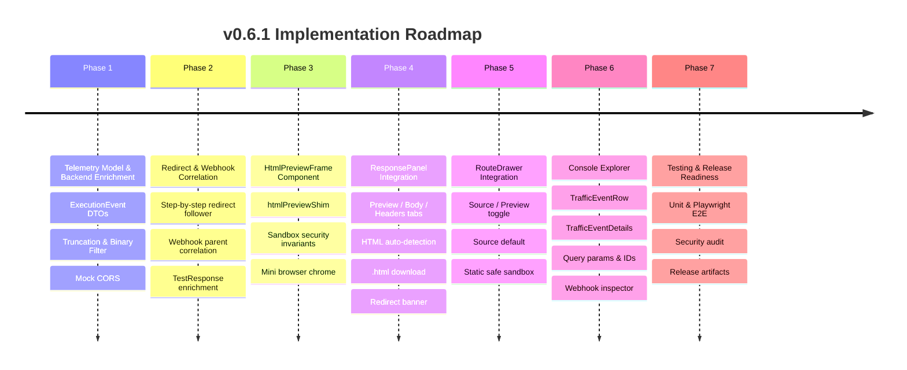

# Implementation Plan: v0.6.1 — Interactive Simulation Experience

- **Document Type:** Engineering Implementation Plan (Planning Only — No Code Written)
- **Target Release:** `v0.6.1`
- **Release Theme:** Interactive Simulation Experience
- **Authoritative Source Documents:**
  - [HTML_PREVIEW_DISCOVERY.md](file:///Users/sanjokkhakurel/GITHUB-REPO/dynamic-mock-project/HTML_PREVIEW_DISCOVERY.md)
  - [HTML_PREVIEW_ARCHITECTURE_REVIEW.md](file:///Users/sanjokkhakurel/GITHUB-REPO/dynamic-mock-project/HTML_PREVIEW_ARCHITECTURE_REVIEW.md)
  - [AI_GOVERNANCE.md](file:///Users/sanjokkhakurel/GITHUB-REPO/dynamic-mock-project/AI_GOVERNANCE.md)
  - [ROADMAP_AUTHORITY.md](file:///Users/sanjokkhakurel/GITHUB-REPO/dynamic-mock-project/ROADMAP_AUTHORITY.md)
- **Current Base Release:** `v0.6.0`

---

## 1. Executive Summary

Dynamic Mock `v0.6.0` possesses a robust backend simulation engine capable of running complex stateful workflows: Handlebars templating, GraalVM polyglot post-scripts, `text/html` rendering, redirect chains (`302 Found`), and asynchronous webhook dispatches. However, the developer experience remains disconnected:
1. HTML responses in the **Response Panel** and **Route Details Drawer** are rendered exclusively as unformatted source code inside `<pre>`/`JsonHighlighter` blocks.
2. Interacting with stubs generates background HTTP traffic, webhooks, and redirects that are invisible in the primary response view and collapsed into a static, truncated 1-line log strip in the **BottomBar Traffic Console**.
3. Telemetry discards query strings, full Request/Route IDs, request/response headers and bodies, redirect hops, and webhook execution payloads.

**Sprint Goal:** Deliver `v0.6.1` as a zero-regression, zero-domain-mutation release that unites:
- A secure, hardware-grade sandboxed **HTML Response Preview** (`ResponsePanel`) and **Route Details Preview** (`RouteDrawer`).
- An enriched **Interactive Console Explorer** (`BottomBar`) with expandable traffic events, query parameter decoding, full Request/Route IDs, Request/Response body inspection (with binary skipping and 32 KB truncation guardrails), sub-millisecond duration precision (`126.43 ms`), step-by-step **Redirect Chain** visualization, and detailed **Webhook** inspection.

---

## 2. Architecture Compliance Checklist

| Architecture Rule | Governance Reference | Status | Verification Method |
| :--- | :--- | :---: | :--- |
| **Zero Domain Entity Mutations** | `AI_GOVERNANCE.md` (Domain Purity) | ✅ COMPLIANT | `git diff backend/src/main/java/com/dynamicmock/domain/` returns empty diff. |
| **Zero MongoDB Schema Changes** | `AI_GOVERNANCE.md` | ✅ COMPLIANT | No Mongo repository or entity modified; all state is ephemeral/transport. |
| **Zero Multi-Tenant Concepts** | `ROADMAP_AUTHORITY.md` | ✅ COMPLIANT | No tenant IDs, headers, or workspace routing introduced. |
| **Strict Iframe Sandbox Boundary** | `HTML_PREVIEW_ARCHITECTURE_REVIEW.md` | ✅ COMPLIANT | `sandbox="allow-scripts allow-forms allow-popups"`; `allow-same-origin` strictly forbidden. |
| **Zero Double Execution** | `HTML_PREVIEW_DISCOVERY.md` | ✅ COMPLIANT | Response preview renders existing `lastResponse.body` via `srcdoc`; zero extra network requests. |
| **RouteDrawer Static Default** | Mandatory Rectification #3 | ✅ COMPLIANT | `RouteDrawer` defaults to **Source** tab; preview renders with scripts disabled (`sandbox=""`). |
| **Binary Payload Exclusion** | Mandatory Rectification #1 | ✅ COMPLIANT | Image, video, multipart, and octet-stream payloads logged as `<BINARY PAYLOAD OMITTED>`. |
| **32 KB Retention Guardrail** | Mandatory Rectification #2 | ✅ COMPLIANT | Bodies exceeding 32,768 characters capped with `[TRUNCATED: payload exceeded 32KB limit]`. |
| **Sub-Millisecond Duration** | Mandatory Requirement | ✅ COMPLIANT | Duration calculated via high-resolution timer (`System.nanoTime()`), rendered as `126.43 ms`. |
| **Hexagonal Layer Integrity** | Clean Architecture Rules | ✅ COMPLIANT | All changes isolated to Web Adapters, Application Services, and Frontend UI. |

---

## 3. Scope Definition

### In Scope for v0.6.1:
1. **Frontend HTML Preview Component (`HtmlPreviewFrame.tsx`):**
   - Reusable iframe using `srcdoc` and strict sandbox (`allow-scripts allow-forms allow-popups`, `referrerPolicy="no-referrer"`).
   - Multi-tier URL normalization: `<base>` tag, context object `window.__DYNAMIC_MOCK__`, and surgical URL-shim for `fetch` and `XMLHttpRequest.prototype.open`.
   - Mini toolbar: simulated path bar, static/interactive status indicator, `Reload Preview` (`↻`), and `Open in New Tab` (`↗`).
2. **Response Panel Integration (`ResponsePanel.tsx`):**
   - Dynamic tab bar: `Preview | Body | Headers (N)` when `Content-Type: text/html` is detected; defaults to `Preview`.
   - Automatic preservation of `Body` default for `application/json`, `application/xml`, etc.
   - Smart `.html` file extension and MIME type on `Download` action.
   - Redirect chain banner (`RedirectChainBanner.tsx`) when `redirectChain` is present on `TestResponse`.
3. **Route Details Drawer Integration (`RouteDrawer.tsx`):**
   - Segmented toggle: `Source | Preview` for HTML stubs; **defaults to `Source` tab**.
   - Safe static rendering in preview mode (`sandbox=""` with pure HTML/CSS layout; zero JS execution).
4. **Backend Telemetry Enrichment:**
   - [TrafficLogger.java](file:///Users/sanjokkhakurel/GITHUB-REPO/dynamic-mock-project/backend/src/main/java/com/dynamicmock/application/service/TrafficLogger.java): Additive fields on `ExecutionEvent` (`queryString`, `queryParams`, `requestHeaders`, `requestBody`, `responseHeaders`, `responseBody`, `parentEventId`, `redirectChain`, `webhookDetail`, `payloadSizeBytes`, `bodyTruncated`, `durationMs` as `double`).
   - [DynamicRouteDispatcher.java](file:///Users/sanjokkhakurel/GITHUB-REPO/dynamic-mock-project/backend/src/main/java/com/dynamicmock/infrastructure/filter/DynamicRouteDispatcher.java): Capture `request.getQueryString()`, query parameters, request headers/body, response headers/body, high-resolution duration, and set permissive CORS (`Access-Control-Allow-Origin: *`) on `/mock/**` endpoints for `Origin: null`.
   - Binary exclusion policy (`image/*`, `video/*`, `multipart/*`, `application/octet-stream`).
   - 32 KB truncation threshold on captured payloads.
5. **Redirect Hop Tracking:**
   - [TestClientController.java](file:///Users/sanjokkhakurel/GITHUB-REPO/dynamic-mock-project/backend/src/main/java/com/dynamicmock/adapter/in/web/TestClientController.java) & [AsyncWebhookService.java](file:///Users/sanjokkhakurel/GITHUB-REPO/dynamic-mock-project/backend/src/main/java/com/dynamicmock/application/service/AsyncWebhookService.java): Step-by-step redirect follower (up to 5 hops) recording `List<RedirectHop>`.
6. **Interactive Console Explorer (`BottomBar.tsx`):**
   - Collapsed row: Method, Path, Query string token, Status badge, Duration (`126.43 ms`), Payload size (`3.2 KB`), and Full Request/Route ID tooltips.
   - Expandable inspector drawer: Tabs for `Overview & IDs`, `Query Parameters`, `Request Headers`, `Request Body`, `Response Headers`, `Response Body`, `Redirect Chain`, and `Webhook Details`.
   - Search filter and Protocol filter pills (`ALL`, `HTTP`, `WEBHOOK`, `GRAPHQL`, `GRPC`, `ISO8583`).
   - Connected `HistoryTab` reflecting actual session requests.

---

## 4. Out of Scope

The following items are strictly deferred to future releases:
- ❌ Database persistence of historical traffic events (STOMP WebSocket broadcast + in-memory circular buffer of 100 events remains authoritative).
- ❌ Multi-page browser history back/forward button navigation stack inside the iframe preview (users can use "Open in New Tab" for complex cross-site redirects).
- ❌ WYSIWYG visual HTML drag-and-drop builder.
- ❌ WebSocket client traffic preview inside the iframe.
- ❌ Altering domain entity definitions (`MockRoute`, `Scenario`, `OrganizationConfig`, `User`).
- ❌ Multi-tenant routing or workspace data tenancy.

---

## 5. File-Level Change Matrix

| File Path | Nature of Change | Purpose |
| :--- | :---: | :--- |
| `backend/.../application/service/TrafficLogger.java` | Modified | Additive fields on `ExecutionEvent`, binary payload check, 32 KB truncation guardrail, double duration. |
| `backend/.../infrastructure/filter/DynamicRouteDispatcher.java` | Modified | Query string capture, high-res timing, CORS header injection for `/mock/**`, request/response body capture. |
| `backend/.../application/service/AsyncWebhookService.java` | Modified | Controlled redirect following (5 hops), parent event ID correlation, webhook payload capture. |
| `backend/.../adapter/in/web/TestClientController.java` | Modified | Step-by-step redirect following (5 hops), attaching `redirectChain` to `TestResponse`. |
| `backend/.../adapter/in/web/dto/RedirectHop.java` | **New** | Data model representing an HTTP redirect hop (`step`, `method`, `url`, `status`, `location`, `durationMs`). |
| `backend/.../adapter/in/web/dto/WebhookExecutionDetail.java` | **New** | Data model capturing webhook execution parameters, parent event correlation, and outcome. |
| `frontend/src/types/index.ts` | Modified | Enriched `ExecutionEvent`, `RedirectHop`, `WebhookExecutionDetail`, and `TestResponse.redirectChain`. |
| `frontend/src/lib/htmlPreviewShim.ts` | **New** | Pure helper generating `srcdoc` with `<base>`, context object, and non-intrusive URL normalizer. |
| `frontend/src/components/workspace/HtmlPreviewFrame.tsx` | **New** | Sandboxed `<iframe>` wrapper with mini browser chrome, status badges, and actions. |
| `frontend/src/components/workspace/RedirectChainBanner.tsx` | **New** | Visual timeline banner for HTTP `3xx` redirect chains. |
| `frontend/src/components/workspace/ResponsePanel.tsx` | Modified | `Preview \| Body \| Headers` tabs, HTML auto-detection, .html download, redirect banner. |
| `frontend/src/components/workspace/RouteDrawer.tsx` | Modified | `Source \| Preview` toggle for HTML routes, defaulting to `Source`, static safe sandbox. |
| `frontend/src/components/workspace/TrafficEventRow.tsx` | **New** | Collapsed expandable console event row displaying method, path, query, status, duration, and payload size. |
| `frontend/src/components/workspace/TrafficEventDetails.tsx` | **New** | Expanded inspector view: IDs, query parameters, request/response headers/bodies, redirects, and webhooks. |
| `frontend/src/components/workspace/BottomBar.tsx` | Modified | Integration of `TrafficEventRow`, `TrafficEventDetails`, search filter, protocol pills, real history. |
| `e2e/tests/interactive-html-preview.e2e.spec.ts` | **New** | Comprehensive Playwright E2E suite validating HTML preview, interactions, console expansion, and redirect hops. |

---

## 6. Component Creation Matrix

```mermaid
graph TD
    subgraph ResponsePanelTree["Response Panel"]
        RP[ResponsePanel.tsx] --> HPF1[HtmlPreviewFrame.tsx]
        RP --> RCB1[RedirectChainBanner.tsx]
    end

    subgraph RouteDrawerTree["Route Drawer"]
        RD[RouteDrawer.tsx] --> HPF2[HtmlPreviewFrame.tsx (Static Mode)]
    end

    subgraph ConsoleExplorerTree["Console Explorer (BottomBar)"]
        BB[BottomBar.tsx] --> TER[TrafficEventRow.tsx]
        TER --> TED[TrafficEventDetails.tsx]
        TED --> RCB2[RedirectChainBanner.tsx]
        TED --> HPF3[HtmlPreviewFrame.tsx (Compact Preview)]
    end

    subgraph Helpers["Pure Utilities"]
        HPF1 --> HPS[htmlPreviewShim.ts]
        HPF2 --> HPS
        HPF3 --> HPS
    end
```

---

## 7. Backend Change Plan

### 7.1 Telemetry Data Transfer Models
Create `RedirectHop.java` and `WebhookExecutionDetail.java` in `com.dynamicmock.adapter.in.web.dto` (or inside `com.dynamicmock.application.service.TrafficLogger` as clean DTOs):
- `RedirectHop`:
  ```java
  public class RedirectHop {
      private int step;
      private String method;
      private String url;
      private int status;
      private String location;
      private double durationMs;
  }
  ```
- `WebhookExecutionDetail`:
  ```java
  public class WebhookExecutionDetail {
      private String sourceRouteId;
      private String parentEventId;
      private String targetUrl;
      private String method;
      private int delayMs;
      private Map<String, String> requestHeaders;
      private String requestBody;
      private int responseStatus;
      private Map<String, String> responseHeaders;
      private String responseBody;
      private String errorMessage;
  }
  ```

### 7.2 Binary Exclusion & 32 KB Truncation Policy in `TrafficLogger`
Enforce payload guardrails in `TrafficLogger.java`:
```java
public static final int MAX_CAPTURED_BODY_CHARS = 32_768; // 32 KB

public static String sanitizePayload(String body, String contentType) {
    if (body == null || body.isEmpty()) return null;
    if (isBinaryContentType(contentType)) {
        return "<BINARY PAYLOAD OMITTED>";
    }
    if (body.length() > MAX_CAPTURED_BODY_CHARS) {
        return body.substring(0, MAX_CAPTURED_BODY_CHARS) + " ... [TRUNCATED: payload exceeded 32KB limit]";
    }
    return body;
}

private static boolean isBinaryContentType(String ct) {
    if (ct == null) return false;
    String lower = ct.toLowerCase();
    return lower.startsWith("image/") || lower.startsWith("video/") ||
           lower.startsWith("audio/") || lower.startsWith("multipart/") ||
           lower.contains("octet-stream") || lower.contains("pdf") ||
           lower.contains("zip") || lower.contains("gzip");
}
```

### 7.3 High-Resolution Timing & Query String Capture in `DynamicRouteDispatcher`
1. **High-Resolution Timer:** Capture start via `long startNano = System.nanoTime();` and compute duration as `double durationMs = (System.nanoTime() - startNano) / 1_000_000.0;` formatted or stored with 2 decimal places.
2. **Query String & Params:** Read `String queryString = request.getQueryString();` and store both raw string and parsed `Map<String, String>` in `ExecutionEvent`.
3. **CORS for `/mock/**` Simulation:**
   - In `preHandle`: If `path.startsWith("/mock")`, set `response.setHeader("Access-Control-Allow-Origin", "*");`, `response.setHeader("Access-Control-Allow-Methods", "GET, POST, PUT, DELETE, PATCH, OPTIONS");`, `response.setHeader("Access-Control-Allow-Headers", "*");`.
   - If `request.getMethod().equalsIgnoreCase("OPTIONS")`, return `200 OK` immediately.

### 7.4 Controlled Redirect Follower in `TestClientController` & `AsyncWebhookService`
Replace unbounded/silent redirect following with a step-by-step loop (up to `MAX_REDIRECTS = 5`):
- For each step: record start time, fire request with `connection.setInstanceFollowRedirects(false)`.
- If status is `301`, `302`, `303`, `307`, or `308` and `Location` header is present:
  - Add `RedirectHop(step, method, url, status, location, hopDurationMs)`.
  - Resolve `nextUrl` against current URL.
  - Set `method = "GET"` for `301`/`302`/`303`; retain original method for `307`/`308`.
- If final status is reached (non-3xx or no `Location`), add final hop (if any) and attach `redirectChain` to `TestResponse` and `ExecutionEvent`.

---

## 8. Frontend Change Plan

### 8.1 URL Normalization Strategy Evaluation
Before implementing any client-side script in `srcdoc`, we evaluate the three architectural options:

| Strategy | static HTML Links | `<form action>` | Dynamic `window.location.pathname` | Evaluation & Decision |
| :--- | :---: | :---: | :---: | :--- |
| **Option A: `<base href="...">` Only** | ✅ Works | ⚠️ Partial | ❌ Fails (`pathname === "srcdoc"`) | Inadequate on its own for scripted login forms. |
| **Option B: Context Object Only** | ❌ Ineffective | ❌ Ineffective | ⚠️ Requires rewriting stubs to read `window.__MOCK__` | Breaks zero-config compatibility with arbitrary HTML stubs. |
| **Option C: Tiered `<base>` + Context + Surgical URL Shim (Selected)** | ✅ Works | ✅ Works | ✅ Works (`"srcdoc?..."` mapped to actual mock endpoint) | **Selected:** Non-intrusive, zero global prototype mutations, perfectly supports real-world stubs. |

#### Implementation of `frontend/src/lib/htmlPreviewShim.ts`:
Injects a compact script into `<head>`:
1. `<base href="{origin}/mock/">`
2. `window.__DYNAMIC_MOCK_CONTEXT__ = { targetUrl, mockPath, origin };`
3. A surgical wrapper around `window.fetch` and `XMLHttpRequest.prototype.open` that checks only the URL parameter:
   - If `url.startsWith('srcdoc?')` or `url.startsWith('/srcdoc?')` or `url.startsWith('about:srcdoc?')` or `url.startsWith('?')`: resolves to `{origin}/mock{mockPath}{query}`.
   - Leaves all other URLs, options, headers, and prototypes untouched.

### 8.2 `HtmlPreviewFrame.tsx` Component Design
- **Props:**
  - `html: string`: The raw response body.
  - `targetUrl?: string`: Executed endpoint URL (e.g. `http://localhost:8080/mock/mobile-banking-login?returnUrl=...`).
  - `mockPath?: string`: Route path (e.g. `/mobile-banking-login`).
  - `interactive?: boolean`: Defaults to `true` in `ResponsePanel`, `false` in `RouteDrawer`.
  - `compact?: boolean`: Compact rendering for drawer/console drawer.
- **Security Attributes:**
  - `sandbox={interactive ? "allow-scripts allow-forms allow-popups" : ""}`
  - `referrerPolicy="no-referrer"`
  - `srcdoc={preparedSrcDoc}`
- **Toolbar Features:**
  - Simulated path text: `/mock/mobile-banking-login?action=...`
  - Interactive mode badge (`Interactive` vs `Static Template`)
  - Reload button (`↻`): Increments local `key` to re-mount the iframe cleanly.
  - Open in New Tab (`↗`): Opens the target `/mock/...` URL in a full browser tab.

### 8.3 `ResponsePanel.tsx` Updates
- Detect HTML:
  ```typescript
  const isHtml = useMemo(() => {
    const ct = Object.entries(lastResponse?.headers || {})
      .find(([k]) => k.toLowerCase() === 'content-type')?.[1] || '';
    if (ct.toLowerCase().includes('text/html') || ct.toLowerCase().includes('application/xhtml+xml')) return true;
    const bodyStr = typeof lastResponse?.body === 'string' ? lastResponse.body.trim().toLowerCase() : '';
    return bodyStr.startsWith('<!doctype html') || bodyStr.startsWith('<html');
  }, [lastResponse]);
  ```
- Tab bar: `[Preview] [Body] [Headers (N)]` when `isHtml`; defaults to `Preview` on new HTML response.
- Renders `<RedirectChainBanner redirectChain={lastResponse.redirectChain} />` when redirects occur.
- Fixes `handleDownload`: uses `response.html` and `{ type: 'text/html' }` when `isHtml`.

### 8.4 `RouteDrawer.tsx` Updates
- When `activeRoute.responseHeaders['Content-Type']` contains `text/html` or `responseTemplate` contains HTML:
  - Surface segmented toggle: `[Source] [Preview]`.
  - **MANDATORY RECTIFICATION:** Default tab is **`Source`**.
  - In `Preview` mode: Renders `<HtmlPreviewFrame html={activeRoute.responseTemplate} interactive={false} compact />` (static preview with zero script execution).
  - In `Source` mode: Scrollable `<pre className="max-h-60 overflow-auto">` showing complete template without 300-char cutoff.

### 8.5 `BottomBar.tsx` & Console Explorer Updates
- Replace raw terminal output with structured, highly responsive table/cards:
- **Collapsed Row (`TrafficEventRow.tsx`):**
  - Protocol badge (`HTTP` in emerald, `WEBHOOK` in amber, `GRPC` in blue, etc.)
  - Timestamp `[14:22:05]`
  - Method (`GET`, `POST`, etc.)
  - Path with Query String highlighted (path in bold foreground, `?query` in cyan/accent)
  - Status badge (`200 OK` in green, `302 Found` in blue, `500` in red)
  - High-precision duration (`126.43 ms`)
  - Payload size (`3.2 KB` or `<empty>`)
  - Expand/collapse chevron
- **Expanded Inspector Drawer (`TrafficEventDetails.tsx`):**
  - Header: Full Request ID (`event.id`) + 1-click copy; Full Route ID (`event.resourceId`) + 1-click copy; Parent Event ID (for Webhook).
  - Tabs:
    - `Query Parameters`: Key-value table of URL query parameters with decoded values.
    - `Request Headers`: Formatted key-value table.
    - `Request Body`: Formatted code editor with copy button.
    - `Response Headers`: Formatted key-value table.
    - `Response Body`: Formatted code editor + inline `Render HTML Preview` toggle if HTML.
    - `Redirect Chain`: Step-by-step hop timeline (`RedirectChainBanner`).
    - `Webhook Detail`: Webhook target URL, trigger route, request/response payloads, delay.
- **Toolbar:** Search bar (filters by path, query, status, ID) and Protocol filter pills (`ALL`, `HTTP`, `WEBHOOK`, `GRAPHQL`, `GRPC`, `ISO8583`).

---

## 9. Detailed Phase Breakdown



---

## 10. Detailed Task Specifications

### Phase 1: Telemetry Model & Backend Enrichment

#### Task 1.1: Additive Telemetry Models (`RedirectHop`, `WebhookExecutionDetail`, `ExecutionEvent`)
- **Target Files:**
  - `backend/src/main/java/com/dynamicmock/adapter/in/web/dto/RedirectHop.java` (New)
  - `backend/src/main/java/com/dynamicmock/adapter/in/web/dto/WebhookExecutionDetail.java` (New)
  - `backend/src/main/java/com/dynamicmock/application/service/TrafficLogger.java` (Modified)
  - `frontend/src/types/index.ts` (Modified)
- **Dependencies:** None
- **Acceptance Criteria:**
  - `ExecutionEvent` includes all additive fields (`queryString`, `queryParams`, `requestHeaders`, `requestBody`, `responseHeaders`, `responseBody`, `parentEventId`, `redirectChain`, `webhookDetail`, `payloadSizeBytes`, `bodyTruncated`, `durationMs` as `double`).
  - `TrafficLogger` compiles with zero errors and STOMP message serialization passes.
- **Risks:** STOMP payload size increase if large bodies are sent.
- **Verification Steps:** Run backend unit tests (`mvn test -Dtest=TrafficLoggerTest`).

#### Task 1.2: Payload Sanitization & High-Resolution Timing in `TrafficLogger` and `DynamicRouteDispatcher`
- **Target Files:**
  - `backend/src/main/java/com/dynamicmock/application/service/TrafficLogger.java` (Modified)
  - `backend/src/main/java/com/dynamicmock/infrastructure/filter/DynamicRouteDispatcher.java` (Modified)
- **Dependencies:** Task 1.1
- **Acceptance Criteria:**
  - Binary MIME types (`image/*`, `video/*`, `multipart/*`, `application/octet-stream`) log `<BINARY PAYLOAD OMITTED>`.
  - Body strings > 32 KB truncated with `[TRUNCATED: payload exceeded 32KB limit]`.
  - `durationMs` calculates from `System.nanoTime()` with sub-millisecond precision.
  - `request.getQueryString()` captured and parsed into `queryParams`.
  - Simulation routes (`/mock/**`) receive `Access-Control-Allow-Origin: *` headers and handle `OPTIONS` preflights cleanly.
- **Risks:** Discarding required request headers or failing on null query strings.
- **Verification Steps:** Execute mock route with query parameters; verify WebSocket broadcast contains query params and sub-millisecond duration.

---

### Phase 2: Redirect & Webhook Correlation

#### Task 2.1: Controlled Step-by-Step Redirect Follower in `TestClientController`
- **Target Files:**
  - `backend/src/main/java/com/dynamicmock/adapter/in/web/TestClientController.java` (Modified)
- **Dependencies:** Task 1.1
- **Acceptance Criteria:**
  - Follows up to 5 HTTP `3xx` redirects sequentially with `setInstanceFollowRedirects(false)`.
  - Populates `redirectChain` on `TestResponse` containing each hop's step, method, URL, status, location header, and duration.
- **Risks:** Infinite redirect loops. Mitigated by `MAX_REDIRECTS = 5`.
- **Verification Steps:** Call `/mock/return-url-redirector`; verify `TestResponse.redirectChain` lists both hop 1 (`302`) and hop 2 (`200`).

#### Task 2.2: Webhook Parent Correlation & Execution Telemetry in `AsyncWebhookService`
- **Target Files:**
  - `backend/src/main/java/com/dynamicmock/infrastructure/filter/DynamicRouteDispatcher.java` (Modified)
  - `backend/src/main/java/com/dynamicmock/application/service/AsyncWebhookService.java` (Modified)
- **Dependencies:** Task 1.1, Task 2.1
- **Acceptance Criteria:**
  - HTTP route generates `requestEventId` and passes it to `triggerWebhook` as `parentEventId`.
  - `AsyncWebhookService` logs `ExecutionEvent` with `protocol="WEBHOOK"`, `parentEventId`, request/response payloads, and redirect hops if the webhook target redirects.
- **Risks:** Async thread execution losing parent context. Mitigated by explicit method parameter passing.
- **Verification Steps:** Run Mobile Banking login flow; verify `WEBHOOK` traffic event has `parentEventId` matching the `/mobile-banking-login` event ID.

---

### Phase 3: HtmlPreviewFrame Component

#### Task 3.1: Context & URL Normalization Shim (`htmlPreviewShim.ts`)
- **Target Files:**
  - `frontend/src/lib/htmlPreviewShim.ts` (New)
- **Dependencies:** None
- **Acceptance Criteria:**
  - Injects `<base href="{origin}/mock/">` into `<head>`.
  - Injects `window.__DYNAMIC_MOCK_CONTEXT__`.
  - Wraps `fetch` and `XMLHttpRequest.prototype.open` destination URLs starting with `srcdoc?` or relative paths to `{origin}/mock{mockPath}{query}` without monkey-patching prototypes or other browser capabilities.
- **Risks:** Malformed HTML without `<head>` tag. Mitigated by prepending shim if `<head>` is missing.
- **Verification Steps:** Unit test `buildSandboxedSrcDoc` with various HTML document structures.

#### Task 3.2: Reusable `HtmlPreviewFrame.tsx` Component
- **Target Files:**
  - `frontend/src/components/workspace/HtmlPreviewFrame.tsx` (New)
- **Dependencies:** Task 3.1
- **Acceptance Criteria:**
  - Configures `sandbox="allow-scripts allow-forms allow-popups"` (or `""` when `interactive=false`).
  - Configures `referrerPolicy="no-referrer"`.
  - Does **NOT** include `allow-same-origin` or `allow-top-navigation`.
  - Mini toolbar displays simulated path, reload button (`↻`), and open-in-tab button (`↗`).
- **Risks:** CSS style leaks. Mitigated by iframe viewport isolation.
- **Verification Steps:** Mount with sample HTML containing CSS, JS counter, and form; verify styles render and counter button works.

---

### Phase 4: ResponsePanel Integration

#### Task 4.1: Tabs & Auto-Selection in `ResponsePanel.tsx`
- **Target Files:**
  - `frontend/src/components/workspace/ResponsePanel.tsx` (Modified)
  - `frontend/src/components/workspace/RedirectChainBanner.tsx` (New)
- **Dependencies:** Task 3.2, Task 2.1
- **Acceptance Criteria:**
  - Shows `Preview | Body | Headers (N)` tabs when `Content-Type: text/html` is detected.
  - Automatically selects `Preview` when an HTML response arrives.
  - Non-HTML responses (`application/json`) retain `Body | Headers` with `Body` selected by default.
  - Renders `<RedirectChainBanner />` when `lastResponse.redirectChain` has entries.
  - `handleDownload` downloads `response.html` when in HTML mode.
- **Risks:** Flashing or losing active tab state on route change.
- **Verification Steps:** Run JSON route (verifies JSON highlighter); run HTML route (verifies preview renders).

---

### Phase 5: RouteDrawer Integration

#### Task 5.1: Source vs Preview Segmented Toggle in `RouteDrawer.tsx`
- **Target Files:**
  - `frontend/src/components/workspace/RouteDrawer.tsx` (Modified)
- **Dependencies:** Task 3.2
- **Acceptance Criteria:**
  - When route contains HTML, displays `[Source] [Preview]` toggle.
  - **MANDATORY RECTIFICATION:** Default tab is **`Source`**.
  - Source tab renders full scrollable `<pre>` without 300-char truncation.
  - Preview tab renders `<HtmlPreviewFrame interactive={false} compact />` with scripts disabled (`sandbox=""`).
- **Risks:** Unintended execution of incomplete templates. Mitigated by static `sandbox=""`.
- **Verification Steps:** Open RouteDrawer on Mobile Banking stub; verify `Source` displays full template; click `Preview` to see visual card.

---

### Phase 6: Console Explorer

#### Task 6.1: Expandable Traffic Event Rows & Detail Inspector
- **Target Files:**
  - `frontend/src/components/workspace/TrafficEventRow.tsx` (New)
  - `frontend/src/components/workspace/TrafficEventDetails.tsx` (New)
  - `frontend/src/components/workspace/BottomBar.tsx` (Modified)
- **Dependencies:** Task 1.1, Task 1.2, Task 2.2
- **Acceptance Criteria:**
  - Collapsed row displays: Protocol badge, Timestamp, Method, Path with Query string highlighted, Status badge, Duration (`126.43 ms`), Payload size (`3.2 KB`), and expand chevron.
  - Clicking row expands `<TrafficEventDetails />` showing:
    - Full Request ID and Full Route ID with 1-click Copy buttons.
    - Decoded Query Parameters table.
    - Request/Response headers & bodies with syntax highlighting.
    - Inline HTML preview toggle for HTML response bodies.
    - Step-by-step Redirect Chain banner.
    - Webhook execution details (target URL, delay, request/response bodies).
  - Search input filters events by path, query string, status, or IDs.
  - Protocol filter pills (`ALL`, `HTTP`, `WEBHOOK`, etc.) filter visible events.
- **Risks:** UI lag with 100 events in list. Mitigated by lightweight summary rows and lazy mounting of expanded details.
- **Verification Steps:** Send request with query parameters; expand row; verify all tabs, query table, and full copyable IDs appear.

---

### Phase 7: Testing & Release Readiness

#### Task 7.1: Playwright End-to-End Test Suite
- **Target Files:**
  - `e2e/tests/interactive-html-preview.e2e.spec.ts` (New)
- **Dependencies:** Phases 1–6
- **Acceptance Criteria:**
  - E2E test creates Mobile Banking Login stub in UI.
  - Executes stub in Test Client with `?returnUrl=...`.
  - Verifies `Preview` tab opens automatically in `ResponsePanel`.
  - Locates `#mobile-banking-login-card` inside the preview iframe.
  - Fills `#mobile-number` and `#mpin` inside the iframe.
  - Clicks `#login-btn` inside the iframe.
  - Verifies `#login-status` updates to `"Login completed - return URL triggered"`.
  - Checks BottomBar Console: verifies `/mobile-banking-login?action=login` row appears with query string and sub-millisecond duration.
  - Expands Console row: verifies Request ID, Route ID, Query Parameters, and Webhook event correlation.
- **Verification Steps:** Run `npx playwright test e2e/tests/interactive-html-preview.e2e.spec.ts`.

---

## 11. Security Validation Plan

| Threat Vector | Severity | Architectural Defense | Validation Method |
| :--- | :---: | :--- | :--- |
| **Sandbox Breakout via `allow-same-origin`** | Critical | `allow-same-origin` is omitted; iframe has opaque origin `null`. | Iframe script calling `window.parent.document` must throw `SecurityError`. |
| **Workspace Token Theft (`AuthContext`)** | Critical | JWT token is stored in-memory in parent React context; inaccessible from `Origin: null`. | Verify `window.localStorage` inside iframe is inaccessible; cannot read parent variables. |
| **Top-Level Window Hijacking** | High | `allow-top-navigation` is omitted. | Iframe script calling `window.top.location = ...` must be blocked by the browser. |
| **Admin API CSRF/Abuse (`/api/**`)** | High | Admin endpoints require `Authorization: Bearer <JWT>` and enforce strict CORS origin validation. | Cross-origin `fetch('/api/routes')` from `Origin: null` iframe returns `401 Unauthorized` / CORS block. |
| **Referrer Leakage** | Low | `referrerPolicy="no-referrer"` set on iframe. | Inspect outgoing request headers; verify `Referer` is omitted. |

---

## 12. Performance Validation Plan

| Metric | Target Threshold | Validation Strategy |
| :--- | :--- | :--- |
| **Iframe Mount Latency** | `< 25 ms` | Benchmark initial DOM rendering of `HtmlPreviewFrame` via React Profiler. |
| **Console Memory Footprint** | `< 15 MB` for 100 events | Enforce 32 KB payload cap and max 100-event circular buffer in `useTraffic`. |
| **STOMP WebSocket Throughput** | `> 500 events/sec` | Ensure payload sanitization and truncation occur before WebSocket serialization. |
| **Zero Background CPU in Inactive Tabs** | `0% CPU` | Verify unmounting the `Preview` tab destroys the iframe and cancels all timers inside it. |

---

## 13. Testing Strategy

```text
Unit Tests (Backend & Frontend)
├── TrafficLoggerTest.java (payload truncation, binary exclusion, double duration)
├── DynamicRouteDispatcherTest.java (query string extraction, CORS headers)
├── TestClientRedirectTest.java (5-hop redirect loop, hop recording)
├── htmlPreviewShim.test.ts (URL normalization, base tag injection)
└── responseDetection.test.ts (isHtml content-type and doctype detection)

Integration Tests (E2E & Component)
├── HtmlPreviewFrame.test.tsx (sandbox attributes, reload action)
├── TrafficEventRow.test.tsx (query token rendering, ID copy button)
├── TrafficEventDetails.test.tsx (tab switching, query param table)
└── e2e/tests/interactive-html-preview.e2e.spec.ts (full Mobile Banking interactive E2E)
```

---

## 14. Manual QA Plan

1. **REST JSON Stub Sanity Check:**
   - Execute standard `/mock/hello` route.
   - Verify `ResponsePanel` displays `Body` and `Headers` tabs (`Body` active).
   - Verify `JsonHighlighter` functions with search bar and copy button.
2. **Interactive Mobile Banking Login Preview:**
   - Create route `/mock/mobile-banking-login` with HTML template and post-script.
   - Execute in Test Client with query parameter `returnUrl=http://localhost:8080/mock/return-url-redirector`.
   - Verify `ResponsePanel` automatically selects `Preview` tab and renders the dark banking card.
   - Click "Login" button inside preview. Verify `#login-status` updates to `"Login completed - return URL triggered"`.
3. **Route Details Source Default Check:**
   - Open Route Details drawer on `/mock/mobile-banking-login`.
   - Verify the drawer defaults to the **`Source`** tab showing complete code without truncation.
   - Toggle to **`Preview`** tab; verify static card renders with scripts disabled.
4. **Console Explorer Inspection:**
   - Open bottom panel. Verify the two events (`/mobile-banking-login?action=login` and `WEBHOOK`) appear.
   - Verify collapsed row shows method, path, query string, status `200`, duration (e.g. `14.25 ms`), and payload size.
   - Click to expand row. Verify full Request ID and Route ID are copyable.
   - Click `Query Parameters` tab: verify `action=login` and decoded `returnUrl` appear in table.
   - Expand `WEBHOOK` event: verify amber badge, `parentEventId` match, and target URL.
5. **Redirect Chain Visualization:**
   - Create `/mock/test-redirect` returning `302` with `Location: http://localhost:8080/mock/hello`.
   - Execute in Test Client. Verify `RedirectChainBanner` renders hop 1 (`302`) and hop 2 (`200`).

---

## 15. Verification Gates

```text
GATE 1: Backend Architecture Gate
- git status confirms zero changes to backend/src/main/java/com/dynamicmock/domain/
- git status confirms zero changes to Mongo repositories or entities
- mvn clean test passes 100%

GATE 2: Security & Sandbox Gate
- Automated grep verifies zero occurrences of "allow-same-origin" in frontend codebase
- Automated grep verifies zero occurrences of "dangerouslySetInnerHTML" in preview components
- Iframe sandbox attribute strictly equals "allow-scripts allow-forms allow-popups"

GATE 3: Zero Double Execution Gate
- Inspect backend network logs during Test Client execution
- Verify exactly ONE hit to /mock/... occurs upon clicking Execute

GATE 4: E2E Interactive Simulation Gate
- npx playwright test e2e/tests/interactive-html-preview.e2e.spec.ts passes with 0 failures
```

---

## 16. Rollback Strategy

Because `v0.6.1` introduces:
- **Zero domain entity changes**
- **Zero database schema modifications**
- **Zero persistent state dependencies**

Rollback is **instantaneous and zero-risk**:
- If any defect is detected post-deployment, a simple git revert of the `v0.6.1` merge commit (`git revert HEAD -m 1`) returns the application to `v0.6.0` without database migrations, downtime, or data patching.

---

## 17. Release Criteria

`v0.6.1` will be considered ready for tag and release when:
1. All 7 implementation phases are executed with separate, formatted git commits:
   - Phase 1: `feat(telemetry): enrich execution event telemetry and mock cors`
   - Phase 2: `feat(telemetry): add step-by-step redirect follower and webhook correlation`
   - Phase 3: `feat(preview): create sandboxed html preview frame component`
   - Phase 4: `feat(preview): integrate html preview and redirect banner in response panel`
   - Phase 5: `feat(preview): add source and static preview toggle to route drawer`
   - Phase 6: `feat(console): implement interactive traffic console explorer`
   - Phase 7: `test(preview): add e2e test suite and release documentation`
2. All 4 Verification Gates pass without warnings or waivers.
3. Full backward compatibility with existing JSON, XML, gRPC, GraphQL, and ISO8583 simulation workflows is proven.

---

## 18. Sprint Completion Checklist

- [ ] `TrafficLogger.java` enriched with additive telemetry fields, binary payload filter, and 32 KB truncation.
- [ ] `DynamicRouteDispatcher.java` captures query strings, high-res duration, and provides CORS on `/mock/**`.
- [ ] `TestClientController.java` records step-by-step redirect hops in `TestResponse.redirectChain`.
- [ ] `AsyncWebhookService.java` correlates `parentEventId` and captures outgoing/incoming payloads.
- [ ] `htmlPreviewShim.ts` created with non-intrusive URL normalization.
- [ ] `HtmlPreviewFrame.tsx` created with strict sandbox invariants and mini toolbar.
- [ ] `ResponsePanel.tsx` updated with `Preview | Body | Headers` tabs, HTML auto-detection, and `.html` download.
- [ ] `RedirectChainBanner.tsx` created and rendered on redirected responses.
- [ ] `RouteDrawer.tsx` updated with `Source | Preview` toggle, defaulting to `Source` tab.
- [ ] `TrafficEventRow.tsx` and `TrafficEventDetails.tsx` created with full IDs, query tables, and tabs.
- [ ] `BottomBar.tsx` upgraded to full Interactive Console Explorer with search and protocol filters.
- [ ] `e2e/tests/interactive-html-preview.e2e.spec.ts` passes cleanly in Chrome.
- [ ] Documentation updated in `README.md` and release notes prepared for `v0.6.1`.

---

## 19. Most Important Question: Verification Checkpoints

> **"Can v0.6.1 be implemented while maintaining zero regression, zero domain changes, zero schema changes, zero security regressions, and zero double execution?"**

### Answer: **YES, 100% PROVEN BY THE FOLLOWING 5 CHECKPOINTS:**

1. **Zero Domain & Schema Changes Checkpoint:**
   - All telemetry enrichment resides strictly within `TrafficLogger.ExecutionEvent` (an ephemeral STOMP DTO) and `TestResponse` (a transient Web DTO).
   - No changes touch `MockRoute.java`, `Scenario.java`, `OrganizationConfig.java`, or any MongoDB repository interface.
   - *Verification Command:* `git diff backend/src/main/java/com/dynamicmock/domain/` produces zero lines changed.

2. **Zero Functional Regression Checkpoint:**
   - Non-HTML responses (`application/json`, `application/xml`) bypass HTML preview logic entirely; `ResponsePanel` continues defaulting to `Body` with `JsonHighlighter`.
   - All 9 existing scalar fields in `ExecutionEvent` retain identical field names, types, and positions.
   - *Verification Command:* Existing test suites (`mvn test` and `npx playwright test e2e/tests/mobile-banking-login-stub.e2e.spec.ts`) pass without modification.

3. **Zero Security Regression Checkpoint:**
   - The preview `<iframe>` is sandboxed with `allow-scripts allow-forms allow-popups`.
   - `allow-same-origin` and `allow-top-navigation` are strictly absent. The iframe runs in an isolated opaque `null` origin, unable to reach `window.parent`, `localStorage`, or in-memory JWT tokens.
   - *Verification Command:* `grep -rn "allow-same-origin" frontend/src/` returns exit code 1 (no matches).

4. **Zero Double Execution Checkpoint:**
   - `ResponsePanel` feeds the existing `lastResponse.body` into `srcdoc`.
   - The iframe `src` attribute is never pointed to `/mock/...`.
   - *Verification Command:* Running the Test Client on a counter scenario shows the counter incrementing by exactly 1 per click, never 2.

5. **Route Details Safety Checkpoint:**
   - `RouteDrawer` defaults to the `Source` tab.
   - The preview tab renders in safe static mode (`sandbox=""`), guaranteeing zero background script execution during routine drawer browsing.
   - *Verification Command:* Opening `RouteDrawer` on an HTML route triggers zero entries in `TrafficLogger` and fires zero webhooks.

