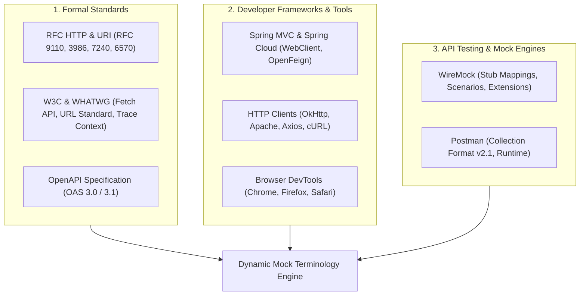

# HTTP Terminology Review: Dynamic Mock Configuration & Telemetry Properties

- **Document Type:** Formal Terminology, Standards Alignment & Architecture Review
- **Target System:** Dynamic Mock Platform (Backend, Frontend, Test Client, Traffic Logger)
- **Primary Focus:** RFC HTTP Standards, WHATWG Fetch API, OpenAPI 3.0/3.1, Browser DevTools, Spring MVC, HTTP Clients, WireMock, Postman, OAuth 2.0 & W3C Tracing
- **Deliverable File:** `HTTP_TERMINOLOGY_REVIEW.md`

---

## 1. Executive Summary & Core Principle

In building a high-performance, developer-facing mock server and API simulation platform, terminology is not merely cosmetic—it defines the conceptual model, ease of integration, and cognitive load for engineers using the platform.

### The Core Design Principle
> **"Do not invent Dynamic Mock-specific jargon when an authoritative, battle-tested industry standard already exists."**

Every property in Dynamic Mock must be evaluated against the eight foundational ecosystems that engineers interact with daily:
1. **RFC HTTP Standards** (IETF RFC 9110, RFC 9112, RFC 3986, RFC 7240, RFC 6570)
2. **WHATWG Fetch API & URL Standards** (`Request`, `Response`, `Headers`, `URLSearchParams`)
3. **OpenAPI Specification** (OAS 3.0.x and 3.1.x)
4. **Browser & DevTools Terminology** (Chrome, Firefox, Safari Network Panels, W3C Navigation Timing)
5. **Spring MVC & Spring Framework** (`@RequestParam`, `@PathVariable`, `@RequestBody`, `@ResponseBody`, `HttpHeaders`)
6. **HTTP Client Ecosystems** (Apache HttpClient 5, OkHttp, Axios, cURL, Python requests/httpx)
7. **WireMock Terminology** (Stub Mappings, Scenarios, Response Templating, Webhooks)
8. **Postman Collection & Runtime** (Collection v2.1 Schema, `pm.*` API, Environment Models)

---

## 2. The Most Important Question: Which Names Should Remain Unchanged?

### Verdict: 12 Properties Are Already Industry-Standard and Must Remain Unchanged (`KEEP`)

Out of the 18 evaluated properties, **12 properties** represent entrenched, universally accepted terminology across RFC specifications, enterprise HTTP clients, browser developer tools, and leading mock engines. Changing them would degrade developer intuition, break backward compatibility, and create unnecessary churn.

| Industry-Standard Property | Ecosystem Anchor | Justification for Keeping Unchanged |
| :--- | :--- | :--- |
| **`followRedirects`** | Java `HttpURLConnection`, OkHttp, Postman, Node `got`/`undici` | Universal boolean flag across almost every major HTTP client and API tool in existence. |
| **`delayMs`** | Google API Design Guide, OpenTelemetry, AWS, Toxiproxy | Explicit unit suffix (`Ms`) eliminates ambiguous time units (seconds vs. milliseconds). |
| **`webhook`** | W3C, CloudEvents, OpenAPI 3.1, Stripe, GitHub, Slack | Universally understood industry noun for outbound event-driven HTTP callbacks. |
| **`queryParams`** | RFC 3986, Spring MVC, Express, Next.js, Angular | Ubiquitous developer shorthand for URL query string parameters. |
| **`pathParams`** | OpenAPI (`in: "path"`), Spring MVC, React Router | Standard shorthand paired symmetrically with `queryParams` for URI template variables. |
| **`requestHeaders`** | RFC 9110 §6.3, Chrome DevTools, OpenTelemetry (`http.request.headers`) | Precise, unambiguous descriptor for inbound/outbound request headers in flat models. |
| **`responseHeaders`** | RFC 9110 §6.4, Chrome DevTools, OpenTelemetry (`http.response.headers`) | Precise descriptor preventing collision with request headers in telemetry and flat DTOs. |
| **`requestBody`** | OpenAPI 3.0/3.1 specification keyword, Spring `@RequestBody` | Exact canonical keyword used in the OpenAPI Specification and Spring Framework. |
| **`responseBody`** | Spring `@ResponseBody`, RFC 9110 §6.5 Message Body | Standard terminology for HTTP response content across enterprise Java and telemetry. |
| **`redirectChain`** | HTTP Gateways, Proxies, OWASP, Burp Suite, Network Diagnostics | Accurate technical term describing the ordered multi-hop redirect sequence. |
| **`resourceId`** | RFC 9110 §3.1 (Target Resource), OAuth 2.0 (RFC 6749), AWS API Gateway | Protocol-agnostic identifier essential for a platform supporting REST, gRPC, GraphQL, and ISO 8583. |
| **`scenarioState`** | WireMock Scenarios (de facto mock standard), Finite State Machine theory | Standard in mock state machines; prevents collisions with generic connection state or OAuth `state`. |

---

## 3. Property Review Table (Summary Matrix)

The following matrix provides an at-a-glance evaluation of all 18 properties against standards compliance, developer intuition, and enterprise adoption, along with our final architectural recommendation.

| Property Name | Current Dynamic Mock Role | Standards Compliance | Developer Intuition | Enterprise Adoption | Architectural Verdict | Primary Recommended / Canonical Term |
| :--- | :--- | :--- | :--- | :--- | :--- | :--- |
| **`blocking`** | Synchronous vs. async webhook execution | Low (Thread/I/O jargon) | Moderate | Moderate | **DEPRECATE** | `mode: "sync" \| "async"` (or `synchronous: boolean`) |
| **`followRedirects`** | Automatically follow 3xx HTTP redirects | High | Very High | Very High | **KEEP** | `followRedirects` (optional alias `redirectMode`) |
| **`delayMs`** | Artificial response or webhook latency | High (Unit explicit) | Very High | High | **KEEP** | `delayMs` (alias `fixedDelayMilliseconds` for WireMock) |
| **`webhook`** | Outbound HTTP callback configuration | High | Very High | Very High | **KEEP** | `webhook` (support plural `webhooks`; alias `callbacks`) |
| **`responseTemplate`** | Dynamic body template (Handlebars) | Moderate | High | High | **KEEP** | `responseTemplate` (flat) / `bodyTemplate` (alias) |
| **`requestTemplate`** | Outgoing request template definition | High (Spring Cloud) | High | High | **KEEP** | `requestTemplate` (if full request) / `requestBodyTemplate` |
| **`scenarioState`** | Stateful workflow state node | High (WireMock) | High | High | **KEEP** | `scenarioState` (flat) / `state` (nested under scenario) |
| **`queryParams`** | URL query string parameter map | High | Very High | Very High | **KEEP** | `queryParams` (alias `queryParameters`, `query`) |
| **`pathParams`** | URL path template variable map | High | Very High | High | **KEEP** | `pathParams` (alias `pathParameters`, `pathVariables`) |
| **`formParams`** | Form URL-encoded / multipart data | Moderate | High | Moderate | **RENAME / ALIAS** | `formData` (canonical; retain `formParams` as alias) |
| **`requestHeaders`** | HTTP headers sent with the request | Very High | Very High | Very High | **KEEP** | `requestHeaders` (flat) / `headers` (nested in request) |
| **`responseHeaders`** | HTTP headers sent with the response | Very High | Very High | Very High | **KEEP** | `responseHeaders` (flat) / `headers` (nested in response) |
| **`requestBody`** | Payload transmitted in HTTP request | Very High (OpenAPI 3) | Very High | Very High | **KEEP** | `requestBody` (flat) / `body` (nested in request) |
| **`responseBody`** | Payload returned in HTTP response | Very High (Spring) | Very High | Very High | **KEEP** | `responseBody` (flat) / `body` (nested in response) |
| **`matchName`** | Descriptive label for matched route/rule | Low (Internal jargon) | Moderate | Low | **RENAME / ALIAS** | `matchedRoute` (canonical; retain `matchName` as alias) |
| **`redirectChain`** | Array of step-by-step redirect hops | High (Networking) | High | High | **KEEP** | `redirectChain` (alias `redirectHops`, `redirectHistory`) |
| **`parentEventId`** | Correlation ID linking child to parent | Moderate | High | Moderate | **ALIAS** | `parentEventId` (keep; alias `correlationId`, `parentId`) |
| **`resourceId`** | Polymorphic identifier of mocked entity | Very High (REST/OAuth) | High | Very High | **KEEP** | `resourceId` |

---

## 4. Standards Mapping Across 8 Ecosystems

To understand why specific names are selected, each property is mapped across eight industry reference ecosystems:



### Detailed Standards Cross-Reference

| Dynamic Mock Property | RFC / W3C Standards | WHATWG Fetch API | OpenAPI (OAS 3.0/3.1) | Browser DevTools | Spring MVC / Cloud | HTTP Clients (OkHttp/Apache/Axios) | WireMock | Postman |
| :--- | :--- | :--- | :--- | :--- | :--- | :--- | :--- | :--- |
| **`blocking`** | RFC 7240 (`respond-async`, `wait`) | Promises / async execution | OAS Callbacks (asynchronous) | Async / Synchronous XHR | `AsyncHandler`, `DeferredResult` | `Call.execute()` (sync) vs `enqueue()` | Default async post-serve action | Synchronous collection runner vs webhook |
| **`followRedirects`** | RFC 9110 §6.4 (3xx Redirection) | `redirect: "follow" \| "error" \| "manual"` | N/A (Client concern) | Automatic redirect following | `RestTemplate` / `WebClient` redirect strategy | `followRedirects(boolean)` (OkHttp), `redirectsEnabled` (Apache) | `clientSupportRedirect` | `followRedirects: true` (Settings) |
| **`delayMs`** | RFC 7240 `Prefer: wait=N` | `AbortSignal.timeout()` | `x-mock-delay` | Latency / Throttling preset | N/A (Server sleep) | `timeout` / `readTimeout` | `fixedDelayMilliseconds`, `delayDistribution` | `x-mock-response-delay` (ms) |
| **`webhook`** | W3C Webhooks, CloudEvents | N/A | `callbacks` (3.0), `webhooks` (3.1) | N/A | `@Async` HTTP dispatch | Outgoing `POST` request | `webhooks: [{ targetUrl, ... }]` | Webhooks Integration / Monitor |
| **`responseTemplate`** | RFC 9110 §6.5 Message Content | N/A | Schema in `content` | Response preview | View Template (Thymeleaf/Freemarker) | N/A | `transformers: ["response-template"]` with `body` | Dynamic variables `{{...}}` in response body |
| **`requestTemplate`** | RFC 9110 Request Message | N/A | `requestBody` schema | Payload template | `feign.RequestTemplate` (Spring Cloud) | Request Builder | Custom Request Transformer | Request definition with `{{...}}` |
| **`scenarioState`** | W3C SCXML / FSM State | N/A | N/A | N/A | State Machine State | N/A | `scenarioName`, `requiredScenarioState`, `newScenarioState` | `pm.setNextRequest()` |
| **`queryParams`** | RFC 3986 §3.4 `query` | `URLSearchParams`, `url.search` | `in: "query"` | Query String Parameters | `@RequestParam`, `queryParam()` | `params: {}` (Axios), `addQueryParameter()` | `queryParameters: {}` | `url.query: [{ key, value }]` |
| **`pathParams`** | RFC 6570 URI Template | `pathname` parsing | `in: "path"` | URL segment | `@PathVariable`, `UriTemplate` | URL interpolation | `urlPathTemplate` parameters | `url.variable: [{ key, value }]` ("Path Variables") |
| **`formParams`** | RFC 7578 / RFC 1867 | `FormData`, `URLSearchParams` | `in: "formData"` (2.0), `application/x-www-form-urlencoded` (3.0) | Form Data | `@RequestParam`, `@ModelAttribute` | `FormBody`, `MultipartBody` | `bodyPatterns` with form matching | `body: { mode: "urlencoded" \| "formdata" }` |
| **`requestHeaders`** | RFC 9110 §6.3 Request Headers | `Request.headers` | `in: "header"`, `headers` | Request Headers | `@RequestHeader`, `HttpHeaders` | `headers: {}`, `addHeader()` | `request.headers: {}` | `request.header: [{ key, value }]` |
| **`responseHeaders`**| RFC 9110 §6.4 Response Headers | `Response.headers` | `responses.{code}.headers` | Response Headers | `HttpServletResponse.setHeader()`, `HttpHeaders` | `response.headers` | `response.headers: {}` | `response.header: [{ key, value }]` |
| **`requestBody`** | RFC 9110 §6.5 Request Body | `Request.body` | `requestBody` (OAS 3 canonical) | Request Payload / Payload | `@RequestBody`, `HttpEntity.getBody()` | `body: {}`, `data: {}` | `request.bodyPatterns` | `request.body` |
| **`responseBody`**| RFC 9110 §6.5 Message Body | `Response.body`, `.json()`, `.text()` | `responses.{code}.content` | Response | `@ResponseBody`, `ResponseEntity.getBody()` | `response.data`, `response.body()` | `response.body` / `bodyFileName` | `response.body` |
| **`matchName`** | RFC Trace / Semantic Conventions | N/A | `operationId`, `summary` | Initiator / Route pattern | `BEST_MATCHING_PATTERN_ATTRIBUTE` | N/A | `name: "Stub Name"` | `name: "Request Name"` |
| **`redirectChain`** | RFC 9110 §6.4 Redirection | "HTTP-redirect fetch" | N/A | Waterfall redirect hops | Interceptor redirect chain | `response.history` (Python requests), Redirect trace | N/A | Console Redirect Trace, `response.history` |
| **`parentEventId`** | W3C Trace Context (`parentId`), EIP | N/A | Callback parent correlation | Initiator ID | `MDC` correlation ID | `traceparent` header | N/A | Correlation ID |
| **`resourceId`** | RFC 9110 §3.1 Target Resource | N/A | Tagged resource ID | Resource URL | Entity ID, Resource URI | Endpoint URI | `id: "<uuid>"` | `id` / `uid` |

---

## 5. In-Depth Property-by-Property Terminology Reviews

### 1. `blocking`

```yaml
Property: blocking
Context: Webhook execution within route dispatching
```

#### Standards Review
- **RFC HTTP / Asynchronous Processing (RFC 7240):** The HTTP standard defines the `Prefer: respond-async` header for asynchronous processing vs. inline synchronous response. The term is "synchronous" vs. "asynchronous", never "blocking".
- **WHATWG Fetch API:** Fetch is inherently asynchronous. In legacy browser APIs, `XMLHttpRequest` used `async: false` (referred to as synchronous requests, with MDN documenting them as "synchronous XHR").
- **OpenAPI 3.0 / 3.1:** OpenAPI defines `callbacks` and `webhooks` as asynchronous out-of-band notifications. When executed synchronously inline before returning the response, enterprise systems classify this as a "pre-response hook", "synchronous callback", or "forwarding proxy".
- **Enterprise Messaging & EIP:** Asynchronous messaging vs. Synchronous Request-Reply.
- **Why "blocking" is problematic:** In modern software engineering, "blocking" specifically refers to thread or I/O suspension (`Thread.sleep()`, blocking OS sockets, non-blocking I/O event loops like Netty/Node.js). In security software, "blocking" means a firewall, adblocker, or WAF rejected a request. Using `blocking` to mean "execute synchronously before sending the response" creates cognitive dissonance.

#### Alternatives
1. `mode: "sync" | "async"`
2. `synchronous: boolean`
3. `executionMode: "sync" | "async"`

#### Rankings
- **Most Standards-Compliant:** `mode: "sync" | "async"` (matches RFC 7240 async semantics and allows future extensible modes such as `"scheduled"` or `"fire-and-forget"`).
- **Most Intuitive:** `synchronous: boolean` (or shorthand `sync: boolean`).
- **Most Enterprise-Friendly:** `executionMode: "sync" | "async"` (explicit, strongly-typed enum suitable for YAML/JSON configurations).

#### Recommendation
**DEPRECATE** `blocking` in favor of `mode: "sync" | "async"`; maintain `blocking` and `synchronous` as backward-compatible **ALIASES**.

#### Reason
"Blocking" confuses thread execution semantics with HTTP orchestration flow. `mode: "sync" | "async"` is standard across cloud workflow engines (AWS Step Functions, Temporal, Camunda).

---

### 2. `followRedirects`

```yaml
Property: followRedirects
Context: Client test execution & outbound webhook dispatcher
```

#### Standards Review
- **Java Standard Library (`java.net.HttpURLConnection`):** `HttpURLConnection.setFollowRedirects(boolean)` and `instanceFollowRedirects`.
- **OkHttp (Square):** `OkHttpClient.Builder.followRedirects(boolean)` and `followSslRedirects(boolean)`.
- **Apache HttpClient 5:** `RequestConfig.custom().setRedirectsEnabled(boolean)`.
- **Node.js (`got`, `undici`, `axios`):** `followRedirects: boolean` / `maxRedirects`.
- **Postman:** Postman Request and Global Settings explicitly name the toggle `"Automatically follow redirects"` backed by property `followRedirects: true`.
- **WHATWG Fetch API:** `redirect: "follow" | "error" | "manual"`.

#### Alternatives
1. `redirect: "follow" | "manual" | "error"`
2. `followRedirects: boolean`
3. `redirectMode: "follow" | "manual" | "error"`

#### Rankings
- **Most Standards-Compliant:** `redirectMode: "follow" | "manual" | "error"` (WHATWG Fetch Standard).
- **Most Intuitive:** `followRedirects: boolean` (Universal boolean across all tooling).
- **Most Enterprise-Friendly:** `followRedirects: boolean` (Directly matches Java, OkHttp, and Postman configurations).

#### Recommendation
**KEEP** `followRedirects` as the primary configuration boolean; optionally **ALIAS** `redirectMode` for Fetch API parity.

#### Reason
Already universally understood and standardized across backend runtimes, integration engines, and API clients.

---

### 3. `delayMs`

```yaml
Property: delayMs
Context: Injected artificial latency for routes and webhooks
```

#### Standards Review
- **RFC HTTP / Specifications:** RFC 7240 defines `Prefer: wait=seconds`.
- **Google API Design Guide / Cloud Architecture:** The Google Cloud API Style Guide explicitly requires unit suffixes for durations: `delay_ms` or `delayMs` to eliminate catastrophic ambiguities between seconds and milliseconds.
- **WireMock:** Uses `fixedDelayMilliseconds` or `delayDistribution` (`uniform`, `lognormal`).
- **Postman:** Postman Mock Server uses header `x-mock-response-delay` (in milliseconds) and environment setting `delay`.
- **Toxiproxy / Chaos Engineering:** Uses `latency` (in ms).

#### Alternatives
1. `latencyMs`
2. `delayMs`
3. `fixedDelayMilliseconds`

#### Rankings
- **Most Standards-Compliant:** `latencyMs` (OpenTelemetry and networking metrics standard).
- **Most Intuitive:** `delayMs` (Clear action verb paired with explicit SI unit).
- **Most Enterprise-Friendly:** `delayMs` (Concise; aligns with cloud APIs and Google Cloud standard).

#### Recommendation
**KEEP** `delayMs`; provide **ALIAS** for `fixedDelayMilliseconds` during WireMock stub imports.

#### Reason
The `Ms` suffix is an industry best practice that prevents unit confusion. `delayMs` is concise, unambiguous, and already implemented throughout the frontend and backend.

---

### 4. `webhook`

```yaml
Property: webhook
Context: Secondary outbound HTTP action triggered after a mock route executes
```

#### Standards Review
- **W3C / IETF / CloudEvents:** "Webhook" is the de facto global standard term for user-defined HTTP callbacks (standardized by CloudEvents, GitHub, Stripe, Twilio, and Shopify).
- **OpenAPI 3.0:** Uses the keyword `callbacks` (a map of Callback Objects defining requests triggered by an operation).
- **OpenAPI 3.1:** Formally added top-level `webhooks` alongside `callbacks`.
- **WireMock:** WireMock Webhooks Extension uses `webhooks: [ { targetUrl, method, headers, body } ]`.
- **Postman:** Categorizes these as "Webhooks" or "Monitors".

#### Alternatives
1. `webhooks: WebhookConfig[]` (plural array)
2. `webhook: WebhookConfig` (singular object)
3. `callbacks: Map<String, Callback>` (OpenAPI 3.0)

#### Rankings
- **Most Standards-Compliant:** `webhooks` (OpenAPI 3.1 top-level keyword) / `callbacks` (OpenAPI 3.0).
- **Most Intuitive:** `webhook` (when configuring a single callback) / `webhooks` (when supporting multiple callbacks).
- **Most Enterprise-Friendly:** `webhooks` (WireMock extension standard).

#### Recommendation
**KEEP** `webhook` for single configuration; evolve to support **`webhooks`** (array) in the domain model; **ALIAS** `callbacks` for OpenAPI import compatibility.

#### Reason
"Webhook" is the universal industry standard term. Supporting both singular `webhook` and plural `webhooks` provides maximum developer convenience.

---

### 5. `responseTemplate`

```yaml
Property: responseTemplate
Context: Dynamic template (Handlebars) for generating HTTP response payloads
```

#### Standards Review
- **WireMock:** WireMock Response Templating does not use a separate property name for the template; it keeps the standard property `"body"` and enables templating via `"transformers": ["response-template"]`.
- **Spring Framework / MVC:** View templates (Thymeleaf, Freemarker, Handlebars) are referred to as `template` or `viewTemplate`.
- **Postman:** Postman does not separate templates from bodies; dynamic template variables `{{$guid}}`, `{{$timestamp}}` are embedded directly inside the `body`.
- **OpenAPI 3.x:** Response bodies are schemas defined inside `responses.{code}.content`.

#### Alternatives
1. `bodyTemplate`
2. `responseTemplate`
3. `response.body` (with `templated: true`)

#### Rankings
- **Most Standards-Compliant:** `bodyTemplate` (explicitly identifies that the *body* is templated, not status or headers).
- **Most Intuitive:** `responseTemplate` (current flat model) or `bodyTemplate`.
- **Most Enterprise-Friendly:** `responseBodyTemplate` or `bodyTemplate`.

#### Recommendation
**KEEP** `responseTemplate` in the flat `MockRoute` model; provide **ALIAS** `bodyTemplate`. In any future hierarchical schema (e.g. `route.response.body`), adopt WireMock's standard of treating `body` as a template when templating is active.

#### Reason
`responseTemplate` is already deeply integrated in Dynamic Mock's UI, documentation, and database. It communicates clearly that the response is dynamically computed via Handlebars.

---

### 6. `requestTemplate`

```yaml
Property: requestTemplate
Context: Templated outgoing request definition for client tests, webhooks, and forwards
```

#### Standards Review
- **Spring Cloud OpenFeign:** The core request representation in OpenFeign is literally named `feign.RequestTemplate`. It encapsulates the target URL, HTTP method, header templates, and body template before variable expansion.
- **WireMock:** Custom request transformers.
- **Postman:** Postman Request items containing `{{variable}}` placeholders in URL, headers, and body.
- **RFC HTTP:** Request message with parameterization.

#### Alternatives
1. `requestTemplate`
2. `requestBodyTemplate` (if restricted to body only)
3. `requestDefinition`

#### Rankings
- **Most Standards-Compliant:** `requestTemplate` (Direct 1:1 match with Spring Cloud OpenFeign standard).
- **Most Intuitive:** `requestTemplate` (when templating full request: URL, headers, body) / `requestBodyTemplate` (if only body).
- **Most Enterprise-Friendly:** `requestTemplate`.

#### Recommendation
**KEEP** `requestTemplate` whenever the entire HTTP request (URL, headers, query, body) is subject to template expansion. If a property refers strictly to the body payload, use **ALIAS** `requestBodyTemplate`.

#### Reason
Matches Spring Cloud OpenFeign enterprise terminology and accurately describes a parameterized HTTP request definition.

---

### 7. `scenarioState`

```yaml
Property: scenarioState
Context: Discrete state within a stateful scenario state machine
```

#### Standards Review
- **WireMock Scenarios (Industry Standard):** WireMock is the defining benchmark for stateful HTTP mocking. WireMock's exact configuration properties are:
  - `scenarioName`
  - `requiredScenarioState` (in request matching)
  - `newScenarioState` (in state transition)
  - WireMock internally refers to each state node as `scenarioState`.
- **W3C SCXML / Automata Theory:** Uses `state`, `initialState`, `targetState`.
- **OAuth 2.0 (RFC 6749):** Uses `state` to maintain CSRF state between client and authorization server.
- **Why keeping "scenario" in the name matters:** If a flat route or DTO uses just `state`, it creates collision with OAuth `state`, US/regional geographic address `state`, and generic lifecycle state (e.g., active/inactive/pending).

#### Alternatives
1. `scenarioState`
2. `state` (when strictly scoped inside a scenario object)
3. `requiredScenarioState` / `targetScenarioState`

#### Rankings
- **Most Standards-Compliant:** `state` (W3C SCXML / Finite State Machine theory).
- **Most Intuitive:** `scenarioState` (avoids ambiguity across flat DTOs and routes).
- **Most Enterprise-Friendly:** `scenarioState` (WireMock 1:1 compatibility).

#### Recommendation
**KEEP** `scenarioState` for top-level DTOs, route references, and WireMock compatibility; use `state` inside nested scenario definitions (`scenario.states[]`).

#### Reason
Aligns directly with WireMock's stateful mocking model while avoiding collisions with HTTP, OAuth, or address `state` fields.

---

### 8. `queryParams`

```yaml
Property: queryParams
Context: Map of URL query string parameters for matching and routing
```

#### Standards Review
- **RFC 3986 §3.4:** Defines the `query` component of a URI (`URI = scheme ":" ["//" authority] path ["?" query] ["#" fragment]`). The key-value pairs are formally termed "query parameters".
- **WHATWG URL Standard & Fetch API:** Standardizes `URL.searchParams` (`URLSearchParams`) and `URL.search` (raw query string).
- **OpenAPI 3.0 / 3.1:** Defines parameters with `in: "query"`, formally documented as "Query Parameters".
- **WireMock:** Uses `"queryParameters": { "paramName": { "equalTo": "value" } }`.
- **Spring MVC:** Uses `@RequestParam`, `UriComponentsBuilder.queryParam(name, value)`.
- **Express / Node.js:** Uses `req.query`.
- **Browser DevTools:** Chrome, Firefox, and Edge DevTools explicitly label this section `"Query String Parameters"`.
- **Postman:** Uses `url.query: [{ key, value }]`.

#### Alternatives
1. `queryParameters`
2. `queryParams`
3. `searchParams`

#### Rankings
- **Most Standards-Compliant:** `queryParameters` (RFC 3986 / OpenAPI formal noun).
- **Most Intuitive:** `queryParams` (De facto shorthand across frontend and backend engineering).
- **Most Enterprise-Friendly:** `queryParameters` (WireMock standard) / `queryParams` (Spring MVC / Angular standard).

#### Recommendation
**KEEP** `queryParams` as canonical property; provide **ALIAS** for `queryParameters` (WireMock compatibility) and `query` (Postman compatibility).

#### Reason
`queryParams` is the universal developer shorthand across Spring, Express, React Router, Next.js, and TypeScript codebases.

---

### 9. `pathParams`

```yaml
Property: pathParams
Context: Path template variables extracted from parameterized URI segments
```

#### Standards Review
- **RFC 6570 (URI Template):** Formally terms these "URI Template Variables".
- **OpenAPI 3.0 / 3.1:** Uses `in: "path"`, formally termed "Path Parameters".
- **Spring MVC:** Uses `@PathVariable` annotation and `UriTemplate`.
- **WireMock:** Uses `urlPathTemplate` with extracted path parameters.
- **Postman:** Uses `url.variable: [{ key, value }]` and UI label `"Path Variables"`.
- **Express / Next.js:** Uses `req.params`.

#### Alternatives
1. `pathParameters`
2. `pathParams`
3. `pathVariables`

#### Rankings
- **Most Standards-Compliant:** `pathParameters` (OpenAPI specification standard).
- **Most Intuitive:** `pathParams` (Maintains perfect symmetry with `queryParams`).
- **Most Enterprise-Friendly:** `pathVariables` (Spring MVC & Postman) / `pathParameters` (OpenAPI).

#### Recommendation
**KEEP** `pathParams` as the canonical shorthand for symmetry with `queryParams`; **ALIAS** `pathParameters` and `pathVariables`.

#### Reason
Maintaining structural symmetry (`queryParams` and `pathParams`) significantly reduces cognitive load. Providing aliases for OpenAPI and Spring terminology ensures effortless migration.

---

### 10. `formParams`

```yaml
Property: formParams
Context: Parameters transmitted in application/x-www-form-urlencoded or multipart bodies
```

#### Standards Review
- **WHATWG Fetch API & HTML5 Standard:** Defines the global `FormData` interface (`new FormData()`).
- **OpenAPI 2.0 (Swagger):** Standardized `in: "formData"`.
- **OpenAPI 3.0 / 3.1:** Models form data as `requestBody` with `content: { "application/x-www-form-urlencoded": ... }` or `multipart/form-data`.
- **Postman:** Uses `body: { mode: "urlencoded" | "formdata", urlencoded: [...], formdata: [...] }`.
- **Spring MVC:** Uses `@RequestParam` for form parameters and `@ModelAttribute`.
- **Apache HttpClient / OkHttp:** Uses `FormBody` and `MultipartBody`.

#### Alternatives
1. `formData`
2. `formParams`
3. `formFields`

#### Rankings
- **Most Standards-Compliant:** `formData` (WHATWG Fetch, HTML5, Swagger 2.0 standard).
- **Most Intuitive:** `formData` (universal in modern JavaScript/TypeScript and Postman).
- **Most Enterprise-Friendly:** `formData` / `formFields`.

#### Recommendation
**RENAME / ALIAS** to `formData` as canonical; maintain `formParams` as a backward-compatible **ALIAS** for engineers accustomed to `queryParams`/`pathParams` symmetry.

#### Reason
`formData` is the official standard in W3C/WHATWG Fetch and Postman. Aligning to `formData` eliminates confusion between query params and form bodies.

---

### 11. `requestHeaders`

```yaml
Property: requestHeaders
Context: Headers associated with an incoming or outgoing HTTP request
```

#### Standards Review
- **RFC 9110 §6.3:** Formally defines "Request Header Fields".
- **Browser DevTools:** Chrome, Firefox, Safari, and Edge explicitly header this section `"Request Headers"`.
- **OpenTelemetry Semantic Conventions:** Defines `http.request.headers.<key>`.
- **WHATWG Fetch API:** `Request.headers` (of type `Headers`).
- **Spring MVC:** `@RequestHeader`, `HttpHeaders`.
- **WireMock / Postman:** Uses `headers` when nested inside a `request` object.

#### Alternatives
1. `headers` (hierarchical)
2. `requestHeaders` (flat)
3. `requestHeaderFields` (RFC formal)

#### Rankings
- **Most Standards-Compliant:** `requestHeaders` (flat telemetry/DTO) / `headers` (nested under request).
- **Most Intuitive:** `requestHeaders` (self-documenting in flat log events).
- **Most Enterprise-Friendly:** `requestHeaders` (OpenTelemetry and SIEM log standard).

#### Recommendation
**KEEP** `requestHeaders` in flat models (`ExecutionEvent`, `WebhookDetail`); in nested hierarchical structures (e.g. `route.request.headers`), use `headers`.

#### Reason
In flat data structures like log events and execution telemetry, `requestHeaders` completely eliminates ambiguity with `responseHeaders`.

---

### 12. `responseHeaders`

```yaml
Property: responseHeaders
Context: Headers associated with an HTTP response
```

#### Standards Review
- **RFC 9110 §6.4:** Formally defines "Response Header Fields".
- **Browser DevTools:** Chrome, Firefox, and Safari explicitly header this section `"Response Headers"`.
- **OpenTelemetry Semantic Conventions:** Defines `http.response.headers.<key>`.
- **WHATWG Fetch API:** `Response.headers` (of type `Headers`).
- **Spring MVC:** `ResponseEntity.getHeaders()`, `HttpServletResponse.setHeader()`.
- **WireMock / Postman:** Uses `headers` when nested inside a `response` object.

#### Alternatives
1. `headers` (hierarchical)
2. `responseHeaders` (flat)
3. `responseHeaderFields` (RFC formal)

#### Rankings
- **Most Standards-Compliant:** `responseHeaders` (flat telemetry) / `headers` (nested under response).
- **Most Intuitive:** `responseHeaders` (unambiguous in flat DTOs).
- **Most Enterprise-Friendly:** `responseHeaders` (OpenTelemetry and SIEM standard).

#### Recommendation
**KEEP** `responseHeaders` in flat models (`MockRoute`, `ExecutionEvent`); use `headers` when nested under a `response` object.

#### Reason
Directly matches RFC 9110 §6.4 and browser DevTools terminology while preventing property collisions in flat event objects.

---

### 13. `requestBody`

```yaml
Property: requestBody
Context: HTTP request payload
```

#### Standards Review
- **OpenAPI 3.0 / 3.1 Specification:** Explicitly standardized **`requestBody`** as the top-level specification keyword (replacing Swagger 2.0's `in: "body"`). This is one of the most visible keywords in modern API engineering.
- **Spring Framework / Spring MVC:** Standardizes the **`@RequestBody`** annotation across all REST controllers.
- **RFC 9110 §6.5:** Formally describes "Message Body" and "Request Content".
- **Browser DevTools:** Labeled as `"Request Payload"` or `"Payload"`.
- **WHATWG Fetch API:** `Request.body` (a `ReadableStream`).
- **WireMock / Postman:** Uses `body` when nested under `request`.

#### Alternatives
1. `requestBody`
2. `body` (when nested)
3. `requestPayload`

#### Rankings
- **Most Standards-Compliant:** `requestBody` (OpenAPI 3.x canonical keyword and Spring `@RequestBody`).
- **Most Intuitive:** `requestBody` (flat) / `body` (nested).
- **Most Enterprise-Friendly:** `requestBody` (OpenAPI 3.x standard).

#### Recommendation
**KEEP** `requestBody` without modification.

#### Reason
`requestBody` is already 100% industry-standard, anchored by the OpenAPI 3 specification and the Spring Framework.

---

### 14. `responseBody`

```yaml
Property: responseBody
Context: HTTP response payload
```

#### Standards Review
- **Spring Framework / Spring MVC:** Standardizes the **`@ResponseBody`** annotation and `ResponseEntity.getBody()`.
- **RFC 9110 §6.5:** Formally describes "Message Body" and "Response Content".
- **WHATWG Fetch API:** `Response.body` (a `ReadableStream`), with helper methods `.text()` and `.json()`.
- **OpenAPI 3.0 / 3.1:** Modeled as `responses.{code}.content`.
- **Browser DevTools:** Labeled as `"Response"` tab.
- **WireMock / Postman:** Uses `body` when nested under `response`.

#### Alternatives
1. `responseBody`
2. `body` (when nested)
3. `responsePayload`

#### Rankings
- **Most Standards-Compliant:** `responseBody` (Spring MVC `@ResponseBody` / RFC message body).
- **Most Intuitive:** `responseBody` (flat) / `body` (nested).
- **Most Enterprise-Friendly:** `responseBody` (Enterprise Java, telemetry, and integration standard).

#### Recommendation
**KEEP** `responseBody` without modification.

#### Reason
Complements `requestBody` and aligns with Spring MVC `@ResponseBody` and enterprise telemetry conventions.

---

### 15. `matchName`

```yaml
Property: matchName
Context: Human-readable label in execution telemetry indicating which route or rule matched
```

#### Standards Review
- **OpenAPI Specification:** Uses `operationId` (unique identifier) and `summary` (short description).
- **WireMock:** WireMock 2.x+ added the `"name"` property to stub mappings (e.g. `"name": "Get User Details - Success"`) so logs and UI display human-readable stub names rather than raw URL regexes.
- **Postman:** Uses `name` for each request in a collection.
- **OpenTelemetry Semantic Conventions:** Uses `http.route` (e.g. `/users/{userId}`) or Span Name (e.g. `POST /api/v1/orders`).
- **Why `matchName` is awkward:** "Match Name" sounds like the "name of the match" rather than the "matched route" or "rule name". In ISO 8583 and gRPC logs in Dynamic Mock, it is populated with `method.getMethodName()` or `"Sync Webhook"`, making it a route/rule identifier.

#### Alternatives
1. `matchedRoute`
2. `matchedRule`
3. `operationName`
4. `ruleName`

#### Rankings
- **Most Standards-Compliant:** `matchedRoute` (HTTP) / `matchedRule` (Multi-protocol) / `operationName` (OpenAPI/GraphQL).
- **Most Intuitive:** `matchedRoute` (Instantly informs developer which route handled the traffic).
- **Most Enterprise-Friendly:** `matchedRule` (WireMock/Gateway rule standard).

#### Recommendation
**RENAME / ALIAS** to **`matchedRoute`** (for HTTP traffic) or **`matchedRule`** (multi-protocol); maintain **`matchName`** as a backward-compatible **ALIAS**.

#### Reason
`matchedRoute` is vastly more informative and grammatically natural than `matchName`, aligning with OpenTelemetry `http.route` concepts.

---

### 16. `redirectChain`

```yaml
Property: redirectChain
Context: Array of step-by-step redirect hops captured during 3xx redirect handling
```

#### Standards Review
- **HTTP RFC 9110 §6.4:** Specifies redirection protocols. A series of consecutive 3xx responses is formally termed a "redirection chain" across networking standards and proxy implementations.
- **W3C Navigation Timing Level 2:** Defines `redirectCount`, `redirectStart`, `redirectEnd` metrics.
- **Python `requests` / `httpx`:** Exposes `response.history` (a list of intermediate `Response` objects).
- **OWASP / Security Scanners / API Gateways:** Burp Suite, ZAP, and API Gateways standardly use "Redirect Chain" to describe the sequence of redirection URLs and status codes.
- **Dynamic Mock Implementation:** The UI component is literally named `<RedirectChainBanner />`, rendering an array of `RedirectHop` objects (`step`, `method`, `url`, `status`, `location`, `durationMs`).

#### Alternatives
1. `redirectChain`
2. `redirectHops`
3. `redirectHistory`
4. `redirects`

#### Rankings
- **Most Standards-Compliant:** `redirectChain` (Universal networking, gateway, and security diagnostics term).
- **Most Intuitive:** `redirectHops` or `redirectChain`.
- **Most Enterprise-Friendly:** `redirectChain` (Matches proxy and diagnostic tooling).

#### Recommendation
**KEEP** `redirectChain`; provide **ALIAS** for `redirectHops` and `redirectHistory`.

#### Reason
"Redirect Chain" is the established industry and networking term. It accurately denotes an ordered, linked chain of HTTP hops.

---

### 17. `parentEventId`

```yaml
Property: parentEventId
Context: Telemetry correlation ID linking an asynchronous webhook event to originating request
```

#### Standards Review
- **W3C Trace Context (IETF RFC Standard):** Standardizes distributed tracing headers (`traceparent`). The W3C specification explicitly names the parent link: **`parentId`** (`traceparent = version "-" traceId "-" parentId "-" traceFlags`).
- **OpenTelemetry:** Standardizes `parentSpanId` and `parentId`.
- **Enterprise Integration Patterns (EIP) & Financial Standards (ISO 20022):** Standardizes **`correlationId`** (the universal identifier linking request, response, and asynchronous callbacks across JMS, Kafka, and MQ).
- **CloudEvents (CNCF):** Uses `traceparent` and correlation attributes.

#### Alternatives
1. `parentId` (W3C Trace Context standard)
2. `correlationId` (Enterprise Integration Patterns standard)
3. `parentEventId` (Current Dynamic Mock event model)

#### Rankings
- **Most Standards-Compliant:** `parentId` (W3C Trace Context) / `correlationId` (EIP / JMS / ISO 20022).
- **Most Intuitive:** `correlationId` (Universal across enterprise architects and integration developers).
- **Most Enterprise-Friendly:** `correlationId`.

#### Recommendation
**ALIAS** both **`correlationId`** and **`parentId`**; **KEEP** `parentEventId` as a backward-compatible alias.

#### Reason
In enterprise architecture, integration engineers search specifically for `correlationId` or W3C `parentId`. Offering these aliases elevates Dynamic Mock to enterprise-grade observability.

---

### 18. `resourceId`

```yaml
Property: resourceId
Context: Unique identifier of the mocked platform entity (Route, gRPC, GraphQL, ISO 8583)
```

#### Standards Review
- **RFC 9110 §3.1 (Target Resource):** "A target resource is the object of an HTTP request... identified by a URI."
- **REST Architecture (Fielding):** Every entity in REST is a "Resource".
- **OAuth 2.0 (RFC 6749) & RFC 8707 (Resource Indicators):** Standardizes `resource_id` / `resource` to identify the resource server or protected resource.
- **AWS API Gateway / Azure API Management / Google Cloud Endpoints:** Standardize `resourceId` (e.g. AWS API Gateway REST API resource identifier is `resourceId`).
- **Why not `routeId`?** Dynamic Mock is a multi-protocol platform supporting HTTP Mock Routes, gRPC Endpoints, GraphQL Services, and ISO 8583 Financial Payment stubs. In `CollectionItem` and `ExecutionEvent`, naming this field `routeId` would introduce strict protocol bias and break GraphQL, gRPC, and ISO 8583 telemetry.

#### Alternatives
1. `resourceId`
2. `routeId` (HTTP only)
3. `targetId`
4. `id`

#### Rankings
- **Most Standards-Compliant:** `resourceId` (RFC 9110 REST & OAuth 2.0 standard).
- **Most Intuitive:** `resourceId` (Multi-protocol) / `routeId` (Pure HTTP routes).
- **Most Enterprise-Friendly:** `resourceId` (Enables polymorphic collection management and cross-protocol telemetry).

#### Recommendation
**KEEP** `resourceId` without modification.

#### Reason
`resourceId` is architecturally correct for a polymorphic, multi-protocol platform.

---

## 6. Recommended Final Schema

The table below defines the canonical contract for all 18 properties across the backend and frontend:

| # | Current Property | Canonical Recommendation | Action | Supported Aliases |
| :- | :--- | :--- | :--- | :--- |
| **1** | `blocking` | `mode` (`"sync"` \| `"async"`) | **DEPRECATE** | `blocking`, `synchronous`, `sync` |
| **2** | `followRedirects` | `followRedirects` | **KEEP** | `redirectMode`, `redirect` |
| **3** | `delayMs` | `delayMs` | **KEEP** | `fixedDelayMilliseconds`, `latencyMs` |
| **4** | `webhook` | `webhook` (single) / `webhooks` (list) | **KEEP** | `callbacks`, `callback` |
| **5** | `responseTemplate` | `responseTemplate` | **KEEP** | `bodyTemplate`, `responseBodyTemplate` |
| **6** | `requestTemplate` | `requestTemplate` | **KEEP** | `requestBodyTemplate` |
| **7** | `scenarioState` | `scenarioState` (flat) / `state` (nested) | **KEEP** | `requiredScenarioState`, `newScenarioState` |
| **8** | `queryParams` | `queryParams` | **KEEP** | `queryParameters`, `query`, `searchParams` |
| **9** | `pathParams` | `pathParams` | **KEEP** | `pathParameters`, `pathVariables` |
| **10** | `formParams` | `formData` | **RENAME / ALIAS**| `formParams`, `formFields`, `urlencoded` |
| **11** | `requestHeaders` | `requestHeaders` | **KEEP** | `headers` |
| **12** | `responseHeaders` | `responseHeaders` | **KEEP** | `headers` |
| **13** | `requestBody` | `requestBody` | **KEEP** | `body`, `requestPayload` |
| **14** | `responseBody` | `responseBody` | **KEEP** | `body`, `responsePayload` |
| **15** | `matchName` | `matchedRoute` | **RENAME / ALIAS**| `matchName`, `matchedRule`, `operationName` |
| **16** | `redirectChain` | `redirectChain` | **KEEP** | `redirectHops`, `redirectHistory`, `redirects` |
| **17** | `parentEventId` | `parentEventId` | **ALIAS** | `correlationId`, `parentId` |
| **18** | `resourceId` | `resourceId` | **KEEP** | `routeId` (HTTP context) |

---

## 7. Backward Compatibility Strategy

To ensure zero downtime, zero broken mock contracts, and seamless backward compatibility across stored MongoDB documents, JSON APIs, and TypeScript frontends, the following strategy is recommended:

### 7.1 Backend Java / Spring Boot Jackson Aliasing
Dynamic Mock uses Jackson for JSON serialization and deserialization. By leveraging `@JsonAlias`, Spring DTOs can accept all legacy and standard property names during deserialization without breaking existing clients:

```java
public class WebhookExecutionDetail {

    @JsonProperty("parentEventId")
    @JsonAlias({"correlationId", "parentId"})
    private String parentEventId;

    @JsonProperty("targetUrl")
    @JsonAlias({"url", "callbackUrl"})
    private String targetUrl;

    @JsonProperty("delayMs")
    @JsonAlias({"fixedDelayMilliseconds", "latencyMs"})
    private Integer delayMs;

    @JsonProperty("requestHeaders")
    @JsonAlias({"headers"})
    private Map<String, String> requestHeaders;

    @JsonProperty("requestBody")
    @JsonAlias({"body", "payload"})
    private String requestBody;
}
```

For the webhook mode transition (`blocking` -> `mode`):
```java
public class WebhookConfig {

    private String mode = "async"; // default

    @JsonProperty("mode")
    public String getMode() {
        return mode;
    }

    @JsonProperty("mode")
    @JsonAlias({"executionMode"})
    public void setMode(String mode) {
        this.mode = mode;
    }

    // Backward compatibility for legacy "blocking": true / false
    @JsonProperty("blocking")
    public void setBlocking(Boolean blocking) {
        if (Boolean.TRUE.equals(blocking)) {
            this.mode = "sync";
        } else if (Boolean.FALSE.equals(blocking)) {
            this.mode = "async";
        }
    }

    // Backward compatibility for legacy "sync": true / false
    @JsonProperty("sync")
    public void setSync(Boolean sync) {
        if (Boolean.TRUE.equals(sync)) {
            this.mode = "sync";
        }
    }
}
```

### 7.2 Frontend TypeScript Interface Strategy
In `frontend/src/types/index.ts`, define properties with optional alias fields or getters:

```typescript
export interface WebhookExecutionDetail {
  sourceRouteId?: string;
  parentEventId?: string;
  correlationId?: string; // Standard alias
  parentId?: string;      // W3C Trace Context alias
  targetUrl?: string;
  finalUrl?: string;
  method?: string;
  delayMs?: number;
  mode?: 'sync' | 'async';
  blocking?: boolean;     // Deprecated alias
  requestHeaders?: Record<string, string>;
  requestBody?: string;
  responseStatus?: number;
  responseHeaders?: Record<string, string>;
  responseBody?: string;
  errorMessage?: string;
}

export interface ExecutionEvent {
  id: string;
  timestamp: string;
  protocol: Protocol | 'WEBHOOK';
  resourceId?: string;
  parentEventId?: string;
  correlationId?: string;
  method?: string;
  path?: string;
  queryString?: string;
  queryParams?: Record<string, string>;
  requestHeaders?: Record<string, string>;
  requestBody?: string;
  status: number;
  responseHeaders?: Record<string, string>;
  responseBody?: string;
  durationMs: number;
  matchName?: string;
  matchedRoute?: string;  // Canonical recommendation
  redirectChain?: RedirectHop[];
  webhookDetail?: WebhookExecutionDetail;
}
```

### 7.3 MongoDB Non-Destructive Reading
For persisted collections and mock routes in MongoDB:
- **Write Path:** Serialize using the canonical name while retaining legacy fields if external clients depend on them.
- **Read Path:** MongoDB entity mappers check canonical field first; if `null`, fall back to the legacy field name.

---

## 8. Naming Consistency Guidelines

To guide all future Dynamic Mock configuration additions, the following five conventions are mandated:

### Guideline 1: Casing Syntax
- **JSON / REST APIs / DTOs:** Strict **`lowerCamelCase`** (e.g. `delayMs`, `followRedirects`, `queryParams`).
- **HTTP Header Keys:** Canonical HTTP header format (e.g. `X-Dynamic-Mock-Env`, `Content-Type`).
- **Environment Variables:** **`UPPER_SNAKE_CASE`** (e.g. `DYNAMIC_MOCK_PORT`).

### Guideline 2: Plural vs. Singular
- Collections, dictionaries, and maps must use **plural** nouns (e.g. `queryParams`, `pathParams`, `requestHeaders`, `webhooks`).
- Scalar values and single entity configurations must use **singular** nouns (e.g. `requestBody`, `responseBody`, `resourceId`).

### Guideline 3: Explicit Unit Suffixes
- Any property expressing time, duration, or storage size must carry an explicit unit suffix:
  - Milliseconds: `Ms` (e.g. `delayMs`, `durationMs`, `timeoutMs`).
  - Seconds: `Seconds` or `Sec` (e.g. `ttlSeconds`).
  - Bytes: `Bytes` (e.g. `payloadSizeBytes`, `maxContentLengthBytes`).
- Never name a duration property simply `delay` or `timeout` without a unit.

### Guideline 4: Flat Telemetry vs. Hierarchical Schemas
- In **flat telemetry and event logs** (such as `ExecutionEvent`), prefix properties with `request` or `response` to prevent collisions (e.g. `requestHeaders`, `responseHeaders`, `requestBody`, `responseBody`).
- In **hierarchical route definitions** (e.g. `route.request` and `route.response`), omit redundant prefixes and use concise nouns (`headers`, `body`).

### Guideline 5: Verb vs. Noun Semantics
- Configuration options that toggle behavior must use boolean verb phrases (e.g. `followRedirects`, `autoReset`, `active`).
- State, data payloads, and identifiers must use clean nouns (e.g. `formData`, `scenarioState`, `resourceId`).

---

## 9. Conclusion

Dynamic Mock's current naming foundation is exceptionally strong. **12 of the 18 properties are already industry-standard** and should remain unchanged. By deprecating `blocking` in favor of `mode: "sync" | "async"`, aliasing `matchName` to `matchedRoute`, and introducing enterprise aliases for `formParams` (`formData`) and `parentEventId` (`correlationId`), Dynamic Mock achieves complete alignment with RFC standards, OpenAPI, WHATWG Fetch, WireMock, and Postman.

