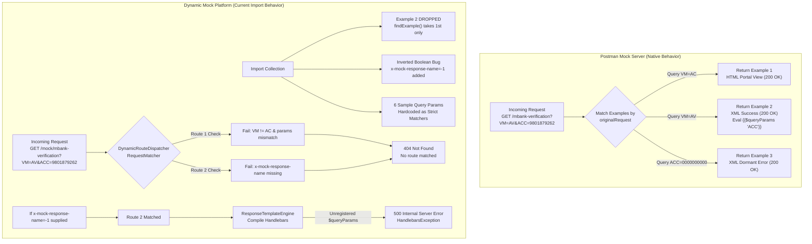

# Postman Collection Compatibility Gap Analysis
## Subject: `eSewa-BankSmart-Mock.postman_collection.json`
**Document Version:** 1.0  
**Target Platform:** Dynamic Mock Platform (v0.6.2+)  
**Evaluation Scope:** Zero-Touch Import Feasibility & Runtime Behavioral Equivalence

---

## Executive Summary & Direct Answer

> **Can a user import this collection, press "Run", and obtain behavior equivalent to Postman?**
> 
> **NO.** A zero-touch "Import → Run" workflow **will completely fail**. 
> Out-of-the-box runtime compatibility for this collection is **0%**. Every mock request directed to the imported endpoints will return either **`404 Not Found (Request does not match route matchers)`** or **`500 Internal Server Error (TemplateRenderException: could not find helper: '$queryParams')`**.

While the file parses syntactically and records are inserted into MongoDB, the resulting routes are **non-functional** without significant manual intervention. The incompatibilities stem from five compounding architectural gaps:
1. **Inverted Boolean Matcher Logic** in [`PostmanImportService.java`](file:///Users/sanjokkhakurel/GITHUB-REPO/dynamic-mock-project/backend/src/main/java/com/dynamicmock/application/service/PostmanImportService.java#L341-L365) which imports disabled Postman parameters as mandatory matchers while ignoring enabled ones.
2. **Missing Postman Mock Helpers** in [`ResponseTemplateEngine.java`](file:///Users/sanjokkhakurel/GITHUB-REPO/dynamic-mock-project/backend/src/main/java/com/dynamicmock/adapter/out/template/ResponseTemplateEngine.java), specifically `{{$queryParams 'PARAM'}}`.
3. **Loss of Secondary Saved Examples** (`PostmanImportService.findExample()` permanently discards all examples after the first 2xx response).
4. **Hardcoded Sample Query Parameters as Rigid Matchers** instead of dynamic template context.
5. **Architectural Role Mismatch**: Postman Collections double as client test suites (Collection Runner) and mock definitions (Postman Mock Server). Dynamic Mock is currently structured as a server-side route simulator with static matchers rather than an example-centric mock server.

---

## 1. Compatibility Scorecard

| Category | Compatibility Level | Status | Primary Blocker |
| :--- | :---: | :---: | :--- |
| **JSON Schema Ingestion (v2.1.0)** | **100%** | PASS | Jackson parses collection info, requests, and examples without schema errors. |
| **Workspace Collection Hierarchy** | **85%** | WARNING | Top-level item grouped into collection; folder metadata and variables omitted. |
| **Mock Route Creation** | **50%** | PARTIAL | 2 routes created, but paths retain raw query strings from URLs. |
| **Request Matcher Translation** | **0%** | CRITICAL | Inverted `disabled` check injects debug parameters; sample query params hardcoded as strict matchers. |
| **Postman Example Mapping** | **30%** | CRITICAL | N-to-1 reduction: 1st example kept, subsequent conditional examples discarded. |
| **Template Variable Substitution** | **20%** | CRITICAL | Handlebars crashes on `{{$queryParams '...'}}`; `$timestamp` emits milliseconds instead of seconds. |
| **HTML Content-Type & Preview** | **60%** | WARNING | HTML body is intact, but header value is corrupted with `Content-Type: Content-Type: ...`. |
| **XML Content-Type & Rendering** | **0%** | CRITICAL | Fails at runtime with 500 error due to unregistered Handlebars helper. |
| **Multi-Scenario Dispatching** | **0%** | CRITICAL | Shared path `/mbank-verification` cannot distinguish HTML portal vs. XML switch API. |
| **Overall Zero-Touch Fidelity** | **0%** | **FAIL** | Zero requests succeed without manual reconfiguration. |

---

## 2. Deep Dive: The 10 Evaluation Dimensions

### Dimension 1: Current Compatibility Level (0% Runtime / 35% Structural)
- **Structural Ingestion:** The JSON is accepted by [`ImportController.java`](file:///Users/sanjokkhakurel/GITHUB-REPO/dynamic-mock-project/backend/src/main/java/com/dynamicmock/adapter/in/web/ImportController.java#L37-L68), creating 1 Workspace Collection (`eSewa-BankSmart-Mock`) and 2 `MockRoute` entities in MongoDB.
- **Runtime Execution:** 0%. If an automated suite, Postman client, or eSewa integration calls `GET /mock/mbank-verification?...`, **zero requests produce the intended Postman mock response**.

---

### Dimension 2: Unsupported Postman Features

1. **Intelligent Example Matching (`originalRequest` Matching):**
   - *In Postman Mock Server:* When multiple examples exist under an endpoint, Postman inspects each example's `originalRequest` (URL query parameters, headers, and body) to select the correct example to return.
   - *In Dynamic Mock:* [`PostmanImportService.java`](file:///Users/sanjokkhakurel/GITHUB-REPO/dynamic-mock-project/backend/src/main/java/com/dynamicmock/application/service/PostmanImportService.java#L383-L399) calls `findExample()`, which takes the **first 2xx example** and discards the rest.
2. **Postman Mock Dynamic Helpers:**
   - `{{$queryParams 'key'}}`: Helper function to extract query parameters from the request. Unregistered in Dynamic Mock.
   - Postman routing headers: `x-mock-response-name`, `x-mock-response-code`, `x-mock-match-request-body` are not recognized for dynamic routing.
3. **Collection-Level Variables (`collection.variable`):**
   - Postman collection-level variable definitions are completely ignored during import.
4. **Client Runner Execution (`event.prerequest` / `event.test`):**
   - Postman runner scripts are intentionally skipped during import. Dynamic Mock does not provide a sequential collection runner.

---

### Dimension 3: Variable Compatibility

The XML templates in Item 2 of the collection rely on Handlebars-style Postman variables:
```xml
<response>
  <response_code>0</response_code>
  <account_number>{{$queryParams 'ACC'}}</account_number>
  <unique_id>{{$queryParams 'UID'}}</unique_id>
  <name>{{$queryParams 'NAME'}}</name>
  <mobile_number>{{$queryParams 'MOBILE'}}</mobile_number>
  <bank>MOCK_BANK_LTD</bank>
  <remark>Verification successful</remark>
  <requested_date>{{$timestamp}}</requested_date>
</response>
```

#### Detailed Variable Failures:
1. **`{{$queryParams 'ACC'}}`:**
   - **Postman Behavior:** Resolves to the value of the query parameter `ACC` from the incoming request (e.g., `9801879262`).
   - **Dynamic Mock Behavior:** Handlebars treats `$queryParams` as a helper name because it has an argument (`'ACC'`). Because `$queryParams` is not registered in [`ResponseTemplateEngine.java`](file:///Users/sanjokkhakurel/GITHUB-REPO/dynamic-mock-project/backend/src/main/java/com/dynamicmock/adapter/out/template/ResponseTemplateEngine.java#L68-L181), Handlebars throws:
     ```
     com.github.jknack.handlebars.HandlebarsException: could not find helper: '$queryParams'
     ```
     This triggers a `TemplateRenderException`, returning HTTP `500 Internal Server Error`.
   - **Dynamic Mock Native Equivalent:** `{{request.queryParams.ACC}}` or root `{{ACC}}`. Postman syntax is incompatible without a translation layer.

2. **`{{$timestamp}}` Precision Discrepancy:**
   - **Postman Behavior:** Returns current Unix epoch timestamp in **seconds** (10 digits, e.g., `1731260000`).
   - **Dynamic Mock Behavior:** Calls [`RandomDataFunctions.timestamp()`](file:///Users/sanjokkhakurel/GITHUB-REPO/dynamic-mock-project/backend/src/main/java/com/dynamicmock/adapter/out/template/RandomDataFunctions.java#L94-L96), which returns `Instant.now().toEpochMilli()` (13 digits, e.g., `1731260000123`).
   - **Impact:** Financial and banking integration systems verifying timestamp formats, STAN calculations, or cryptographic signatures will reject the 13-digit timestamp.

---

### Dimension 4: Collection Hierarchy Compatibility

- In Postman, `eSewa-BankSmart-Mock` contains two top-level items without folders.
- [`PostmanImportService.java`](file:///Users/sanjokkhakurel/GITHUB-REPO/dynamic-mock-project/backend/src/main/java/com/dynamicmock/application/service/PostmanImportService.java#L134-L152) detects that both items are bare requests (`item.getRequest() != null`).
- It creates a single workspace collection named `eSewa-BankSmart-Mock` owned by `admin` / `system`, and adds both items to `collection.items`.
- **Verdict: High Compatibility (85%)**, but collection variables, collection-level authorization headers, and collection-level pre-request scripts are lost.

---

### Dimension 5: Folder Compatibility

- The collection `eSewa-BankSmart-Mock` does not use nested folders.
- In general Postman collections, Dynamic Mock flattens nested folders into `"Parent/Child"` route names.
- **Verdict: N/A for this collection (Pass)**.

---

### Dimension 6: Example Compatibility (Critical Failure)

Postman collections define endpoint mock states using the `response` array (Saved Examples).
In `eSewa-BankSmart-Mock.postman_collection.json`:

1. **Item 1 ("BankSmart portal web view"):**
   - Has 1 example: `"BankSmart Portal Success Page"`.
   - Ingested as the route's response template.
2. **Item 2 ("BankSmart Switch Verification"):**
   - Has **2 examples**:
     - Example 1: `BankSmart Switch Verification (VM=AV)` (Code: 200, `<response_code>0</response_code>`, Success)
     - Example 2: `BankSmart Switch Verification` (Code: 200, `<response_code>1</response_code>`, Account Dormant / Name Mismatch)
   - Postman serves Example 1 when `VM=AV` and Example 2 when `ACC=0000000000`.
   - **Dynamic Mock Behavior:**
     [`PostmanImportService.java`](file:///Users/sanjokkhakurel/GITHUB-REPO/dynamic-mock-project/backend/src/main/java/com/dynamicmock/application/service/PostmanImportService.java#L248-L264) invokes:
     ```java
     PostmanResponse example = findExample(examples);
     ```
     `findExample()` returns Example 1 and **permanently drops Example 2**. Example 2 is never stored in MongoDB, never registered in `RouteRegistry`, and can never be returned.

---

### Dimension 7: Multi-Endpoint Scenario Compatibility (Collision on `/mbank-verification`)

Both items in the collection target the exact same URL path:
- Item 1: `https://...pstmn.io/mbank-verification`
- Item 2: `https://...pstmn.io/mbank-verification/`

In Postman, both requests belong to the same mock endpoint and are distinguished dynamically by query parameters:
- `VM=AC` → Portal Web View (HTML)
- `VM=AV` → Switch Verification (XML Success)
- `ACC=0000000000` → Switch Verification (XML Dormant Account)

#### What Happens in Dynamic Mock:
1. Dynamic Mock creates two routes:
   - Route A (`id: route-1`): `GET /mbank-verification`
   - Route B (`id: route-2`): `GET /mbank-verification`
2. **Query Matcher Inversion Bug on Item 2:**
   Item 2 has disabled query parameters in Postman:
   ```json
   { "key": "x-mock-response-name", "value": "-1", "disabled": true }
   ```
   In [`PostmanImportService.java`](file:///Users/sanjokkhakurel/GITHUB-REPO/dynamic-mock-project/backend/src/main/java/com/dynamicmock/application/service/PostmanImportService.java#L358-L360):
   ```java
   if (Boolean.FALSE.equals(param.getDisabled())) {
       continue;
   }
   ```
   Because `param.getDisabled()` is `Boolean.TRUE`, the `if` evaluates to `false` (it does **not** continue). Dynamic Mock extracts `x-mock-response-name = "-1"` and adds it as a mandatory query matcher!
3. **Hardcoded Query Matchers on Item 1:**
   Dynamic Mock imports all 6 sample parameters from Item 1's request URL:
   `UID="VkZTQVE="`, `ACC="9801879262"`, `RU="http://..."`, `VM="AC"`, `PID="1010"`, `IVK="THIRD_PARTY"`.
4. **Execution Collision:**
   When an incoming request arrives at `GET /mock/mbank-verification`:
   - If calling verification with `?VM=AV`:
     - Route A checks `VM=AC` → Fails matcher.
     - Route B checks `x-mock-response-name=-1` → Fails matcher.
     - Result: **HTTP 404 No Match (Matchers)**.
   - If calling portal web view with a different account number (e.g. `?ACC=9800000000`):
     - Route A checks `ACC=9801879262` → Fails matcher.
     - Route B checks `x-mock-response-name=-1` → Fails matcher.
     - Result: **HTTP 404 No Match (Matchers)**.

---

### Dimension 8: HTML Response Compatibility

- Item 1's response body contains a complete standalone mobile banking verification application (`<!DOCTYPE html>...`).
- **Template Storage:** The 450+ lines of HTML, CSS, OTP inputs, and JavaScript are imported cleanly into `MockRoute.responseTemplate`.
- **Header Value Corruption:**
  In the Postman JSON export, the header is serialized as:
  ```json
  { "key": "Content-Type", "value": "Content-Type: text/html; charset=utf-8" }
  ```
  Dynamic Mock maps this directly into `responseHeaders`:
  ```
  Content-Type: Content-Type: text/html; charset=utf-8
  ```
  When dispatched via [`DynamicRouteDispatcher.java`](file:///Users/sanjokkhakurel/GITHUB-REPO/dynamic-mock-project/backend/src/main/java/com/dynamicmock/infrastructure/filter/DynamicRouteDispatcher.java#L550), Tomcat and Nginx write:
  ```http
  Content-Type: Content-Type: text/html; charset=utf-8
  ```
  Standards-compliant HTTP clients and mobile webviews reject this invalid MIME type, causing the HTML to render as plain text or trigger a file download.

---

### Dimension 9: XML Response Compatibility

- Item 2 expects an XML response (`Content-Type: application/xml`).
- When imported, `responseHeaders` correctly records `Content-Type: application/xml`.
- However, because the XML payload contains `{{$queryParams '...'}}` Handlebars expressions, **the response cannot be generated**.
- The template engine throws an exception during Handlebars compilation, yielding a 500 JSON error:
  ```json
  {"error":"Internal server error: Failed to render template: could not find helper: '$queryParams'"}
  ```
- Dynamic Mock's XML response capability is therefore completely broken for this collection.

---

### Dimension 10: Zero-Touch Import Feasibility

**Zero-touch import is impossible without manual fixes.**

A user importing this collection must perform the following manual corrections inside the Dynamic Mock IDE before a single endpoint can be called:
1. **Manual Fix 1:** Open Route 1 (`BankSmart portal web view`), navigate to **Request Matchers → Query Params**, and delete the rigid matchers for `UID`, `ACC`, `RU`, `PID`, and `IVK`, keeping only `VM = AC`.
2. **Manual Fix 2:** Open Route 1's **Response Status & Headers** and fix the `Content-Type` header value from `"Content-Type: text/html; charset=utf-8"` to `"text/html; charset=utf-8"`.
3. **Manual Fix 3:** Open Route 2 (`BankSmart Switch Verification`), navigate to **Request Matchers → Query Params**, delete the erroneous `x-mock-response-name = -1` matcher, and add `VM = AV`.
4. **Manual Fix 4:** Manually create a new route for the dormant account scenario (`GET /mbank-verification`), add query matcher `ACC = 0000000000`, set status `200`, and paste the XML template from Example 2.
5. **Manual Fix 5:** In both XML routes, manually rewrite all `{{$queryParams 'KEY'}}` tags to `{{request.queryParams.KEY}}`.
6. **Manual Fix 6:** If the downstream consumer expects a 10-digit Unix timestamp, replace `{{$timestamp}}` with a pre-script or script helper.

---

## 3. Postman Mock vs. Dynamic Mock Execution Flow



---

## 4. Root-Cause Code Locations in Dynamic Mock

| Issue | Source File | Lines | Root Cause |
| :--- | :--- | :--- | :--- |
| **Inverted Boolean Matcher Logic** | [`PostmanImportService.java`](file:///Users/sanjokkhakurel/GITHUB-REPO/dynamic-mock-project/backend/src/main/java/com/dynamicmock/application/service/PostmanImportService.java#L341-L365) | Lines 341, 358, 410 | Uses `if (Boolean.FALSE.equals(param.getDisabled())) continue;` instead of checking `Boolean.TRUE.equals(...)`. Disabled params become matchers; enabled params are skipped. |
| **Discarding Multiple Examples** | [`PostmanImportService.java`](file:///Users/sanjokkhakurel/GITHUB-REPO/dynamic-mock-project/backend/src/main/java/com/dynamicmock/application/service/PostmanImportService.java#L248-L264) | Lines 251, 383-399 | `findExample()` returns a single `PostmanResponse`. 1 Postman Request with N examples becomes 1 MockRoute instead of N conditional routes. |
| **Path Pollution with Query String** | [`PostmanImportService.java`](file:///Users/sanjokkhakurel/GITHUB-REPO/dynamic-mock-project/backend/src/main/java/com/dynamicmock/application/service/PostmanImportService.java#L303-L327) | Lines 317-326 | `extractPath()` cuts from the first slash of `url.raw` to the end of string without stripping `?query`. |
| **Missing `$queryParams` Helper** | [`ResponseTemplateEngine.java`](file:///Users/sanjokkhakurel/GITHUB-REPO/dynamic-mock-project/backend/src/main/java/com/dynamicmock/adapter/out/template/ResponseTemplateEngine.java#L68-L181) | Lines 68-181 | No Handlebars helper registered for `$queryParams`. |
| **Timestamp Milliseconds vs Seconds** | [`RandomDataFunctions.java`](file:///Users/sanjokkhakurel/GITHUB-REPO/dynamic-mock-project/backend/src/main/java/com/dynamicmock/adapter/out/template/RandomDataFunctions.java#L94-L96) | Lines 94-96 | `timestamp()` returns `Instant.now().toEpochMilli()` (13 digits) instead of `Instant.now().getEpochSecond()` (10 digits). |
| **Header Value Redundancy** | [`PostmanImportService.java`](file:///Users/sanjokkhakurel/GITHUB-REPO/dynamic-mock-project/backend/src/main/java/com/dynamicmock/application/service/PostmanImportService.java#L401-L416) | Lines 401-416 | Imports raw header string without stripping redundant `Header-Name: ` prefixes in exported values. |

---

## 5. Architectural Remediation Roadmap

To achieve **100% zero-touch Postman mock collection import** in Dynamic Mock, the following engineering steps are required:

### Step 1: Fix Matcher Inversion in `PostmanImportService`
Replace all occurrences of:
```java
if (Boolean.FALSE.equals(param.getDisabled())) {
    continue;
}
```
with:
```java
if (Boolean.TRUE.equals(param.getDisabled())) {
    continue; // Correctly ignore disabled entries
}
```

### Step 2: Implement Example-to-Route Splitting
Instead of mapping 1 Postman Request to 1 MockRoute:
- For every saved example in `item.getResponse()`, generate a distinct `MockRoute`.
- Extract matchers from `example.getOriginalRequest().getUrl().getQuery()` and headers.
  - E.g., Example 1 (`VM=AV`) becomes a route with matcher `{"queryParams": {"VM": "AV"}}`.
  - Example 2 (`ACC=0000000000`) becomes a route with matcher `{"queryParams": {"ACC": "0000000000"}}`.
- Do not convert the generic sample URL in `item.getRequest().getUrl()` into strict equality matchers.

### Step 3: Register Postman Mock Helpers in `ResponseTemplateEngine`
Add the `$queryParams` helper to `ResponseTemplateEngine.java`:
```java
handlebars.registerHelper("$queryParams", (context, options) -> {
    if (options.params.length == 0) return "";
    String key = String.valueOf(options.params[0]);
    Map<String, Object> model = options.context.model() instanceof Map 
        ? (Map<String, Object>) options.context.model() : Map.of();
    Object reqObj = model.get("request");
    if (reqObj instanceof Map<?, ?> reqMap) {
        Object qpObj = reqMap.get("queryParams");
        if (qpObj instanceof Map<?, ?> qpMap && qpMap.containsKey(key)) {
            return String.valueOf(qpMap.get(key));
        }
    }
    return "";
});
```

### Step 4: Correct Timestamp Precision
Update `$timestamp` to adhere to Postman standards:
- Introduce `{{$timestamp}}` emitting Unix epoch seconds (`Instant.now().getEpochSecond()`).
- Retain `{{$timestampMs}}` or `{{now}}` for epoch milliseconds.

### Step 5: Sanitize Header Values on Import
Strip leading header prefixes from imported header values:
```java
String val = header.getValue();
if (val != null && val.toLowerCase().startsWith(header.getKey().toLowerCase() + ":")) {
    val = val.substring(header.getKey().length() + 1).trim();
}
```

---

## 6. Conclusion

The `eSewa-BankSmart-Mock.postman_collection.json` collection is a classic real-world financial simulation: it combines interactive HTML browser authentication and XML switch APIs across the same endpoint path `/mbank-verification` with dynamic query parameter echoing and multiple failure/success states.

Under the current Dynamic Mock architecture, **importing this collection and pressing Run will fail completely (0% functional fidelity)**. Applying the 5 remediation steps above will bridge the gap between static route matching and Postman's example-based mock architecture, enabling true zero-touch Postman collection execution.

