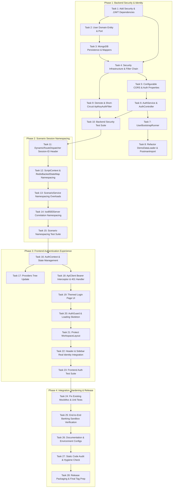

# Sprint 4 Implementation Plan
## Authentication Foundation, Multi-User Identity & Scenario Namespacing

**Document Version**: 1.0  
**Date**: 2026-10-14  
**Status**: APPROVED IMPLEMENTATION PLAN  
**Source Documents**:
- `SPRINT_04_DISCOVERY.md`
- `SPRINT_04_ARCHITECTURE_REVIEW.md`  
**Governing Documents**: `AI_GOVERNANCE.md`, `ROADMAP_AUTHORITY.md`, `MASTER_PRODUCT_ACTION_PLAN.md`

---

## 1. Executive Summary & Document Control

### 1.1 Objective
Convert the architectural decisions approved in `SPRINT_04_ARCHITECTURE_REVIEW.md` into an actionable, file-level, step-by-step engineering roadmap for Sprint 4.

Sprint 4 transitions Dynamic Mock from a single-user local prototype into an enterprise-ready, authenticated simulation platform. Upon sprint completion:
1. Every API management route (`/api/**`) is protected by stateless JWT authentication with BCrypt-hashed credentials.
2. The UI features a dedicated login experience, session management, and role-agnostic user context.
3. Simulation traffic routes (`/mock/**`), ISO8583 TCP (`8583`), and WebSocket traffic (`/ws-traffic/**`) remain zero-friction and public.
4. Stateful scenarios support concurrent QA execution through `X-Session-ID`-based Redis namespacing without state collisions.
5. Legacy `"default-user"` hardcoded references are completely purged from active application code paths.

### 1.2 Architecture Contract Compliance
Per `AI_GOVERNANCE.md`, this plan enforces all decisions recorded in `SPRINT_04_ARCHITECTURE_REVIEW.md`:
- **ADR-1 (JWT Algorithm)**: Symmetric HS256, 8-hour token lifetime.
- **ADR-2 (Stateless Sessions)**: No refresh token complexity in Sprint 4 (deferred to Sprint 6).
- **ADR-3 (Frontend Token Storage)**: In-memory React state within `AuthContext` (no localStorage/sessionStorage XSS vulnerability; no cookie CSRF complexity).
- **ADR-4 (Registration Model)**: Environment-variable-gated (`APP_AUTH_ALLOW_REGISTRATION:false`). Disabled by default.
- **ADR-5 (Scenario Isolation)**: `X-Session-ID` request header on `/mock/**` (Redis keys: `scenario:state:{scenarioName}:{sessionId}`). Shared fallback preserved for Banking Sandbox tutorial compatibility.
- **ADR-6 (API Key Coexistence)**: `ApiKeyAuthFilter` demoted to order 100 with `Authorization: Bearer` short-circuit. Constant-time `MessageDigest.isEqual` preserved.
- **ADR-7 (Domain Layer Purity)**: `User.java` domain entity contains ZERO framework/persistence annotations (Lombok only).
- **ADR-8 (Password Hashing)**: BCrypt strength 12 via Spring Security standard encoder.

### 1.3 Out-of-Scope Guardrails (Strict)
The following features are **strictly deferred** to Sprint 5, Sprint 6, or later and must NOT be implemented in Sprint 4:
- Role-Based Access Control (RBAC), permission matrices, and user roles (Sprint 6).
- Refresh tokens and server-side token revocation lists (Sprint 6).
- LDAP / Active Directory / SAML / OIDC / OAuth2 SSO integrations (Sprint 7+).
- WebSocket STOMP protocol authentication (Sprint 6).
- Per-user scenario ownership (adding `userId` to `Scenario.java`) (Sprint 6).
- Multi-tenancy and organization-level workspaces (deferred).
- Registration invite tokens and email verification (deferred).
- Audit trail for authorization events (deferred).
- White labeling UI customization (Sprint 5).

---

## 2. Implementation Phases Overview

The implementation is structured into 4 sequential phases, executing in strict dependency order:



---

## 3. Detailed Task Breakdown & Implementation Specifications

### Phase 1: Backend Security Infrastructure & User Identity (Days 1–2)

#### Task 1: Add Spring Security and JJWT Dependencies
- **Target Files**:
  - `backend/build.gradle`
- **Prerequisites**: None.
- **Implementation**:
  Add `spring-boot-starter-security`, JJWT 0.12.6 libraries, and `spring-security-test`:
  ```groovy
  // In dependencies block:
  implementation 'org.springframework.boot:spring-boot-starter-security'
  implementation 'io.jsonwebtoken:jjwt-api:0.12.6'
  runtimeOnly    'io.jsonwebtoken:jjwt-impl:0.12.6'
  runtimeOnly    'io.jsonwebtoken:jjwt-jackson:0.12.6'

  testImplementation 'org.springframework.security:spring-security-test'
  ```
- **Acceptance Criteria**: `./gradlew build -x test` resolves all dependencies without version conflicts.
- **Risk Mitigation**: DO NOT restart dev server until Task 4 creates `SecurityConfig.java`, as Spring Security defaults to blocking all requests.

---

#### Task 2: Create User Domain Entity and Repository Port
- **Target Files**:
  - `backend/src/main/java/com/dynamicmock/domain/entity/User.java` (CREATE)
  - `backend/src/main/java/com/dynamicmock/domain/port/out/UserRepository.java` (CREATE)
- **Prerequisites**: Task 1.
- **Implementation**:
  - `User.java`: Pure domain entity. Lombok `@Data`, `@Builder`, `@NoArgsConstructor`, `@AllArgsConstructor` ONLY. No Spring Data `@Document`, no Jakarta `@Entity`, no Jackson `@JsonProperty`.
    - Fields: `id` (String), `username` (String), `email` (String), `passwordHash` (String), `active` (Boolean), `createdAt` (LocalDateTime), `updatedAt` (LocalDateTime).
  - `UserRepository.java`: Domain output port interface:
    ```java
    package com.dynamicmock.domain.port.out;

    import com.dynamicmock.domain.entity.User;
    import java.util.Optional;

    public interface UserRepository {
        Optional<User> findById(String id);
        Optional<User> findByUsername(String username);
        Optional<User> findByEmail(String email);
        boolean existsByUsername(String username);
        boolean existsByEmail(String email);
        User save(User user);
        long count();
    }
    ```
- **Acceptance Criteria**: Entity and Port compile cleanly with zero imports outside `java.*` and `lombok.*`.

---

#### Task 3: MongoDB Persistence Entities, Mappers & Repository Adapter
- **Target Files**:
  - `backend/src/main/java/com/dynamicmock/infrastructure/persistence/mongodb/entity/UserMongoEntity.java` (CREATE)
  - `backend/src/main/java/com/dynamicmock/infrastructure/persistence/mongodb/mapper/UserMapper.java` (CREATE)
  - `backend/src/main/java/com/dynamicmock/infrastructure/persistence/mongodb/repository/MongoUserRepository.java` (CREATE)
  - `backend/src/main/java/com/dynamicmock/infrastructure/persistence/mongodb/repository/UserRepositoryImpl.java` (CREATE)
- **Prerequisites**: Task 2.
- **Implementation**:
  - `UserMongoEntity.java`: `@Document(collection = "users")`. Fields: `@Id String id`, `@Indexed(unique = true) String username`, `@Indexed(unique = true) String email`, `String passwordHash`, `Boolean active`, `LocalDateTime createdAt`, `LocalDateTime updatedAt`.
  - `UserMapper.java`: Clean converter methods `toDomain(UserMongoEntity entity)` and `toEntity(User domain)`.
  - `MongoUserRepository.java`: Extends `MongoRepository<UserMongoEntity, String>`. Adds `findByUsername(String username)`, `findByEmail(String email)`, `boolean existsByUsername(String username)`, `boolean existsByEmail(String email)`.
  - `UserRepositoryImpl.java`: `@Repository` implementing `UserRepository`, delegating to `MongoUserRepository` via `UserMapper`.
- **Acceptance Criteria**: Clean Architecture boundaries preserved. Infrastructure layer isolates all MongoDB annotations.

---

#### Task 4: Security Infrastructure Configuration & Filter Chain
- **Target Files**:
  - `backend/src/main/java/com/dynamicmock/infrastructure/security/PasswordEncoderConfig.java` (CREATE)
  - `backend/src/main/java/com/dynamicmock/infrastructure/security/JwtTokenService.java` (CREATE)
  - `backend/src/main/java/com/dynamicmock/infrastructure/security/UserDetailsServiceImpl.java` (CREATE)
  - `backend/src/main/java/com/dynamicmock/infrastructure/security/JwtAuthenticationFilter.java` (CREATE)
  - `backend/src/main/java/com/dynamicmock/infrastructure/security/SecurityConfig.java` (CREATE)
- **Prerequisites**: Tasks 1, 2, 3.
- **Implementation Details**:
  - `PasswordEncoderConfig.java`: Declares `@Bean public PasswordEncoder passwordEncoder() { return new BCryptPasswordEncoder(12); }`.
  - `JwtTokenService.java`:
    - Reads `@Value("${app.auth.jwt-secret}")` and `@Value("${app.auth.jwt-expiry-hours:8}")`.
    - Implements `@PostConstruct public void validateSecret()`: Throws `IllegalStateException` if secret length < 32 chars. Logs loud `WARN` if default insecure secret is detected.
    - Methods: `String generateToken(String userId, String username)`, `boolean validateToken(String token)`, `String extractUserId(String token)`, `String extractUsername(String token)`.
    - Signs token using `Jwts.builder()` with `Keys.hmacShaKeyFor(secretBytes)` and HS256 algorithm.
  - `UserDetailsServiceImpl.java`: Implements `UserDetailsService`. Loads user via `UserRepository.findByUsername(username)`. Returns `org.springframework.security.core.userdetails.User` with empty authorities (roles deferred to Sprint 6).
  - `JwtAuthenticationFilter.java`: `OncePerRequestFilter`.
    - Extracts `Authorization: Bearer <token>`.
    - If valid, sets `SecurityContextHolder.getContext().setAuthentication(usernamePasswordAuthToken)`.
    - If absent or invalid, lets request proceed unauthenticated (Spring Security enforces access rules downstream).
  - `SecurityConfig.java`:
    ```java
    @Configuration
    @EnableWebSecurity
    @RequiredArgsConstructor
    public class SecurityConfig {
        private final JwtAuthenticationFilter jwtAuthenticationFilter;

        @Bean
        public SecurityFilterChain securityFilterChain(HttpSecurity http) throws Exception {
            return http
                .csrf(csrf -> csrf.disable())
                .cors(Customizer.withDefaults())
                .sessionManagement(s -> s.sessionCreationPolicy(SessionCreationPolicy.STATELESS))
                .authorizeHttpRequests(auth -> auth
                    .requestMatchers("/mock/**").permitAll()
                    .requestMatchers("/api/auth/**").permitAll()
                    .requestMatchers("/ws-traffic/**").permitAll()
                    .requestMatchers("/actuator/health", "/actuator/info").permitAll()
                    .requestMatchers("/api/**").authenticated()
                    .anyRequest().permitAll()
                )
                .addFilterBefore(jwtAuthenticationFilter, UsernamePasswordAuthenticationFilter.class)
                .build();
        }

        @Bean
        public AuthenticationManager authenticationManager(AuthenticationConfiguration config) throws Exception {
            return config.getAuthenticationManager();
        }
    }
    ```
- **Acceptance Criteria**: Unauthenticated `/mock/**`, `/api/auth/**`, and `/ws-traffic/**` return expected responses; `/api/**` requires valid JWT; invalid token returns `401 Unauthorized`.

---

#### Task 5: Configurable CORS and Application Properties
- **Target Files**:
  - `backend/src/main/resources/application.yml` (MODIFY)
  - `backend/src/main/java/com/dynamicmock/infrastructure/config/WebConfig.java` (MODIFY)
- **Prerequisites**: Task 4.
- **Implementation**:
  - In `application.yml`:
    ```yaml
    app:
      api:
        key: ${API_KEY:default-dev-key}
      auth:
        jwt-secret: ${APP_AUTH_JWT_SECRET:local-dev-insecure-secret-must-be-changed-in-prod-minimum-32-chars}
        jwt-expiry-hours: ${APP_AUTH_JWT_EXPIRY_HOURS:8}
        allow-registration: ${APP_AUTH_ALLOW_REGISTRATION:false}
        admin-username: ${ADMIN_USERNAME:admin}
        admin-password: ${ADMIN_PASSWORD:admin}
      cors:
        allowed-origins: ${APP_CORS_ALLOWED_ORIGINS:http://localhost:3000}
    ```
  - In `WebConfig.java`:
    Inject `@Value("${app.cors.allowed-origins:http://localhost:3000}") String allowedOrigins`. Split by `,` and pass `allowedOriginPatterns(allowedOrigins.split(","))`.
- **Acceptance Criteria**: Configurable multi-origin CORS supported for deployment flexibility. Default dev values preserve local developer experience.

---

#### Task 6: AuthService and AuthController Endpoints
- **Target Files**:
  - `backend/src/main/java/com/dynamicmock/application/service/AuthService.java` (CREATE)
  - `backend/src/main/java/com/dynamicmock/adapter/in/web/AuthController.java` (CREATE)
  - `backend/src/main/java/com/dynamicmock/adapter/in/web/dto/LoginRequest.java` (CREATE)
  - `backend/src/main/java/com/dynamicmock/adapter/in/web/dto/LoginResponse.java` (CREATE)
  - `backend/src/main/java/com/dynamicmock/adapter/in/web/dto/RegisterRequest.java` (CREATE)
  - `backend/src/main/java/com/dynamicmock/adapter/in/web/dto/UserResponse.java` (CREATE)
- **Prerequisites**: Tasks 2, 3, 4, 5.
- **Implementation**:
  - Endpoints:
    1. `POST /api/auth/login`:
       - Body: `{ username, password }`.
       - Validation: Both non-blank.
       - Logic: Check user exists and `passwordEncoder.matches(rawPassword, user.getPasswordHash())`.
       - Error Response: On ANY failure, return uniform `401 Unauthorized`: `{"error": "Invalid username or password"}` (no user enumeration).
       - Success Response: `200 OK` with `{ token, expiresInSeconds, userId, username, email }`.
    2. `POST /api/auth/register`:
       - Check `allowRegistration`: If `false`, return `403 Forbidden` with `{"error": "Registration is disabled. Set APP_AUTH_ALLOW_REGISTRATION=true to enable."}`.
       - Body: `{ username, email, password }`.
       - Validation: Username alphanumeric (3-30 chars), email valid format, password >= 8 chars.
       - Uniqueness check: If username or email exists, return `409 Conflict`.
       - Save user with BCrypt hashed password, active = true.
       - Response: `201 Created` with `UserResponse` (no password hash).
    3. `GET /api/auth/me`:
       - Protected endpoint. Reads `Principal` / `SecurityContext`.
       - Returns `UserResponse` for current authenticated user.
- **Acceptance Criteria**: All 3 endpoints comply with DTO contracts, validation, error formats, and security rules.

---

#### Task 7: UserBootstrapRunner for Headless Admin Provisioning
- **Target Files**:
  - `backend/src/main/java/com/dynamicmock/infrastructure/config/UserBootstrapRunner.java` (CREATE)
- **Prerequisites**: Tasks 2, 3, 4, 5.
- **Implementation**:
  - Implements `ApplicationRunner`.
  - In `run(ApplicationArguments args)`:
    - Check `userRepository.count()`.
    - If `0`:
      - Read `adminUsername` (default: `"admin"`) and `adminPassword` (default: `"admin"`).
      - If using default password, emit a prominent warning: `log.warn("*** DEFAULT ADMIN CREDENTIALS CREATED (admin/admin). Set ADMIN_PASSWORD before production deployment! ***");`.
      - Create `User` with BCrypt hashed password, `active = true`, `createdAt = now()`.
      - Persist via `userRepository.save(adminUser)`.
      - `log.info("Bootstrapped initial administrator user: {}", adminUsername);`.
- **Acceptance Criteria**: Fresh MongoDB start automatically provisions initial admin account. Existing MongoDB databases are untouched.

---

#### Task 8: Refactor DemoDataLoader & PostmanImportService Away from "default-user"
- **Target Files**:
  - `backend/src/main/java/com/dynamicmock/infrastructure/config/DemoDataLoader.java` (MODIFY)
  - `backend/src/main/java/com/dynamicmock/application/service/PostmanImportService.java` (MODIFY)
- **Prerequisites**: Tasks 2, 7.
- **Implementation**:
  - In `DemoDataLoader.java`:
    - Inject `UserRepository userRepository`.
    - In `seedWorkspace()`:
      - Resolve default owner: `String ownerId = userRepository.findByUsername("admin").map(User::getId).orElse("system");`.
      - Replace `"default-user"` with `ownerId` when calling `collectionService.getCollectionsByUserId(ownerId)` and `createCollection("Sample Collection", ownerId, ...)`.
  - In `PostmanImportService.java`:
    - Change `importPostmanCollection` method signature or overload to accept `String userId`.
    - If not provided or called via legacy route, resolve to authenticated principal or admin user ID instead of static `"default-user"`.
- **Acceptance Criteria**: No dangling collections under non-existent `"default-user"` ID.

---

#### Task 9: Demote and Short-Circuit ApiKeyAuthFilter
- **Target Files**:
  - `backend/src/main/java/com/dynamicmock/infrastructure/filter/ApiKeyAuthFilter.java` (MODIFY)
  - `backend/src/main/java/com/dynamicmock/infrastructure/config/ApiKeyFilterConfig.java` (MODIFY)
- **Prerequisites**: Task 4.
- **Implementation**:
  - In `ApiKeyAuthFilter.java`:
    - At top of `doFilterInternal()`:
      ```java
      // Short-circuit: if Bearer token present, skip API key verification (delegated to JWT filter)
      String authHeader = request.getHeader("Authorization");
      if (authHeader != null && authHeader.startsWith("Bearer ")) {
          filterChain.doFilter(request, response);
          return;
      }
      ```
    - Retain timing-attack-resistant constant-time check: `MessageDigest.isEqual(...)` for `X-API-KEY`.
  - In `ApiKeyFilterConfig.java`:
    - Change `registrationBean.setOrder(1);` to `registrationBean.setOrder(100);`.
- **Acceptance Criteria**: Bearer JWT requests pass directly to Spring Security; requests with `X-API-KEY` continue to authenticate headless tools/scripts; requests with neither return `401`.

---

#### Task 10: Backend Security & Auth Unit/Integration Test Suite
- **Target Files**:
  - `backend/src/test/java/com/dynamicmock/infrastructure/security/JwtTokenServiceTest.java` (CREATE)
  - `backend/src/test/java/com/dynamicmock/adapter/in/web/AuthControllerTest.java` (CREATE)
  - `backend/src/test/java/com/dynamicmock/infrastructure/persistence/UserRepositoryImplTest.java` (CREATE)
- **Prerequisites**: Tasks 1 through 9.
- **Implementation**:
  - `JwtTokenServiceTest`: Tests token generation, signature validation, expiration, and weak secret startup failure.
  - `AuthControllerTest`: MockMvc tests for `POST /api/auth/login` (success, wrong pass, invalid body), `POST /api/auth/register` (disabled vs enabled, conflict), and `GET /api/auth/me`.
  - `UserRepositoryImplTest`: MongoDB persistence integration tests using Testcontainers.
- **Acceptance Criteria**: `./gradlew test` passes all security tests with 100% assertions green.

---

### Phase 2: Scenario Session Namespacing (Day 3)

#### Task 11: DynamicRouteDispatcher X-Session-ID Header Extraction
- **Target Files**:
  - `backend/src/main/java/com/dynamicmock/infrastructure/filter/DynamicRouteDispatcher.java` (MODIFY)
- **Prerequisites**: None (can run in parallel with Phase 1).
- **Implementation**:
  - In `buildScriptContext(HttpServletRequest request, ...)`:
    - Extract header: `String sessionId = request.getHeader("X-Session-ID");`.
    - If `sessionId != null && !sessionId.trim().isEmpty()`, sanitize and use it.
    - Set `sessionId` in `ScriptContext`.
    - Build Redis state key:
      ```java
      String stateKey = "dynamic-mock:script-state:global";
      if (sessionId != null && !sessionId.trim().isEmpty()) {
          stateKey = "dynamic-mock:script-state:session:" + sessionId.trim();
      } else if (envId != null && !envId.isEmpty()) {
          stateKey = "dynamic-mock:script-state:env:" + envId;
      }
      ```
- **Acceptance Criteria**: Mock traffic with `X-Session-ID` isolates GraalVM script state to session scope.

---

#### Task 12: ScriptContext & RedisBackedStateMap Namespacing Support
- **Target Files**:
  - `backend/src/main/java/com/dynamicmock/domain/entity/ScriptContext.java` (MODIFY)
- **Prerequisites**: Task 11.
- **Implementation**:
  - Add `private String sessionId;` field to `ScriptContext.java` (Lombok `@Builder` handles the rest).
  - Domain entity purity maintained (no framework annotations).
- **Acceptance Criteria**: `ScriptContext` carries optional `sessionId` through script execution pipeline.

---

#### Task 13: ScenarioService State Namespacing Overloads
- **Target Files**:
  - `backend/src/main/java/com/dynamicmock/application/service/ScenarioService.java` (MODIFY)
- **Prerequisites**: Task 11.
- **Implementation**:
  - Refactor Redis key generation to accept an optional namespace:
    ```java
    private String buildStateKey(String scenarioName, String namespace) {
        if (namespace != null && !namespace.trim().isEmpty()) {
            return SCENARIO_STATE_PREFIX + scenarioName + ":" + namespace.trim();
        }
        return SCENARIO_STATE_PREFIX + scenarioName;
    }

    private String buildExecKey(String scenarioName, String namespace) {
        if (namespace != null && !namespace.trim().isEmpty()) {
            return SCENARIO_EXEC_PREFIX + scenarioName + ":" + namespace.trim();
        }
        return SCENARIO_EXEC_PREFIX + scenarioName;
    }
    ```
  - Overload state inspection and transition methods:
    - `public String getCurrentState(String scenarioName, String namespace)`
    - `public void setCurrentState(String scenarioName, String state, String namespace)`
    - `public Long getExecutionCount(String scenarioName, String namespace)`
    - `public Map<String, Object> getStateVariables(String scenarioName, String namespace)`
    - `public ProcessResult processTransition(String scenarioName, String trigger, Map<String, Object> context, String namespace)`
  - Retain legacy non-namespaced methods delegating with `namespace = null` to maintain 100% backward compatibility with Banking Sandbox tutorial and single-user workflows.
- **Acceptance Criteria**: When `namespace` is supplied, Redis keys are scoped. When null, shared keys are used.

---

#### Task 14: Iso8583Server State Machine Correlation Namespacing
- **Target Files**:
  - `backend/src/main/java/com/dynamicmock/adapter/out/protocol/iso8583/Iso8583Server.java` (MODIFY)
- **Prerequisites**: Task 13.
- **Implementation**:
  - Extract session or correlation identifier if present (e.g. Field 37 Retrieval Reference Number, Field 11 Systems Trace Audit Number, or socket session metadata).
  - Pass correlation identifier as namespace to `scenarioService.processTransition(...)`.
  - Fall back to global if no session correlation is present.
- **Acceptance Criteria**: ISO8583 payment transactions support isolated state machine execution during concurrent simulator runs.

---

#### Task 15: Scenario Namespacing & Concurrency Unit Test Suite
- **Target Files**:
  - `backend/src/test/java/com/dynamicmock/application/service/ScenarioServiceNamespacingTest.java` (CREATE)
- **Prerequisites**: Tasks 11, 12, 13, 14.
- **Implementation**:
  - Unit tests asserting:
    1. Two concurrent executions with different session IDs maintain separate state transitions on the same scenario name.
    2. Resetting session A does not reset session B.
    3. Global execution without session ID continues to work as expected.
- **Acceptance Criteria**: Concurrency isolation verified with zero state cross-contamination.

---

### Phase 3: Frontend Authentication Experience (Days 4–5)

#### Task 16: AuthContext & In-Memory Token Management
- **Target Files**:
  - `frontend/src/context/AuthContext.tsx` (CREATE)
  - `frontend/src/hooks/useAuth.ts` (CREATE)
  - `frontend/src/types/auth.ts` (CREATE)
- **Prerequisites**: Tasks 6, 10.
- **Implementation**:
  - In `types/auth.ts`:
    ```typescript
    export interface AuthUser {
      id: string;
      username: string;
      email?: string;
    }

    export interface AuthContextType {
      user: AuthUser | null;
      token: string | null;
      isLoading: boolean;
      login: (username: string, password: string) => Promise<void>;
      logout: () => void;
      getToken: () => string | null;
    }
    ```
  - In `AuthContext.tsx`:
    - Manage in-memory state: `const [token, setToken] = useState<string | null>(null);`
    - Manage user state: `const [user, setUser] = useState<AuthUser | null>(null);`
    - Manage loading state: `const [isLoading, setIsLoading] = useState<boolean>(true);`
    - On mount, optionally check session via `GET /api/auth/me`. If invalid/expired, reset state.
    - Provide `login(username, password)`: calls `POST /api/auth/login`, saves token and user in memory.
    - Provide `logout()`: clears state and redirects to `/login`.
  - In `useAuth.ts`: Convenience hook `useAuth() => useContext(AuthContext)`.
- **Acceptance Criteria**: Auth state completely self-contained in memory; no sensitive tokens stored in `localStorage` or `sessionStorage`.

---

#### Task 17: Update Providers Tree
- **Target Files**:
  - `frontend/src/app/providers.tsx` (MODIFY)
- **Prerequisites**: Task 16.
- **Implementation**:
  - Wrap `<AuthProvider>` around `<WorkspaceProvider>`, `<ThemeProvider>`, and `<DialogProvider>`:
    ```tsx
    <QueryClientProvider client={queryClient}>
      <AuthProvider>
        <ThemeProvider>
          <DialogProvider>
            <WorkspaceProvider>
              {children}
            </WorkspaceProvider>
          </DialogProvider>
        </ThemeProvider>
      </AuthProvider>
    </QueryClientProvider>
    ```
- **Acceptance Criteria**: Every component down the tree has access to `useAuth()`.

---

#### Task 18: ApiClient Bearer Interceptor and 401 Handler
- **Target Files**:
  - `frontend/src/lib/apiClient.ts` (MODIFY)
- **Prerequisites**: Task 16.
- **Implementation**:
  - Remove hardcoded `NEXT_PUBLIC_API_KEY` request header injection.
  - Expose an auth token setter/getter hook:
    ```typescript
    let authTokenGetter: (() => string | null) | null = null;
    let authLogoutHandler: (() => void) | null = null;

    export const setAuthTokenGetter = (getter: () => string | null) => {
      authTokenGetter = getter;
    };

    export const setAuthLogoutHandler = (handler: () => void) => {
      authLogoutHandler = handler;
    };
    ```
  - In request interceptor:
    ```typescript
    apiClient.interceptors.request.use((config) => {
      const token = authTokenGetter ? authTokenGetter() : null;
      if (token) {
        config.headers.Authorization = `Bearer ${token}`;
      }
      return config;
    });
    ```
  - In response interceptor:
    ```typescript
    apiClient.interceptors.response.use(
      (response) => response,
      (error) => {
        if (error.response?.status === 401) {
          if (authLogoutHandler) {
            authLogoutHandler();
          }
        }
        return Promise.reject(error);
      }
    );
    ```
- **Acceptance Criteria**: Outgoing API requests automatically attach `Authorization: Bearer <token>`; 401 status triggers session cleanup and redirects to login.

---

#### Task 19: Themed Login Page UI
- **Target Files**:
  - `frontend/src/app/login/page.tsx` (CREATE)
- **Prerequisites**: Tasks 16, 17, 18.
- **Implementation**:
  - Create a modern, aesthetic login view matching Dynamic Mock's dark/light design system:
    - Card container with subtle glassmorphism and border highlight.
    - Dynamic Mock logo and enterprise badge.
    - Username and Password inputs with floating labels / icons.
    - Submit button with loading spinner during authentication.
    - Form validation with clear error display.
    - Uniform error banner: *"Invalid username or password"*.
    - Optional "Register" tab if registration is enabled.
- **Acceptance Criteria**: Login page looks premium, responsive, works seamlessly in both dark and light themes, and fulfills accessibility standards.

---

#### Task 20: AuthGuard Component with Loading Skeleton
- **Target Files**:
  - `frontend/src/components/auth/AuthGuard.tsx` (CREATE)
- **Prerequisites**: Task 16.
- **Implementation**:
  - Client component wrapping protected children.
  - Reads `const { token, isLoading } = useAuth();` and `useRouter()`.
  - While `isLoading === true`: Render full-screen `AuthLoading` skeleton (preventing any flash of unauthenticated workspace content).
  - If `!token && !isLoading`: Redirect to `/login` via `router.replace('/login')`.
  - If `token`: Render children.
- **Acceptance Criteria**: Unauthenticated users never see workspace routes or mock lists. Zero content flash.

---

#### Task 21: Protect WorkspaceLayout with AuthGuard
- **Target Files**:
  - `frontend/src/components/workspace/WorkspaceLayout.tsx` (MODIFY)
- **Prerequisites**: Tasks 19, 20.
- **Implementation**:
  - Wrap internal layout contents in `<AuthGuard>{children}</AuthGuard>`.
- **Acceptance Criteria**: Navigating to `/` or any internal route without logging in redirects directly to `/login`.

---

#### Task 22: Replace "default-user" in Header & Sidebar with Real User Identity
- **Target Files**:
  - `frontend/src/components/workspace/Header.tsx` (MODIFY)
  - `frontend/src/components/workspace/Sidebar.tsx` (MODIFY)
- **Prerequisites**: Tasks 16, 21.
- **Implementation**:
  - In `Header.tsx`:
    - Replace `const userId = 'default-user';` with `const { user, logout } = useAuth(); const userId = user?.id || '';`.
    - Replace static user avatar with user menu displaying `user?.username`.
    - Add "Sign Out" dropdown button triggering `logout()`.
  - In `Sidebar.tsx`:
    - Replace `const userId = 'default-user';` with `const { user } = useAuth(); const userId = user?.id || '';`.
    - Pass dynamic `userId` to `useCollections(userId)`.
- **Acceptance Criteria**: Zero references to `"default-user"` in Header and Sidebar. Current user identity visually indicated in the top navigation.

---

#### Task 23: Frontend Auth Component & Context Unit Tests
- **Target Files**:
  - `frontend/src/__tests__/context/AuthContext.test.tsx` (CREATE)
  - `frontend/src/__tests__/components/AuthGuard.test.tsx` (CREATE)
- **Prerequisites**: Tasks 16 through 22.
- **Implementation**:
  - Jest / React Testing Library tests covering:
    1. Login flow sets token and user state.
    2. Logout clears token and triggers navigation.
    3. AuthGuard displays loading skeleton when initializing.
    4. AuthGuard redirects to `/login` when unauthenticated.
- **Acceptance Criteria**: `npm test` runs with 100% pass rate on new auth tests.

---

### Phase 4: Integration, Hardening & Release Preparation (Days 5–6)

#### Task 24: Fix Existing MockMvc and Unit Tests with Security Annotations
- **Target Files**:
  - `backend/src/test/java/com/dynamicmock/adapter/in/web/RouteControllerTest.java` (MODIFY)
  - `backend/src/test/java/com/dynamicmock/adapter/in/web/ScenarioControllerTest.java` (MODIFY)
  - `backend/src/test/java/com/dynamicmock/adapter/in/web/SandboxControllerTest.java` (MODIFY)
  - `backend/src/test/java/com/dynamicmock/adapter/in/web/EnvironmentControllerTest.java` (MODIFY)
  - `backend/src/test/java/com/dynamicmock/adapter/in/web/CollectionControllerTest.java` (MODIFY)
- **Prerequisites**: Tasks 4, 10.
- **Implementation**:
  - Add `@WithMockUser(username = "admin")` to existing controller test methods or use `@AutoConfigureMockMvc(addFilters = false)` where appropriate.
  - Verify that mock routes `/mock/**` tests pass WITHOUT any mock user (proving public bypass works).
- **Acceptance Criteria**: `./gradlew test` passes 100% across the entire existing test suite.

---

#### Task 25: End-to-End Banking Sandbox Verification Under Authentication
- **Target Files**:
  - `SPRINT_04_VALIDATION_REPORT.md` (CREATE during release testing)
- **Prerequisites**: Tasks 1 through 24.
- **Implementation**:
  - Execute full sandbox workflow:
    1. Start application with fresh MongoDB & Redis containers.
    2. Verify initial admin is bootstrapped (`admin/admin`).
    3. Log in via UI / `POST /api/auth/login`.
    4. Load Reference Banking Sandbox via 1-click button (`POST /api/sandbox/load`).
    5. Send 0100 Authorization request via Message Simulator.
    6. Verify state transition to `AUTHORIZED`.
    7. Send 0220 Capture request; verify `CAPTURED`.
    8. Send 0420 Reversal; verify `REVERSED`.
    9. Send mock request with `X-Session-ID: session-qa-42` and verify independent state.
- **Acceptance Criteria**: Zero regressions in functional simulation capabilities.

---

#### Task 26: Documentation and Environment Configurations
- **Target Files**:
  - `README.md` (MODIFY)
  - `CHANGELOG.md` (MODIFY)
  - `docker-compose.yml` (MODIFY)
  - `.env.example` (MODIFY)
- **Prerequisites**: Task 25.
- **Implementation**:
  - In `README.md`: Document authentication setup, default login credentials (`admin/admin`), environment variables (`APP_AUTH_JWT_SECRET`, `APP_AUTH_ALLOW_REGISTRATION`, `ADMIN_PASSWORD`), and session namespacing header `X-Session-ID`.
  - In `CHANGELOG.md`: Record Sprint 4 features under `[0.4.0]` release section.
  - In `docker-compose.yml`: Add `APP_AUTH_JWT_SECRET` and `ADMIN_PASSWORD` placeholders with instructions.
  - In `.env.example`: Update frontend environment variables (remove `NEXT_PUBLIC_API_KEY`, add instructions).
- **Acceptance Criteria**: All documentation accurately reflects the multi-user authentication architecture.

---

#### Task 27: Static Code Audit & Hygiene Check
- **Target Files**: Entire repository.
- **Prerequisites**: Tasks 1 through 26.
- **Implementation**:
  - Run git grep searches:
    - `git grep -ni "default-user"` -> Confirm ZERO matches in active code paths.
    - `git grep -ni "default-dev-key"` -> Confirm demoted to fallback only.
  - Run build verification:
    - `./gradlew check`
    - `npm run build`
    - `npm run lint`
- **Acceptance Criteria**: Zero build errors, zero linter warnings, zero accidental large files.

---

#### Task 28: Release Packaging and v0.4.0 Git Tag Preparation
- **Target Files**:
  - `RELEASE_NOTES_v0.4.0.md` (CREATE)
- **Prerequisites**: Task 27.
- **Implementation**:
  - Prepare release notes highlighting:
    - Authentication foundation & JWT architecture
    - Secure multi-user login and session management
    - Scenario session namespacing for concurrent QA teams
    - Full backward compatibility with the Reference Banking Sandbox
- **Acceptance Criteria**: Repository is ready for tag `v0.4.0`.

---

## 4. File-Level Change Matrix

The following matrix provides the definitive inventory of all files touched in Sprint 4:

| Component | File Path | Action | Description |
|---|---|---|---|
| **Backend Build** | `backend/build.gradle` | MODIFY | Add `spring-boot-starter-security`, `jjwt` 0.12.6, `spring-security-test`. |
| **Backend Domain** | `backend/src/main/java/com/dynamicmock/domain/entity/User.java` | CREATE | Pure domain entity (Lombok only, zero framework annotations). |
| **Backend Domain** | `backend/src/main/java/com/dynamicmock/domain/port/out/UserRepository.java` | CREATE | Domain output port interface for user persistence operations. |
| **Backend Domain** | `backend/src/main/java/com/dynamicmock/domain/entity/ScriptContext.java` | MODIFY | Add `sessionId` field for script execution scoping. |
| **Backend Persistence** | `backend/src/main/java/com/dynamicmock/infrastructure/persistence/mongodb/entity/UserMongoEntity.java` | CREATE | MongoDB document entity with unique indexes on username and email. |
| **Backend Persistence** | `backend/src/main/java/com/dynamicmock/infrastructure/persistence/mongodb/mapper/UserMapper.java` | CREATE | Type-safe mapper between domain `User` and `UserMongoEntity`. |
| **Backend Persistence** | `backend/src/main/java/com/dynamicmock/infrastructure/persistence/mongodb/repository/MongoUserRepository.java` | CREATE | Spring Data MongoDB interface. |
| **Backend Persistence** | `backend/src/main/java/com/dynamicmock/infrastructure/persistence/mongodb/repository/UserRepositoryImpl.java` | CREATE | Adapter implementing `UserRepository` port. |
| **Backend Security** | `backend/src/main/java/com/dynamicmock/infrastructure/security/PasswordEncoderConfig.java` | CREATE | BCryptPasswordEncoder bean (strength 12). |
| **Backend Security** | `backend/src/main/java/com/dynamicmock/infrastructure/security/JwtTokenService.java` | CREATE | HS256 JWT issue, validation, claims extraction, 32-char secret check. |
| **Backend Security** | `backend/src/main/java/com/dynamicmock/infrastructure/security/UserDetailsServiceImpl.java` | CREATE | Implements Spring `UserDetailsService` using `UserRepository`. |
| **Backend Security** | `backend/src/main/java/com/dynamicmock/infrastructure/security/JwtAuthenticationFilter.java` | CREATE | `OncePerRequestFilter` parsing Bearer token into SecurityContext. |
| **Backend Security** | `backend/src/main/java/com/dynamicmock/infrastructure/security/SecurityConfig.java` | CREATE | `SecurityFilterChain` permitting `/mock/**`, `/api/auth/**`, `/ws-traffic/**`. |
| **Backend Filter** | `backend/src/main/java/com/dynamicmock/infrastructure/filter/ApiKeyAuthFilter.java` | MODIFY | Add Bearer short-circuit, retain constant-time key validation. |
| **Backend Filter** | `backend/src/main/java/com/dynamicmock/infrastructure/filter/DynamicRouteDispatcher.java` | MODIFY | Extract `X-Session-ID` header, construct session-scoped Redis state keys. |
| **Backend Config** | `backend/src/main/java/com/dynamicmock/infrastructure/config/ApiKeyFilterConfig.java` | MODIFY | Demote filter registration order from `1` to `100`. |
| **Backend Config** | `backend/src/main/java/com/dynamicmock/infrastructure/config/WebConfig.java` | MODIFY | Support configurable multi-origin CORS from application properties. |
| **Backend Config** | `backend/src/main/java/com/dynamicmock/infrastructure/config/UserBootstrapRunner.java` | CREATE | Seed initial admin user if repository count is zero. |
| **Backend Config** | `backend/src/main/java/com/dynamicmock/infrastructure/config/DemoDataLoader.java` | MODIFY | Replace `"default-user"` with dynamically resolved admin user ID. |
| **Backend Application**| `backend/src/main/java/com/dynamicmock/application/service/AuthService.java` | CREATE | Authenticate credentials, register users, validate tokens. |
| **Backend Application**| `backend/src/main/java/com/dynamicmock/application/service/ScenarioService.java` | MODIFY | Add namespacing overloads to `getCurrentState`, `setCurrentState`, etc. |
| **Backend Application**| `backend/src/main/java/com/dynamicmock/application/service/PostmanImportService.java` | MODIFY | Parameterize user ID import owner instead of `"default-user"`. |
| **Backend Adapter** | `backend/src/main/java/com/dynamicmock/adapter/in/web/AuthController.java` | CREATE | REST controller for `/api/auth/login`, `/register`, `/me`. |
| **Backend Adapter** | `backend/src/main/java/com/dynamicmock/adapter/in/web/dto/LoginRequest.java` | CREATE | DTO for user login credentials. |
| **Backend Adapter** | `backend/src/main/java/com/dynamicmock/adapter/in/web/dto/LoginResponse.java` | CREATE | DTO containing JWT token and user profile. |
| **Backend Adapter** | `backend/src/main/java/com/dynamicmock/adapter/in/web/dto/RegisterRequest.java` | CREATE | DTO for user registration payload. |
| **Backend Adapter** | `backend/src/main/java/com/dynamicmock/adapter/in/web/dto/UserResponse.java` | CREATE | DTO for sanitized user representation (no passwords). |
| **Backend Adapter** | `backend/src/main/java/com/dynamicmock/adapter/out/protocol/iso8583/Iso8583Server.java` | MODIFY | Pass correlation ID as namespace to `ScenarioService`. |
| **Backend Config** | `backend/src/main/resources/application.yml` | MODIFY | Add `app.auth` properties, configurable CORS origins. |
| **Frontend Types** | `frontend/src/types/auth.ts` | CREATE | TypeScript interfaces for `AuthUser`, tokens, context types. |
| **Frontend Context** | `frontend/src/context/AuthContext.tsx` | CREATE | React context managing in-memory token, user, login, logout. |
| **Frontend Hooks** | `frontend/src/hooks/useAuth.ts` | CREATE | Custom hook for consuming `AuthContext`. |
| **Frontend Lib** | `frontend/src/lib/apiClient.ts` | MODIFY | Inject Bearer token, remove static key, intercept 401s. |
| **Frontend App** | `frontend/src/app/providers.tsx` | MODIFY | Mount `<AuthProvider>` in root providers hierarchy. |
| **Frontend App** | `frontend/src/app/login/page.tsx` | CREATE | Themed, accessible, responsive login page. |
| **Frontend Guard** | `frontend/src/components/auth/AuthGuard.tsx` | CREATE | Route guard with loading skeleton and login redirect. |
| **Frontend Layout**| `frontend/src/components/workspace/WorkspaceLayout.tsx` | MODIFY | Wrap workspace layout inside `<AuthGuard>`. |
| **Frontend Header**| `frontend/src/components/workspace/Header.tsx` | MODIFY | Display active user, add sign-out button, purge `"default-user"`. |
| **Frontend Sidebar**| `frontend/src/components/workspace/Sidebar.tsx` | MODIFY | Fetch collections for authenticated user ID, purge `"default-user"`. |
| **Docs / Config** | `docker-compose.yml` | MODIFY | Add `APP_AUTH_JWT_SECRET` and `ADMIN_PASSWORD` environment variables. |
| **Docs / Config** | `frontend/.env.example` | MODIFY | Remove `NEXT_PUBLIC_API_KEY`, update auth notes. |
| **Docs / Config** | `README.md` | MODIFY | Document authentication, default credentials, security env vars. |
| **Docs / Config** | `CHANGELOG.md` | MODIFY | Add v0.4.0 release notes and feature entries. |

---

## 5. Comprehensive Test Plan

Every task in Sprint 4 is bound to concrete automated test cases. The testing strategy enforces zero regressions across existing simulation capabilities.

### 5.1 Backend Unit & Integration Tests

```
backend/src/test/java/com/dynamicmock/
├── infrastructure/security/
│   ├── JwtTokenServiceTest.java
│   └── ApiKeyAuthFilterTest.java
├── infrastructure/persistence/
│   └── UserRepositoryImplTest.java
├── application/service/
│   ├── AuthServiceTest.java
│   └── ScenarioServiceNamespacingTest.java
└── adapter/in/web/
    └── AuthControllerTest.java
```

#### Test Specifications:
1. **`JwtTokenServiceTest`**:
   - `testGenerateAndValidateToken_Success`: Generates valid token, asserts claims extraction (`sub`, `username`).
   - `testExpiredToken_FailsValidation`: Validates expired token throws exception or returns false.
   - `testTamperedToken_FailsValidation`: Alters token signature, asserts validation failure.
   - `testWeakSecret_ThrowsStartupException`: Initializing service with <32 char secret throws `IllegalStateException`.
2. **`AuthControllerTest` (MockMvc)**:
   - `testLogin_Success`: Valid credentials return 200 with JWT and user payload.
   - `testLogin_InvalidPassword_UniformError`: Bad password returns 401 with identical `"Invalid username or password"`.
   - `testLogin_NonExistentUser_UniformError`: Unknown user returns 401 with identical `"Invalid username or password"`.
   - `testRegister_WhenDisabled_Returns403`: With `app.auth.allow-registration=false`, returns 403 Forbidden.
   - `testRegister_WhenEnabled_CreatesUser`: With `app.auth.allow-registration=true`, returns 201 Created.
   - `testRegister_DuplicateUsername_Returns409`: Conflict on duplicate username.
   - `testGetMe_Authenticated_ReturnsProfile`: Valid Bearer token returns 200 with profile.
   - `testGetMe_Unauthenticated_Returns401`: Missing token returns 401 Unauthorized.
3. **`ApiKeyAuthFilterTest`**:
   - `testBearerToken_ShortCircuitsApiKeyFilter`: Request with `Authorization: Bearer <token>` passes without checking `X-API-KEY`.
   - `testValidApiKey_Authenticates`: Request with valid `X-API-KEY` succeeds.
   - `testInvalidApiKey_Returns401`: Request with bad `X-API-KEY` returns 401.
4. **`ScenarioServiceNamespacingTest`**:
   - `testConcurrentSessions_IsolatedStates`:
     - Set state for `Card Payment Flow` with namespace `session-alpha` -> `AUTHORIZED`.
     - Set state for `Card Payment Flow` with namespace `session-beta` -> `INITIAL`.
     - Assert `getCurrentState("Card Payment Flow", "session-alpha")` is `AUTHORIZED`.
     - Assert `getCurrentState("Card Payment Flow", "session-beta")` is `INITIAL`.
   - `testGlobalFallback_MaintainsLegacyBehavior`: Calling without namespace operates on global Redis keys.
5. **Existing Controller Tests**:
   - Update `RouteControllerTest`, `ScenarioControllerTest`, `SandboxControllerTest`, `EnvironmentControllerTest`, `CollectionControllerTest` with `@WithMockUser`.
   - Verify unauthenticated `/mock/hello` returns 200 (proving public bypass).

### 5.2 Frontend Automated Tests

```
frontend/src/__tests__/
├── context/
│   └── AuthContext.test.tsx
├── components/
│   └── AuthGuard.test.tsx
└── lib/
    └── apiClient.test.ts
```

#### Test Specifications:
1. **`AuthContext.test.tsx`**:
   - `testInitialState_IsLoading`: Starts in loading state.
   - `testLogin_UpdatesTokenAndUser`: Calling `login()` sends POST request, updates state, and sets token getter.
   - `testLogout_ClearsState`: Calling `logout()` wipes in-memory token and user.
2. **`AuthGuard.test.tsx`**:
   - `testLoadingState_RendersSkeleton`: While `isLoading` is true, renders loading skeleton, never protected content.
   - `testUnauthenticated_RedirectsToLogin`: When `token` is null, calls `router.replace('/login')`.
   - `testAuthenticated_RendersChildren`: When `token` exists, renders protected workspace layout.
3. **`apiClient.test.ts`**:
   - `testRequestInterceptor_AttachesBearerToken`: Outgoing requests include `Authorization: Bearer <token>`.
   - `testResponseInterceptor_401TriggersLogout`: 401 response invokes registered logout callback.

### 5.3 Manual End-to-End Banking Sandbox Regression Test
Run the full 9-step banking sandbox scenario to ensure zero regression:
1. Boot backend and frontend.
2. Navigate to `http://localhost:3000` -> Verify redirected to `/login`.
3. Log in with `admin/admin` -> Verify workspace opens.
4. Header shows `admin` user with logout option.
5. Load Reference Banking Sandbox via 1-click button.
6. Send 0100 Authorization -> Observe `AUTHORIZED` in Scenario State Inspector.
7. Send 0220 Capture -> Observe `CAPTURED`.
8. Send 0420 Reversal -> Observe `REVERSED`.
9. Verify `/mock/**` endpoint responded to requests without requiring auth headers.

---

## 6. Release Criteria & Verification Gates

The release of **Dynamic Mock v0.4.0** is subject to passing five sequential verification gates:

```
┌────────────────────────────────────────────────────────────────────────┐
│                      SPRINT 4 VERIFICATION GATES                       │
├────────┬───────────────────────────┬───────────────────────────────────┤
│ Gate   │ Verification Requirement  │ Passing Criteria                  │
├────────┼───────────────────────────┼───────────────────────────────────┤
│ Gate 1 │ Security Configuration    │ • No Spring Security lockouts     │
│        │ & Compile Gate            │ • /mock/** accessible public      │
│        │                           │ • /ws-traffic/** SockJS connects  │
│        │                           │ • Secret length validation active │
├────────┼───────────────────────────┼───────────────────────────────────┤
│ Gate 2 │ Automated Test Suite      │ • ./gradlew test: 0 failures      │
│        │                           │ • npm test: 0 failures            │
│        │                           │ • npm run build: 0 TS errors      │
├────────┼───────────────────────────┼───────────────────────────────────┤
│ Gate 3 │ Functional Auth Wall      │ • Unauthenticated -> /login       │
│        │                           │ • Valid login -> Workspace        │
│        │                           │ • Invalid login -> Uniform 401    │
│        │                           │ • Logout wipes in-memory token    │
│        │                           │ • Gated registration behaves      │
├────────┼───────────────────────────┼───────────────────────────────────┤
│ Gate 4 │ Scenario Namespacing &    │ • Banking Sandbox passes 100%     │
│        │ Sandbox Isolation         │ • X-Session-ID isolates state     │
│        │                           │ • Concurrent ISO8583 runs OK      │
├────────┼───────────────────────────┼───────────────────────────────────┤
│ Gate 5 │ Repository Hygiene &      │ • Zero "default-user" in code     │
│        │ Governance                │ • git status clean                │
│        │                           │ • No files > 10MB staged          │
└────────┴───────────────────────────┴───────────────────────────────────┘
```

---

## 7. Rollback Strategy & Contingency Procedures

### 7.1 Rollback Triggers
An immediate rollback or implementation abort is mandated if:
1. Spring Security integration breaks core mock traffic dispatching (`/mock/**`) in a way that cannot be resolved within `SecurityConfig.java`.
2. Existing jPOS ISO8583 TCP socket processing is impeded by Spring Security filters.
3. Testcontainers / MongoDB test execution encounters irrecoverable environment corruption.

### 7.2 Git Rollback Procedure
All changes in Sprint 4 must be developed on a dedicated sprint branch: `feature/sprint-04-auth-foundation`.
- In the event of an unresolvable failure prior to release, abort by returning to `main` (which sits at v0.3.0 release tag):
  ```bash
  git checkout main
  git reset --hard v0.3.0
  ```
- If individual tasks need reversal:
  - Phase 3 frontend changes can be rolled back without impacting Phase 1/2 backend changes because backend preserves the secondary `ApiKeyAuthFilter` on order 100.
  - Phase 2 scenario namespacing changes can be rolled back to single-key Redis storage without breaking Phase 1 authentication.

### 7.3 Database & State Rollback Procedure
1. **MongoDB**:
   - The new `users` collection is additive. Rollback requires only dropping the `users` collection:
     ```javascript
     db.users.drop();
     ```
   - Collections created during testing with real user IDs can be re-assigned or cleaned up without touching existing `routes` or `environments`.
2. **Redis**:
   - Namespaced Redis keys follow `scenario:state:*:<sessionId>` and `dynamic-mock:script-state:session:*`.
   - Flush keys matching the session pattern if state corruption occurs:
     ```bash
     redis-cli KEYS "*:session:*" | xargs redis-cli DEL
     ```

### 7.4 Emergency Fallback Mode (Operator Bypass)
If an enterprise customer must temporarily disable authentication for an isolated test bench:
- Set environment variable `APP_AUTH_BYPASS=true` (or configure a secondary profile `dev-insecure`).
- In `SecurityConfig.java`, if bypass is enabled, permit all on `/api/**` with a prominent warning log:
  `log.warn("*** WARNING: AUTHENTICATION BYPASS ENABLED. DO NOT USE IN PRODUCTION! ***");`

---

## 8. Summary of Implementation Sequence for Execution

| Step # | Action | Estimated Duration | Verification Check |
|---|---|---|---|
| **Step 1** | Update `build.gradle` with Security & JJWT dependencies | 30 mins | Gradle build passes |
| **Step 2** | Create `User.java` and `UserRepository.java` | 30 mins | Clean domain compile |
| **Step 3** | Implement MongoDB entities, mapper, repository | 45 mins | Persistence compiles |
| **Step 4** | Implement SecurityConfig, JwtTokenService, Filter, Encoder | 2 hours | `/mock/**` verified public, `/api/**` blocked |
| **Step 5** | Add auth & CORS configs to `application.yml` and `WebConfig` | 30 mins | CORS headers verified |
| **Step 6** | Implement `AuthService` and `AuthController` | 2 hours | `/api/auth/login` working |
| **Step 7** | Implement `UserBootstrapRunner` | 45 mins | `admin/admin` seeded on start |
| **Step 8** | Refactor `DemoDataLoader` & `PostmanImportService` | 45 mins | Zero `"default-user"` references in backend |
| **Step 9** | Update `ApiKeyAuthFilter` with Bearer short-circuit | 30 mins | Headless key & Bearer coexist |
| **Step 10** | Write backend security unit & MockMvc tests | 3 hours | `./gradlew test` passes |
| **Step 11-15** | Implement `X-Session-ID` scenario namespacing & tests | 4 hours | Isolated Redis state verified |
| **Step 16-18** | Implement frontend `AuthContext`, `apiClient` interceptor | 2 hours | Token auto-attached |
| **Step 19-21** | Implement Login page, `AuthGuard`, protect layout | 4 hours | UI auth wall operational |
| **Step 22** | Integrate user identity into Header & Sidebar | 2 hours | Real username displayed |
| **Step 23** | Write frontend auth component & context tests | 2 hours | `npm test` passes |
| **Step 24** | Update existing MockMvc tests with `@WithMockUser` | 2 hours | Entire test suite green |
| **Step 25-28** | E2E Banking Sandbox verification, docs, release prep | 3 hours | v0.4.0 release ready |
