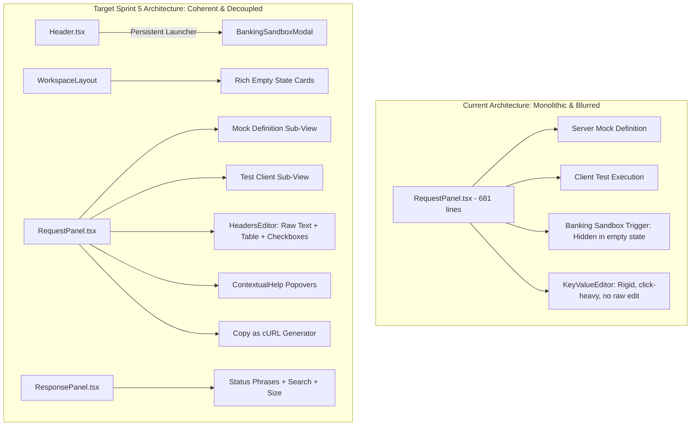
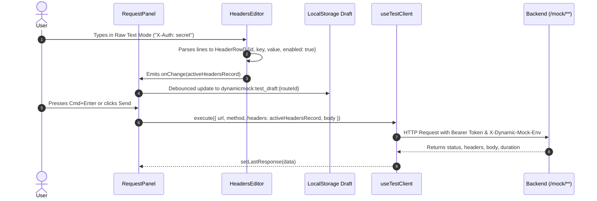
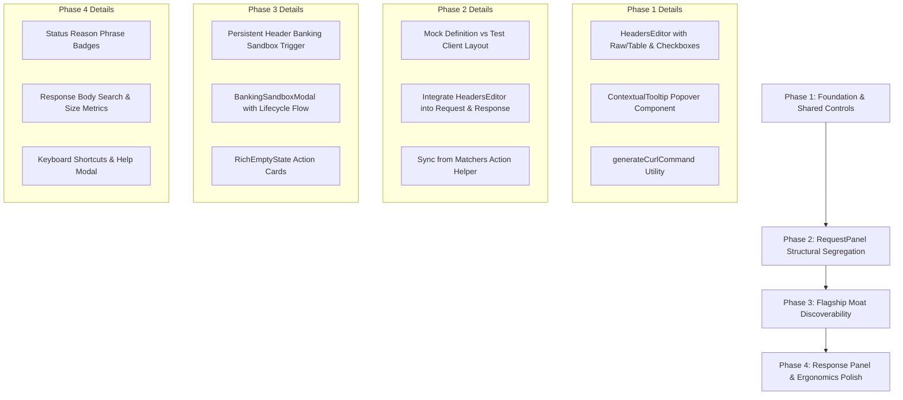

# Sprint 5 Architecture Review
## First-Time User Experience & Workspace Productivity

**Document Version**: 1.0  
**Date**: 2026-10-17  
**Status**: ARCHITECTURE APPROVED WITH ADJUSTMENTS  
**Reviewing**: `SPRINT_05_UX_DISCOVERY.md` proposed architecture and backlog  
**Governing Documents**: 
- `AI_GOVERNANCE.md` (Productization, Feature Completion, Differentiation Rules)
- `ROADMAP_AUTHORITY.md` (Strategic Priority & Roadmap Integrity)
- `MASTER_PRODUCT_ACTION_PLAN.md` (Core Moats & Competitive Scoring)
- `MASTER_PRODUCT_ACTION_PLAN_REVIEW.md` ("Ship the moat. Package it as an experience. Then defend it.")

---

## 1. Executive Review & Architectural Verdict

The UX backlog proposed in `SPRINT_05_UX_DISCOVERY.md` is **architecturally approved with strategic adjustments**.

The discovery document correctly diagnosed that the platform's primary bottleneck to enterprise adoption is not backend horsepower, but **interaction ergonomics, conceptual opacity, and discoverability failure of our core banking moat**.



### Architectural Verdict
* **Strategic Alignment**: **PASS**. Fully aligns with `MASTER_PRODUCT_ACTION_PLAN_REVIEW.md` Recommendation B ("Package the moat as an experience") and `AI_GOVERNANCE.md` Productization Rule.
* **Component Architecture**: **APPROVED WITH REFACTORING**. The current monolithic `RequestPanel.tsx` (681 lines) manages 13 distinct pieces of state and conflates server route configuration with client test execution. A modular decomposition is required.
* **Data Model & Schema Impact**: **ZERO BACKEND REGRESSION**. All changes are localized to frontend components, contexts, and client-side draft stores. No database migrations, MongoDB document schema alterations, or Spring Boot REST API modifications are required.
* **Scope Boundary**: **STRICTLY ENFORCED**. P0 deliverables are capped at 25 Story Points. P1 features (e.g., Command Palette, Interactive Product Tour) are preserved as stretch goals and must not delay core ergonomics.

---

## 2. Scope & Risk Analysis

### 2.1 Scope Issues Identified
1. **The "Headers" Tab Category Error**: In the current codebase (`RequestPanel.tsx:324-346`), the `Headers` tab contains both *Request Headers (Sent with Test Request)* and *Response Headers (Returned by Mock)*, alongside *Response Status Code*. This is an architectural category error. The test client's outgoing headers and the mock server's returned headers serve opposite roles in the HTTP transaction. They must be physically segregated.
2. **Missing Matcher Diagnostics**: When a user configures a Matcher (e.g., `X-Correlation-Id: abc`) and fires a test request without that header, the engine returns `404 {"error":"Request does not match route matchers"}`. Without an in-context explanation, users assume the mock server is broken. A diagnostic helper is required.
3. **Empty State Vulnerability**: The current empty state (`RequestPanel.tsx:207-229`) is the *only* place the Banking Sandbox is exposed. Once any route exists, the sandbox trigger unmounts permanently. Discoverability must not be coupled to workspace empty states.

### 2.2 Over-Engineering Risks

| Feature | Over-Engineering Risk | Architectural Ruling |
|---|---|---|
| **Raw Headers Editor** | Writing an AST-based HTTP parser or bundling heavy text parsing libraries. | **REJECT AST PARSER**. A pure, deterministic line-by-line regex parser (`/^(.*?):[ \t]*(.*)$/`) in a controlled textarea is completely sufficient and executes in < 1ms. |
| **Command Palette** | Building a full modal action system with fuzzy matching, submenus, and async action dispatching. | **DEFER TO P1**. Cmd+K route search already exists in `Header.tsx`. Extending it into an action launcher is valuable, but must not cannibalize P0 sprint capacity. |
| **Guided Product Tour** | Bundling external multi-megabyte tour libraries (e.g. Shepherd.js, intro.js) with complex DOM overlay hooks. | **DEFER EXTERNAL LIBS**. Prioritize permanent, contextual `ContextualHelp` (ⓘ) popovers and rich empty state action cards first. If a tour is built, implement a lightweight, self-contained 4-step modal tour. |
| **Mock vs Test Separation** | Splitting the workspace into completely different Next.js route paths (e.g., `/stubs` vs `/test-runner`). | **REJECT ROUTE SPLITTING**. Page transitions cause unnecessary unmounting, flash of content, and draft sync overhead. Implement as a cleanly segregated sub-view or segmented control within `RequestPanel.tsx`. |

### 2.3 Missing Requirements Discovered During Review
1. **"Populate Test Client from Matchers" Action**: When an engineer configures matchers on a route, they should not have to manually re-type those exact same keys and values into the Test Client runner. An action button *"Fill from Matchers"* must be added to instantly populate the test request with required headers/params.
2. **Header Row Checkbox State Persistence**: If a user disables a header via a checkbox, that header must be omitted from `handleSend` and `handleSave`, but **must remain stored in the local test draft** so the user can re-enable it without re-typing.
3. **HTTP Status Code Mapping**: `ResponsePanel.tsx` displays raw numeric status (`200`, `404`, `500`). It must map status codes to standard HTTP/1.1 reason phrases (e.g., `200 OK`, `201 Created`, `400 Bad Request`, `404 Not Found`, `502 Bad Gateway`).

---

## 3. Component Architecture & UI Hierarchy

### 3.1 Structural Component Hierarchy (Target State)

```
frontend/src/
├── components/
│   └── workspace/
│       ├── Header.tsx                          [UPDATED: Persistent Banking Sandbox trigger, Help & Shortcuts action]
│       ├── Sidebar.tsx                         [UPDATED: Quickstart Sandbox item, clear route count indicator]
│       ├── RequestPanel.tsx                    [REFACTORED: Orchestrator for Mock Definition & Test Client]
│       │   ├── MockDefinitionView.tsx          [NEW: Matchers, Response Headers/Status, Templates, Polyglot Scripts]
│       │   └── TestClientView.tsx              [NEW: Test URL bar, Send action, Query Params, Request Headers, cURL export]
│       ├── HeadersEditor.tsx                   [NEW: Reusable Key-Value Table + Raw Multiline Text + Checkbox Toggles]
│       ├── ContextualTooltip.tsx               [NEW: Accessible ⓘ Popover with syntax hints and doc links]
│       ├── ResponsePanel.tsx                   [UPDATED: Status reason phrases, payload search, copy response cURL]
│       ├── RichEmptyState.tsx                  [NEW: Four interactive onboarding cards when activeRoute == null]
│       ├── BankingSandboxModal.tsx             [NEW: Interactive modal with scenario diagram & 1-click execution]
│       └── KeyboardShortcutsModal.tsx          [NEW: Accessible cheat-sheet modal for workspace hotkeys]
```

### 3.2 Detailed Component Impacts

#### `Header.tsx`
* **Changes**:
  - Add a dedicated, highly visible **"Banking Sandbox"** button with a landmark icon (`Landmark` from `lucide-react`) in the top navigation bar. Clicking opens `BankingSandboxModal`.
  - Add a **"Help & Shortcuts"** icon button (`HelpCircle`) next to the theme toggle.
  - Preserve `Cmd+K` route search without regression.

#### `Sidebar.tsx`
* **Changes**:
  - Add a persistent "Banking Sandbox (Reference)" pinned entry at the top of the collection list or under an "Explore Scenarios" section.
  - Highlight active routes and show match count badges if applicable.

#### `RequestPanel.tsx` (Core Decomposition)
* **Current Violation**: Single file handles draft persistence, URL manipulation, route save mutation, test execution, tab switching, and inline rendering of 3 separate table editors.
* **Refactoring Plan**:
  - `RequestPanel.tsx` acts as the coordinator maintaining shared route context.
  - Divide the UI into two unambiguous sections:
    1. **Top Section (Test Execution Bar)**: Method selector, Test URL input, Send button, "Copy as cURL" button, and test draft status.
    2. **Bottom Section (Tabbed Configuration)**:
       - Tab 1: **Test Request** (`Params`, `Headers`, `Body`) — Client runner scope.
       - Tab 2: **Mock Definition** (`Matchers`, `Response Headers & Status`, `Response Body Template`, `Scripts`) — Server stub scope.
  - Each tab embeds `ContextualTooltip` to immediately clarify its execution scope.

#### `ResponsePanel.tsx`
* **Changes**:
  - Add HTTP status reason phrase badge next to status code (`200 OK`, `404 Not Found`).
  - Add "Copy as cURL" replay button.
  - Add payload size calculation (`JSON.stringify(body).length` formatted as B / KB).
  - Add a filter input inside the body viewer to search within response JSON keys and values.

---

## 4. State Management & Draft Persistence Architecture

### 4.1 State Flow Diagram



### 4.2 State Schema Specifications

#### A. Internal `HeaderRow` Representation
To support checkboxes without breaking `Record<string, string>` backward compatibility, the editor maintains an internal structured row state:

```typescript
export interface HeaderRow {
  id: string;
  key: string;
  value: string;
  enabled: boolean;
}
```

* **Serialization to API**:
  ```typescript
  export function toHeaderRecord(rows: HeaderRow[]): Record<string, string> {
    const record: Record<string, string> = {};
    for (const row of rows) {
      if (row.enabled && row.key.trim()) {
        record[row.key.trim()] = row.value;
      }
    }
    return record;
  }
  ```
* **Parsing from Raw Text**:
  ```typescript
  export function parseRawHeaders(raw: string): HeaderRow[] {
    return raw
      .split('\n')
      .filter(line => line.trim().length > 0)
      .map((line, idx) => {
        const colonIndex = line.indexOf(':');
        if (colonIndex === -1) {
          return { id: `row-${idx}`, key: line.trim(), value: '', enabled: true };
        }
        return {
          id: `row-${idx}`,
          key: line.slice(0, colonIndex).trim(),
          value: line.slice(colonIndex + 1).trim(),
          enabled: true
        };
      });
  }
  ```

#### B. LocalStorage Test Draft Schema (`dynamicmock:test_draft:{routeId}`)
The existing storage schema established in post-v0.4.0 maintenance is preserved and backwards-compatible:

```typescript
export interface TestRequestDraft {
  requestHeaders: Record<string, string>;          // Backwards-compatible enabled headers
  headerRows?: HeaderRow[];                         // Sprint 5 additions preserving disabled states
  queryParams: Record<string, string>;
  requestBodyType: 'none' | 'json' | 'form' | 'raw';
  requestBodyContent: string;
  updatedAt: number;
}
```

> [!NOTE]
> When hydrating from `localStorage`, if `headerRows` exists, it is loaded into the editor. If only legacy `requestHeaders` exists, it is converted on-the-fly via `Object.entries(draft.requestHeaders).map(([key, value]) => ({ id, key, value, enabled: true }))`. This guarantees 100% backward compatibility.

---

## 5. Deep Dives on Priority Subsystems

### 5.1 Banking Sandbox Discoverability & Lifecycle Modal
* **Problem**: The Banking Sandbox is our #1 sales asset and core technical moat, but exists only as an unstyled button rendered when `!activeRoute`. Once an active route is loaded, it is impossible to find.
* **Architectural Solution**:
  1. **Persistent Header Button**: `Header.tsx` renders a prominent `Banking Sandbox` button with a `Landmark` icon and a "Moat Demo" badge.
  2. **Dedicated Modal (`BankingSandboxModal.tsx`)**:
     - Visual diagram of the pre-configured financial lifecycle:
       `0100 Authorization` → `0200 Capture` → `0400 Reversal` → `Redis State Inspector`.
     - Displays live status: indicates whether sandbox routes are currently present in MongoDB.
     - Action 1: **"Load / Reset Banking Sandbox"** (Calls `POST /api/sandbox/load`).
     - Action 2: **"Run Automated Lifecycle Demo"** (Executes the 0100 → 0200 → 0400 sequence in order and streams the real-time responses).
     - Action 3: **"Open Documentation & Walkthrough"** (Links to tutorial documentation).

### 5.2 Raw / Bulk Headers Editor Architecture
* **Problem**: Adding headers via discrete `<input>` fields requires excessive mouse clicks and prevents pasting headers from browser DevTools, Burp Suite, or cURL commands.
* **Architectural Solution**:
  - `HeadersEditor.tsx` provides a seamless segmented toggle:
    - **[Table View]**: Individual key, value inputs with drag/delete and active/inactive checkboxes.
    - **[Raw Text View]**: Multiline `<textarea>` displaying headers formatted as `Key: Value`.
  - **Bi-Directional Synchronization**:
    - Switching from Table to Raw: Formats enabled rows as `Key: Value` text.
    - Switching from Raw to Table: Parses multiline text into `HeaderRow[]`.
    - Typing in Raw Mode debounces emissions to parent state to avoid UI lag.
  - **Autocomplete Support**: In Table View, typing in the Key field provides native datalist suggestions for standard HTTP headers (`Authorization`, `Content-Type`, `Accept`, `X-Correlation-Id`, `If-Match`, etc.).

### 5.3 Mock Stub vs Test Runner Segregation
* **Problem**: Flat 6-tab navigation causes cognitive overload. Users do not understand whether a tab configures the mock server's behavior or configures the client's test request.
* **Architectural Solution**:
  - Segregate into two explicitly labelled domains:

```
┌─────────────────────────────────────────────────────────────────────────────┐
│ METHOD [POST]  URL [{{BASE_URL}}/api/v1/payments]   [Send ▶] [Copy cURL 📋] │
├─────────────────────────────────────────────────────────────────────────────┤
│  [TEST CLIENT RUNNER]                       [MOCK STUB CONFIGURATION]       │
│  ├── Query Params (3)                       ├── Request Matchers (2) ⓘ     │
│  ├── Request Headers (4) [Raw/Table]        ├── Response Status & Headers   │
│  └── Request Body (JSON)                    ├── Response Body (Handlebars)  │
│                                             └── Polyglot Scripts (JS/Python)│
└─────────────────────────────────────────────────────────────────────────────┘
```

  - **Visual Distinctiveness**: The Test Client uses an active "execution" theme (blue/emerald accents), while Mock Stub Configuration uses a "definition" theme (purple/slate accents).
  - **"Populate Test from Matchers" Helper**: An inline button in the Matchers card allows users to copy all required matcher headers and query parameters directly into the Test Client draft, eliminating 404 mismatches.

### 5.4 Contextual Help & Semantic Tooltip System
* **Problem**: New users do not understand Matcher mechanics, GraalVM script execution contexts, or Handlebars template functions.
* **Architectural Solution**:
  - Create a lightweight `ContextualTooltip.tsx` utilizing Radix UI Popover / Tooltip or accessible Tailwind CSS hover popovers.
  - **Semantic Definitions**:
    - *Matchers*: *"Rules that incoming requests must satisfy to trigger this mock. If a request does not meet all matchers, the engine returns a 404 mismatch error."*
    - *Request Headers*: *"Headers sent by Dynamic Mock's built-in test client when you click Send. Does not alter server response rules."*
    - *Response Headers*: *"Headers returned by the mock server to calling clients."*
    - *Scripts*: *"Pre-request and post-response logic executed via GraalVM polyglot engine (JavaScript/Python). Has access to `context`, `request`, and `state`."*
    - *Response Body*: *"Dynamic template supporting Handlebars helpers: `{{random.uuid}}`, `{{now 'yyyy-MM-dd'}}`, `{{state.variable}}`."*

### 5.5 "Copy as cURL" Generation Engine
* **Architectural Implementation**:
  - Pure utility function `generateCurlCommand(options: CurlOptions): string`:
    ```typescript
    export function generateCurlCommand({ method, url, headers, body }: CurlOptions): string {
      const parts = ['curl -X ' + method];
      for (const [k, v] of Object.entries(headers)) {
        parts.push(`-H "${k}: ${v.replace(/"/g, '\\"')}"`);
      }
      if (body && method !== 'GET' && method !== 'HEAD') {
        parts.push(`--data '${body.replace(/'/g, "'\\''")}'`);
      }
      parts.push(`"${url}"`);
      return parts.join(' \\\n  ');
    }
    ```
  - Added to:
    1. `RequestPanel.tsx` (next to the `Send` button).
    2. `ResponsePanel.tsx` (copies the cURL command used to generate the response).
  - Handles clipboard permissions with fallback textarea for non-HTTPS dev environments.

### 5.6 Rich Empty State Architecture
* **Problem**: When no route is selected, the user sees a barren screen with an uninformative prompt.
* **Architectural Solution**:
  - Implement `RichEmptyState.tsx` presenting four prominent cards:
    1. **Reference Banking Sandbox (Flagship)**: Icon, description of ISO8583 0100/0200/0400 flow, "Launch Sandbox" button.
    2. **Create REST Mock Stub**: One-click prompt to create a standard `GET /hello` mock.
    3. **Import OpenAPI / Postman**: Opens the existing `ImportModal`.
    4. **Simulate ISO8583 / Financial Protocol**: Opens the protocol editor or simulator view.

---

## 6. Backward Compatibility & Data Integrity Contract

| Layer | Compatibility Assessment | Risk Level |
|---|---|:---:|
| **MongoDB Document Entities** | **Zero changes**. `MockRoute.java`, `Scenario.java`, `User.java` remain completely unmodified. | **ZERO** |
| **REST API Contracts** | `/api/routes/**`, `/api/sandbox/load`, `/api/auth/**`, `/mock/**` contracts remain identical. | **ZERO** |
| **LocalStorage Test Drafts** | Schema extended with optional `headerRows`. Old drafts automatically migrate upon parse. | **LOW** |
| **Active Route Selection** | Restoring `dynamicmock:active_route_id` on page reload is preserved without regressions. | **ZERO** |
| **Theme & Environment State** | `WorkspaceContext` preserves all existing environment variables and panel layout modes. | **ZERO** |

---

## 7. Accessibility (a11y) & Usability Standards

To ensure enterprise accessibility compliance (WCAG 2.1 AA):
1. **Contextual Help Icons**: All `ⓘ` buttons must include `aria-label="Help: [Topic]"` and be focusable via `Tab`. Pressing `Enter` or `Space` must open the popover; `Escape` must close it.
2. **Keyboard Shortcuts**:
   - `Cmd+Enter` / `Ctrl+Enter` triggers `handleSend`.
   - `Cmd+S` / `Ctrl+S` triggers `handleSave`.
   - Shortcuts must not trigger if the user is typing within Monaco / CodeEditor without modifier keys.
   - A visible "Shortcuts" modal (`?` hotkey) must document all available key combinations.
3. **Color Contrast**:
   - HTTP status badges (`200 OK` in green, `404 Not Found` in red/amber) must maintain minimum 4.5:1 contrast against both light and dark panel backgrounds.
   - Tooltip text must use high-contrast foreground tokens (`text-foreground`).
4. **Headers Editor Checkboxes**: Checkbox inputs must be wrapped in semantic `<label>` elements with clear focus outlines (`focus-visible:ring-2`).

---

## 8. Implementation Sequencing & Dependency Phasing

The implementation must proceed in four distinct, verifiable phases to prevent regressions:



### Phase 1: Shared Controls & Foundation (Effort: 7 SP)
- Implement `HeadersEditor.tsx` (Table + Raw Text modes, checkbox toggles, autocomplete).
- Implement `ContextualTooltip.tsx` (Accessible hover/focus popovers).
- Implement `generateCurlCommand` utility with unit tests.

### Phase 2: RequestPanel Structural Segregation (Effort: 8 SP)
- Refactor `RequestPanel.tsx` to cleanly segregate Mock Stub Definition from Test Client Runner.
- Replace legacy `KeyValueEditor` with `HeadersEditor`.
- Implement "Populate Test from Matchers" helper button.
- Attach contextual tooltips to all 6 configuration sections.

### Phase 3: Flagship Moat Discoverability (Effort: 6 SP)
- Add persistent "Banking Sandbox" button to `Header.tsx`.
- Implement `BankingSandboxModal.tsx` with lifecycle visualization and execution triggers.
- Implement `RichEmptyState.tsx` with 4 interactive onboarding cards.

### Phase 4: Response Panel & Ergonomics Polish (Effort: 4 SP)
- Add HTTP reason phrases (`200 OK`, `404 Not Found`) and size indicators to `ResponsePanel.tsx`.
- Add response payload search/filtering.
- Bind `Cmd+Enter` (Send) and `Cmd+S` (Save) shortcuts.
- Implement `KeyboardShortcutsModal.tsx`.

---

## 9. Architectural Sign-Off & Approval Conditions

### Approval Conditions
1. **No Backend Modifications**: Sprint 5 implementation must not modify any Java backend files or database schemas.
2. **Backward Compatibility**: Existing saved routes and local storage test drafts must continue to load without data loss.
3. **Performance Budget**: Raw headers parsing and syntax highlighting must execute in under 16ms (60 FPS UI frame budget) for payloads up to 100 headers.
4. **Scope Discipline**: P0 backlog items (25 Story Points total) must be completed and audited before any P1 items (Command Palette, Guided Tour) are initiated.

### Summary
The architecture review concludes that **Sprint 5: First-Time User Experience & Workspace Productivity** resolves the critical product-market bottleneck identified in post-v0.4.0 QA. By packaging our core banking moat as an intuitive, high-velocity developer experience, Sprint 5 prepares the platform for enterprise evaluation and creates a seamless foundation for Sprint 6 White-Labeling.

**Status**: **APPROVED TO PROCEED TO IMPLEMENTATION PLANNING**.
