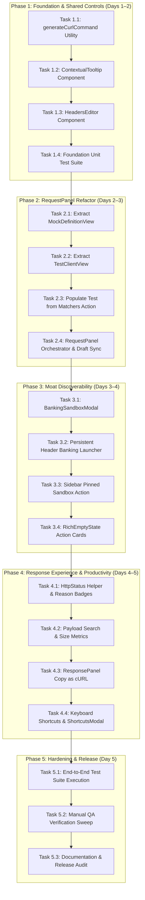
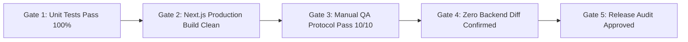

# Sprint 5 Implementation Plan
## First-Time User Experience & Workspace Productivity

**Document Version**: 1.0  
**Date**: 2026-10-17  
**Status**: APPROVED IMPLEMENTATION PLAN  
**Source Documents**:
- `SPRINT_05_UX_DISCOVERY.md`
- `SPRINT_05_ARCHITECTURE_REVIEW.md`  
**Governing Documents**: 
- `AI_GOVERNANCE.md` (Productization, Feature Completion, Differentiation Rules)
- `ROADMAP_AUTHORITY.md` (Strategic Priority & Roadmap Integrity)
- `MASTER_PRODUCT_ACTION_PLAN.md` (Moats & Differentiating Architecture)
- `MASTER_PRODUCT_ACTION_PLAN_REVIEW.md` ("Ship the moat. Package it as an experience. Then defend it.")

---

## 1. Executive Summary

### 1.1 Objective
Convert the architectural decisions approved in `SPRINT_05_ARCHITECTURE_REVIEW.md` into an actionable, file-level, step-by-step engineering roadmap for Sprint 5.

Sprint 5 eliminates the critical friction points identified during post-v0.4.0 manual QA. While Sprints 1 through 4 delivered world-class backend capabilities (ISO8583 engine, stateful simulation, reference banking sandbox, and JWT authentication), Sprint 5 transforms those capabilities into a frictionless, commercial-grade developer workbench.

Upon completion of Sprint 5:
1. **Developer Velocity Multiplied**: A modern `HeadersEditor` allows engineers to paste multiline headers directly from browser DevTools, Burp Suite, or cURL commands, toggle headers via checkboxes, and auto-complete common HTTP headers.
2. **Moat Discoverability Unlocked**: The Reference Banking Sandbox is elevated from a buried zero-state button into a permanent top-tier feature in the Header and Sidebar, backed by an interactive `BankingSandboxModal` displaying the ISO8583 transaction lifecycle.
3. **Conceptual Opacity Eliminated**: The monolithic `RequestPanel` is refactored into a clear, segregated interaction model: **Test Client Runner** (client execution) vs. **Mock Stub Configuration** (server rules), augmented by contextual `ContextualTooltip` (ⓘ) popovers and a *"Populate Test from Matchers"* shortcut.
4. **Testing Productivity Polished**: The workspace gains one-click "Copy as cURL" actions, HTTP status code reason phrases (`200 OK`, `404 Not Found`), payload size calculations, in-viewer JSON search, and standard keyboard shortcuts (`Cmd+Enter`, `Cmd+S`, `?` cheatsheet).
5. **Zero Backend Regression**: All enhancements execute within the frontend client layer without requiring MongoDB migrations or Spring Boot API changes.

---

## 2. Architecture Compliance Verification

In strict accordance with `AI_GOVERNANCE.md` and `SPRINT_05_ARCHITECTURE_REVIEW.md`, this plan enforces the following architectural invariants:

| Architecture Decision | Approved Specification | Implementation Constraint |
|---|---|---|
| **ADR-1: Regex-Based Raw Headers Parser** | Line-by-line regex parser (`/^(.*?):[ \t]*(.*)$/`) | No AST parsers or heavy external parsing libraries. Parsing must execute in `< 1ms`. |
| **ADR-2: Sub-Component RequestPanel Decomposition** | Segmented Sub-Views (`TestClientView`, `MockDefinitionView`) within `RequestPanel.tsx` | No route-splitting or Next.js page transitions that cause page reload overhead or state disruption. |
| **ADR-3: Backward-Compatible Draft Schema** | Optional `headerRows?: HeaderRow[]` added to `dynamicmock:test_draft:{routeId}` | Legacy drafts containing plain `Record<string, string>` must seamlessly migrate on load without errors. |
| **ADR-4: Persistent Sandbox Accessibility** | Dedicated `Landmark` action in `Header.tsx` and pinned entry in `Sidebar.tsx` | The Banking Sandbox launcher must be accessible at all times, independent of whether routes exist. |
| **ADR-5: In-Memory / Accessible Tooltips** | Native Radix/Tailwind CSS popovers with ARIA compliance (`role="tooltip"`, `aria-label`) | Accessible via keyboard (`Tab`, `Enter`, `Escape`). Minimalist, subtle design to avoid UI clutter. |
| **ADR-6: Pure Utility cURL Generator** | Pure functional module `frontend/src/lib/curl.ts` | Fully tested with quote escaping, multi-line formatting, and clipboard fallback for non-HTTPS dev setups. |
| **ADR-7: Zero Backend API Modifications** | Frontend-only scope | Zero Java code changes, zero Spring Security modifications, zero MongoDB schema changes. |

---

## 3. Scope Boundaries

Sprint 5 encompasses the complete P0 backlog defined in the architecture review (25 Story Points):

1. **Shared Foundation Controls**: `HeadersEditor` (Raw multiline text + Table + Checkboxes), `ContextualTooltip` (Accessible ⓘ Popover), and `generateCurlCommand` utility.
2. **RequestPanel Architecture Refactor**: Structural segregation of **Test Client Runner** and **Mock Stub Configuration**, integration of `HeadersEditor`, and *"Populate Test from Matchers"* helper.
3. **Flagship Moat Discoverability**: Persistent Header action, Sidebar pinned entry, interactive `BankingSandboxModal`, and `RichEmptyState` cards.
4. **Response Experience Polish**: HTTP status reason phrase badges, response size indicator, JSON payload search filter, and "Copy Response as cURL".
5. **Productivity Hotkeys**: `Cmd+Enter` (Send), `Cmd+S` (Save), and `KeyboardShortcutsModal` (`?`).

---

## 4. Out-of-Scope Items

The following items are **strictly out of scope** for Sprint 5:

- **Command Palette (`Cmd+K` Action Launcher)**: Deferred to Sprint 6 (P1). The existing `Cmd+K` route filter in `Header.tsx` remains untouched.
- **External Multi-Step Guided Tour (Shepherd/Driver.js)**: Deferred to Sprint 6. Contextual tooltips and rich empty states provide sufficient onboarding without third-party library bloat.
- **White-Labeling & Runtime Theming**: Scheduled for Sprint 6 per roadmap sequence.
- **Role-Based Access Control (RBAC) & SAML/OIDC**: Deferred to enterprise phase.
- **Backend Protocol Engine Modifications**: No changes to jPOS, GraalVM runtime, or Redis state machine.

---

## 5. Phase Breakdown & Execution Sequence



---

## 6. Detailed Task Specifications

### Phase 1: Foundation & Shared Controls

#### Task 1.1: Implement `generateCurlCommand` Utility & Unit Tests
- **Target Files**:
  - `frontend/src/lib/curl.ts` (NEW)
  - `frontend/src/lib/curl.test.ts` (NEW)
- **Modified Files**: None.
- **Prerequisites**: None.
- **Implementation Requirements**:
  1. Define `CurlOptions` interface: `{ method: string; url: string; headers?: Record<string, string>; body?: string }`.
  2. Escape special characters: single quotes in body payload (`'\''`), double quotes in header values.
  3. Format output across multiple lines with trailing backslashes (`\`) for readability.
  4. Omit `--data` flag for `GET` and `HEAD` methods.
  5. Provide a clipboard copy helper with fallback for non-HTTPS environments (`document.execCommand('copy')`).
- **Acceptance Criteria**:
  - Emits valid, terminal-executable cURL syntax for all HTTP methods.
  - Correctly escapes quotes and nested JSON payloads.
  - 100% test coverage in `curl.test.ts`.
- **Risks**: Malformed multi-line body strings breaking terminal execution.
- **Verification Steps**:
  - Run `npm test -- src/lib/curl.test.ts`.
  - Validate output string by pasting into terminal against local mock server.

#### Task 1.2: Implement `ContextualTooltip` Accessible Popover Component
- **Target Files**:
  - `frontend/src/components/workspace/ContextualTooltip.tsx` (NEW)
  - `frontend/src/components/workspace/ContextualTooltip.test.tsx` (NEW)
- **Modified Files**: None.
- **Prerequisites**: None.
- **Implementation Requirements**:
  1. Render a subtle `ⓘ` icon (`HelpCircle` from `lucide-react`) with customizable styling.
  2. Support hover and click triggers with automatic outside-click dismissal.
  3. Props: `title: string`, `description: string`, `syntaxExample?: string`, `docLink?: string`, `side?: 'top' | 'right' | 'bottom' | 'left'`.
  4. Keyboard accessibility: Focusable via `Tab`, toggleable via `Enter` or `Space`, dismissible via `Escape`.
  5. Set `role="tooltip"`, `aria-label`, and `aria-expanded` attributes.
- **Acceptance Criteria**:
  - Renders cleanly in both dark and light modes.
  - Accessible via keyboard without mouse interaction.
  - Passing unit tests in `ContextualTooltip.test.tsx`.
- **Risks**: Z-index stacking collisions with Monaco editor overlays.
- **Verification Steps**:
  - Run `npm test -- src/components/workspace/ContextualTooltip.test.tsx`.
  - Test keyboard navigation (`Tab` -> `Space` -> `Escape`).

#### Task 1.3: Implement `HeadersEditor` Component with Raw/Table Sync & Checkboxes
- **Target Files**:
  - `frontend/src/components/workspace/HeadersEditor.tsx` (NEW)
  - `frontend/src/components/workspace/HeadersEditor.test.tsx` (NEW)
- **Modified Files**: None.
- **Prerequisites**: Task 1.2 (`ContextualTooltip`).
- **Implementation Requirements**:
  1. Internal state manages `HeaderRow[] = Array<{ id: string; key: string; value: string; enabled: boolean }>`.
  2. **Table Mode**:
     - Checkbox toggle for each row (enables/disables without deleting).
     - Key and Value input fields with auto-grow behavior.
     - Datalist autocomplete for standard HTTP headers (`Authorization`, `Content-Type`, `Accept`, `X-Correlation-Id`, `Cache-Control`, etc.).
     - Delete button (`Trash2`) and "Add Row" button.
  3. **Raw Multiline Text Mode**:
     - Controlled `<textarea>` with monospace font.
     - Bi-directional sync: formats enabled rows to `Key: Value\n`; parses multiline text into `HeaderRow[]`.
     - Deterministic regex parser: `/^(.*?):[ \t]*(.*)$/`. Lines without colons treated as key with empty value.
  4. **Emissions**:
     - `onChange(entries: Record<string, string>, rows: HeaderRow[])`: Emits only enabled key-value pairs for API calls while passing the full `HeaderRow[]` for draft persistence.
- **Acceptance Criteria**:
  - Pasting 20 lines of headers from DevTools into Raw mode immediately populates the Table mode.
  - Unchecking a row excludes it from the emitted `Record<string, string>`, but keeps it visible.
  - Passing unit tests in `HeadersEditor.test.tsx`.
- **Risks**: Infinite re-render loop between raw text state and row array state during rapid typing.
- **Verification Steps**:
  - Run `npm test -- src/components/workspace/HeadersEditor.test.tsx`.
  - Test rapid typing and view switching in browser.

#### Task 1.4: Foundation Unit Test Suite Execution
- **Target Files**: All Phase 1 test files.
- **Prerequisites**: Tasks 1.1, 1.2, 1.3.
- **Implementation Requirements**:
  - Run full test suite for Phase 1.
  - Verify zero test failures and zero lint warnings.
- **Acceptance Criteria**:
  - All tests pass: `npm test`.

---

### Phase 2: RequestPanel Structural Refactor

#### Task 2.1: Extract `MockDefinitionView` Component
- **Target Files**:
  - `frontend/src/components/workspace/MockDefinitionView.tsx` (NEW)
- **Modified Files**: None.
- **Prerequisites**: Task 1.2, Task 1.3.
- **Implementation Requirements**:
  1. Encapsulate Mock Server Configuration into dedicated sections:
     - **Request Matchers Card**: Headers matchers (`HeadersEditor`), Query Params matchers (`HeadersEditor`), and Body Matchers (`equals`, `contains`, `regex`, `jsonpath`, `xpath`). Embedded with `ContextualTooltip`.
     - **Response Status & Headers Card**: Numeric status code input with reason badge, and Response Headers (`HeadersEditor`).
     - **Response Body Card**: Handlebars response template editor (`CodeEditor`) with quick helper badges (`{{random.uuid}}`, `{{now}}`).
     - **Polyglot Scripts Card**: Monaco editor for JavaScript/Python scripts with GraalVM context guide.
  2. Embed *"Populate Test Client from Matchers"* action button in the Matchers card header.
- **Acceptance Criteria**:
  - Renders all server stub configuration parameters cleanly.
  - Emits updates via callbacks to parent `RequestPanel`.
- **Risks**: Prop drilling or state desynchronization with `activeRoute`.
- **Verification Steps**:
  - Verify route configuration saves correctly to MongoDB via `updateRoute`.

#### Task 2.2: Extract `TestClientView` Component
- **Target Files**:
  - `frontend/src/components/workspace/TestClientView.tsx` (NEW)
- **Modified Files**: None.
- **Prerequisites**: Task 1.1, Task 1.3.
- **Implementation Requirements**:
  1. Encapsulate Test Execution Client into dedicated tabs:
     - **Params Tab**: Query parameters (`HeadersEditor`).
     - **Headers Tab**: Outgoing test request headers (`HeadersEditor` with Raw toggle and checkboxes).
     - **Body Tab**: Test request body (selector: `none`, `json`, `form`, `raw`; `CodeEditor`).
  2. Include "Copy as cURL" button calling `generateCurlCommand`.
- **Acceptance Criteria**:
  - Constructing test params, headers, and body passes payload directly to `execute(...)`.
  - Copy cURL button copies exact command including headers and body.
- **Risks**: Omitting active environment variables (`X-Dynamic-Mock-Env`).
- **Verification Steps**:
  - Inspect outgoing network payload in browser DevTools when clicking Send.

#### Task 2.3: Implement "Populate Test from Matchers" Action
- **Target Files**:
  - `frontend/src/components/workspace/MockDefinitionView.tsx`
  - `frontend/src/components/workspace/RequestPanel.tsx`
- **Prerequisites**: Tasks 2.1, 2.2.
- **Implementation Requirements**:
  1. Add a button in the Matchers card: *"Fill Test Request from Matchers"*.
  2. On click:
     - Copy `matchers.headers` into `requestHeaders` and `headerRows`.
     - Copy `matchers.queryParams` into `queryParams`.
     - If `matchers.bodyMatchType === 'equals'` or `contains`, populate `requestBodyContent`.
     - Trigger toast notification via Sonner: *"Test request updated with matcher criteria"*.
- **Acceptance Criteria**:
  - Instantly populates the test client with all matching criteria, preventing 404 mismatch errors.
- **Risks**: Overwriting existing user drafts without confirmation. Provide subtle prompt or undo if non-empty.
- **Verification Steps**:
  - Create a route with matchers, click the button, switch to Test Client, and verify populated fields.

#### Task 2.4: Refactor `RequestPanel.tsx` Orchestrator with Segmented View
- **Target Files**:
  - `frontend/src/components/workspace/RequestPanel.tsx` (MODIFIED)
- **Prerequisites**: Tasks 2.1, 2.2, 2.3.
- **Implementation Requirements**:
  1. Replace the flat 6-tab navigation (`params`, `headers`, `request-body`, `matchers`, `body`, `scripts`) with a high-level segmented control:
     - **[Test Client Runner]** (Active execution focus)
     - **[Mock Definition]** (Server rule configuration)
  2. Maintain persistent top bar:
     - Method selector (`GET`, `POST`, `PUT`, etc.).
     - Target URL bar (`{{BASE_URL}}/path`).
     - Action buttons: `Send ▶`, `Save 💾`, `Copy cURL 📋`.
  3. Preserve localStorage draft persistence (`dynamicmock:test_draft:{routeId}`) with backward compatibility for `headerRows`.
  4. Reduce `RequestPanel.tsx` complexity from 681 lines to < 250 lines by delegating to `MockDefinitionView` and `TestClientView`.
- **Acceptance Criteria**:
  - Clean visual separation between client testing and server definition.
  - All existing routes and drafts load seamlessly without regressions.
- **Risks**: Breaking draft hydration from `localStorage`.
- **Verification Steps**:
  - Refresh browser on multiple routes; verify test drafts persist intact.
  - Run existing test: `npm test -- src/components/workspace/DraftPersistence.test.ts`.

---

### Phase 3: Moat Discoverability & Onboarding

#### Task 3.1: Implement `BankingSandboxModal` Component
- **Target Files**:
  - `frontend/src/components/workspace/BankingSandboxModal.tsx` (NEW)
  - `frontend/src/components/workspace/BankingSandboxModal.test.tsx` (NEW)
- **Modified Files**: None.
- **Prerequisites**: None.
- **Implementation Requirements**:
  1. Modal dialog rendered via `DialogContext` or standard accessible portal.
  2. **Header**: "Reference Banking Sandbox — 5-Minute Financial Quickstart".
  3. **Visual Architecture Diagram**:
     - Step 1: `0100 Authorization` (Reserve funds, STAN generation).
     - Step 2: `0200 Financial Presentment / Capture` (Finalize settlement).
     - Step 3: `0400 Acquirer Reversal` (Unwind authorization).
     - Step 4: `State Machine Inspector` (Redis key `scenario:state:Card Payment Flow`).
  4. **Actions**:
     - Button: *"Load / Reset Banking Sandbox"* (POST `/api/sandbox/load`).
     - Button: *"Run Automated Scenario Demo"* (Executes sequential transaction cycle).
     - Button: *"Close"*.
- **Acceptance Criteria**:
  - Clearly explains the financial simulation capabilities.
  - Calling "Load Sandbox" triggers API and updates workspace without full page crash.
- **Risks**: Network timeout during sandbox seeding.
- **Verification Steps**:
  - Open modal, click "Load Sandbox", verify sandbox stubs appear in sidebar.

#### Task 3.2: Persistent Banking Sandbox Action in `Header.tsx`
- **Target Files**:
  - `frontend/src/components/workspace/Header.tsx` (MODIFIED)
- **Prerequisites**: Task 3.1.
- **Implementation Requirements**:
  1. Add a primary navigation button in `Header.tsx` navbar:
     - Landmark icon (`Landmark` from `lucide-react`).
     - Label: "Banking Sandbox".
     - Badge: "Demo / Moat".
  2. Clicking opens `BankingSandboxModal`.
  3. Visible 100% of the time, regardless of whether routes exist or which route is selected.
- **Acceptance Criteria**:
  - Evaluators can launch or inspect the sandbox at any moment with 1 click.
- **Risks**: Navbar overcrowding on small mobile viewports. Ensure responsive collapsing on `< 768px`.
- **Verification Steps**:
  - Resize viewport; verify button collapses cleanly to icon-only on mobile.

#### Task 3.3: Pinned Sandbox Action in `Sidebar.tsx`
- **Target Files**:
  - `frontend/src/components/workspace/Sidebar.tsx` (MODIFIED)
- **Prerequisites**: Task 3.1.
- **Implementation Requirements**:
  1. Add a pinned section above or inside the Collections list:
     - "Banking Sandbox (Reference)" item with credit card / landmark icon.
  2. Clicking opens the sandbox collection or triggers `BankingSandboxModal`.
- **Acceptance Criteria**:
  - Pinned item is immediately visible upon opening the sidebar.
- **Risks**: Visual clutter in collections tree.
- **Verification Steps**:
  - Check sidebar rendering in both empty and populated workspace states.

#### Task 3.4: Implement `RichEmptyState` Onboarding Cards
- **Target Files**:
  - `frontend/src/components/workspace/RichEmptyState.tsx` (NEW)
  - `frontend/src/components/workspace/RequestPanel.tsx` (MODIFIED)
- **Prerequisites**: Task 3.1.
- **Implementation Requirements**:
  1. Replace the bare empty state in `RequestPanel.tsx` when `!activeRoute`.
  2. Display a responsive 2x2 grid of action cards:
     - **Card 1 (Flagship)**: *Reference Banking Sandbox* (highlights ISO8583 flows, "Launch" button).
     - **Card 2**: *Create REST Mock Stub* (prompts method and path).
     - **Card 3**: *Import API Spec* (triggers Postman / OpenAPI import).
     - **Card 4**: *Multi-Protocol Simulator* (links to ISO8583 / gRPC simulation).
- **Acceptance Criteria**:
  - Completely eliminates the empty canvas feeling for new users.
  - Provides clear call-to-action paths for all evaluation personas.
- **Risks**: None.
- **Verification Steps**:
  - Clear workspace routes or deselect active route; verify rich cards render and buttons trigger expected modals.

---

### Phase 4: Response Experience & Productivity

#### Task 4.1: Implement `httpStatus` Helper & Reason Phrase Badges
- **Target Files**:
  - `frontend/src/lib/httpStatus.ts` (NEW)
  - `frontend/src/lib/httpStatus.test.ts` (NEW)
  - `frontend/src/components/workspace/ResponsePanel.tsx` (MODIFIED)
- **Prerequisites**: None.
- **Implementation Requirements**:
  1. Create lookup dictionary mapping standard HTTP status codes (100–599) to reason phrases (`200 OK`, `201 Created`, `400 Bad Request`, `401 Unauthorized`, `404 Not Found`, `500 Internal Server Error`, etc.).
  2. In `ResponsePanel.tsx`, display status badge with full text: e.g. `200 OK` (green) or `404 Not Found` (red/amber).
  3. Include payload size metric in the header bar: formatted as `X B` or `Y KB`.
- **Acceptance Criteria**:
  - Status badge displays descriptive text alongside status number.
  - Response size updates dynamically based on payload content.
- **Risks**: Unknown or custom status codes. Fallback to `Custom Status` gracefully.
- **Verification Steps**:
  - Run `npm test -- src/lib/httpStatus.test.ts`.
  - Send requests returning 200, 404, and 500; verify badges in UI.

#### Task 4.2: Add Response Payload Search & Filter
- **Target Files**:
  - `frontend/src/components/workspace/ResponsePanel.tsx` (MODIFIED)
- **Prerequisites**: None.
- **Implementation Requirements**:
  1. Add a search input (`Search` icon) in the Response panel toolbar.
  2. When query is entered:
     - Highlight matching keys, values, and substrings inside the formatted JSON viewer.
     - Display match count badge (e.g. `3 matches`).
     - Provide Clear button (`X`).
- **Acceptance Criteria**:
  - Enables rapid inspection of large response bodies (> 100 lines) without manual scrolling.
- **Risks**: Performance lag during large JSON string searches. Use debounced input.
- **Verification Steps**:
  - Load large JSON payload, search for specific field, verify highlights.

#### Task 4.3: Implement "Copy as cURL" in ResponsePanel
- **Target Files**:
  - `frontend/src/components/workspace/ResponsePanel.tsx` (MODIFIED)
- **Prerequisites**: Task 1.1 (`generateCurlCommand`).
- **Implementation Requirements**:
  1. Add a dedicated "Copy as cURL" button in the response actions bar.
  2. Reconstructs and copies the cURL command corresponding to the last executed request.
  3. Toast notification confirming: *"cURL command copied to clipboard"*.
- **Acceptance Criteria**:
  - Allows instant terminal replication of the exact request that generated the response.
- **Risks**: Clipboard permission denials. Use fallback copy textarea.
- **Verification Steps**:
  - Execute request, click button, paste into terminal, verify identical execution.

#### Task 4.4: Implement Keyboard Shortcuts & `KeyboardShortcutsModal`
- **Target Files**:
  - `frontend/src/components/workspace/KeyboardShortcutsModal.tsx` (NEW)
  - `frontend/src/components/workspace/Header.tsx` (MODIFIED)
  - `frontend/src/components/workspace/RequestPanel.tsx` (MODIFIED)
- **Prerequisites**: None.
- **Implementation Requirements**:
  1. Bind global/panel keyboard listeners:
     - `Cmd+Enter` / `Ctrl+Enter`: Trigger `handleSend`.
     - `Cmd+S` / `Ctrl+S`: Trigger `handleSave` (prevent browser save dialog).
     - `?`: Toggle `KeyboardShortcutsModal`.
  2. Implement `KeyboardShortcutsModal`:
     - Clean, accessible dialog displaying shortcuts grouped by category (Execution, Editing, Navigation).
  3. Add a "Keyboard Shortcuts" trigger in `Header.tsx` under the Help menu.
- **Acceptance Criteria**:
  - Power users can test and save routes without reaching for the mouse.
  - Cheatsheet modal documents all available hotkeys.
- **Risks**: Keydown events intercepting normal text editing in inputs. Only trigger modifier combinations (`Cmd`/`Ctrl`), or check `document.activeElement`.
- **Verification Steps**:
  - Press `Cmd+Enter` to send request; press `Cmd+S` to save route; press `?` to open modal.

---

### Phase 5: Integration, Hardening & Release

#### Task 5.1: End-to-End Test Suite Execution
- **Target Files**: Entire frontend test suite.
- **Prerequisites**: All Phase 1–4 tasks.
- **Implementation Requirements**:
  - Run full test suite: `npm test`.
  - Verify all 17 existing tests + new unit tests pass with 0 failures.
  - Run frontend build check: `npm run build`.
- **Acceptance Criteria**:
  - Clean test run and clean Next.js production build.
- **Verification Steps**:
  - Execute `npm test && npm run build` in `frontend/`.

#### Task 5.2: Manual QA Verification Sweep
- **Prerequisites**: Task 5.1.
- **Implementation Requirements**:
  - Execute the 10-step manual QA verification protocol (Section 11).
  - Verify zero regressions against post-v0.4.0 critical fixes.
- **Acceptance Criteria**:
  - All 10 manual QA test cases pass.

#### Task 5.3: Documentation & Release Audit
- **Target Files**:
  - `README.md` (Update UX features & screenshots if applicable)
  - `SPRINT_05_RELEASE_AUDIT.md` (Generate upon sprint completion)
- **Prerequisites**: Task 5.2.
- **Implementation Requirements**:
  - Document all new keyboard shortcuts, bulk headers format, and banking sandbox launcher.
- **Acceptance Criteria**:
  - Documentation accurately reflects Sprint 5 capabilities.

---

## 7. File-Level Change Matrix

| File Path | Type | Action | Description |
|---|:---:|:---:|---|
| `frontend/src/lib/curl.ts` | Code | **NEW** | Utility to format and escape cURL commands from request parameters. |
| `frontend/src/lib/curl.test.ts` | Test | **NEW** | Unit test suite for `generateCurlCommand`. |
| `frontend/src/lib/httpStatus.ts` | Code | **NEW** | Lookup mapping HTTP status codes to standard reason phrases. |
| `frontend/src/lib/httpStatus.test.ts` | Test | **NEW** | Unit test suite for status code mapping. |
| `frontend/src/components/workspace/ContextualTooltip.tsx` | UI | **NEW** | Accessible popover component for contextual ⓘ help icons. |
| `frontend/src/components/workspace/ContextualTooltip.test.tsx` | Test | **NEW** | Unit test suite for `ContextualTooltip`. |
| `frontend/src/components/workspace/HeadersEditor.tsx` | UI | **NEW** | Reusable Key-Value Table + Raw Multiline Text Editor with Checkbox toggles. |
| `frontend/src/components/workspace/HeadersEditor.test.tsx` | Test | **NEW** | Unit test suite for `HeadersEditor` synchronization and parsing. |
| `frontend/src/components/workspace/MockDefinitionView.tsx` | UI | **NEW** | Dedicated view for Matchers, Mock Response, Templates, and Scripts. |
| `frontend/src/components/workspace/TestClientView.tsx` | UI | **NEW** | Dedicated view for Params, Request Headers, Body, and cURL export. |
| `frontend/src/components/workspace/BankingSandboxModal.tsx` | UI | **NEW** | Interactive modal showcasing ISO8583 lifecycle and sandbox loader. |
| `frontend/src/components/workspace/BankingSandboxModal.test.tsx` | Test | **NEW** | Unit test suite for `BankingSandboxModal`. |
| `frontend/src/components/workspace/RichEmptyState.tsx` | UI | **NEW** | 4-card onboarding grid displayed when `activeRoute == null`. |
| `frontend/src/components/workspace/KeyboardShortcutsModal.tsx` | UI | **NEW** | Accessible modal displaying workspace keyboard shortcuts. |
| `frontend/src/components/workspace/RequestPanel.tsx` | UI | **MODIFIED** | Orchestrator refactored to use segmented control, sub-views, and shortcuts. |
| `frontend/src/components/workspace/ResponsePanel.tsx` | UI | **MODIFIED** | Added status phrase badges, size metrics, payload search, and cURL copy. |
| `frontend/src/components/workspace/Header.tsx` | UI | **MODIFIED** | Added persistent Banking Sandbox button, Help & Shortcuts action. |
| `frontend/src/components/workspace/Sidebar.tsx` | UI | **MODIFIED** | Added pinned Banking Sandbox entry. |

---

## 8. Component Creation Matrix

| Component Name | File Location | Key Props / Interface | Accessibility Roles |
|---|---|---|---|
| `ContextualTooltip` | `components/workspace/ContextualTooltip.tsx` | `title`, `description`, `syntaxExample?`, `docLink?`, `side?` | `role="tooltip"`, `aria-label`, `aria-expanded` |
| `HeadersEditor` | `components/workspace/HeadersEditor.tsx` | `title`, `entries`, `initialRows?`, `onChange(entries, rows)` | Form controls with `<label>`, `focus-visible:ring-2` |
| `MockDefinitionView` | `components/workspace/MockDefinitionView.tsx` | `route`, `matchers`, `responseStatus`, `responseHeaders`, `template`, `scripts`, `onChange`, `onSyncFromMatchers` | Semantic sections, headers, and code editors |
| `TestClientView` | `components/workspace/TestClientView.tsx` | `queryParams`, `requestHeaders`, `headerRows`, `bodyType`, `bodyContent`, `onChange`, `onCopyCurl` | Form inputs, tablist, accessible buttons |
| `BankingSandboxModal` | `components/workspace/BankingSandboxModal.tsx` | `isOpen`, `onClose`, `onLoadSuccess` | `role="dialog"`, `aria-modal="true"`, focus trap |
| `RichEmptyState` | `components/workspace/RichEmptyState.tsx` | `onLoadSandbox`, `onCreateRoute`, `onImport` | Action cards with accessible button triggers |
| `KeyboardShortcutsModal` | `components/workspace/KeyboardShortcutsModal.tsx` | `isOpen`, `onClose` | `role="dialog"`, `aria-modal="true"`, `<kbd>` badges |

---

## 9. Migration & Backward Compatibility Strategy

### 9.1 LocalStorage Test Drafts (`dynamicmock:test_draft:{routeId}`)
Existing user test drafts stored in browser `localStorage` use the format:
```json
{
  "requestHeaders": { "Content-Type": "application/json" },
  "queryParams": { "page": "1" },
  "requestBodyType": "json",
  "requestBodyContent": "{\"foo\":\"bar\"}",
  "updatedAt": 1729000000000
}
```

The updated `HeadersEditor` extends this structure without breaking backward compatibility:
```typescript
// Hydration logic in RequestPanel.tsx:
if (draft.headerRows && Array.isArray(draft.headerRows)) {
  setHeaderRows(draft.headerRows);
} else if (draft.requestHeaders) {
  // Migrate legacy Record<string, string> on-the-fly
  setHeaderRows(
    Object.entries(draft.requestHeaders).map(([key, value], idx) => ({
      id: `legacy-${idx}-${key}`,
      key,
      value,
      enabled: true
    }))
  );
}
```

### 9.2 Route Data Integrity
All route entities saved to the backend via `updateRoute` continue to transmit standard `Record<string, string>` maps for `responseHeaders`, `queryParams`, and `matchers`. No disabled or internal UI metadata is leaked to the MongoDB database.

---

## 10. Test Strategy

```
Unit Tests (Vitest)
  ├── curl.test.ts                     (Format, escaping, method handling)
  ├── httpStatus.test.ts               (Status phrases, unknown fallbacks)
  ├── ContextualTooltip.test.tsx       (Keyboard navigation, toggle, ARIA)
  ├── HeadersEditor.test.tsx           (Table/Raw sync, checkbox toggle, parsing)
  └── BankingSandboxModal.test.tsx     (Dialog render, API trigger, close)

Integration Tests (Vitest + React Testing Library)
  ├── RequestPanel.test.tsx            (Segmented view switching, draft save)
  └── ResponsePanel.test.tsx           (Badge rendering, search filter, size)

Regression Tests
  ├── DraftPersistence.test.ts         (Verifies post-v0.4.0 fix remains active)
  └── Existing Frontend Test Suite     (All 17 existing tests passing)
```

---

## 11. Manual QA Plan

Execute this 10-step validation script after implementation:

| Step | Action | Expected Result |
|:---:|---|---|
| **1** | Open workspace with zero routes. | `RichEmptyState` renders with 4 cards. "Load Banking Sandbox" button is prominently displayed. |
| **2** | Click "Banking Sandbox" in the top Header navbar. | `BankingSandboxModal` opens, displaying the 4-step financial transaction diagram. |
| **3** | Click "Load Sandbox" inside the modal. | Success toast appears. Sandbox stubs (0100, 0200, 0400) appear in sidebar. |
| **4** | Select `0100 Authorization` stub. | `RequestPanel` displays with **[Test Client Runner]** and **[Mock Definition]** views. |
| **5** | Switch to **Mock Definition** tab; inspect Matchers. | Tooltips (ⓘ) display clear explanations on hover and focus. |
| **6** | Click *"Fill Test Request from Matchers"*. | Toast confirms copy. Switch to Test Client; verify all matcher headers and params are populated. |
| **7** | In Test Client Headers, switch to **Raw Mode**. | Multiline text displays formatted `Key: Value` lines. Paste 5 additional headers; switch back to Table mode. All 5 headers render as rows. |
| **8** | Uncheck one header checkbox in Table mode. | Click "Copy as cURL". Paste into text editor; verify the unchecked header is **omitted** from the cURL command. |
| **9** | Press `Cmd+Enter` (or `Ctrl+Enter`). | Request executes immediately without mouse click. Response panel displays status `200 OK`, payload size, and duration. |
| **10** | Press `?` on the keyboard. | `KeyboardShortcutsModal` opens, listing all available workspace hotkeys. |

---

## 12. Verification Gates



* **Gate 1**: `npm test` executes with 100% pass rate across all unit and integration tests.
* **Gate 2**: `npm run build` succeeds without TypeScript errors, lint warnings, or packaging errors.
* **Gate 3**: Manual QA protocol passes all 10 steps without unexpected errors or visual glitches.
* **Gate 4**: `git diff backend/` outputs empty (verifying zero backend modifications).
* **Gate 5**: `SPRINT_05_RELEASE_AUDIT.md` signs off on all acceptance criteria.

---

## 13. Rollback Strategy

Because all Sprint 5 changes are strictly confined to the frontend application:
1. **Source Control Rollback**: If an unresolvable regression is detected, reverting the frontend git commits restores the stable v0.4.0 UI instantly.
2. **Database Immunity**: Zero MongoDB migrations or document schema updates are performed. Existing stored routes and environments remain 100% intact.
3. **Local Storage Graceful Degradation**: The new draft schema is a pure superset of the old format; clearing browser `localStorage` or restoring legacy drafts introduces zero data corruption.

---

## 14. Release Criteria

Sprint 5 will be tagged as **`v0.5.0`** upon satisfying the following criteria:
1. All 18 target and new files in the File-Level Change Matrix are implemented and reviewed.
2. The P0 backlog (25 Story Points) is 100% complete.
3. Test suite passes with > 25 total tests and zero regressions.
4. Next.js production build completes cleanly.
5. The Banking Sandbox is discoverable and executable within 30 seconds of first application launch.

---

## 15. Sprint Completion Checklist

- [ ] **Phase 1: Foundation Controls**
  - [ ] `generateCurlCommand` utility and unit tests implemented.
  - [ ] `ContextualTooltip` accessible component and unit tests implemented.
  - [ ] `HeadersEditor` (Table/Raw modes, checkboxes, autocomplete) and unit tests implemented.
  - [ ] Phase 1 test suite passing.
- [ ] **Phase 2: RequestPanel Refactor**
  - [ ] `MockDefinitionView` extracted and configured.
  - [ ] `TestClientView` extracted and configured.
  - [ ] *"Populate Test from Matchers"* action button wired and verified.
  - [ ] `RequestPanel.tsx` refactored to segmented view (< 250 lines).
  - [ ] Draft persistence backward compatibility validated.
- [ ] **Phase 3: Moat Discoverability**
  - [ ] `BankingSandboxModal` implemented with lifecycle flow.
  - [ ] Persistent Banking Sandbox button added to `Header.tsx`.
  - [ ] Pinned Banking Sandbox entry added to `Sidebar.tsx`.
  - [ ] `RichEmptyState` action cards implemented for empty workspace.
- [ ] **Phase 4: Response Experience & Productivity**
  - [ ] `httpStatus` helper created and reason badges added to `ResponsePanel.tsx`.
  - [ ] Response payload search and size metrics implemented.
  - [ ] "Copy as cURL" action added to `ResponsePanel.tsx`.
  - [ ] Global keyboard shortcuts (`Cmd+Enter`, `Cmd+S`, `?`) and `KeyboardShortcutsModal` wired.
- [ ] **Phase 5: Release Readiness**
  - [ ] Full automated test suite passes (`npm test`).
  - [ ] Production build passes (`npm run build`).
  - [ ] 10-step manual QA validation protocol passes 100%.
  - [ ] Zero backend file modifications verified (`git diff backend/` is empty).
  - [ ] Sprint 5 release audit generated and signed off.
