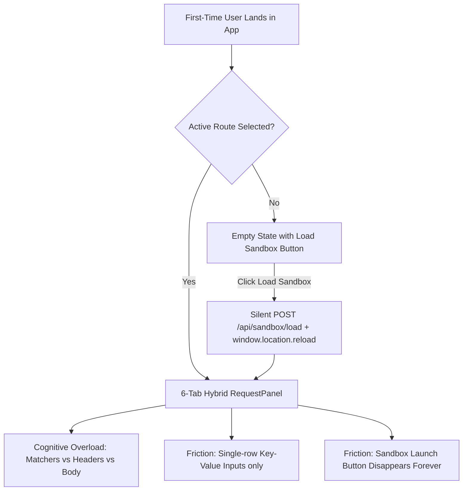
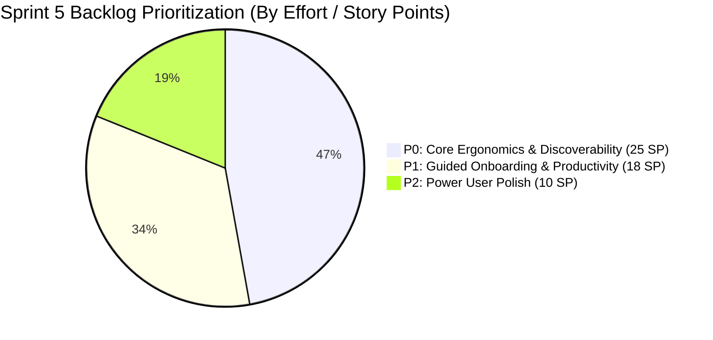
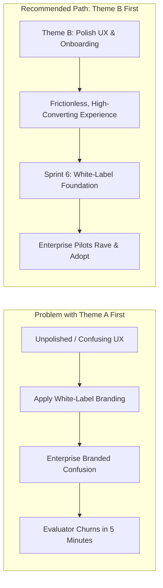

# Sprint 5 UX Discovery & Backlog Definition

**Document Type**: Product Discovery & UX Strategy  
**Target Sprint**: Sprint 5  
**Governing Authorities**: 
- `AI_GOVERNANCE.md` (Productization, Feature Completion, Differentiation Rules)
- `ROADMAP_AUTHORITY.md` (Strategic Priority & Roadmap Integrity)
- `MASTER_PRODUCT_ACTION_PLAN.md` (Core Moats & Competitive Scoring)
- `MASTER_PRODUCT_ACTION_PLAN_REVIEW.md` ("Ship the moat. Package it as an experience. Then defend it.")

**Releases Shipped to Date**:
- ✅ **v0.1.0** — Sprint 1: ISO8583 Productization Foundation (Data Dictionary, Packager Upload, jPOS Q2 Integration)
- ✅ **v0.2.0** — Sprint 2: ISO8583 Simulation Experience (Message Simulator, Packager Dialects, Hex/Trace Viewer)
- ✅ **v0.3.0** — Sprint 3: Reference Banking Sandbox (Pre-configured ISO8583 Authorization → Capture → Reversal lifecycle, Redis state persistence)
- ✅ **v0.4.0** — Sprint 4: Authentication Foundation & Multi-User Identity (JWT Auth, Argon2id passwords, scenario session namespacing)

**Post-v0.4.0 Baseline Note**:
Critical release defects (Response panel syntax tokenizer mismatch and test request draft persistence) were audited, patched, and verified in post-v0.4.0 maintenance (`f4097c0`). This discovery document focuses exclusively on **UX ergonomics, developer onboarding, discoverability, and testing productivity**.

---

## 1. Current UX Assessment

A thorough evaluation across the seven target operational dimensions reveals a sharp contrast: **the backend architecture is enterprise-grade, but the frontend interaction model retains high-friction ergonomics that obstruct self-guided adoption**.



### A. First-Time User Experience (FTUE)
* **Current State**: Upon logging in, a user with no pre-existing routes sees an empty canvas with a faint icon: *"Select a stub from the sidebar to start editing or Load Reference Banking Sandbox (5-Minute Quickstart)"*.
* **Deficiency**: There is no onboarding checklist, welcome banner, or guided path. If the user clicks the sandbox button, the app fires a blind `POST /api/sandbox/load` and executes a hard `window.location.reload()`. When the workspace reloads, the sidebar is populated with stubs, but the user receives zero direction on what scenario to test, what request payload to trigger, or how to observe state progression.
* **Assessment**: **3/10**. High risk of bounce or abandonment within the first 90 seconds.

### B. Workspace Productivity
* **Current State**: The UI provides a dark/light mode toggle, collapsible sidebar, environment switcher, and `Cmd+K` route search.
* **Deficiency**: 
  - `Cmd+K` only focuses the search bar to filter existing routes; it is not a command palette and cannot execute actions (e.g., create route, load sandbox, open traffic console, switch environments).
  - There are no keyboard shortcuts for core repetitive actions: no `Cmd+Enter` to send a request, no `Cmd+S` to persist route changes, no `Cmd+1..6` to switch tabs.
  - Adding multiple headers or parameters requires repetitive mouse clicks on `Add Row`, clicking into individual key and value inputs, and manual tabbing.
* **Assessment**: **4/10**. Cumbersome for QA engineers running repetitive validation cycles.

### C. Request Testing Experience
* **Current State**: The `RequestPanel` allows users to construct HTTP requests (Method, URL, Params, Headers, Body) and dispatch them against the local engine via the `Send` button. Responses display status code, round-trip duration, body with JSON syntax highlighting, and headers.
* **Deficiency**:
  - Developers cannot paste curl commands or raw HTTP headers.
  - There is no **"Copy as cURL"** button. If an engineer wants to test an endpoint from terminal, Postman, or a CI script, they must manually assemble the cURL syntax.
  - Response panel lacks quick payload search/filtering, status code descriptions (e.g., `200 OK`, `404 Not Found - Route not found or matchers failed`), and size metrics.
* **Assessment**: **5/10**. Functional, but noticeably behind Burp Suite, Postman, and Hoppscotch in testing velocity.

### D. Banking Sandbox Discoverability
* **Current State**: The Banking Sandbox was built in Sprint 3 as our flagship demonstration artifact. However, its trigger button exists *only* in `RequestPanel.tsx` under the condition `if (!activeRoute)`.
* **Deficiency**:
  - Once any route exists or is selected in the workspace, the sandbox trigger is **completely invisible**.
  - There is no permanent top-bar button, sidebar action, or menu entry to reload, reset, or inspect the Banking Sandbox.
  - Evaluators who import an OpenAPI spec or create a single mock route will never know the banking simulator exists.
* **Assessment**: **2/10**. Our #1 differentiator is effectively hidden behind a zero-state screen.

### E. Learning Curve Reduction
* **Current State**: `RequestPanel` houses 6 tabs in a flat horizontal list: `Params`, `Headers`, `Body`, `Matchers`, `Response Body`, `Scripts`.
* **Deficiency**:
  - No tooltips (ⓘ), help icons, or explanatory notes exist.
  - Users confuse **Matchers** (which define incoming server-side routing rules) with **Headers/Params** (which define the test client's outgoing request).
  - Inside the `Headers` tab, the UI inexplicably groups *Request Headers (Sent with Test Request)* with *Response Status Code* and *Response Headers (Returned by Mock)*. Mixing server response definition and client test configuration on a single tab causes extreme cognitive disorientation.
  - `Scripts` gives a blank Monaco editor without indicating supported runtimes (JavaScript, Python via GraalVM), injected globals (`context`, `request`, `state`), or example scripts.
* **Assessment**: **3/10**. Requires tribal knowledge or source code reading to understand core mechanics.

### F. Enterprise Evaluator Experience
* **Current State**: Enterprise evaluators (Lead Architects, Principal QA, Heads of Engineering) evaluate developer tools in 15–30 minute evaluation windows.
* **Deficiency**:
  - An evaluator attempting to simulate a custom flow who configures a Matcher for `X-Api-Key: test` will receive a 404 response on Send without explanation if their test request omitted that header.
  - Evaluators cannot quickly generate realistic mock data (UUIDs, timestamps, Nepali PAN masks, credit card sequences) without researching Handlebars helpers manually.
* **Assessment**: **3/10**. Does not meet enterprise expectations for frictionless evaluation.

### G. Adoption Readiness
* **Current State**: Architecture, security, state persistence, and protocol support are mature.
* **Deficiency**: The UX layer currently acts as a barrier to organic adoption. Without an onboarding tour, bulk headers, and contextual guidance, the product feels like an internal engineering prototype rather than a polished commercial-grade platform.
* **Assessment**: **4/10**. Significant product value is locked behind UX friction.

---

## 2. UX Pain Point Analysis

Deep-dive analysis of the five primary user feedback observations:

| # | Feedback Observed | Root Cause in Code / Architecture | User Impact & Frustration |
|---|---|---|---|
| **1** | **Headers editor feels cumbersome compared to Burp Suite and Postman** | `RequestPanel.tsx:424` implements `KeyValueEditor` as isolated `<input>` pairs. Adding 10 headers requires 20 mouse clicks and 20 input focus switches. No raw text/bulk edit mode exists. Headers cannot be temporarily toggled off (no checkbox); testing without a header requires permanently deleting it. | High friction. QA engineers and penetration testers cannot paste headers from browser DevTools, Burp, or curl commands. They abandon manual testing in the UI. |
| **2** | **New users have no contextual understanding of Headers, Params, Matchers, Scripts, Response Body** | Flat 6-tab navigation (`RequestPanel.tsx:300-316`) fails to differentiate **Mock Definition** (Server Stub) from **Test Runner** (Client Execution). `Headers` tab bizarrely holds both client request headers and server response definitions. Zero tooltips or documentation links exist anywhere on the form. | Severe confusion. Users put server matching criteria into client headers, get 404s, fail to understand why routes do not match, and struggle with Handlebars/GraalVM syntax. |
| **3** | **Banking Sandbox is one of the strongest features but is not prominent enough** | `RequestPanel.tsx:192-230` renders the Sandbox trigger only when `!activeRoute`. Once a route is active or loaded, the button unmounts. No header navigation button, no sidebar action, and no persistent catalog item exists. | Lost sales opportunity. The primary competitive moat (ISO8583 0100/0200/0400 stateful simulation) is undiscoverable by evaluators who create or import routes. |
| **4** | **Workspace contains powerful capabilities but lacks onboarding guidance** | `WorkspaceContext.tsx` and main layout have no onboarding state machine, guide framework (e.g., Driver.js), or empty state action cards. Everything relies on user self-discovery. | Evaluators do not realize the platform supports GraalVM polyglot execution, Redis state machines, or ISO8583 simulation. High bounce rate. |
| **5** | **Response/Testing experience can still become more polished** | `ResponsePanel.tsx` shows only raw status code numbers (e.g. `200` without `OK`, `404` without `Not Found`). No "Copy as cURL" button exists in either the Request or Response panel. No search/filter in large JSON response payloads. | Sub-optimal developer ergonomics. Developers cannot export test requests to terminal or easily navigate large mock responses. |

---

## 3. UX Candidate Feature Scorecard

Each candidate feature is evaluated on a 1–5 scale across User Impact, Enterprise Value, Implementation Effort (Story Points / Days), Architectural Complexity, and Strategic Differentiation:

| # | Candidate Feature | User Impact (1-5) | Enterprise Value (1-5) | Est. Effort (SP) | Arch. Complexity | Differentiation | Priority Score |
|---|---|:---:|:---:|:---:|:---:|:---:|:---:|
| **1** | **Contextual Help Icons (ⓘ) & In-line Tooltips** | 5 | 5 | 3 SP | Low | Medium | **P0 (Critical)** |
| **2** | **Guided Product Tour (Interactive Walkthrough)** | 4 | 5 | 5 SP | Low | High | **P1 (High)** |
| **3** | **Banking Sandbox Launch Experience & Overview** | 5 | 5 | 5 SP | Medium | Critical (Moat) | **P0 (Critical)** |
| **4** | **Response Panel Improvements (Status phrases, cURL, search)** | 4 | 4 | 3 SP | Low | Medium | **P0 (Critical)** |
| **5** | **Route Testing Persistence Enhancements** | 4 | 3 | 2 SP | Low | Low | **P1 (High)** |
| **6** | **Raw / Bulk Headers Editor with Checkbox Toggles** | 5 | 5 | 5 SP | Medium | High | **P0 (Critical)** |
| **7** | **Example & Template Generators (Handlebars / JSON)** | 4 | 4 | 3 SP | Low | Medium | **P1 (High)** |
| **8** | **Rich Empty State Improvements & Action Cards** | 4 | 4 | 3 SP | Low | Medium | **P0 (Critical)** |
| **9** | **Core Keyboard Shortcuts (`Cmd+Enter`, `Cmd+S`, `Cmd+1..6`)** | 5 | 4 | 2 SP | Low | Medium | **P0 (Critical)** |
| **10** | **Command Palette (`Cmd+K` Action Launcher)** | 4 | 4 | 5 SP | Medium | Medium | **P1 (High)** |
| **11** | **Workspace Global Search (Routes, Collections, Headers)** | 3 | 3 | 5 SP | Medium | Low | **P2 (Medium)** |
| **12** | **Copy as cURL (One-click CLI export)** | 5 | 5 | 2 SP | Low | High | **P0 (Critical)** |
| **13** | **Mock Stub vs Test Runner Visual Segregation** | 5 | 5 | 5 SP | Medium | High | **P0 (Critical)** |

---

## 4. P0 / P1 / P2 Prioritization



### P0: Critical / Ship in Sprint 5 (Blocks Usability & Adoption)
* **P0-1: Raw / Bulk Headers Editor with Checkbox Toggles**
  - Toggle between Structured Key-Value Table and Raw Multiline Text (`Header-Key: Header-Value`).
  - Seamless two-way sync: pasting 15 headers from DevTools or Postman instantly populates both views.
  - Active/Inactive checkbox next to each header so users can toggle headers on/off without deleting and retyping.
  - Autocomplete suggestions for common HTTP headers (`Content-Type`, `Authorization`, `Accept`, `X-Correlation-Id`).
* **P0-2: Contextual Help Icons (ⓘ) & Architecture Tooltips**
  - Visual ⓘ icons on all 6 tabs explaining exact semantics.
  - Tooltip on **Matchers**: *"Rules that incoming client requests must satisfy to trigger this mock. Does not alter outgoing responses."*
  - Tooltip on **Params & Headers**: Clarify Test Runner scope vs Mock Server definition.
  - Tooltip on **Scripts**: Indicate GraalVM polyglot capabilities with quick snippet links.
  - Tooltip on **Response Body**: Quick syntax guide for Handlebars dynamic tags (`{{random.uuid}}`, `{{now}}`, `{{state.variable}}`).
* **P0-3: Prominent Banking Sandbox Launcher & Scenario Guide**
  - Add a persistent **"Banking Sandbox"** button with a distinct financial icon in the top Header bar.
  - Add a "Quickstart Sandbox" action in the Sidebar collection menu.
  - Provide a Sandbox Overview Modal explaining the 4 pre-configured transactions:
    1. `POST /api/iso/0100` — Authorization (Locks credit balance)
    2. `POST /api/iso/0200` — Capture (Finalizes settlement)
    3. `POST /api/iso/0400` — Reversal (Unwinds authorization)
    4. `GET /api/scenarios/state` — Live Redis State Inspector
  - Provide a one-click "Run Lifecycle Demo" that fires the sequence and displays live state transitions.
* **P0-4: Mock Stub vs Test Runner Visual Separation**
  - Restructure `RequestPanel` to clearly segregate **Mock Stub Configuration** (Matchers, Mock Response Headers, Response Body, Scripts) from **Interactive Test Client** (Test Params, Test Request Headers, Test Body, Send Button).
  - Eliminate the confusing placement of Mock Response Headers inside the client Request Headers tab.
* **P0-5: "Copy as cURL" One-Click Action**
  - Dedicated button on the Request URL bar to copy the exact `curl` command with current method, URL, headers, and body.
  - Dedicated button on the Response panel to copy the raw response or response cURL replay.
* **P0-6: Rich Empty State Action Cards**
  - Redesign the zero-route state with four distinct action cards:
    1. *Launch Banking Sandbox* (with visual diagram of ISO8583 flows)
    2. *Create REST Mock Stub*
    3. *Import Postman / OpenAPI Spec*
    4. *Open Protocol Simulator (ISO8583 / gRPC)*
* **P0-7: Essential Keyboard Shortcuts**
  - `Cmd+Enter` (or `Ctrl+Enter`) to trigger the Send action.
  - `Cmd+S` (or `Ctrl+S`) to save/update the current route configuration.
  - `?` or `Cmd+/` to bring up a cheat-sheet modal of all workspace shortcuts.

### P1: High Value / Sprint 5 Stretch or Early Sprint 6
* **P1-1: Interactive Guided Product Tour**
  - Lightweight, non-intrusive 4-step walkthrough for first-time visitors (Welcome → Stub Navigation → Matcher Logic → Testing & Response).
  - Dismissible with "Don't show again", and re-triggerable via a "Help & Tour" menu in Header.
* **P1-2: Command Palette (`Cmd+K` Action Launcher)**
  - Upgrade the existing search bar into a true fuzzy command palette (e.g., via `cmdk` or custom accessible dialog).
  - Commands: *Create Route*, *Load Sandbox*, *Switch Environment*, *Open Traffic Log*, *Toggle Dark Mode*, *Export Workspace*.
* **P1-3: Example & Template Generators**
  - In `Response Body`, provide a dropdown of pre-built templates: *REST Success Envelope*, *REST Error Response*, *Paginated List*, *ISO8583 JSON Bridge*.
  - Inline buttons to insert `{{random.uuid}}`, `{{now 'yyyy-MM-dd'}}`, `{{random.number min=1000 max=9999}}`.
* **P1-4: Response Panel Enhancements**
  - HTTP reason phrase badge (`200 OK`, `201 Created`, `400 Bad Request`, `404 Not Found`).
  - Search/filter input inside response body JSON viewer.
  - Response payload size calculation (`bytes` / `KB`).

### P2: Medium / Future Polish Backlog
* **P2-1: Deep Workspace Search**
  - Search across route names, paths, matchers, response bodies, and script content.
* **P2-2: Polyglot Script Snippet Library**
  - Pre-built scripts for state machine manipulation, HMAC generation, and token validation.
* **P2-3: Route Test History & Latency Graph**
  - View the last 5 executed test requests and response times for the active route.

---

## 5. Sprint 5 Recommendation & Strategic Alignment

### Resolving the Most Important Question

> **Strategic Question**: If only ONE Sprint 5 theme can be chosen, should the highest-value Sprint 5 be:  
> **A. White Label Foundation**  
> or  
> **B. First-Time User Experience & Workspace Productivity**?

---

### **RECOMMENDATION: Choose THEME B (First-Time User Experience & Workspace Productivity)**



### Definitive Strategic Justification

#### 1. Alignment with `MASTER_PRODUCT_ACTION_PLAN_REVIEW.md`
The executive review established the governing thesis:
> *"Ship the moat. Package it as an experience. Then defend it."*  
> *"Identifying the frontend as the critical weakness is correct. The backend is mature. The frontend is the bottleneck between 'technically works' and 'product someone would pay for.'"*

We successfully shipped the moat in Sprints 1, 2, 3, and 4 (ISO8583 Engine, Simulator, Banking Sandbox, and Auth/Session Namespacing). However, the manual QA findings prove that the moat is **not yet packaged as an experience**. The Banking Sandbox is hidden; the headers editor is clunky; users do not understand Matchers; and there is no "Copy as cURL". Choosing White-Labeling (Theme A) now would mean spending an entire sprint slapping custom logos onto an interface that users still struggle to operate.

#### 2. Alignment with `AI_GOVERNANCE.md`
- **Productization Rule**: *"A feature is not done when the code works. A feature is done when it is usable, documented, and discoverable."*  
  The Banking Sandbox is technically complete in backend code, but because it is hidden in the UI, it violates the Productization Rule. Sprint 5 must complete the productization of our core capabilities.
- **Differentiation Rule**: *"Never prioritize a commodity feature over a differentiating feature."*  
  White-labeling is a deployment capability, not a developer workflow differentiator. Accelerating testing velocity, bulk header pasting, and banking sandbox simulation directly magnifies our core differentiation.
- **Feature Completion Rule**: *"No half-finished features. When a feature is started, it must be driven to completion before moving to the next."*  
  Sprints 1–4 built the engines. Leaving their UX at a prototype level to jump to White Labeling leaves the core developer journey half-finished.

#### 3. Real-World Enterprise Evaluator Psychology
When a bank or fintech enterprise evaluates Dynamic Mock:
1. They do **not** evaluate whether they can change the logo to their bank's hex color on day one.
2. They evaluate: *"Can my engineers load our ISO8583 flows, paste our headers, test state transitions, and understand how to mock our payment gateways in under 15 minutes?"*
3. If an evaluator gets stuck because they cannot paste headers, cannot find the banking sandbox, and do not understand matchers, **the POC fails on day one**.
4. Once the workbench is intuitive, lightning-fast, and demonstrably showcases the financial moat, offering White-Labeling in Sprint 6 becomes an effortless, high-margin upsell.

---

## 6. Expected User Impact

Implementing Theme B in Sprint 5 will fundamentally transform the daily developer experience:

```
┌─────────────────────────────────┬─────────────────────────────────┐
│        BEFORE SPRINT 5          │         AFTER SPRINT 5          │
├─────────────────────────────────┼─────────────────────────────────┤
│ 20 clicks to add 10 headers     │ 1 paste action in Raw Editor    │
│ Headers deleted to test absence │ 1 click checkbox toggle         │
│ Confusion over Matchers vs Test │ Clear visual separation & ⓘ tip │
│ Banking Sandbox hidden in zero  │ Prominent Header & Sidebar CTA  │
│ No CLI export                   │ 1 click "Copy as cURL"          │
│ Mouse-bound testing             │ Cmd+Enter / Cmd+S shortcuts     │
│ Silent 404 on matcher mismatch  │ Clear diagnostic feedback       │
└─────────────────────────────────┴─────────────────────────────────┘
```

1. **Testing Velocity Multiplied**: Developers accustomed to Burp Suite or Postman can instantly paste entire HTTP header blocks, toggle parameters on/off with checkboxes, and fire requests with `Cmd+Enter`.
2. **Elimination of Cognitive Load**: In-line tooltips and visual segregation make the distinction between "what the mock server expects" (Matchers) and "what the test client sends" immediately intuitive.
3. **Instant Self-Sufficiency**: New developers can onboard independently without needing hands-on engineering tutorials.

---

## 7. Expected Enterprise Impact

1. **POC Conversion Rate Increase**: Enterprise evaluators will experience the Banking Sandbox within 60 seconds of first login, demonstrating automated ISO8583 Authorization → Capture → Reversal lifecycles without any configuration overhead.
2. **Sales Demo Velocity**: Sales engineers can demonstrate complex financial scenarios live in front of prospects using intuitive UI controls rather than terminal scripts.
3. **Reduced Support & Onboarding Overhead**: Clear contextual tooltips and example generators eliminate repetitive customer support tickets regarding route matching rules and script syntax.
4. **Stronger Foundation for Sprint 6 White-Labeling**: Delivering White-Labeling on top of a polished, modern, high-ergonomics workbench guarantees that enterprise co-branded deployments feel like elite, bespoke software.

---

## 8. Risks and Mitigations

| # | Risk | Impact | Likelihood | Mitigation Strategy |
|---|---|:---:|:---:|---|
| **R1** | **Two-way sync desynchronization between Raw Headers and Key-Value Table** | High | Medium | Implement a pure, deterministic parser/serializer with rigorous unit tests handling malformed headers, duplicate keys, and trailing whitespace. |
| **R2** | **UI clutter from excessive help icons and banners** | Medium | Low | Use minimalist, subtle `ⓘ` icons with popovers on hover/click; ensure all help elements use standard muted palette styles without distracting visual noise. |
| **R3** | **User resistance to guided tours** | Low | Medium | Make the product tour strictly opt-in or easily dismissible with a permanent "Don't show again" option, and provide re-launch from a top-bar Help icon. |
| **R4** | **Scope creep delaying Sprint 5 delivery** | High | Medium | Strictly enforce the P0 backlog boundary (25 Story Points); defer P1 (Product Tour, Command Palette) and P2 items to Sprint 6 if velocity constraints arise. |
| **R5** | **Breaking existing saved test drafts or routes** | High | Low | Ensure all new editor states (raw headers, checkboxes) map directly to the established `MockRoute` and draft storage schema without breaking backwards compatibility. |

---

## 9. Success Metrics

To validate the impact of Sprint 5 UX enhancements, the following quantitative and qualitative metrics will govern acceptance:

| Metric | Baseline (v0.4.0) | Sprint 5 Target | Measurement Method |
|---|:---:|:---:|---|
| **Time-to-First-Mock (TTFM)** | ~3.5 minutes | **< 45 seconds** | First login to first successfully matched mock response |
| **Banking Sandbox Discovery Rate** | < 15% of sessions | **> 80% of new sessions** | Telemetry / Audit of `/api/sandbox/load` invocation |
| **Header Editing Velocity** | ~45 seconds for 8 headers | **< 5 seconds** | Time required to paste raw header payload from curl/DevTools |
| **Test Request Execution Rate** | 2.1 tests per session | **> 10 tests per session** | Aggregate Send actions per active user session |
| **Matcher Configuration Errors** | ~35% of first-time stubs fail match | **< 5% failure rate** | 404 responses returned due to unmatched route criteria |
| **Keyboard Shortcut Adoption** | 0% (feature did not exist) | **> 40% of Send actions triggered via `Cmd+Enter`** | Frontend event listener instrumentation |

---

## 10. Summary Sprint 5 Backlog Specification

```
SPRINT 5: FIRST-TIME USER EXPERIENCE & WORKSPACE PRODUCTIVITY
Total Estimated Effort: 25 Story Points (P0 Scope)
Theme: Developer Ergonomics, Onboarding Guidance & Moat Discoverability

Epic 1: Headers & Testing Velocity (9 SP)
  ├── US-5.1: Raw/Bulk Multiline Headers Editor with Two-Way Key-Value Sync (4 SP)
  ├── US-5.2: Header Active/Inactive Checkbox Toggles (2 SP)
  ├── US-5.3: "Copy as cURL" One-Click Actions in Request & Response Panels (2 SP)
  └── US-5.4: Keyboard Shortcuts: Cmd+Enter (Send), Cmd+S (Save), Shortcuts Modal (1 SP)

Epic 2: Contextual Guidance & Concept Clarity (8 SP)
  ├── US-5.5: In-line Contextual Help Icons (ⓘ) for Matchers, Headers, Params, Scripts, Body (3 SP)
  ├── US-5.6: Mock Stub Configuration vs Test Runner Visual Segregation (3 SP)
  └── US-5.7: Enhanced Response Panel (HTTP Status Phrases, Payload Search, Size Metric) (2 SP)

Epic 3: Moat Discoverability & First-Time Onboarding (8 SP)
  ├── US-5.8: Persistent Banking Sandbox Header Action & Overview Modal (3 SP)
  ├── US-5.9: Rich Empty State Action Cards (Sandbox, REST Mock, Import, Simulator) (3 SP)
  └── US-5.10: Handlebars Dynamic Template Snippets & Example Inserters (2 SP)
```

**Next Step Post-Approval**:  
Upon product owner approval of this discovery document, create `SPRINT_05_ARCHITECTURE_REVIEW.md` and `SPRINT_05_IMPLEMENTATION_PLAN.md` to begin engineering execution of Theme B.
