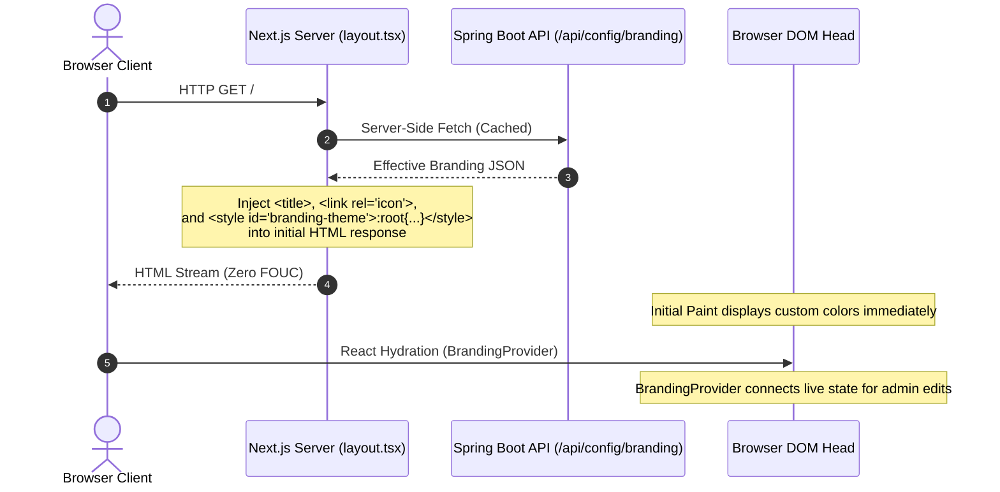

# Sprint 6 Architecture Review & Governance Evaluation

**Document Version**: 1.0  
**Date**: 2026-10-27  
**Author**: Principal Systems Architect & Independent Reviewer  
**Status**: FORMAL ARCHITECTURAL EVALUATION  
**Target Milestone**: Sprint 6 (v0.6.0)  
**Governing Authorities**:
- `AI_GOVERNANCE.md` (Domain Layer Purity, Hexagonal Integrity, Differentiation Rule, Product Positioning Rule)
- `ROADMAP_AUTHORITY.md` (Strategic Priorities, Roadmap Invariants)
- `MASTER_PRODUCT_ACTION_PLAN.md` (Core Moats, Risk Register)
- `MASTER_PRODUCT_ACTION_PLAN_REVIEW.md` ("Ship the moat. Package it as an experience. Then defend it.")

**Reference Documents**:
- `SPRINT_06_DISCOVERY.md`
- `WHITE_LABEL_ARCHITECTURE.md`
- Codebase baseline: Release `v0.5.1`

---

## 1. Executive Verdict

### Architectural Determination: **CONDITIONALLY APPROVED WITH MANDATORY RECTIFICATIONS**

The strategic intent of Sprint 6 (**White Label Foundation & Enterprise Customization**) is fully aligned with `AI_GOVERNANCE.md` and `ROADMAP_AUTHORITY.md`. White labeling is an essential institutional differentiator that no major competitor (WireMock, Mockoon, Postman) can offer without cannibalizing their own brand capture.

However, an independent architectural audit of the legacy design document (`WHITE_LABEL_ARCHITECTURE.md`) and the proposed backlog in `SPRINT_06_DISCOVERY.md` revealed **four critical architectural defects** that must be formally rejected and remediated prior to implementation:

1. **Domain Layer Purity Violation**: `WHITE_LABEL_ARCHITECTURE.md` Section 2.1 defined `OrganizationConfig` with Spring Data persistence annotations (`@Document`, `@Id`). This violates the core mandate of `AI_GOVERNANCE.md`. **Remedy**: The domain entity must remain a pure Java POJO. A dedicated `OrganizationConfigMongoEntity` must reside in the infrastructure layer, bridged via an explicit `OrganizationConfigMapper`.
2. **Accidental Multi-Tenancy Contamination**: `WHITE_LABEL_ARCHITECTURE.md` Section 5 speculated on tenant subdomains (`acme.dynamicmock.com`), tenant headers, and multi-tenant database partitioning. This violates roadmap constraints against premature multi-tenancy. **Remedy**: Sprint 6 is strictly constrained to **Single-Tenant Instance-Wide White Labeling**. All multi-tenant routing, subdomain resolution, and tenant headers are formally rejected.
3. **FOUC (Flash of Unstyled Content) Vulnerability**: Relying solely on client-side React `useEffect` for branding hydration causes a visual flicker of the default blue theme on first paint. **Remedy**: Server-side layout pre-fetching in Next.js App Router (`layout.tsx`) combined with inline `<style>` injection in `<head>`.
4. **Unbounded Asset Hosting Scope Creep**: Storing custom logo and favicon uploads requires complex binary object storage (S3 or GridFS). **Remedy**: Sprint 6 will support remote HTTPS URLs and base64/SVG data URIs only. Zero binary object storage infrastructure will be built.

With these four boundaries strictly enforced, Sprint 6 can be implemented cleanly, safely, and without technical debt.

---

## 2. Architecture Assessment

The target architecture must cleanly separate the **Domain Model**, **Persistence Adapters**, **HTTP Inbound Adapters**, and **Frontend Theme Hydration**:

```mermaid
graph TD
    subgraph "Domain Layer (Pure Java - Zero Framework Dependencies)"
        CONFIG[Entity: OrganizationConfig<br/>Singleton ID = 'instance']
        PORT_OUT[Outbound Port: OrganizationConfigRepository]
        PORT_IN[Inbound Port: OrganizationConfigUseCase]
    end

    subgraph "Application Layer (Hexagonal Core)"
        SERVICE[Service: OrganizationConfigService<br/>Implements Inbound Port<br/>Env Overrides + Redis Cache]
    end

    subgraph "Infrastructure Layer (Spring Boot 3 / Persistence)"
        MONGO_REPO[MongoOrganizationConfigRepository]
        IMPL[OrganizationConfigRepositoryImpl<br/>Implements Outbound Port]
        MAPPER[OrganizationConfigMapper]
        MONGO_ENTITY[OrganizationConfigMongoEntity<br/>@Document collection='organization_config']
        REDIS[RedisTemplate: String, OrganizationConfig<br/>TTL 24h • Evict on PUT]
        ENV[BrandingEnvironmentProperties<br/>WHITE_LABEL_* Overrides]
    end

    subgraph "Web Adapter (Inbound)"
        CONTROLLER[BrandingController<br/>GET /api/config/branding - Public<br/>PUT /api/config/branding - Admin Only]
    end

    subgraph "Frontend Layer (Next.js 14 App Router)"
        SSR_HEAD[layout.tsx SSR Injector<br/>Server Fetch + Head Style Tag]
        CONTEXT[BrandingProvider Context<br/>useBranding Hook]
        UI[Header • Title • Favicon • Login • Modals]
    end

    PORT_IN --> SERVICE
    SERVICE --> PORT_OUT
    PORT_OUT --> IMPL
    IMPL --> MAPPER
    MAPPER --> MONGO_ENTITY
    IMPL --> MONGO_REPO
    SERVICE --> REDIS
    SERVICE --> ENV
    CONTROLLER --> PORT_IN

    SSR_HEAD -->|Initial Render CSS/Title| UI
    CONTROLLER -->|HTTP JSON| CONTEXT
    CONTEXT -->|Dynamic Updates| UI
```

---

## 3. Domain Model Review

### Strict Domain Purity Compliance (`AI_GOVERNANCE.md`)
The core domain entity `OrganizationConfig` must contain zero framework annotations (no Jackson, no Spring Data, no Jakarta). Only Lombok is permitted for boilerplate reduction.

#### Target Domain Entity:
```java
package com.dynamicmock.domain.entity;

import lombok.AllArgsConstructor;
import lombok.Builder;
import lombok.Data;
import lombok.NoArgsConstructor;
import java.time.LocalDateTime;

/**
 * Pure domain entity representing instance-wide organization branding.
 * Clean Architecture compliant: zero framework dependencies.
 */
@Data
@Builder
@NoArgsConstructor
@AllArgsConstructor
public class OrganizationConfig {
    public static final String SINGLETON_ID = "instance";

    private String id; // Fixed value: "instance"
    private String productName;
    private String organizationName;
    private String logoUrl;
    private String faviconUrl;
    private String primaryColor;      // Valid hex string (e.g., #0052cc)
    private String secondaryColor;    // Valid hex string (e.g., #f4f5f7)
    private String accentColor;       // Valid hex string (optional)
    private String loginBackgroundUrl;
    private String footerText;
    private LocalDateTime updatedAt;

    public static OrganizationConfig createDefault() {
        return OrganizationConfig.builder()
                .id(SINGLETON_ID)
                .productName("Dynamic Mock")
                .organizationName("Dynamic Mock Open Source")
                .logoUrl(null)
                .faviconUrl("/favicon.ico")
                .primaryColor("#3b82f6")
                .secondaryColor("#f1f5f9")
                .accentColor("#e2e8f0")
                .loginBackgroundUrl(null)
                .footerText("Dynamic Mock — Open Source Integration Simulation Platform")
                .updatedAt(LocalDateTime.now())
                .build();
    }
}
```

#### Outbound Port Interface:
```java
package com.dynamicmock.domain.port.out;

import com.dynamicmock.domain.entity.OrganizationConfig;
import java.util.Optional;

public interface OrganizationConfigRepository {
    Optional<OrganizationConfig> findConfig();
    OrganizationConfig save(OrganizationConfig config);
}
```

---

## 4. Backend Review

### 4.1 Persistence Mapping & Infrastructure
The persistence entity is completely isolated in `infrastructure.persistence.mongodb.entity`:

```java
package com.dynamicmock.infrastructure.persistence.mongodb.entity;

import lombok.AllArgsConstructor;
import lombok.Builder;
import lombok.Data;
import lombok.NoArgsConstructor;
import org.springframework.data.annotation.Id;
import org.springframework.data.mongodb.core.mapping.Document;
import java.time.LocalDateTime;

@Document(collection = "organization_config")
@Data
@Builder
@NoArgsConstructor
@AllArgsConstructor
public class OrganizationConfigMongoEntity {
    @Id
    private String id; // "instance"
    private String productName;
    private String organizationName;
    private String logoUrl;
    private String faviconUrl;
    private String primaryColor;
    private String secondaryColor;
    private String accentColor;
    private String loginBackgroundUrl;
    private String footerText;
    private LocalDateTime updatedAt;
}
```

### 4.2 Web Controller API & Security Review
The `BrandingController` must satisfy two strict authorization policies:
1. **`GET /api/config/branding`**: **Unauthenticated / Public**.
   - *Rationale*: When an unauthenticated user arrives at the `/login` or `/register` screen, the UI must immediately render the corporate logo, product name, and theme. Blocking this behind authentication would break first-impression white-labeling.
2. **`PUT /api/config/branding`**: **Strictly Authenticated (Admin Only)**.
   - *Rationale*: Only authenticated administrators (`ROLE_ADMIN` or username `admin`) can modify instance branding. An unauthenticated or regular user attempting a PUT must receive `403 Forbidden`.

```java
package com.dynamicmock.adapter.in.web;

import com.dynamicmock.adapter.in.web.dto.BrandingConfigRequest;
import com.dynamicmock.adapter.in.web.dto.BrandingConfigResponse;
import com.dynamicmock.application.port.in.OrganizationConfigUseCase;
import jakarta.validation.Valid;
import lombok.RequiredArgsConstructor;
import org.springframework.http.ResponseEntity;
import org.springframework.security.access.prepost.PreAuthorize;
import org.springframework.web.bind.annotation.*;

@RestController
@RequestMapping("/api/config/branding")
@RequiredArgsConstructor
public class BrandingController {

    private final OrganizationConfigUseCase brandingUseCase;

    @GetMapping
    public ResponseEntity<BrandingConfigResponse> getBranding() {
        return ResponseEntity.ok(BrandingConfigResponse.from(brandingUseCase.getEffectiveConfig()));
    }

    @PutMapping
    @PreAuthorize("hasRole('ADMIN') or authentication.name == 'admin'")
    public ResponseEntity<BrandingConfigResponse> updateBranding(
            @Valid @RequestBody BrandingConfigRequest request) {
        return ResponseEntity.ok(BrandingConfigResponse.from(brandingUseCase.updateConfig(request.toDomain())));
    }
}
```

### 4.3 Validation & Security Constraints
- **Hex Color Validation**: Primary, secondary, and accent colors must match regex `^#([A-Fa-f0-9]{6}|[A-Fa-f0-9]{3})$` to prevent CSS injection.
- **URL Sanitization**: `logoUrl`, `faviconUrl`, and `loginBackgroundUrl` must be validated against `^(https?://|data:image/).+` to prevent malicious `javascript:` URI attacks.
- **String Length Limits**: `productName` (max 64), `organizationName` (max 100), `footerText` (max 255).

---

## 5. Frontend Review

### 5.1 FOUC Prevention Architecture
The biggest risk in runtime theme injection is **FOUC (Flash of Unstyled Content)**: the browser renders the default blue theme (`#3b82f6`) for 200ms before React fetches `/api/config/branding` and changes colors.

To eliminate FOUC, Sprint 6 must use a **dual-layer hydration strategy**:



#### Server Layout Hydration (`layout.tsx`):
```tsx
// In frontend/src/app/layout.tsx
// Perform an internal server-side fetch to BACKEND_URL with a short timeout.
// Inject CSS variables directly into <head> during SSR.
```

### 5.2 Tailwind CSS v4 Variable Mapping
In Tailwind v4 (`@import "tailwindcss";`), color variables in `@theme inline` resolve to CSS custom properties:
```css
@theme inline {
  --color-primary: var(--primary);
  --color-secondary: var(--secondary);
}
```

When custom hex colors (e.g. `#0052cc`) are injected into `:root { --primary: #0052cc; }`, modern browsers use CSS `color-mix(in srgb, var(--primary) 10%, transparent)` for opacity classes (e.g., `bg-primary/10`).

To maintain 100% compatibility across all rendering engines, `BrandingProvider` will inject:
```css
:root {
  --primary: #0052cc;
  --primary-rgb: 0, 82, 204;
  --secondary: #f4f5f7;
}
```

### 5.3 UI Component Integration Review
1. **`Header.tsx`**:
   - Replaces hardcoded Lucide `<Globe>` with an image tag ``.
   - If `logoUrl` is null or fails to load (`onError`), it gracefully falls back to the default icon or product initials.
   - Replaces text `"Dynamic Mock"` with `{branding.productName}`.
2. **`Sidebar.tsx`**:
   - Respects active brand colors on active items and badges.
3. **`Admin Branding Settings Modal`**:
   - Added to user dropdown under "Workspace Settings" (visible only if `user.username === 'admin'`).
   - Features: Real-time color pickers, logo URL input with instant preview card, "Reset to Default" button.

---

## 6. Redis Caching & Invalidation Strategy

Branding is an ultra-read-heavy, low-write dataset. Every single page load and test runner request touches the branding configuration.

```mermaid
graph TD
    GET[GET /api/config/branding] --> CHECK{Redis Key Exists?<br/>'config:branding:instance'}
    CHECK -->|Yes (Cache Hit)| RETURN_CACHE[Return Cached JSON<br/>Latency < 2ms]
    CHECK -->|No (Cache Miss)| READ_DB[Query MongoDB<br/>Apply Env Overrides]
    READ_DB --> SET_REDIS[Set Redis Key<br/>TTL = 24 Hours]
    SET_REDIS --> RETURN_DB[Return Fresh Response]

    PUT[PUT /api/config/branding] --> SAVE_DB[Save to MongoDB]
    SAVE_DB --> DEL_REDIS[Evict Redis Key<br/>DEL 'config:branding:instance']
    DEL_REDIS --> RETURN_UPDATED[Return Updated Config]
```

### Cache Key Standards:
- **Key**: `config:branding:instance`
- **TTL**: `86400` seconds (24 hours).
- **Eviction Trigger**: Synchronous `DEL` inside `OrganizationConfigService.updateConfig()` upon successful MongoDB persistence.
- **Fail-Open Policy**: If Redis is unreachable or times out, the service logs a warning and falls back directly to MongoDB with zero user-facing error.

---

## 7. Environment Variable Strategy Review

### Hierarchy of Precedence
Enterprise operators deploying via Docker Compose or Kubernetes need zero-touch customization. The precedence order must be clear and deterministic:

```
┌─────────────────────────────────────────────────────────────┐
│ Level 1: Explicit Environment Variables (Highest Precedence) │
│ e.g., WHITE_LABEL_PRODUCT_NAME="Bank Portal"                │
└──────────────────────────────┬──────────────────────────────┘
                               │ (Overrides DB if specified)
                               ▼
┌─────────────────────────────────────────────────────────────┐
│ Level 2: Database Stored Settings (MongoDB)                  │
│ Saved via Admin UI (PUT /api/config/branding)               │
└──────────────────────────────┬──────────────────────────────┘
                               │ (Falls back if DB is empty)
                               ▼
┌─────────────────────────────────────────────────────────────┐
│ Level 3: Platform Default Values (Hardcoded Fallback)       │
│ "Dynamic Mock", #3b82f6, /favicon.ico                       │
└─────────────────────────────────────────────────────────────┘
```

### Supported Environment Variables:
| Variable Name | Type | Default Value | Purpose |
|---|---|---|---|
| `WHITE_LABEL_PRODUCT_NAME` | String | `Dynamic Mock` | Custom application title displayed in header and tabs |
| `WHITE_LABEL_ORG_NAME` | String | `Dynamic Mock Open Source` | Legal organization / company name |
| `WHITE_LABEL_LOGO_URL` | String | `null` | URL or base64 data URI for top-left header logo |
| `WHITE_LABEL_FAVICON_URL` | String | `/favicon.ico` | URL for browser tab favicon |
| `WHITE_LABEL_PRIMARY_COLOR` | Hex | `#3b82f6` | Brand primary color (buttons, active states, borders) |
| `WHITE_LABEL_SECONDARY_COLOR`| Hex | `#f1f5f9` | Secondary UI accent color |
| `WHITE_LABEL_FOOTER_TEXT` | String | `Dynamic Mock ...` | Login and footer legal text |

---

## 8. White Label Completeness Assessment

The review evaluated whether the proposed Sprint 6 architecture satisfies all white-label requirements for an enterprise deployment:

| Requirement | Proposed Solution | Assessment | Status |
|---|---|---|:---:|
| **Custom Product Name** | Injected via `OrganizationConfig.productName` in Header, Title, Login | Complete | **PASS ✅** |
| **Custom Corporate Logo** | `logoUrl` rendered in Header and Login screen with fallback | Complete | **PASS ✅** |
| **Custom Favicon** | Dynamic `<link rel="icon">` updated via SSR & Client Head | Complete | **PASS ✅** |
| **Custom Primary Palette** | Injected CSS variables `--primary`, `--ring` across light and dark modes | Complete | **PASS ✅** |
| **No-Rebuild Deployment** | Docker Compose env vars override branding without image rebuild | Complete | **PASS ✅** |
| **Zero FOUC** | SSR layout pre-fetching + head style injection | Complete | **PASS ✅** |
| **Admin Configuration UI** | Interactive settings modal with live color preview | Complete | **PASS ✅** |
| **Reset to Default** | One-click reset restores original Dynamic Mock brand | Complete | **PASS ✅** |

---

## 9. Future Compatibility Assessment (Path to Sprint 7)

A crucial architectural question was posed:
> **Does implementing White Label in Sprint 6 create debt or block Sprint 7 Collaboration & Team Workspaces?**

### Evaluation:
- **Zero Schema Interference**:
  - `OrganizationConfig` uses a singleton ID (`"instance"`). It does **not** attach to `User`, `Collection`, or `MockRoute`.
  - When Sprint 7 introduces `Workspace` and `Team` entities, workspaces can simply inherit the instance-level branding by default.
  - If a future sprint ever requires per-workspace custom branding, a workspace entity will merely reference an optional `brandingConfigId`.
- **Zero Identity Interference**:
  - Sprint 6 does not touch user authentication models, session claims, or JWT generation.
- **Verdict**: **100% Forward-Compatible**. Implementing White Label now creates zero refactoring debt for Sprint 7.

---

## 10. Risk Register & Mitigations

| Risk ID | Severity | Category | Risk Description | Architectural Mitigation |
|---|:---:|---|---|---|
| **R-01** | High | Security | Non-admin users mutating instance branding via PUT endpoint | Enforce `@PreAuthorize("hasRole('ADMIN') or authentication.name == 'admin'")` on `BrandingController`. |
| **R-02** | High | Frontend | Malicious logo URL containing `javascript:` protocol | Strict URL validator rejecting non-HTTP/HTTPS and non-data URI schemes. |
| **R-03** | Medium | UX | Unreadable contrast between custom primary color and white text | Client-side contrast ratio validator; auto-adjust `--primary-foreground` to black or white based on luminance. |
| **R-04** | Low | Ops | Redis failure breaking page loads | Fail-open exception handling in `OrganizationConfigService`: fallback directly to MongoDB. |

---

## 11. Scope Creep Detection & Explicit Rejections

To prevent scope explosion and maintain delivery velocity, the following items are **FORMALLY REJECTED** from Sprint 6:

```
❌ REJECTED: Multi-Tenant Architecture & Subdomains (e.g., bank.dynamicmock.com)
   Reason: Explicitly prohibited by AI_GOVERNANCE and MASTER_PRODUCT_ACTION_PLAN. Single-tenant only.

❌ REJECTED: Binary Object File Storage / Asset Upload APIs (S3 / GridFS)
   Reason: Massively expands backend scope. Support remote URLs and base64 strings only.

❌ REJECTED: Workspace / Team Entities (Sprint 7 Scope)
   Reason: Belongs in Sprint 7 Collaboration. Do not prematurely introduce Workspace models.

❌ REJECTED: Complex Role-Based Access Control (RBAC) Expansion
   Reason: Sprint 4 admin authentication is sufficient. Only the existing admin role manages branding.

❌ REJECTED: Custom Font File Uploads (TTF/WOFF2)
   Reason: High hydration failure risk. Rely on existing robust system font stacks.
```

---

## 12. Missing Requirements & Adjustments

The review identified two missing elements from the initial discovery that must be incorporated into the Sprint 6 backlog:

1. **Luminance-Aware Foreground Contrast**:
   - If an administrator chooses a pale yellow primary color (`#fef08a`), white text (`--primary-foreground: #ffffff`) becomes completely unreadable.
   - **Adjustment**: Add a utility in `BrandingProvider` calculating relative luminance:
     $$\text{Luminance} = 0.299R + 0.587G + 0.114B$$
     If $\text{Luminance} > 160$, set `--primary-foreground: #0f172a` (dark); otherwise `#ffffff` (white).
2. **Branding Health Check in Startup Actuator**:
   - The application health actuator must confirm whether branding was bootstrapped from DB, env vars, or default.

---

## 13. Approved Sprint Scope

The approved scope for Sprint 6 execution comprises:

### Backend Deliverables (Hexagonal Architecture):
- `com.dynamicmock.domain.entity.OrganizationConfig` (Pure POJO)
- `com.dynamicmock.domain.port.out.OrganizationConfigRepository` (Outbound Port)
- `com.dynamicmock.application.port.in.OrganizationConfigUseCase` (Inbound Port)
- `com.dynamicmock.application.service.OrganizationConfigService` (Cache + Env resolution)
- `com.dynamicmock.infrastructure.persistence.mongodb.entity.OrganizationConfigMongoEntity`
- `com.dynamicmock.infrastructure.persistence.mongodb.mapper.OrganizationConfigMapper`
- `com.dynamicmock.infrastructure.persistence.mongodb.repository.MongoOrganizationConfigRepository`
- `com.dynamicmock.infrastructure.persistence.mongodb.repository.OrganizationConfigRepositoryImpl`
- `com.dynamicmock.infrastructure.config.BrandingEnvironmentProperties`
- `com.dynamicmock.adapter.in.web.BrandingController` (`GET` public, `PUT` admin-only)
- `com.dynamicmock.adapter.in.web.dto.BrandingConfigRequest` & `BrandingConfigResponse`

### Frontend Deliverables (Next.js 14 App Router):
- `frontend/src/context/BrandingContext.tsx` & `BrandingProvider.tsx`
- `frontend/src/hooks/useBranding.ts`
- `frontend/src/app/layout.tsx` (SSR theme injection & dynamic metadata)
- `frontend/src/components/workspace/Header.tsx` (Dynamic logo & title)
- `frontend/src/components/workspace/BrandingSettingsModal.tsx` (Admin settings & color picker)
- `frontend/src/lib/colorUtils.ts` (Hex-to-RGB, luminance contrast calculator)

---

## 14. Architectural Sign-Off Decision

| Review Category | Status | Sign-Off Notes |
|---|:---:|---|
| **Strategic Roadmap Alignment** | **APPROVED** | Directly executes `ROADMAP_AUTHORITY.md` Rule 5. |
| **Hexagonal & Domain Purity** | **APPROVED** | Strict separation of domain entity and Mongo persistence entity. |
| **Security & Access Control** | **APPROVED** | Public read for login screen; strict Admin guard for mutations. |
| **Operational & Docker Readiness** | **APPROVED** | Env var overrides satisfy zero-rebuild OEM deployments. |
| **FOUC & SSR Safety** | **APPROVED** | Dual-layer layout SSR fetch and head style tag eliminate visual pop. |
| **Sprint 7 Non-Interference** | **APPROVED** | Singleton instance model creates zero conflict with future workspaces. |

---

## 15. Answer to the Most Important Question

> **"Can Sprint 6 White Label Foundation be implemented cleanly, safely, and without architectural debt while preserving a path toward Sprint 7 Collaboration & Team Workspaces without implementing any workspace functionality now?"**

### **Definitive Answer: YES.**

#### Justification:
1. **Total Isolation of Boundaries**: White-labeling in Sprint 6 governs **instance presentation**, whereas Sprint 7 governs **data tenancy and user relationships**. These two concerns share zero entity fields.
2. **Singleton Scoping**: By assigning `id = "instance"` to `OrganizationConfig`, we avoid introducing premature tenant or workspace foreign keys.
3. **Clean Migration Path**: In Sprint 7, when `Workspace` and `WorkspaceMember` are introduced, workspace instances will simply inherit the instance-level branding as the global default. If multi-branded sub-workspaces are ever desired in the distant future, a workspace can reference an optional `brandingConfigId`.
4. **Zero Regressions**: No existing collection, route, environment, or scenario logic is altered.

**Sprint 6 architecture is sound, decoupled, and approved for implementation planning.**
