# Sprint 6 Implementation Plan
## White Label Foundation & Enterprise Customization

**Document Version**: 1.0  
**Date**: 2026-10-27  
**Author**: Principal Systems Architect  
**Status**: APPROVED IMPLEMENTATION PLAN  
**Milestone Target**: Release `v0.6.0`  
**Governing Documents**:
- `AI_GOVERNANCE.md` (Domain Layer Purity, Hexagonal Integrity, Differentiation Rule, Product Positioning Rule)
- `ROADMAP_AUTHORITY.md` (Strategic Priorities, Governance Invariants)
- `MASTER_PRODUCT_ACTION_PLAN.md` (Core Moats, Strategic Positioning, Risk Register)
- `MASTER_PRODUCT_ACTION_PLAN_REVIEW.md` ("Ship the moat. Package it as an experience. Then defend it.")

**Source Documents**:
- `SPRINT_06_DISCOVERY.md`
- `SPRINT_06_ARCHITECTURE_REVIEW.md`
- `WHITE_LABEL_ARCHITECTURE.md`

---

## 1. Executive Summary

### 1.1 Objective & Context
Sprint 6 converts the architectural mandates approved in `SPRINT_06_ARCHITECTURE_REVIEW.md` into an actionable, file-by-file engineering implementation plan. 

Across Sprints 1 through 5, Dynamic Mock built an unmatched multi-protocol simulation engine (ISO8583, REST, GraphQL, gRPC), stateful scenario choreography, a Reference Banking Sandbox, authentication with multi-user identity, and a polished developer workbench (`v0.5.1`). 

**Sprint 6 transforms Dynamic Mock from an internal development tool into an institutional, commercial-grade, white-label integration platform.** 

Upon completion of Sprint 6:
1. **Zero-Touch OEM & Partner Rebranding**: Operators and OEM partners can deploy the platform with custom product branding, corporate logos, and theme palettes purely via container environment variables (`WHITE_LABEL_*`) without rebuilding Docker images or recompiling frontends.
2. **Dynamic Runtime Theming with Zero FOUC**: Injected primary and secondary color palettes dynamically recalculate CSS variables, Tailwind v4 theme tokens, and luminance-aware contrast text across both Light and Dark modes. Server-side pre-fetching in Next.js `layout.tsx` guarantees zero visual flicker (0ms FOUC).
3. **Public Unauthenticated Theme Hydration**: Visitors landing on the `/login` screen immediately perceive the custom corporate brand, logo, and legal footer text prior to authentication.
4. **Administrative Branding Management**: Authenticated administrators can interactively preview, customize, and reset branding properties through a dedicated "Branding & Appearance" settings modal backed by atomic Redis cache invalidation.
5. **Strict Architectural Integrity**: 100% Hexagonal Clean Architecture compliance. The domain model remains pure POJO. Multi-tenancy, workspace hierarchies, and premature team features are rigorously excluded.

---

## 2. Architecture Compliance Checklist

The implementation must satisfy all constraints established in `AI_GOVERNANCE.md` and `SPRINT_06_ARCHITECTURE_REVIEW.md`:

| Architecture Invariant | Specification | Enforcement Mechanism |
|---|---|---|
| **Domain Layer Purity** | Pure Java POJO; zero Spring Data, Jackson, or Jakarta annotations | `OrganizationConfig.java` in `com.dynamicmock.domain.entity` |
| **Hexagonal Isolation** | Inbound Port + Outbound Port + Application Service | Decoupled domain interfaces; adapters only call ports |
| **Single-Tenant Scoping** | Instance-wide singleton configuration (`id = "instance"`) | Strict rejection of `tenantId`, subdomains, or workspace keys |
| **Zero-Rebuild OEM Deploy** | `WHITE_LABEL_*` container env vars override DB settings on boot | `BrandingEnvironmentProperties` + `BrandingBootstrapRunner` |
| **Zero FOUC (No Flicker)** | SSR `<head>` layout style injection + server-side prefetch | Next.js App Router Server Component in `layout.tsx` |
| **Luminance Contrast Safety** | Auto-calculate `$0.299R + 0.587G + 0.114B$` for text contrast | `colorUtils.ts` dynamically sets `--primary-foreground` |
| **Redis Cache Optimization** | Key `config:branding:instance`, 24h TTL, synchronous eviction | `RedisBrandingCacheService` with fail-open fallback to Mongo |
| **Security & RBAC Guard** | Public `GET` (for login), Admin-only `PUT` | `@PreAuthorize("hasRole('ADMIN') or authentication.name == 'admin'")` |
| **Safe Asset References** | Remote HTTPS URLs and SVG/base64 data URIs only | Strict regex sanitization; zero S3/GridFS binary upload bloat |
| **Zero Backend Regression** | Preserves all existing REST, ISO8583, Auth, and Scenario routes | Unit and integration test suites run with 100% pass rate |

---

## 3. Scope Definition

Sprint 6 is structured into six focused phases totaling **25 Story Points** (standard single-sprint velocity):

1. **Phase 1: Backend Domain Foundation (3 SP)**: Pure domain entity, outbound port interface, inbound port interface, MongoDB persistence entity, mapper, and repository adapter.
2. **Phase 2: Branding API & Runtime Configuration (5 SP)**: Spring Boot `BrandingController`, validation DTOs, security authorization, environment variable precedence loader, and Redis caching.
3. **Phase 3: Frontend Branding Runtime (6 SP)**: React `BrandingProvider`, `useBranding` hook, color math utilities (Hex-to-RGB, luminance contrast), and dynamic CSS variable injection.
4. **Phase 4: UI Integration & FOUC Prevention (5 SP)**: SSR layout injection in `layout.tsx`, dynamic `<title>` and `<link rel="icon">`, dynamic logo in `Header.tsx`, branded `/login` screen, and footer legal text.
5. **Phase 5: Branding Administration (4 SP)**: Admin-only `BrandingSettingsModal`, real-time color pickers, live visual preview card, and one-click "Reset to Defaults".
6. **Phase 6: Testing & Release Readiness (2 SP)**: Comprehensive unit, integration, and security test suites, Docker verification, and documentation updates.

---

## 4. Explicit Out-of-Scope List

To protect sprint boundaries and prevent scope creep, the following items are **FORMALLY EXCLUDED**:

- ❌ **Multi-Tenancy & Subdomain Routing**: No `tenant.dynamicmock.com` routing, no multi-tenant headers (`X-Tenant-ID`), no per-tenant database schemas.
- ❌ **Workspace & Team Entities**: No `Workspace.java`, no `WorkspaceMember.java`, no team invitation workflows (deferred to Sprint 7).
- ❌ **Complex RBAC Hierarchies**: No granular permission matrices; authorization is restricted to the existing `ADMIN` role.
- ❌ **Binary Asset File Uploads / Object Storage**: No AWS S3 SDK, no MongoDB GridFS, no local multipart file uploads. Logos/favicons must use HTTPS URLs or base64 data URIs.
- ❌ **Custom Font File Uploading**: No dynamic TTF/WOFF2 font loading (uses existing robust system font stacks).
- ❌ **SSL / Automated Reverse Proxy Cert Generation**: Handled externally by Nginx or customer ingress controllers.

---

## 5. File-Level Change Matrix

| File Path | Layer | Action | Responsibility |
|---|:---:|:---:|---|
| `backend/src/main/java/com/dynamicmock/domain/entity/OrganizationConfig.java` | Domain | **NEW** | Pure POJO domain entity representing instance branding |
| `backend/src/main/java/com/dynamicmock/domain/port/out/OrganizationConfigRepository.java` | Domain | **NEW** | Outbound repository port interface |
| `backend/src/main/java/com/dynamicmock/application/port/in/OrganizationConfigUseCase.java` | Application | **NEW** | Inbound use case port interface |
| `backend/src/main/java/com/dynamicmock/infrastructure/persistence/mongodb/entity/OrganizationConfigMongoEntity.java` | Infra | **NEW** | Spring Data MongoDB persistence entity |
| `backend/src/main/java/com/dynamicmock/infrastructure/persistence/mongodb/mapper/OrganizationConfigMapper.java` | Infra | **NEW** | Bidirectional domain <-> persistence mapper |
| `backend/src/main/java/com/dynamicmock/infrastructure/persistence/mongodb/repository/MongoOrganizationConfigRepository.java` | Infra | **NEW** | Spring Data Mongo repository interface |
| `backend/src/main/java/com/dynamicmock/infrastructure/persistence/mongodb/repository/OrganizationConfigRepositoryImpl.java` | Infra | **NEW** | Outbound repository implementation |
| `backend/src/main/java/com/dynamicmock/infrastructure/cache/RedisBrandingCacheService.java` | Infra | **NEW** | Redis caching layer with atomic eviction and fail-open |
| `backend/src/main/java/com/dynamicmock/infrastructure/config/BrandingEnvironmentProperties.java` | Infra | **NEW** | `@ConfigurationProperties` binding `WHITE_LABEL_*` env vars |
| `backend/src/main/java/com/dynamicmock/infrastructure/config/BrandingBootstrapRunner.java` | Infra | **NEW** | Seeds initial branding from env vars on application boot |
| `backend/src/main/java/com/dynamicmock/application/service/OrganizationConfigService.java` | Application | **NEW** | Core business logic, cache coordination, env resolution |
| `backend/src/main/java/com/dynamicmock/adapter/in/web/dto/BrandingConfigRequest.java` | Web | **NEW** | Validated DTO for branding mutations |
| `backend/src/main/java/com/dynamicmock/adapter/in/web/dto/BrandingConfigResponse.java` | Web | **NEW** | Response DTO for branding configuration |
| `backend/src/main/java/com/dynamicmock/adapter/in/web/BrandingController.java` | Web | **NEW** | REST controller (`GET` public, `PUT` admin-only) |
| `backend/src/main/resources/application.yml` | Config | **MODIFIED** | Added white-label configuration property defaults |
| `docker-compose.yml` | Ops | **MODIFIED** | Added `WHITE_LABEL_*` environment variables documentation |
| `frontend/src/types/branding.ts` | Frontend | **NEW** | TypeScript interfaces for branding models |
| `frontend/src/lib/colorUtils.ts` | Frontend | **NEW** | Hex-to-RGB, luminance calculations, and contrast logic |
| `frontend/src/lib/colorUtils.test.ts` | Test | **NEW** | Unit test suite for color calculations |
| `frontend/src/context/BrandingContext.tsx` | Frontend | **NEW** | React context definition and consumer hook |
| `frontend/src/context/BrandingProvider.tsx` | Frontend | **NEW** | Theme injector, CSS variable synthesizer, live state |
| `frontend/src/hooks/useBranding.ts` | Frontend | **NEW** | React Query hook for fetching and updating branding |
| `frontend/src/components/workspace/BrandingSettingsModal.tsx` | UI | **NEW** | Admin branding management modal with live preview |
| `frontend/src/app/layout.tsx` | UI | **MODIFIED** | SSR branding pre-fetch, `<head>` style tag, metadata |
| `frontend/src/components/workspace/Header.tsx` | UI | **MODIFIED** | Dynamic logo, dynamic title, user menu settings trigger |
| `frontend/src/app/login/page.tsx` | UI | **MODIFIED** | Branded login header, custom logo, legal footer text |
| `frontend/src/app/providers.tsx` | UI | **MODIFIED** | Wrapped application tree in `BrandingProvider` |
| `README.md` | Doc | **MODIFIED** | Documented white-label configuration and deployment guide |

---

## 6. Component Creation Matrix

```
frontend/src/
├── context/
│   ├── BrandingContext.tsx              [NEW: State & Type definitions]
│   └── BrandingProvider.tsx             [NEW: DOM Style injector & Hydration]
├── hooks/
│   └── useBranding.ts                   [NEW: React Query mutations & queries]
├── lib/
│   ├── colorUtils.ts                    [NEW: Hex/RGB & Luminance math]
│   └── colorUtils.test.ts               [NEW: 100% test coverage]
├── types/
│   └── branding.ts                      [NEW: TypeScript contracts]
└── components/workspace/
    ├── BrandingSettingsModal.tsx        [NEW: Admin settings dialog]
    ├── BrandingSettingsModal.test.tsx   [NEW: Interaction & validation tests]
    └── Header.tsx                       [MODIFIED: Dynamic logo & title]
```

---

## 7. Detailed Phase Breakdown

```mermaid
graph TD
    subgraph "Phase 1: Backend Domain Foundation"
        T11[Task 1.1: OrganizationConfig Domain Entity] --> T12[Task 1.2: Repository & UseCase Ports]
        T12 --> T13[Task 1.3: Mongo Entity & Mapper]
        T13 --> T14[Task 1.4: Mongo Repository Adapter]
    end

    subgraph "Phase 2: Branding API & Runtime"
        T14 --> T21[Task 2.1: Env Properties & Redis Cache Service]
        T21 --> T22[Task 2.2: OrganizationConfigService Core]
        T22 --> T23[Task 2.3: DTOs & Validation]
        T23 --> T24[Task 2.4: BrandingController & Security]
        T24 --> T25[Task 2.5: Bootstrap CommandLineRunner]
    end

    subgraph "Phase 3: Frontend Branding Runtime"
        T25 --> T31[Task 3.1: Color Utilities & Luminance Math]
        T31 --> T32[Task 3.2: Branding Types & Hook]
        T32 --> T33[Task 3.3: BrandingProvider & CSS Injector]
    end

    subgraph "Phase 4: UI Integration & SSR"
        T33 --> T41[Task 4.1: Next.js layout.tsx SSR Pre-fetch]
        T41 --> T42[Task 4.2: Header.tsx Dynamic Logo & Title]
        T42 --> T43[Task 4.3: Login Screen Rebranding]
    end

    subgraph "Phase 5: Branding Administration"
        T43 --> T51[Task 5.1: BrandingSettingsModal UI]
        T51 --> T52[Task 5.2: Header User Menu Action]
        T52 --> T53[Task 5.3: Live Preview & Reset Mechanism]
    end

    subgraph "Phase 6: Testing & Release Readiness"
        T53 --> T61[Task 6.1: Backend Integration Tests]
        T61 --> T62[Task 6.2: Frontend Vitest Suite]
        T62 --> T63[Task 6.3: Docker Compose E2E Verification]
        T63 --> T64[Task 6.4: Documentation & Audit Report]
    end
```



---

## 8. Detailed Task Specifications

### Phase 1: Backend Domain Foundation

#### Task 1.1: Domain Entity Implementation
- **Target Files**: `backend/src/main/java/com/dynamicmock/domain/entity/OrganizationConfig.java`
- **New Files**: `OrganizationConfig.java`
- **Modified Files**: None
- **Dependencies**: None
- **Acceptance Criteria**:
  - Class resides in `com.dynamicmock.domain.entity`.
  - Zero Spring Data, Jackson, or Jakarta persistence annotations.
  - Contains singleton constant `SINGLETON_ID = "instance"`.
  - Fields: `id`, `productName`, `organizationName`, `logoUrl`, `faviconUrl`, `primaryColor`, `secondaryColor`, `accentColor`, `loginBackgroundUrl`, `footerText`, `updatedAt`.
  - Contains `createDefault()` static factory method providing platform defaults.
- **Risks**: Accidental inclusion of `@Document` or `@Id`.
- **Verification Steps**:
  - Code inspection confirms zero framework imports except Lombok.

#### Task 1.2: Port Interfaces Definition
- **Target Files**: 
  - `backend/src/main/java/com/dynamicmock/domain/port/out/OrganizationConfigRepository.java`
  - `backend/src/main/java/com/dynamicmock/application/port/in/OrganizationConfigUseCase.java`
- **New Files**: Both files
- **Modified Files**: None
- **Dependencies**: Task 1.1
- **Acceptance Criteria**:
  - `OrganizationConfigRepository` defines `Optional<OrganizationConfig> findConfig()` and `OrganizationConfig save(OrganizationConfig config)`.
  - `OrganizationConfigUseCase` defines `OrganizationConfig getEffectiveConfig()`, `OrganizationConfig updateConfig(OrganizationConfig config)`, and `OrganizationConfig resetToDefault()`.
- **Verification Steps**:
  - `javac` compile validation.

#### Task 1.3: Persistence Entity & Mapper
- **Target Files**:
  - `backend/src/main/java/com/dynamicmock/infrastructure/persistence/mongodb/entity/OrganizationConfigMongoEntity.java`
  - `backend/src/main/java/com/dynamicmock/infrastructure/persistence/mongodb/mapper/OrganizationConfigMapper.java`
- **New Files**: Both files
- **Modified Files**: None
- **Dependencies**: Task 1.1
- **Acceptance Criteria**:
  - `OrganizationConfigMongoEntity` has `@Document(collection = "organization_config")` and `@Id`.
  - `OrganizationConfigMapper` provides null-safe `toDomain()` and `toEntity()` transformations.
- **Verification Steps**:
  - Write unit test `OrganizationConfigMapperTest` asserting bidirectional translation.

#### Task 1.4: Mongo Repository Adapter Implementation
- **Target Files**:
  - `backend/src/main/java/com/dynamicmock/infrastructure/persistence/mongodb/repository/MongoOrganizationConfigRepository.java`
  - `backend/src/main/java/com/dynamicmock/infrastructure/persistence/mongodb/repository/OrganizationConfigRepositoryImpl.java`
- **New Files**: Both files
- **Modified Files**: None
- **Dependencies**: Tasks 1.2, 1.3
- **Acceptance Criteria**:
  - `MongoOrganizationConfigRepository` extends `MongoRepository<OrganizationConfigMongoEntity, String>`.
  - `OrganizationConfigRepositoryImpl` implements `OrganizationConfigRepository`, maps entities via `OrganizationConfigMapper`, and delegates to `MongoOrganizationConfigRepository`.
- **Verification Steps**:
  - Integration test verifies MongoDB persistence of `SINGLETON_ID`.

---

### Phase 2: Branding API & Runtime Configuration

#### Task 2.1: Environment Properties & Redis Caching Service
- **Target Files**:
  - `backend/src/main/java/com/dynamicmock/infrastructure/config/BrandingEnvironmentProperties.java`
  - `backend/src/main/java/com/dynamicmock/infrastructure/cache/RedisBrandingCacheService.java`
- **New Files**: Both files
- **Modified Files**: None
- **Dependencies**: Task 1.1
- **Acceptance Criteria**:
  - `BrandingEnvironmentProperties` binds prefix `white-label` (`product-name`, `org-name`, `logo-url`, `favicon-url`, `primary-color`, `secondary-color`, `footer-text`).
  - `RedisBrandingCacheService` caches JSON under key `config:branding:instance` with 24-hour TTL (`Duration.ofHours(24)`).
  - Synchronous `evict()` deletes key atomically.
  - Fail-open resilience: If Redis throws an exception, logs warning and returns `Optional.empty()` without failing application requests.
- **Verification Steps**:
  - Unit test verifies cache set, hit, miss, and eviction behavior with mocked `RedisTemplate`.

#### Task 2.2: Application Service Implementation
- **Target Files**: `backend/src/main/java/com/dynamicmock/application/service/OrganizationConfigService.java`
- **New Files**: `OrganizationConfigService.java`
- **Modified Files**: None
- **Dependencies**: Tasks 1.2, 2.1
- **Acceptance Criteria**:
  - Implements `OrganizationConfigUseCase`.
  - `getEffectiveConfig()` flow:
    1. Check Redis cache.
    2. On miss, read from `OrganizationConfigRepository` (or default if absent).
    3. Layer active `BrandingEnvironmentProperties` overrides on top of DB configuration.
    4. Store effective result in Redis cache.
  - `updateConfig()` flow:
    1. Sets `id = SINGLETON_ID` and `updatedAt = LocalDateTime.now()`.
    2. Persists to MongoDB via repository.
    3. Evicts Redis cache key.
    4. Returns updated effective config.
  - `resetToDefault()` deletes or overwrites DB record with `OrganizationConfig.createDefault()` and evicts cache.
- **Verification Steps**:
  - Unit test verifies environment variable precedence over database settings.

#### Task 2.3: Web DTOs & Validation
- **Target Files**:
  - `backend/src/main/java/com/dynamicmock/adapter/in/web/dto/BrandingConfigRequest.java`
  - `backend/src/main/java/com/dynamicmock/adapter/in/web/dto/BrandingConfigResponse.java`
- **New Files**: Both files
- **Modified Files**: None
- **Dependencies**: Task 1.1
- **Acceptance Criteria**:
  - `BrandingConfigRequest` enforces:
    - `primaryColor` & `secondaryColor` match regex `^#([A-Fa-f0-9]{6}|[A-Fa-f0-9]{3})$`.
    - `logoUrl`, `faviconUrl`, and `loginBackgroundUrl` match `^(https?://|data:image/).+`.
    - `productName` `@Size(max = 64)`.
    - `organizationName` `@Size(max = 100)`.
    - `footerText` `@Size(max = 255)`.
  - `BrandingConfigResponse` provides static factory `from(OrganizationConfig domain)`.
- **Verification Steps**:
  - Bean validation test passes for valid hex codes and fails for invalid CSS scripts or malformed URLs.

#### Task 2.4: REST Controller & Security Guard
- **Target Files**: `backend/src/main/java/com/dynamicmock/adapter/in/web/BrandingController.java`
- **New Files**: `BrandingController.java`
- **Modified Files**: `backend/src/main/java/com/dynamicmock/infrastructure/security/SecurityConfig.java` (if needed)
- **Dependencies**: Tasks 2.2, 2.3
- **Acceptance Criteria**:
  - Mapped to `/api/config/branding`.
  - `GET /api/config/branding`: Publicly accessible (PermitAll in SecurityConfig) to support unauthenticated login rendering.
  - `PUT /api/config/branding`: Protected by `@PreAuthorize("hasRole('ADMIN') or authentication.name == 'admin'")`.
  - `POST /api/config/branding/reset`: Protected by admin guard.
- **Verification Steps**:
  - `MockMvc` test confirms unauthenticated `GET` returns 200 OK.
  - `MockMvc` test confirms unauthenticated `PUT` returns 401/403 Forbidden.
  - `MockMvc` test confirms authenticated admin `PUT` returns 200 OK with updated configuration.

#### Task 2.5: Application Startup Bootstrapper
- **Target Files**: `backend/src/main/java/com/dynamicmock/infrastructure/config/BrandingBootstrapRunner.java`
- **New Files**: `BrandingBootstrapRunner.java`
- **Modified Files**: None
- **Dependencies**: Tasks 2.1, 2.2
- **Acceptance Criteria**:
  - Implements `CommandLineRunner`.
  - Runs on Spring Boot boot.
  - Checks if `OrganizationConfig` exists in MongoDB.
  - If MongoDB collection is empty, seeds an initial record populated from `BrandingEnvironmentProperties` or default values.
- **Verification Steps**:
  - Verify startup log message: `[BrandingBootstrapRunner] Initialized instance branding configuration.`

---

### Phase 3: Frontend Branding Runtime

#### Task 3.1: Color Utilities & Luminance Math
- **Target Files**: 
  - `frontend/src/lib/colorUtils.ts`
  - `frontend/src/lib/colorUtils.test.ts`
- **New Files**: Both files
- **Modified Files**: None
- **Dependencies**: None
- **Acceptance Criteria**:
  - `hexToRgb(hex: string): { r: number, g: number, b: number } | null`
  - `hexToRgbString(hex: string): string` (formats as `"R, G, B"` for CSS variables)
  - `getLuminance(hex: string): number` using formula `0.299 * r + 0.587 * g + 0.114 * b`.
  - `getContrastForeground(hex: string): string` returning `"#0f172a"` if luminance > 160, else `"#ffffff"`.
  - `isValidHex(hex: string): boolean`.
- **Verification Steps**:
  - Vitest test suite verifies `#ffffff` returns dark foreground, `#000000` returns white foreground, and `#3b82f6` returns white foreground.

#### Task 3.2: TypeScript Contracts & React Query Hook
- **Target Files**:
  - `frontend/src/types/branding.ts`
  - `frontend/src/hooks/useBranding.ts`
- **New Files**: Both files
- **Modified Files**: None
- **Dependencies**: Task 3.1
- **Acceptance Criteria**:
  - TypeScript types: `BrandingConfig` and `BrandingUpdateRequest`.
  - `useBranding()` exposes `branding`, `isLoading`, `updateBranding`, `resetBranding`, `isUpdating`.
  - Automatic query cache invalidation on successful mutation.
- **Verification Steps**:
  - Render hook test confirms data retrieval and mutation dispatch.

#### Task 3.3: BrandingContext & Dynamic Theme Injector
- **Target Files**:
  - `frontend/src/context/BrandingContext.tsx`
  - `frontend/src/context/BrandingProvider.tsx`
- **New Files**: Both files
- **Modified Files**: `frontend/src/app/providers.tsx`
- **Dependencies**: Tasks 3.1, 3.2
- **Acceptance Criteria**:
  - `BrandingProvider` dynamically updates document root styles:
    - `--primary: {primaryColor}`
    - `--primary-rgb: {hexToRgbString(primaryColor)}`
    - `--primary-foreground: {getContrastForeground(primaryColor)}`
    - `--ring: {primaryColor}`
    - `--secondary: {secondaryColor}`
  - Injects or updates an inline `<style id="dynamic-branding-style">` to guarantee immediate cascade across all shadow or portal boundaries.
- **Verification Steps**:
  - Vitest test verifies CSS variable update on context mount.

---

### Phase 4: UI Integration & FOUC Prevention

#### Task 4.1: Next.js Layout SSR Hydration & FOUC Defense
- **Target Files**: `frontend/src/app/layout.tsx`
- **New Files**: None
- **Modified Files**: `frontend/src/app/layout.tsx`
- **Dependencies**: Tasks 2.4, 3.1
- **Acceptance Criteria**:
  - `RootLayout` performs a server-side fetch to `http://mock-server:8080/api/config/branding` (or fallback `http://localhost:8080`) with a 1500ms timeout.
  - Generates initial dynamic metadata: `<title>{productName} - API Workspace</title>`.
  - Injects initial `<link rel="icon" href={faviconUrl} />`.
  - Injects inline `<style id="ssr-branding-theme">` in `<head>` containing pre-calculated `:root` CSS variables.
  - Fail-safe fallback: If backend fetch fails or times out during build/boot, immediately falls back to hardcoded Dynamic Mock defaults with zero build failure.
- **Verification Steps**:
  - View initial page source in browser; verify `<style id="ssr-branding-theme">` contains configured primary color before client JS runs.

#### Task 4.2: Header Logo & Title Integration
- **Target Files**: `frontend/src/components/workspace/Header.tsx`
- **New Files**: None
- **Modified Files**: `frontend/src/components/workspace/Header.tsx`
- **Dependencies**: Tasks 3.3, 4.1
- **Acceptance Criteria**:
  - Replaces hardcoded Lucide `<Globe>` and text `"Dynamic Mock"` with:
    - If `branding.logoUrl` exists: ``.
    - If `branding.logoUrl` is missing or triggers `onError`: gracefully falls back to `<Globe className="h-3.5 w-3.5 text-primary-foreground" />`.
    - Text title renders `{branding.productName}`.
- **Verification Steps**:
  - Header displays custom logo when configured and fallback icon when logo is null or invalid.

#### Task 4.3: Login & Register Screen Rebranding
- **Target Files**: `frontend/src/app/login/page.tsx`
- **New Files**: None
- **Modified Files**: `frontend/src/app/login/page.tsx`
- **Dependencies**: Task 3.3
- **Acceptance Criteria**:
  - Login card displays `{branding.logoUrl}` (or styled brand icon fallback).
  - Heading renders `{branding.productName}` and subtitle `{branding.organizationName}`.
  - Footer displays `{branding.footerText}`.
  - Submit button uses branded primary color token.
- **Verification Steps**:
  - Navigating to `/login` when unauthenticated displays the customized white-label assets.

---

### Phase 5: Branding Administration

#### Task 5.1: Admin Settings Modal UI
- **Target Files**: 
  - `frontend/src/components/workspace/BrandingSettingsModal.tsx`
  - `frontend/src/components/workspace/BrandingSettingsModal.test.tsx`
- **New Files**: Both files
- **Modified Files**: None
- **Dependencies**: Tasks 3.1, 3.2
- **Acceptance Criteria**:
  - Accessible only to administrators.
  - Form fields:
    - Product Name (text input)
    - Organization Name (text input)
    - Logo URL (text input with image preview card)
    - Favicon URL (text input)
    - Primary Color (Hex text input + native `<input type="color">` picker)
    - Secondary Color (Hex text input + native `<input type="color">` picker)
    - Footer Text (textarea)
  - Live Preview Card: Displays a miniature mockup of Header and Buttons demonstrating the selected primary color and contrast text in real time before saving.
  - "Save Changes" button with loading indicator.
  - "Reset to Defaults" button with confirmation dialog.
- **Verification Steps**:
  - Unit tests verify form input handling, hex validation, preview updates, and submission.

#### Task 5.2: Workspace Header Action Wiring
- **Target Files**: `frontend/src/components/workspace/Header.tsx`
- **New Files**: None
- **Modified Files**: `frontend/src/components/workspace/Header.tsx`
- **Dependencies**: Task 5.1
- **Acceptance Criteria**:
  - Inside the user profile dropdown:
    - If `user.username === 'admin'`, renders an item `"Branding & Appearance"` with a `<Palette className="h-3.5 w-3.5" />` icon.
    - If non-admin user, the item is not rendered.
  - Clicking the item opens `BrandingSettingsModal`.
- **Verification Steps**:
  - Log in as `admin`: menu item is visible.
  - Log in as standard user: menu item is absent.

#### Task 5.3: Live Theme Synchronization
- **Target Files**: `frontend/src/context/BrandingProvider.tsx`
- **New Files**: None
- **Modified Files**: `frontend/src/context/BrandingProvider.tsx`
- **Dependencies**: Tasks 5.1, 5.2
- **Acceptance Criteria**:
  - Saving in `BrandingSettingsModal` immediately updates `BrandingContext`.
  - DOM CSS variables update instantaneously without requiring a full page refresh.
  - Document title and favicon update reactively in the active tab.
- **Verification Steps**:
  - Change primary color from blue to purple in modal, click Save: entire workbench UI immediately turns purple with toast notification.

---

### Phase 6: Testing & Release Readiness

#### Task 6.1: Backend Test Suite
- **Target Files**:
  - `backend/src/test/java/com/dynamicmock/application/service/OrganizationConfigServiceTest.java`
  - `backend/src/test/java/com/dynamicmock/adapter/in/web/BrandingControllerTest.java`
  - `backend/src/test/java/com/dynamicmock/infrastructure/persistence/mongodb/mapper/OrganizationConfigMapperTest.java`
- **New Files**: All three test files
- **Modified Files**: None
- **Dependencies**: Phases 1 & 2
- **Acceptance Criteria**:
  - 100% test pass rate for all newly created classes.
  - Verifies env var precedence, Redis cache hits/misses/evictions, validation failures, and admin security guards.
- **Verification Steps**:
  - Run `./gradlew test` (or `mvn test`) -> All tests pass.

#### Task 6.2: Frontend Unit & Component Tests
- **Target Files**:
  - `frontend/src/lib/colorUtils.test.ts`
  - `frontend/src/components/workspace/BrandingSettingsModal.test.tsx`
- **New Files**: Both test files
- **Modified Files**: None
- **Dependencies**: Phases 3, 4, 5
- **Acceptance Criteria**:
  - All Vitest test suites pass with 0 errors.
- **Verification Steps**:
  - Run `npm test` in `frontend/` -> 100% passed.

#### Task 6.3: Docker Compose E2E Verification
- **Target Files**: `docker-compose.yml`
- **New Files**: None
- **Modified Files**: `docker-compose.yml`
- **Dependencies**: All prior tasks
- **Acceptance Criteria**:
  - Launch containers with:
    ```bash
    WHITE_LABEL_PRODUCT_NAME="FinTech Sandbox" \
    WHITE_LABEL_PRIMARY_COLOR="#7c3aed" \
    docker compose up -d
    ```
  - Opening `http://localhost/` renders "FinTech Sandbox" in purple without rebuilding images.
- **Verification Steps**:
  - Verify browser visual appearance and actuator health endpoint.

#### Task 6.4: Documentation & Audit Preparation
- **Target Files**:
  - `README.md`
  - `CHANGELOG.md`
  - `SPRINT_06_RELEASE_AUDIT.md`
- **New Files**: `SPRINT_06_RELEASE_AUDIT.md`
- **Modified Files**: `README.md`, `CHANGELOG.md`
- **Dependencies**: Task 6.3
- **Acceptance Criteria**:
  - Document all `WHITE_LABEL_*` environment variables in `README.md`.
  - Document Admin branding customization workflow with screenshots.
  - Generate release audit report validating zero regressions.
- **Verification Steps**:
  - Verify markdown formatting and link integrity.

---

## 9. Backend Change Plan

### Package Structure:
```
backend/src/main/java/com/dynamicmock/
├── domain/
│   ├── entity/
│   │   └── OrganizationConfig.java               [NEW: Domain Model]
│   └── port/out/
│       └── OrganizationConfigRepository.java     [NEW: Outbound Port]
├── application/
│   ├── port/in/
│   │   └── OrganizationConfigUseCase.java        [NEW: Inbound Port]
│   └── service/
│       └── OrganizationConfigService.java        [NEW: Core Service]
├── infrastructure/
│   ├── cache/
│   │   └── RedisBrandingCacheService.java        [NEW: Redis Layer]
│   ├── config/
│   │   ├── BrandingEnvironmentProperties.java    [NEW: Env Props]
│   │   └── BrandingBootstrapRunner.java          [NEW: Startup Seed]
│   └── persistence/mongodb/
│       ├── entity/
│       │   └── OrganizationConfigMongoEntity.java [NEW: Mongo Entity]
│       ├── mapper/
│       │   └── OrganizationConfigMapper.java      [NEW: Mapper]
│       └── repository/
│           ├── MongoOrganizationConfigRepository.java [NEW: Spring Data]
│           └── OrganizationConfigRepositoryImpl.java  [NEW: Adapter]
└── adapter/in/web/
    ├── BrandingController.java                   [NEW: REST Controller]
    └── dto/
        ├── BrandingConfigRequest.java            [NEW: Request DTO]
        └── BrandingConfigResponse.java           [NEW: Response DTO]
```

---

## 10. Frontend Change Plan

### Package & Module Structure:
```
frontend/src/
├── types/
│   └── branding.ts                              [NEW: Model Interfaces]
├── lib/
│   ├── colorUtils.ts                            [NEW: Contrast Math]
│   └── colorUtils.test.ts                       [NEW: Color Math Tests]
├── hooks/
│   └── useBranding.ts                           [NEW: React Query Hook]
├── context/
│   ├── BrandingContext.tsx                      [NEW: Context Def]
│   └── BrandingProvider.tsx                     [NEW: Theme Injector]
├── components/workspace/
│   ├── BrandingSettingsModal.tsx                [NEW: Admin Modal]
│   ├── BrandingSettingsModal.test.tsx           [NEW: Modal Tests]
│   └── Header.tsx                               [MODIFIED: Dynamic UI]
└── app/
    ├── layout.tsx                               [MODIFIED: SSR & Head]
    ├── login/page.tsx                           [MODIFIED: Branded Form]
    └── providers.tsx                            [MODIFIED: Context Wrap]
```

---

## 11. Redis Strategy Implementation

### 11.1 Key & Data Structure
- **Key**: `config:branding:instance`
- **Data Format**: Serialized JSON representation of `OrganizationConfig`.
- **TTL**: `86400` seconds (24 hours).

### 11.2 Flow Control
1. **Read Path (`GET`)**:
   ```
   BrandingController.getBranding()
     └─► OrganizationConfigService.getEffectiveConfig()
           ├─► RedisBrandingCacheService.get()
           │     └─► [HIT] Return cached config (< 2ms)
           └─► [MISS]
                 ├─► OrganizationConfigRepository.findConfig()
                 ├─► Layer active environment variable overrides
                 ├─► RedisBrandingCacheService.set(effectiveConfig)
                 └─► Return effective config
   ```
2. **Write Path (`PUT`)**:
   ```
   BrandingController.updateBranding()
     └─► OrganizationConfigService.updateConfig()
           ├─► OrganizationConfigRepository.save(config)
           ├─► RedisBrandingCacheService.evict() (Atomic DEL)
           └─► Return updated effective config
   ```

### 11.3 Resilience & Fallback
If the Redis cluster is unreachable, `RedisBrandingCacheService` catches all exceptions, outputs a structured warning log, and returns `Optional.empty()`. The service proceeds directly to MongoDB, guaranteeing **zero downtime or 500 errors during Redis disruptions**.

---

## 12. Environment Variable Strategy

### 12.1 Supported Configuration Matrix
| Variable Name | Mapping Property | Default Value | Format / Rule |
|---|---|---|---|
| `WHITE_LABEL_PRODUCT_NAME` | `white-label.product-name` | `Dynamic Mock` | Max 64 chars |
| `WHITE_LABEL_ORG_NAME` | `white-label.org-name` | `Dynamic Mock Open Source` | Max 100 chars |
| `WHITE_LABEL_LOGO_URL` | `white-label.logo-url` | `null` | HTTPS URL or `data:image/...` |
| `WHITE_LABEL_FAVICON_URL` | `white-label.favicon-url` | `/favicon.ico` | HTTPS URL or local path |
| `WHITE_LABEL_PRIMARY_COLOR` | `white-label.primary-color` | `#3b82f6` | Hex code `^#([0-9a-fA-F]{6})$` |
| `WHITE_LABEL_SECONDARY_COLOR`| `white-label.secondary-color` | `#f1f5f9` | Hex code `^#([0-9a-fA-F]{6})$` |
| `WHITE_LABEL_FOOTER_TEXT` | `white-label.footer-text` | `Dynamic Mock Platform` | Max 255 chars |

### 12.2 Layered Precedence Rule
1. **Highest Priority**: Non-empty Environment Variables (`WHITE_LABEL_*`).
2. **Medium Priority**: Stored MongoDB document values (`OrganizationConfigMongoEntity`).
3. **Lowest Priority**: Hardcoded platform fallback defaults (`OrganizationConfig.createDefault()`).

---

## 13. Security Validation Plan

1. **Authorization Boundary Enforcement**:
   - `GET /api/config/branding`: Public. Must not expose system credentials, database URIs, or internal infrastructure details.
   - `PUT /api/config/branding`: Authenticated. Must strictly reject requests lacking valid JWT with `ROLE_ADMIN` or username `admin`.
2. **CSS Injection Prevention**:
   - Hex color fields must be validated via regex `^#([A-Fa-f0-9]{6}|[A-Fa-f0-9]{3})$`. Characters such as `;`, `{`, `}`, `(`, `)` are rejected to prevent malicious CSS property injection.
3. **XSS & Protocol Hijacking Prevention**:
   - Logo and favicon URLs must strictly match `^(https?://|data:image/).+`. Schemes such as `javascript:`, `vbscript:`, or `data:text/html` must trigger a `400 Bad Request`.
4. **Input Sanitization**:
   - String fields must be trimmed and HTML-escaped before presentation.

---

## 14. Migration Strategy

- **Zero Database Migration Overhead**:
  - The `organization_config` MongoDB collection is completely new.
  - On startup, `BrandingBootstrapRunner` checks if `id = "instance"` exists. If not, it creates it.
  - Existing MongoDB collections (`users`, `mockRoutes`, `collections`, `environments`, `scenarios`) are **100% untouched**.
- **No Client Storage Invalidation Required**:
  - The frontend relies on live API state and SSR HTML injection. No legacy `localStorage` keys need migration.

---

## 15. Test Strategy

| Test Level | Scope | Framework | Target Deliverable |
|---|---|---|---|
| **Unit Test (Backend)** | Domain Entity, Mapper, Validation | JUnit 5, AssertJ | `OrganizationConfigMapperTest.java` |
| **Unit Test (Backend)** | Service layer logic, env precedence | Mockito, JUnit 5 | `OrganizationConfigServiceTest.java` |
| **Unit Test (Frontend)** | Color calculations, luminance, contrast | Vitest | `colorUtils.test.ts` |
| **Component Test** | Provider theme injection, CSS variables | Vitest, RTL | `BrandingProvider.test.tsx` |
| **Component Test** | Admin settings modal form & preview | Vitest, RTL | `BrandingSettingsModal.test.tsx` |
| **Integration Test** | Controller HTTP API & Security guards | Spring MockMvc | `BrandingControllerTest.java` |
| **E2E Container Test** | Docker Compose with environment variables | Bash / cURL | Manual verification script |

---

## 16. Manual QA Plan

```
Step 1: Fresh Deployment Boot
  - Run docker compose up -d.
  - Open http://localhost/login in an incognito window.
  - Verify default "Dynamic Mock" branding, logo, and blue theme appear.

Step 2: Admin Login & Modal Navigation
  - Sign in as admin.
  - Click User Avatar -> "Branding & Appearance".
  - Verify BrandingSettingsModal opens with current values populated.

Step 3: Interactive Theme Update
  - Change Product Name to "Acme Test Hub".
  - Change Primary Color to purple (#8b5cf6).
  - Enter a valid custom Logo URL.
  - Click "Save Changes".
  - Verify toast notification appears.
  - Verify Header logo, Header title, buttons, and active states immediately turn purple.

Step 4: Persistence & Browser Refresh
  - Refresh the browser tab (F5).
  - Verify zero FOUC: Page renders immediately in purple with "Acme Test Hub".
  - Verify tab title reads "Acme Test Hub - API Workspace".

Step 5: Public Login Screen Inspection
  - Log out.
  - Verify /login screen immediately reflects "Acme Test Hub", purple submit button, and custom logo.

Step 6: Security Verification
  - Log in as a regular (non-admin) user.
  - Verify "Branding & Appearance" does NOT appear in user dropdown.
  - Attempt PUT /api/config/branding via cURL with non-admin token; verify 403 Forbidden.

Step 7: Reset to Defaults
  - Log in as admin -> Open Branding Modal -> Click "Reset to Defaults".
  - Confirm reset.
  - Verify UI reverts immediately to default Dynamic Mock brand and blue styling.
```

---

## 17. Verification Gates

To declare Sprint 6 complete, the code must pass all five mandatory release gates:

| Gate | Check | Passing Criteria |
|---|---|---|
| **Gate 1: Unit & Component Tests** | Gradle & Vitest test runners | 100% pass across backend & frontend test suites |
| **Gate 2: Production Builds** | `npm run build` and `./gradlew build` | Exit Code 0 with 0 compilation errors or lint failures |
| **Gate 3: Security & Authorization** | MockMvc security verification | Unauthenticated `PUT` blocked; non-admin `PUT` blocked |
| **Gate 4: Zero FOUC Verification** | Chrome DevTools Network throttle | Initial SSR response contains `<style>` with custom colors |
| **Gate 5: Docker Container Health** | `docker compose ps` | All 5 containers healthy, responsive on port 80 |

---

## 18. Rollback Strategy

1. **Database Rollback**:
   - If issues arise, executing `db.organization_config.drop()` in `mongosh` completely clears branding configuration.
   - The application automatically falls back to hardcoded Dynamic Mock defaults.
2. **Environment Variable Rollback**:
   - Removing `WHITE_LABEL_*` from `.env` or `docker-compose.yml` and restarting reverts the platform to database/default settings.
3. **Git Reversion**:
   - All Sprint 6 changes are additive new files, with minimal touchpoints in `Header.tsx`, `layout.tsx`, and `login/page.tsx`. A `git revert` is clean and risk-free.

---

## 19. Release Criteria

Release `v0.6.0` will be tagged only when:
- All 6 phases and 22 file deliverables are merged.
- All 5 Verification Gates pass.
- `README.md` includes the complete OEM and White Label configuration guide.
- `SPRINT_06_RELEASE_AUDIT.md` is signed off with **PASS**.

---

## 20. Sprint Completion Checklist

- [ ] Phase 1: Pure domain entity `OrganizationConfig.java` and Mongo persistence adapter created.
- [ ] Phase 2: `BrandingController`, Redis caching, and environment variable precedence operational.
- [ ] Phase 3: `BrandingProvider`, dynamic CSS variable injection, and luminance contrast math verified.
- [ ] Phase 4: `layout.tsx` SSR hydration eliminates FOUC; Header and Login screens dynamically rebranded.
- [ ] Phase 5: Admin `BrandingSettingsModal` allows live preview, updates, and default reset.
- [ ] Phase 6: All automated test suites passing; Docker Compose OEM verification successful.
- [ ] Governance: Clean Hexagonal Architecture maintained; zero multi-tenant or workspace contamination.

---

## 21. Answer to the Most Important Question

> **"Can Sprint 6 be implemented while maintaining zero regression to v0.5.1, zero architectural debt, and zero multi-tenant contamination? What are the verification checkpoints proving this?"**

### **Definitive Answer: YES.**

#### Verification Checkpoints Proving Complete Safety:
1. **Zero Regression to v0.5.1 Checkpoint**:
   - `MockRoute`, `Collection`, `Environment`, and `Scenario` domain models and APIs are **100% untouched**.
   - All 71 existing frontend Vitest tests and all existing Spring Boot tests remain fully passing.
2. **Zero Architectural Debt Checkpoint**:
   - Domain Layer Purity is strictly enforced: `OrganizationConfig.java` has zero framework annotations.
   - Hexagonal boundary is maintained: Web controllers only call Inbound Ports; outbound adapters only implement Outbound Ports.
3. **Zero Multi-Tenant Contamination Checkpoint**:
   - Singleton ID `"instance"` is hardcoded at the domain level.
   - Zero `tenantId` columns, zero subdomain routing rules, and zero multi-tenant request interceptors exist in the codebase.
   - When Sprint 7 introduces `Workspace` and `Team` models, they will naturally inherit instance-level branding without requiring schema migration.

**Sprint 6 implementation plan is comprehensive, architecturally verified, and approved for execution.**
