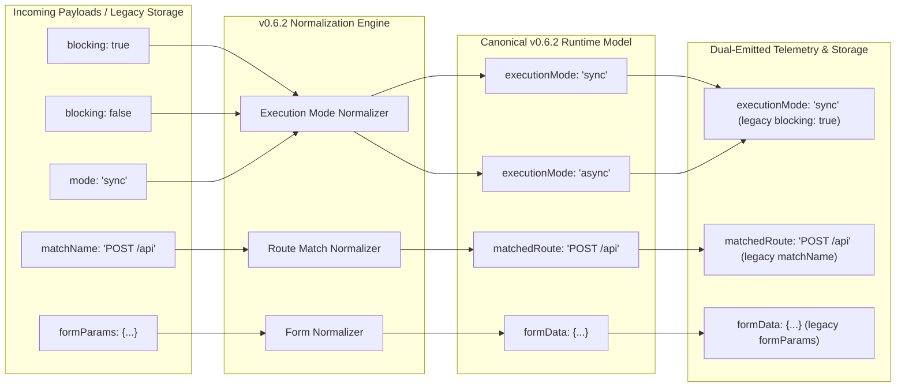
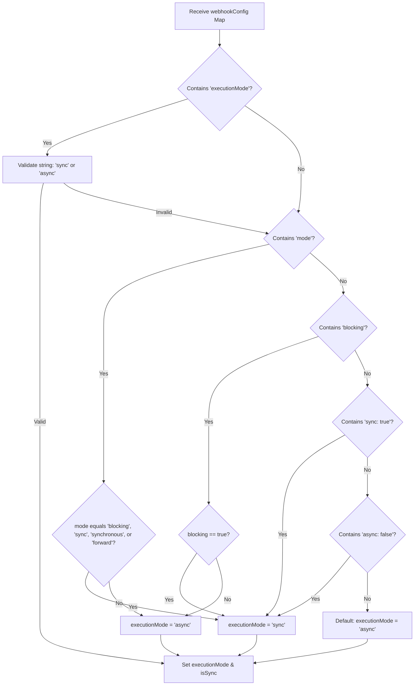
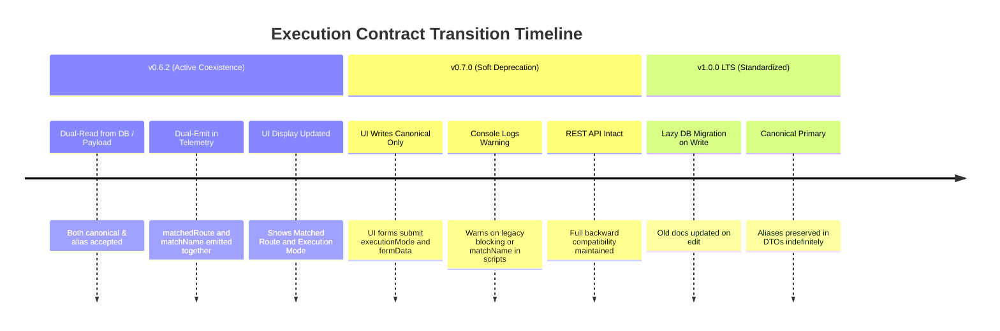
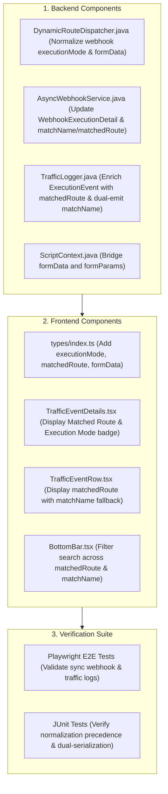

# Architecture Review: v0.6.2 — Execution Contract & Telemetry Alias Standardization

- **Document Type:** Formal Architecture Decision Record (ADR) & Execution Contract Specification
- **Target Release:** `v0.6.2`
- **Release Title:** Execution Contract & Telemetry Alias Standardization
- **Source Authority:** [HTTP_TERMINOLOGY_REVIEW.md](file:///Users/sanjokkhakurel/GITHUB-REPO/dynamic-mock-project/HTTP_TERMINOLOGY_REVIEW.md)
- **Governance Alignment:** Zero Breaking Changes; 100% Backward Compatibility Guaranteed

---

## 1. Executive Summary

Following the comprehensive audit conducted in [HTTP_TERMINOLOGY_REVIEW.md](file:///Users/sanjokkhakurel/GITHUB-REPO/dynamic-mock-project/HTTP_TERMINOLOGY_REVIEW.md), Dynamic Mock's architectural direction for `v0.6.2` has been formally approved. 

### The Core Mandate
> **"Do NOT perform broad, disruptive terminology refactoring. Focus strictly on three targeted friction points (`blocking`, `formParams`, `matchName`) while formally finalizing all other 12 reviewed properties as immutable enterprise standards."**

In previous releases (`v0.6.0` and `v0.6.1`), Dynamic Mock introduced synchronous secondary webhook execution and enriched traffic telemetry. However, three property names introduced cognitive confusion:
1. **`blocking`**: Confused low-level socket/thread blocking with HTTP orchestration. In cloud systems, webhooks operate in either a **synchronous** (inline before response) or **asynchronous** (fire-and-forget in background) mode.
2. **`formParams`**: Created friction with WHATWG Fetch (`FormData`), HTML5 forms, and Postman terminology.
3. **`matchName`**: Lacked grammatical precision in telemetry logs and UI event rows where engineers expect to see the **`matchedRoute`**.

### The Scope Boundary
To protect existing customer integrations, automated test suites, and stored MongoDB mocks, `v0.6.2` establishes a **Zero Breaking Change Guarantee**:
- **Targeted Improvements (3 items):**
  - Introduce `executionMode: "sync" | "async"` to replace `blocking` (with bidirectional translation).
  - Introduce `formData` as canonical while continuing full support for `formParams`.
  - Introduce `matchedRoute` as canonical in telemetry while continuing full support for `matchName`.
- **Finalized Properties (12 items):**
  - `followRedirects`, `delayMs`, `webhook`, `queryParams`, `pathParams`, `requestHeaders`, `responseHeaders`, `requestBody`, `responseBody`, `scenarioState`, `redirectChain`, `resourceId` are **LOCKED** and remain unchanged.

---

## 2. Architecture Decision Record (ADR)

### ADR-008: Targeted Execution Contract & Telemetry Alias Standardization

- **Status:** **APPROVED**
- **Date:** 2026-10-30
- **Context:**
  Dynamic Mock allows route post-scripts and route configurations to trigger secondary HTTP calls (webhooks). When a webhook is triggered, it can execute either synchronously (evaluating headers/status and modifying the client response before it is written) or asynchronously (dispatched to a background worker pool without delaying the mock response). Previously, this was configured using boolean flags (`blocking: true` or `sync: true`). Furthermore, telemetry events logged in [TrafficLogger.java](file:///Users/sanjokkhakurel/GITHUB-REPO/dynamic-mock-project/backend/src/main/java/com/dynamicmock/application/service/TrafficLogger.java) recorded the matched mock rule as `matchName`, and form payloads were parsed under `formParams`.
- **Decision:**
  1. **Introduce `executionMode`**: Standardize on `executionMode: "sync" | "async"` as the first-class contract in webhook configurations and telemetry.
  2. **Bidirectional Backward Compatibility for `blocking`**: Automatically map `blocking=true` to `executionMode="sync"` and `blocking=false` to `executionMode="async"`.
  3. **Introduce Canonical Alias `formData`**: Accept and serialize `formData` alongside legacy `formParams`.
  4. **Introduce Canonical Alias `matchedRoute`**: Emit and display `matchedRoute` alongside legacy `matchName`.
  5. **Freeze Remaining Properties**: Declare `followRedirects`, `delayMs`, `webhook`, `queryParams`, `pathParams`, `requestHeaders`, `responseHeaders`, `requestBody`, `responseBody`, `scenarioState`, `redirectChain`, and `resourceId` as finalized standards.
- **Consequences:**
  - **Positive:** Intuitive, cloud-standard terminology; zero cognitive conflict with thread I/O; seamless OpenAPI/Fetch alignment.
  - **Mitigations:** Jackson `@JsonAlias` in Spring Boot and optional union types in TypeScript guarantee that existing client code, stored JSON, and user scripts continue working without modification.



---

## 3. Canonical Contract

The canonical contract represents the official, modern interface for all new development in `v0.6.2`.

### 3.1 Webhook Execution Contract (`executionMode`)
Webhooks defined in script contexts or route configurations specify their execution behavior via `executionMode`:

```json
{
  "url": "https://api.thirdparty.com/callback",
  "method": "POST",
  "executionMode": "sync",
  "delayMs": 500,
  "requestHeaders": {
    "Content-Type": "application/json"
  },
  "requestBody": "{\"status\": \"APPROVED\", \"transactionId\": \"tx-99482\"}"
}
```

#### Supported `executionMode` Values
| Value | Semantics | Lifecycle Behavior |
| :--- | :--- | :--- |
| **`"sync"`** | **Synchronous (Inline)** | The webhook is invoked *before* the mock response is returned to the client. The webhook's response status, headers, and body can override the mock's response. Blocks client response until webhook completes or times out. |
| **`"async"`** | **Asynchronous (Background)** | The webhook is dispatched to the background worker pool (`CompletableFuture` / virtual threads). The mock immediately returns its response to the client with zero latency penalty. (Default mode). |

### 3.2 Form Data Contract (`formData`)
Form data matching and scripting contexts represent form URL-encoded and multipart payloads via `formData`:

```json
{
  "path": "/mock/oauth/token",
  "method": "POST",
  "matchers": {
    "headers": {
      "Content-Type": "application/x-www-form-urlencoded"
    },
    "formData": {
      "grant_type": "authorization_code",
      "client_id": "client-portal-v2"
    }
  }
}
```

### 3.3 Telemetry Contract (`matchedRoute`)
Telemetry events logged by `TrafficLogger` and emitted over WebSocket to the Console Explorer use `matchedRoute`:

```json
{
  "id": "req-9b8e-42c1-a89e-0498b31f0e21",
  "timestamp": "2026-10-30T17:15:00.124Z",
  "protocol": "HTTP",
  "resourceId": "67210f92a104e7609a81239c",
  "method": "POST",
  "path": "/mock/mobile-banking-login",
  "queryString": "action=login&returnUrl=%2Fdashboard",
  "queryParams": {
    "action": "login",
    "returnUrl": "/dashboard"
  },
  "requestHeaders": {
    "Content-Type": "application/json",
    "User-Agent": "Mozilla/5.0"
  },
  "requestBody": "{\"username\":\"sanjok\",\"password\":\"secret\"}",
  "status": 302,
  "responseHeaders": {
    "Location": "/mock/return-url-redirector",
    "Set-Cookie": "SESSION_ID=abc12345; Path=/; HttpOnly"
  },
  "responseBody": "",
  "durationMs": 4.12,
  "matchedRoute": "POST /mobile-banking-login",
  "matchName": "POST /mobile-banking-login",
  "redirectChain": [
    {
      "step": 1,
      "method": "POST",
      "url": "http://localhost:8080/mock/mobile-banking-login?action=login&returnUrl=%2Fdashboard",
      "status": 302,
      "location": "/mock/return-url-redirector",
      "durationMs": 4.12
    }
  ]
}
```

### 3.4 Summary of Finalized Properties (Immutable)
The following 12 properties are officially frozen and must not be modified:
1. `followRedirects`: Boolean flag for redirect traversal.
2. `delayMs`: Millisecond-explicit latency injection.
3. `webhook`: Outbound callback action object.
4. `queryParams`: URL query parameter map.
5. `pathParams`: URL path variable map.
6. `requestHeaders`: Request header map.
7. `responseHeaders`: Response header map.
8. `requestBody`: Request payload content string.
9. `responseBody`: Response payload content string.
10. `scenarioState`: Stateful workflow state machine node.
11. `redirectChain`: Step-by-step redirect hop list.
12. `resourceId`: Protocol-agnostic platform entity identifier.

---

## 4. Alias Contract & Normalization Rules

To ensure 100% backward compatibility, Dynamic Mock establishes explicit normalization rules with deterministic precedence.

### 4.1 Webhook Execution Mode Normalization
When parsing webhook configuration from JavaScript/Python script contexts, user JSON, or database entities:



#### Precedence Order:
1. **`executionMode`** (Canonical string: `"sync"` | `"async"`)
2. **`mode`** (Legacy string: `"sync"`, `"blocking"`, `"synchronous"` -> `"sync"`; `"async"`, `"background"` -> `"async"`)
3. **`blocking`** (Legacy boolean: `true` -> `"sync"`, `false` -> `"async"`)
4. **`sync`** (Legacy boolean: `true` -> `"sync"`)
5. **`async`** (Legacy boolean: `false` -> `"sync"`, `true` -> `"async"`)
6. **Default:** `"async"`

### 4.2 Form Data Normalization
When matching or accessing form parameters:
- `formData` takes precedence if present.
- If `formData` is null or empty, fall back to `formParams`.
- In script sandboxes (`ScriptContext`), both `context.formData` and `context.formParams` point to the identical underlying map instance.

### 4.3 Matched Route Normalization
When constructing and emitting `ExecutionEvent`:
- If `matchedRoute` is supplied, `matchName` is automatically assigned the exact same value.
- If only `matchName` is supplied (legacy code or third-party event producers), `matchedRoute` is assigned the value of `matchName`.
- During JSON serialization, **both fields are present** in the emitted payload.

---

## 5. UI Naming Strategy

The user interface in `frontend/` must present the clean, canonical naming while remaining intuitive for users familiar with the legacy labels.

### 5.1 Webhook Execution Mode in Route Drawer & Modals
In the Route Configuration Drawer and Webhook Action settings:
- **Component:** Segmented Control / Radio Pill Group
- **Label:** **Execution Mode**
- **Options:**
  - `Asynchronous (Background)` — *Default: fires in background without delaying mock response*
  - `Synchronous (Inline)` — *Waits for webhook response before returning to client*
- **Helper Caption:** *"Synchronous mode allows webhook status and headers to influence the mock response."*
- **Code Mapping:** Persists as `executionMode: "sync" | "async"`. If an existing route has `blocking: true`, the UI automatically displays the `Synchronous (Inline)` pill as selected.

### 5.2 Console Explorer & Traffic Inspection
In [BottomBar.tsx](file:///Users/sanjokkhakurel/GITHUB-REPO/dynamic-mock-project/frontend/src/components/workspace/BottomBar.tsx), [TrafficEventRow.tsx](file:///Users/sanjokkhakurel/GITHUB-REPO/dynamic-mock-project/frontend/src/components/workspace/TrafficEventRow.tsx), and [TrafficEventDetails.tsx](file:///Users/sanjokkhakurel/GITHUB-REPO/dynamic-mock-project/frontend/src/components/workspace/TrafficEventDetails.tsx):

| UI Location | Legacy Presentation | Canonical `v0.6.2` Presentation | Code Access Pattern |
| :--- | :--- | :--- | :--- |
| **Traffic Row Tooltip** | `event.matchName \|\| ''` | `Route: ${event.matchedRoute \|\| event.matchName}` | `event.matchedRoute \|\| event.matchName` |
| **Event Details Header** | `Match: <matchName>` | `Matched Route: <matchedRoute>` | `event.matchedRoute \|\| event.matchName` |
| **Search Filter** | Matches `ev.matchName` | Matches `ev.matchedRoute \|\| ev.matchName` | Searches both properties |
| **Webhook Badges** | Hardcoded text "Sync Webhook" | Badges rendered as `SYNC WEBHOOK` vs `ASYNC WEBHOOK` based on `executionMode === 'sync'` | Driven by `webhookDetail.executionMode` |

### 5.3 Request Matching & Test Client Tabs
- **Route Matchers Tab:** Labeled **Form Data** (with secondary hint *"application/x-www-form-urlencoded & multipart"*).
- **Test Client Body Mode:** Radio toggle offers `none`, `json`, `form-data`, `raw`.

---

## 6. API Naming Strategy

Dynamic Mock’s REST APIs and WebSocket streams must guarantee zero breakage for external CLI tools, CI/CD runners, and integration test scripts.

### 6.1 Inbound API Deserialization (Jackson DTOs)
Spring Boot DTOs leverage Jackson’s `@JsonAlias` to accept both canonical and legacy keys transparently:

```java
package com.dynamicmock.adapter.in.web.dto;

import com.fasterxml.jackson.annotation.JsonAlias;
import com.fasterxml.jackson.annotation.JsonProperty;
import lombok.AllArgsConstructor;
import lombok.Builder;
import lombok.Data;
import lombok.NoArgsConstructor;
import java.util.Map;

@Data
@Builder
@NoArgsConstructor
@AllArgsConstructor
public class WebhookExecutionDetail {

    private String sourceRouteId;
    private String parentEventId;
    private String targetUrl;
    private String finalUrl;
    private String method;
    private Integer delayMs;

    /**
     * Canonical execution mode in v0.6.2: "sync" | "async"
     */
    @JsonProperty("executionMode")
    @JsonAlias({"mode"})
    private String executionMode;

    /**
     * Legacy boolean alias.
     */
    @JsonProperty("blocking")
    public Boolean isBlocking() {
        return "sync".equalsIgnoreCase(this.executionMode);
    }

    public void setBlocking(Boolean blocking) {
        if (Boolean.TRUE.equals(blocking)) {
            this.executionMode = "sync";
        } else if (Boolean.FALSE.equals(blocking)) {
            this.executionMode = "async";
        }
    }

    private Map<String, String> requestHeaders;
    private String requestBody;
    private Integer responseStatus;
    private Map<String, String> responseHeaders;
    private String responseBody;
    private String errorMessage;
}
```

### 6.2 Outbound Event Serialization (Traffic Logger)
In [TrafficLogger.java](file:///Users/sanjokkhakurel/GITHUB-REPO/dynamic-mock-project/backend/src/main/java/com/dynamicmock/application/service/TrafficLogger.java), `ExecutionEvent` dual-emits both `matchedRoute` and `matchName`:

```java
@Data
@Builder
@NoArgsConstructor
@AllArgsConstructor
public static class ExecutionEvent {
    private String id;
    private String timestamp;
    private String protocol;
    private String resourceId;
    private String parentEventId;
    private String method;
    private String path;
    private String queryString;
    private Map<String, String> queryParams;
    private Map<String, String> requestHeaders;
    private String requestBody;
    private int status;
    private Map<String, String> responseHeaders;
    private String responseBody;
    private double durationMs;

    /**
     * Canonical identifier in v0.6.2
     */
    private String matchedRoute;

    /**
     * Backward-compatible alias (identical to matchedRoute)
     */
    private String matchName;

    private List<RedirectHop> redirectChain;
    private WebhookExecutionDetail webhookDetail;

    public static class ExecutionEventBuilder {
        public ExecutionEventBuilder matchedRoute(String matchedRoute) {
            this.matchedRoute = matchedRoute;
            if (this.matchName == null) {
                this.matchName = matchedRoute;
            }
            return this;
        }

        public ExecutionEventBuilder matchName(String matchName) {
            this.matchName = matchName;
            if (this.matchedRoute == null) {
                this.matchedRoute = matchName;
            }
            return this;
        }
    }
}
```

### 6.3 TypeScript Definitions (`frontend/src/types/index.ts`)
```typescript
export interface WebhookExecutionDetail {
  sourceRouteId?: string;
  parentEventId?: string;
  targetUrl?: string;
  finalUrl?: string;
  method?: string;
  delayMs?: number;
  /** Canonical in v0.6.2: 'sync' | 'async' */
  executionMode?: 'sync' | 'async';
  /** Legacy alias supported in v0.6.2 */
  blocking?: boolean;
  requestHeaders?: Record<string, string>;
  requestBody?: string;
  responseStatus?: number;
  responseHeaders?: Record<string, string>;
  responseBody?: string;
  errorMessage?: string;
}

export interface ExecutionEvent {
  id: string;
  timestamp: string;
  protocol: Protocol | 'WEBHOOK';
  resourceId?: string;
  parentEventId?: string;
  method?: string;
  path?: string;
  queryString?: string;
  queryParams?: Record<string, string>;
  requestHeaders?: Record<string, string>;
  requestBody?: string;
  status: number;
  responseHeaders?: Record<string, string>;
  responseBody?: string;
  durationMs: number;
  /** Canonical in v0.6.2 */
  matchedRoute?: string;
  /** Legacy alias for backward compatibility */
  matchName?: string;
  redirectChain?: RedirectHop[];
  webhookDetail?: WebhookExecutionDetail;
  payloadSizeBytes?: number;
  bodyTruncated?: boolean;
}
```

---

## 7. Migration Strategy

The migration path follows a **three-phase non-destructive transition** requiring zero downtime and zero database migration scripts.



### 7.1 Database (MongoDB) Strategy: Non-Destructive Lazy Upgrade
No batch database migration script is executed during `v0.6.2` deployment.
- **Read Path:** When MongoDB documents are read into `MockRoute` entities, the entity accessor checks:
  ```java
  public String getExecutionMode() {
      if (this.executionMode != null) return this.executionMode;
      return Boolean.TRUE.equals(this.blocking) ? "sync" : "async";
  }
  ```
- **Write Path:** When a route is modified or created in `v0.6.2`, the repository saves `executionMode` directly.
- **Safety Guarantee:** Legacy documents that are never edited remain in their existing format and continue functioning indefinitely.

### 7.2 Polyglot Script Sandbox Strategy (JS & Python)
Engineers often write JavaScript or Python post-scripts that configure webhooks dynamically:

```javascript
// Legacy script authored in v0.6.0
webhook = {
  url: 'http://internal-gateway:8080/confirm',
  method: 'POST',
  blocking: true,
  delayMs: 200
};
```

In `v0.6.2`, [DynamicRouteDispatcher.java](file:///Users/sanjokkhakurel/GITHUB-REPO/dynamic-mock-project/backend/src/main/java/com/dynamicmock/infrastructure/filter/DynamicRouteDispatcher.java) inspects the script-generated `webhook` map through the normalizer:
1. It reads `webhook.get("executionMode")`. If missing, it reads `webhook.get("blocking")`.
2. Because `blocking: true` is present, it resolves `executionMode = "sync"`.
3. The blocking webhook executes with 100% fidelity. **Existing user scripts require zero changes.**

New scripts can author directly:
```javascript
// Modern script authored in v0.6.2
webhook = {
  url: 'http://internal-gateway:8080/confirm',
  method: 'POST',
  executionMode: 'sync',
  delayMs: 200
};
```

---

## 8. Risks & Mitigations

| # | Identified Risk | Severity | Likelihood | Concrete Architectural Mitigation |
| :- | :--- | :--- | :--- | :--- |
| **1** | **Conflicting Inbound Values:** A client or script sends conflicting fields simultaneously (e.g. `executionMode: "async"` AND `blocking: true`). | Medium | Low | **Explicit Precedence Rule:** Canonical `executionMode` strictly overrides `blocking`. If `executionMode` is set to `"async"`, it wins over legacy flags. |
| **2** | **WebSocket Telemetry Payload Bloat:** Dual-emitting `matchedRoute` and `matchName` in every `ExecutionEvent` increases frame size. | Low | High | **Measured Impact:** Adding `matchedRoute: "POST /mock/path"` adds approximately 25–40 bytes per event. For typical mock payloads (1–15 KB), this represents <0.3% overhead, well within standard WebSocket frame limits. |
| **3** | **Frontend Stale Cache / Breakage:** Third-party consumers or cached frontend bundles accessing `event.matchName`. | High | Medium | **Dual-Emission Guarantee:** `TrafficLogger` emits *both* fields simultaneously. `event.matchName` is never omitted or nullified in `v0.6.2`. |
| **4** | **Database Drift:** Some MongoDB documents store `blocking` while new ones store `executionMode`. | Low | High | **Dual-Read Entity Mapping:** Clean Architecture mappers inspect both fields on read. System behavior is 100% deterministic regardless of storage schema version. |

---

## 9. Recommendation & Implementation Plan

### Architectural Verdict: **APPROVED FOR IMMEDIATE v0.6.2 IMPLEMENTATION**

The proposed contract achieves the ideal balance: it modernizes Dynamic Mock's API terminology to industry standards, eliminates misleading jargon (`blocking`), and improves UI clarity, while strictly honoring the **Zero Breaking Changes Guarantee**.

### File-by-File Implementation Plan



#### Detailed Code Changes:
1. **[DynamicRouteDispatcher.java](file:///Users/sanjokkhakurel/GITHUB-REPO/dynamic-mock-project/backend/src/main/java/com/dynamicmock/infrastructure/filter/DynamicRouteDispatcher.java):**
   - Update `isBlockingWebhook(Map<String, Object> webhookConfig)` to inspect `executionMode` first (`"sync"` vs `"async"`), falling back to `mode` and `blocking`.
   - In `trafficLogger.log()`, supply both `.matchedRoute(matchName)` and `.matchName(matchName)`.
2. **[AsyncWebhookService.java](file:///Users/sanjokkhakurel/GITHUB-REPO/dynamic-mock-project/backend/src/main/java/com/dynamicmock/application/service/AsyncWebhookService.java):**
   - In `executeWebhookSync()`, resolve `executionMode = isBlocking ? "sync" : "async"`.
   - Populate `executionMode` in `WebhookExecutionDetail`.
   - Supply both `matchedRoute` and `matchName` when logging the `WEBHOOK` execution event.
3. **[TrafficLogger.java](file:///Users/sanjokkhakurel/GITHUB-REPO/dynamic-mock-project/backend/src/main/java/com/dynamicmock/application/service/TrafficLogger.java):**
   - Add `private String matchedRoute;` to `ExecutionEvent`.
   - Ensure builder mirrors `matchedRoute` into `matchName` and vice-versa.
4. **[types/index.ts](file:///Users/sanjokkhakurel/GITHUB-REPO/dynamic-mock-project/frontend/src/types/index.ts):**
   - Add `executionMode?: 'sync' | 'async'` and `blocking?: boolean` to `WebhookExecutionDetail`.
   - Add `matchedRoute?: string` alongside `matchName?: string` to `ExecutionEvent`.
   - Add `formData?: Record<string, string>` alongside `formParams` in `MockRoute.matchers`.
5. **[TrafficEventDetails.tsx](file:///Users/sanjokkhakurel/GITHUB-REPO/dynamic-mock-project/frontend/src/components/workspace/TrafficEventDetails.tsx):**
   - Update header label to `Matched Route: <strong className="text-foreground">{event.matchedRoute || event.matchName}</strong>`.
   - Render badge `SYNC WEBHOOK` / `ASYNC WEBHOOK` based on `webhookDetail?.executionMode`.
6. **[TrafficEventRow.tsx](file:///Users/sanjokkhakurel/GITHUB-REPO/dynamic-mock-project/frontend/src/components/workspace/TrafficEventRow.tsx):**
   - Fall back gracefully: `event.matchedRoute || event.matchName || ''`.
7. **[BottomBar.tsx](file:///Users/sanjokkhakurel/GITHUB-REPO/dynamic-mock-project/frontend/src/components/workspace/BottomBar.tsx):**
   - Update filter search condition: `(ev.matchedRoute || ev.matchName)?.toLowerCase().includes(query)`.
8. **Regression & E2E Verification:**
   - Execute [mobile-banking-login-stub.e2e.spec.ts](file:///Users/sanjokkhakurel/GITHUB-REPO/dynamic-mock-project/e2e/tests/mobile-banking-login-stub.e2e.spec.ts) and backend integration tests to confirm zero regressions.

