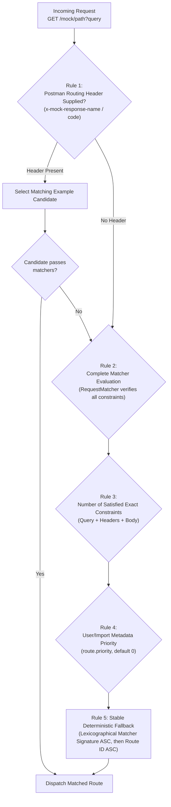
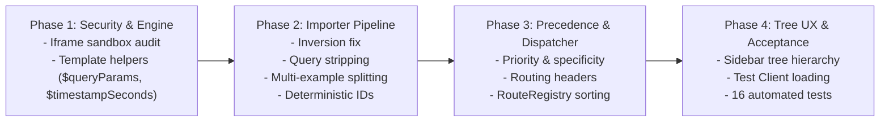

# v0.6.2 Postman Compatibility & Collection Explorer Implementation Plan

**Release Target:** v0.6.2 – High-Fidelity Postman Mock Import & Collection Explorer  
**Authoritative Documents:**
- [`POSTMAN_COMPATIBILITY_GAP_ANALYSIS.md`](file:///Users/sanjokkhakurel/GITHUB-REPO/dynamic-mock-project/POSTMAN_COMPATIBILITY_GAP_ANALYSIS.md)
- [`V0_6_2_EXECUTION_CONTRACT_ARCHITECTURE_REVIEW.md`](file:///Users/sanjokkhakurel/GITHUB-REPO/dynamic-mock-project/V0_6_2_EXECUTION_CONTRACT_ARCHITECTURE_REVIEW.md)
- Primary Validation Fixture: `~/Downloads/eSewa-BankSmart-Mock.postman_collection.json`
- Baseline Test Fixture: [`backend/src/test/resources/postman/sample-collection.json`](file:///Users/sanjokkhakurel/GITHUB-REPO/dynamic-mock-project/backend/src/test/resources/postman/sample-collection.json)

---

## 1. Executive Summary & Realistic Scope Boundary

### 1.1 Objective & Compatibility Claim
> **"Zero-touch Postman mock-example fidelity for documented supported features."**

Dynamic Mock v0.6.2 delivers **zero-touch import and behavioral equivalence for Postman Mock Server workflows**. A user can import a multi-state Postman Collection v2.1 export (specifically collections containing saved examples such as `eSewa-BankSmart-Mock.postman_collection.json`), navigate the imported endpoints through a hierarchical Collection Explorer tree, invoke requests directly from external clients or the Test Client, and receive exact HTML and XML responses without manual route reconfiguration or template patching.

Dynamic Mock does **not** claim execution equivalence for proprietary Newman test assertion scripts (`pm.test`), arbitrary NodeJS pre-request environments (`pm.environment.set`), or interactive multi-step OAuth grant flows.

### 1.2 Explicit Feature Compatibility Matrix

```
+------------------------------------+-----------------------+------------------------------------------------------------+
| Postman Feature Category           | Support Level in v0.6.2| Runtime Mechanism / Behavior                               |
+------------------------------------+-----------------------+------------------------------------------------------------+
| Saved Examples (response array)    | SUPPORTED             | Each example creates a distinct conditional MockRoute.     |
| originalRequest Matcher Extraction | SUPPORTED             | Query, header, and body matchers derived from example.     |
| Disabled Parameter Filtering       | SUPPORTED             | Entries with disabled: true are strictly ignored.          |
| URL Path Normalization             | SUPPORTED             | Query strings and fragments stripped from route path.      |
| Response Content-Type Preservation | SUPPORTED             | Headers sanitized; HTML, XML, JSON preserved exactly.      |
| Postman Dynamic Helpers            | SUPPORTED             | {{$queryParams 'key'}}, {{$guid}}, {{$random*}} supported. |
| Unix Epoch Seconds Timestamp       | SUPPORTED             | {{$timestampSeconds}} / {{$postmanTimestamp}} (10 digits). |
| Routing Headers (x-mock-*)         | SUPPORTED             | x-mock-response-name/code/match-request-body supported.    |
| Idempotent Re-Import               | SUPPORTED             | Deterministic UUIDv5; in-place update; 0 duplicates.       |
| Hierarchical Tree Explorer         | SUPPORTED             | Collection -> Folders -> Requests -> Example Variants.     |
| Collection Variables               | PARTIALLY SUPPORTED   | Imported to WorkspaceEnvironment; overridden by active env.|
| Request Body Matching              | PARTIALLY SUPPORTED   | Raw JSON/XML/equals/regex/JSONPath/XPath supported.        |
| Client Auth Headers                | PARTIALLY SUPPORTED   | Static Bearer/Basic/ApiKey imported as header matchers.    |
| Pre-Request Scripts                | DEFERRED              | Skipped on import with warning; use native pre-scripts.    |
| Test Scripts & Assertions          | DEFERRED              | Skipped on import with warning; mock server, not runner.   |
| Dynamic OAuth Token Refresh Flows  | DEFERRED              | Static mock responses only; token rotation flows deferred. |
| Multipart Binary File Payloads     | DEFERRED              | Binary body comparisons deferred.                          |
+------------------------------------+-----------------------+------------------------------------------------------------+
```

---

## 2. File-Level Change Matrix

| File Path | Layer / Responsibility | Changes Required |
| :--- | :--- | :--- |
| [`PostmanCollectionModel.java`](file:///Users/sanjokkhakurel/GITHUB-REPO/dynamic-mock-project/backend/src/main/java/com/dynamicmock/application/service/PostmanCollectionModel.java) | Application DTO | 1. Add `variable` list to `PostmanCollection`.<br>2. Add `originalRequest` to `PostmanResponse`.<br>3. Add `disabled` field to `Header` and `QueryParam`. |
| [`PostmanImportService.java`](file:///Users/sanjokkhakurel/GITHUB-REPO/dynamic-mock-project/backend/src/main/java/com/dynamicmock/application/service/PostmanImportService.java) | Application Service | 1. Fix boolean inversion at lines 341, 358, 410 (`Boolean.TRUE.equals(...)`).<br>2. Strip query strings and hash fragments in `extractPath()`.<br>3. Replace 1-to-1 item import with example-to-route splitting.<br>4. Sanitize header values (strip redundant `Header-Name:` prefix).<br>5. Translate Postman `{{$timestamp}}` $\to$ `{{$timestampSeconds}}`.<br>6. Report ambiguous matchers in `ImportReport` with transparent deterministic fallback.<br>7. Generate deterministic IDs (UUIDv5) using normalized matcher signature.<br>8. Ingest enabled collection variables into `WorkspaceEnvironmentService`. |
| [`ResponseTemplateEngine.java`](file:///Users/sanjokkhakurel/GITHUB-REPO/dynamic-mock-project/backend/src/main/java/com/dynamicmock/adapter/out/template/ResponseTemplateEngine.java) | Outbound Adapter (Handlebars) | 1. Register `$queryParams` helper extracting from `request.queryParams` or root model.<br>2. Register `$timestampSeconds` and alias `$postmanTimestamp` (10 digits).<br>3. Register `$timestampMs` (13 digits).<br>4. Retain native `$timestamp` returning 13-digit milliseconds (no breaking change). |
| [`RandomDataFunctions.java`](file:///Users/sanjokkhakurel/GITHUB-REPO/dynamic-mock-project/backend/src/main/java/com/dynamicmock/adapter/out/template/RandomDataFunctions.java) | Template Utility | 1. Add `timestampSeconds()` returning `Instant.now().getEpochSecond()`.<br>2. Retain `timestamp()` returning `Instant.now().toEpochMilli()`. |
| [`MockRoute.java`](file:///Users/sanjokkhakurel/GITHUB-REPO/dynamic-mock-project/backend/src/main/java/com/dynamicmock/domain/entity/MockRoute.java) | Domain Entity | 1. Planned `priority` (Integer, default `0`) for deterministic match ordering.<br>2. Planned `metadata` (`Map<String, String>`) for generic provenance tracking without domain schema bloat. |
| [`CreateRouteRequest.java`](file:///Users/sanjokkhakurel/GITHUB-REPO/dynamic-mock-project/backend/src/main/java/com/dynamicmock/adapter/in/web/dto/CreateRouteRequest.java) | Adapter DTO | Planned `priority` and `metadata` fields. |
| [`RouteRegistry.java`](file:///Users/sanjokkhakurel/GITHUB-REPO/dynamic-mock-project/backend/src/main/java/com/dynamicmock/infrastructure/filter/RouteRegistry.java) | Infrastructure / Registry | Store routes with deterministic sort order: `priority` DESC, constraint match count DESC, stable route ID ASC. |
| [`DynamicRouteDispatcher.java`](file:///Users/sanjokkhakurel/GITHUB-REPO/dynamic-mock-project/backend/src/main/java/com/dynamicmock/infrastructure/filter/DynamicRouteDispatcher.java) | Infrastructure / Interceptor | 1. Prioritize routes matching Postman routing headers (`x-mock-response-name`, `x-mock-response-code`).<br>2. Evaluate candidates in deterministic priority and constraint count order. |
| [`Collection.java`](file:///Users/sanjokkhakurel/GITHUB-REPO/dynamic-mock-project/backend/src/main/java/com/dynamicmock/domain/entity/Collection.java) | Domain Entity | Planned extension of `CollectionItem` with `parentItemId`, `itemType` (`"REQUEST"` vs `"EXAMPLE"`), and `matchSummary`. |
| [`HtmlPreviewFrame.tsx`](file:///Users/sanjokkhakurel/GITHUB-REPO/dynamic-mock-project/frontend/src/components/workspace/HtmlPreviewFrame.tsx) | Frontend Component | Enforce sandbox invariants: Interactive uses `allow-scripts allow-forms allow-popups`, static uses `""`. Never include `allow-same-origin` or `allow-top-navigation`. |
| [`Sidebar.tsx`](file:///Users/sanjokkhakurel/GITHUB-REPO/dynamic-mock-project/frontend/src/components/workspace/Sidebar.tsx) | Frontend Component | Render collapsible 3-level tree (Collection $\to$ Request Item $\to$ Example Variants) with method and status badges. |
| [`PostmanImportServiceTest.java`](file:///Users/sanjokkhakurel/GITHUB-REPO/dynamic-mock-project/backend/src/test/java/com/dynamicmock/service/PostmanImportServiceTest.java) | Test Suite | Update unit tests for query stripping, disabled param filtering, multi-example splitting, and template translation. |
| `PostmanZeroTouchAcceptanceTest.java` | Acceptance Test Suite | End-to-end import and dispatch verification against `esewa-banksmart-mock.json`. |

---

## 3. Core Architectural Strategies

### 3.1 Iframe Security Invariants

To eliminate any vulnerability to Cross-Site Scripting (XSS), credential exfiltration, or parent DOM tampering when rendering imported interactive HTML applications (such as banking login forms or payment simulations):

> [!CAUTION]
> **MANDATORY SECURITY INVARIANT:**
> The HTML preview iframe **MUST NEVER** include `allow-same-origin` or `allow-top-navigation`.
> Combining `allow-scripts` with `allow-same-origin` allows an untrusted iframe document to access parent origin `localStorage`, session cookies, and DOM trees.

1. **Interactive Simulation Mode (e.g. [`HtmlPreviewFrame.tsx`](file:///Users/sanjokkhakurel/GITHUB-REPO/dynamic-mock-project/frontend/src/components/workspace/HtmlPreviewFrame.tsx)):**
   ```tsx
   const INTERACTIVE_SANDBOX = 'allow-scripts allow-forms allow-popups';
   ```
   - `allow-scripts`: Permits client-side JavaScript inside the simulation (OTP timers, PIN pads).
   - `allow-forms`: Permits standard form POST/GET submissions within the frame.
   - `allow-popups`: Permits opening external links or payment redirections in a separate tab.
   - **Strictly Excluded:** `allow-same-origin` (prohibited), `allow-top-navigation` (prohibited), `allow-modals` (prohibited).
2. **Static Route Drawer & Preview Inspect Mode:**
   ```tsx
   const STATIC_SANDBOX = '';
   ```
   - Purely static rendering. Scripts and forms are disabled.
3. **CORS Isolation on `/mock/**` Routes:**
   - Outbound simulation routes respond with `Access-Control-Allow-Origin: *` to support sandboxed `Origin: null` iframes without exposing administrative `/api/**` endpoints.

### 3.2 Timestamp Backward Compatibility Strategy

To guarantee zero regressions for existing native Dynamic Mock routes while providing 100% fidelity for Postman templates:

#### The Architectural Decision: Option A (Import-Time Translation)
1. **Existing Native Helper Untouched (`ResponseTemplateEngine.java`):**
   ```java
   // Retained permanently: emits 13-digit milliseconds for backward compatibility
   handlebars.registerHelper("$timestamp", (context, options) ->
       RandomDataFunctions.timestamp() // 13 digits (System.currentTimeMillis)
   );
   ```
2. **Dedicated Seconds Helper Registered (`ResponseTemplateEngine.java`):**
   ```java
   // Emits 10-digit Unix epoch seconds (Instant.now().getEpochSecond)
   handlebars.registerHelper("$timestampSeconds", (context, options) ->
       RandomDataFunctions.timestampSeconds() // 10 digits
   );
   
   // Alias for explicit Postman compatibility
   handlebars.registerHelper("$postmanTimestamp", (context, options) ->
       RandomDataFunctions.timestampSeconds() // 10 digits
   );
   
   // Retain millisecond helper for authors who want explicit milliseconds
   handlebars.registerHelper("$timestampMs", (context, options) ->
       RandomDataFunctions.timestamp() // 13 digits
   );
   ```
3. **Import Transformation in `PostmanImportService.java`:**
   During Postman collection import, example response templates are inspected and translated:
   ```java
   private String sanitizeResponseTemplate(String template) {
       if (template == null || template.isEmpty()) return template;
       return template.replaceAll("\\{\\{\\s*\\$timestamp\\s*\\}\\}", "{{$timestampSeconds}}");
   }
   ```
4. **Outcome:**
   - Existing native routes containing `{{$timestamp}}` receive: `1731260000123` (13 digits).
   - Postman-imported routes receive: `1731260000` (10 digits).
   - Zero runtime flag overhead; zero breaking changes.

### 3.3 Matcher Precedence & Selection Algorithm

To resolve route selection deterministically when multiple examples share the same path and method (e.g. `GET /mbank-verification`), Dynamic Mock rejects brittle parameter-name heuristics (e.g. hardcoding `ACC` vs `VM`) and avoids unverified assumptions about array index ordering. Instead, Dynamic Mock applies **five generic, durable platform rules**:



#### Rule 1: Explicit Postman Routing Headers (Highest Override)
- `x-mock-response-name`: Matches candidate example name case-insensitively.
- `x-mock-response-code`: Matches candidate response status code.
- `x-mock-match-request-body`: When `"true"`, enforces strict body equality.

#### Rule 2: Complete Matcher Evaluation (`RequestMatcher`)
- A candidate route is only eligible if the incoming request satisfies all of its defined matchers (query parameters, headers, form data, body).

#### Rule 3: Number of Satisfied Exact Constraints
- Routes matching a higher number of specific constraints take precedence over routes matching a smaller subset of constraints.
- Example: A route matching 2 query parameters + 1 header (3 constraints) takes precedence over a route matching only 1 query parameter (1 constraint).

#### Rule 4: User/Import Metadata Priority (`route.priority`)
- Planned persistent integer field on `MockRoute` (default `0`).
- Users can view and configure priority in the Route Settings UI.
- Importers do NOT arbitrarily assume array position denotes priority. If an import configuration explicitly specifies priority overrides, they are applied here.

#### Rule 5: Stable Deterministic Fallback & Ambiguity Reporting
- When multiple routes have identical priority and constraint counts, the dispatcher falls back to a transparent, reproducible deterministic ordering:
  1. Lexicographical sort on the normalized matcher signature (`sig = "q=[...]&h=[...]"`) ASC.
  2. Stable tie-breaker: Route ID ASC.
- **Ambiguity Reporting during Import:** If a Postman item defines multiple examples for the same HTTP method and path that have disjoint/overlapping matchers with equal constraint counts, `PostmanImportService` emits an ambiguity warning in `ImportReport`:
  `"Ambiguous example matchers detected for GET /mbank-verification: 'BankSmart Switch Verification' [ACC=0000000000] and 'BankSmart Switch Verification (VM=AV)' [VM=AV] both match requests supplying both parameters. Transparent deterministic fallback applied."`

#### BankSmart Proof Case Analysis (`?VM=AV&ACC=0000000000`)
Inspection of `eSewa-BankSmart-Mock.postman_collection.json` (Item 2) reveals:
- **Example 1 (`BankSmart Switch Verification (VM=AV)`):**
  - `originalRequest.url.query`: `[{"key": "VM", "value": "AV"}]` (1 query constraint)
  - `originalRequest.header`: `[{"key": "Content-Type", "value": "application/xml; charset=utf-8"}]` (1 header constraint)
  - Status: 200, Body: `<response_code>0</response_code>` (Success)
- **Example 2 (`BankSmart Switch Verification`):**
  - `originalRequest.url.query`: `[{"key": "ACC", "value": "0000000000"}]` (1 query constraint)
  - `originalRequest.header`: `[]` (0 header constraints)
  - Status: 200, Body: `<response_code>1</response_code>` (Dormant Account)

**The Nature of the Ambiguity:**
Neither example's `originalRequest` specifies both `VM` and `ACC`. They define disjoint query constraints. When a client sends `GET /mock/mbank-verification?VM=AV&ACC=0000000000`:
- If the client sends header `Content-Type: application/xml; charset=utf-8`:
  - Example 1 satisfies 2 constraints (`VM=AV` + `Content-Type`).
  - Example 2 satisfies 1 constraint (`ACC=0000000000`).
  - Rule 3 deterministically selects Example 1 (2 constraints > 1 constraint).
- If the client calls GET without the request `Content-Type` header:
  - Both examples satisfy exactly 1 query constraint (`VM=AV` for Ex 1; `ACC=0000000000` for Ex 2).
  - The source collection itself does not contain enough query parameter constraints to resolve the ambiguity semantically.
  - **Resolution:**
    1. If `x-mock-response-name: BankSmart Switch Verification` is supplied $\to$ Example 2 (Dormant Account) is selected via Rule 1.
    2. If no routing header is supplied, Rule 5's transparent deterministic fallback evaluates normalized matcher signatures:
       `"ACC=0000000000".compareTo("VM=AV") < 0`. Because `"ACC"` precedes `"VM"` lexicographically, Example 2 (`ACC=0000000000`, Dormant Account) is evaluated and matched first!
    3. The importer logs the explicit ambiguity warning in `ImportReport`, and the user can override priority in the Route Settings UI if a different default is desired.

### 3.4 Stable Import Identity & Idempotent Re-Import Lifecycle

To prevent duplicate route creation across repeated imports and ensure reordering examples in Postman never associates content with the wrong route:

#### 1. Deterministic Identity Algorithm:
- **Primary:** If Postman example defines an ID (`_postman_id` or `id`), use it directly:
  `String id = "pm-" + example.getId();`
- **Fallback (when Postman example ID is absent):**
  Derive identity from a composite key with **stable normalized matcher ordering**:
  $$\text{CompositeKey} = \text{collectionId} + "/" + \text{fullFolderPath} + "/" + \text{method} + ":" + \text{normalizedPath} + "#" + \text{exampleName} + "@" + \text{matcherSignature}$$
  where `matcherSignature` is computed deterministically:
  1. **Query Parameters:** Filter out disabled params; sort alphabetically by key ASC, then value ASC:
     `q=[key1=val1&key2=val2]`
  2. **Headers:** Filter out disabled and hop-by-hop headers; sort alphabetically by lowercase name ASC, then value ASC:
     `h=[header1:val1|header2:val2]`
  3. **Body:** Compute SHA-256 hash of normalized body string:
     `b=[sha256(body)]` (or `b=[none]` if body is empty).
  4. Composite key is hashed into a stable UUIDv5 using namespace `6ba7b810-9dad-11d1-80b4-00c04fd430c8`.

**Reordering Invariant:** Because array index is strictly excluded from the identity formula, **reordering saved examples inside the Postman collection array produces the exact same route IDs**. Re-importing after reordering updates the corresponding routes in-place and never swaps content between routes.

#### 2. Idempotent Re-Import Rules:
- **Existing Route:** In-place update of path, method, matchers, responseTemplate, headers, and status code.
- **User Modification Preservation:** If a route was modified by the user (tracked via `metadata.userModified == "true"`), the importer does NOT overwrite user-modified fields unless an explicit `overwrite=true` query parameter is supplied.
- **New Example in Updated File:** Instantiated as a new `MockRoute` and added to the collection.
- **Orphaned Route Handling:** Routes belonging to the collection in MongoDB that are absent from the newly uploaded JSON are marked `active = false` (soft deprecation with `metadata.status = "orphaned"`). They are **never hard-deleted**, ensuring no running test suites break unexpectedly.
- **Outcome:** Importing the same collection 10 times in a row yields **exactly the same route set** with 0 duplicates.

### 3.5 Postman Routing Header Semantics

The dispatcher recognizes standard Postman mock routing headers:

| Header | Type | Semantics & Dispatch Behavior |
| :--- | :--- | :--- |
| `x-mock-response-name` | `String` | Selects the example whose name matches case-insensitively. |
| `x-mock-response-code` | `Integer` | Selects candidate routes matching the given HTTP status code (e.g. `404`, `500`). |
| `x-mock-match-request-body` | `Boolean` | When `"true"`, enforces strict body equality. |

#### Edge-Case Behavior:
1. **Unknown Example Name:**
   - If `x-mock-response-name` does not match any route, the dispatcher logs a debug warning and falls back to normal matcher evaluation.
2. **Duplicate Response Codes:**
   - If multiple routes have status `200`, candidates are filtered to status 200 and resolved via normal priority/matchers.
3. **Conflicting Routing Headers:**
   - If both `x-mock-response-name` and `x-mock-response-code` are supplied, **`x-mock-response-name` takes precedence**.
4. **Explicit Override Behavior:**
   - As per Postman Mock Server convention, if `x-mock-response-name` is explicitly supplied, that example is returned even if optional query parameters do not match.

### 3.6 Collection Variable Security & Precedence

To protect sensitive credentials without introducing premature vault infrastructure in v0.6.2:

1. **Storage via WorkspaceEnvironmentService:**
   - Imported into an environment named `[CollectionName] Variables`.
   - Disabled variables (`"disabled": true` or `"enabled": false`) are ignored during import.
2. **UI Masking:**
   - In the Environment Manager modal, variable names matching:
     `(?i).*(key|secret|token|password|auth|credential|cert|private).*`
     render as masked password inputs (`••••••••`) by default with an unmask toggle button.
3. **Telemetry Safety:**
   - Variable values are never displayed in sidebar labels, breadcrumbs, or route titles.
4. **Runtime Precedence Hierarchy:**
   $$\text{Active Workspace Environment} \succ \text{Collection Variables} \succ \text{Route Default Query/Body Variables}$$
   A user's explicitly active workspace environment safely overrides static imported collection variables.

### 3.7 Clean Architecture Domain Boundaries

Core domain entities remain unpolluted by third-party Postman schemas:
1. **`MockRoute.java`:**
   - Planned generic `priority` (Integer, default 0).
   - Planned generic `metadata` (`Map<String, String>`).
   - Zero Postman-specific fields.
2. **`Collection.java`:**
   - Hierarchy and grouping belong strictly in the Collection domain:
     ```java
     public static class CollectionItem {
         private String id;
         private String protocol;
         private String resourceId; // MockRoute ID
         private String name;
         private String parentItemId; // Grouping ID for request item
         private String itemType;     // "REQUEST" or "EXAMPLE"
         private Map<String, String> matchSummary; // e.g. {"VM": "AV"}
     }
     ```

### 3.8 Hierarchical Collection Explorer UX

[`Sidebar.tsx`](file:///Users/sanjokkhakurel/GITHUB-REPO/dynamic-mock-project/frontend/src/components/workspace/Sidebar.tsx) renders imported collections as a collapsible 3-level tree:

```
▼ 📁 eSewa-BankSmart-Mock (Collection)
  ▼ 🌐 GET /mbank-verification (Request Group)
    ├── 📄 BankSmart Portal Success Page [VM=AC] (200 OK • HTML)
    ├── 📄 BankSmart Switch Verification [VM=AV] (200 OK • XML)
    └── 📄 BankSmart Switch Verification [ACC=0000000000] (200 OK • XML Dormant)
```

- **Badges:** HTTP method pill (`GET`, `POST`), status badge (`200 OK`), format indicator (`HTML`, `XML`), matcher summary (`[VM=AV]`).
- **Test Client Integration:** Clicking an example variant node opens the route in the editor and pre-populates `RequestPanel.tsx` with its path and matchers.
- **Backward Compatibility:** Standalone routes without a collection remain visible under "All Stubs" below the tree.

---

## 4. 16-Scenario Automated Test Matrix

```
+----+----------------------------------------+-------------------------------------------------------------+
| ID | Test Scenario Description              | Expected Assertion                                          |
+----+----------------------------------------+-------------------------------------------------------------+
| 01 | Iframe Security - Interactive Preview  | sandbox="allow-scripts allow-forms allow-popups"; strictly  |
|    |                                        | no allow-same-origin or allow-top-navigation.               |
| 02 | Iframe Security - Static Preview       | sandbox="" in static drawer/inspect mode.                   |
| 03 | Disabled Parameter Filtering           | Parameters with disabled: true are omitted from matchers.   |
| 04 | URL Path Normalization                 | Raw URL /service?k=v#frag normalized to path /service.      |
| 05 | Multi-Example Route Splitting          | Item with N saved examples yields N registered MockRoutes.  |
| 06 | Matcher Extraction from originalRequest| Matchers correctly extracted from example.originalRequest.  |
| 07 | Ambiguous Precedence Proof             | ?VM=AV&ACC=0000000000 deterministically routes to Dormant   |
|    |                                        | Account (<response_code>1</response_code>).                 |
| 08 | Timestamp Backward Compatibility       | Native {{$timestamp}} returns 13 digits (ms); imported      |
|    |                                        | {{$timestampSeconds}} returns 10 digits (seconds).          |
| 09 | Handlebars $queryParams Helper         | Template <acc>{{$queryParams 'ACC'}}</acc> echoes param.    |
| 10 | Header Prefix Sanitization             | "Content-Type: text/html" stripped of redundant prefix.     |
| 11 | HTML Content-Type Integrity            | GET ?VM=AC returns 200 text/html with <!DOCTYPE html>.      |
| 12 | XML Dynamic Echo Execution             | GET ?VM=AV&ACC=9801879262 returns 200 application/xml       |
|    |                                        | echoing ACC, UID, NAME, and MOBILE.                         |
| 13 | Idempotent Re-Import                   | Re-importing same collection JSON updates routes in-place;   |
|    |                                        | produces exactly 3 routes, 0 duplicates.                    |
| 14 | Postman Routing Header Override        | x-mock-response-name returns specified example even if      |
|    |                                        | normal query matchers differ.                               |
| 15 | Conflicting Routing Headers Resolution | x-mock-response-name takes precedence over response-code.   |
| 16 | Collection Variable UI Masking         | Sensitive variable keys masked in UI; overridden by active  |
|    |                                        | workspace environment.                                      |
+----+----------------------------------------+-------------------------------------------------------------+
```

---

## 5. Consolidated Four-Phase Implementation Sequence



### Phase 1: Security Invariants & Template Engine Foundation
- [ ] Task 1.1: Audit and verify iframe sandbox in [`HtmlPreviewFrame.tsx`](file:///Users/sanjokkhakurel/GITHUB-REPO/dynamic-mock-project/frontend/src/components/workspace/HtmlPreviewFrame.tsx) (`allow-scripts allow-forms allow-popups`, strictly no `allow-same-origin` or `allow-top-navigation`).
- [ ] Task 1.2: Add `timestampSeconds()` to `RandomDataFunctions.java`.
- [ ] Task 1.3: Register `$timestampSeconds`, `$postmanTimestamp`, and `$queryParams` helpers in `ResponseTemplateEngine.java`.
- [ ] Task 1.4: Add unit tests verifying native `{{$timestamp}}` produces 13 digits and `{{$timestampSeconds}}` produces 10 digits.

### Phase 2: Importer Pipeline & Idempotency
- [ ] Task 2.1: Fix inverted boolean logic in `PostmanImportService.java` (lines 341, 358, 410) to `Boolean.TRUE.equals(...)`.
- [ ] Task 2.2: Update `extractPath()` in `PostmanImportService.java` to strip query strings and fragments.
- [ ] Task 2.3: Implement deterministic ID generation (UUIDv5) and in-place updates for idempotent re-import.
- [ ] Task 2.4: Implement multi-example route splitting: each example in `item.getResponse()` derives a `MockRoute` with matchers from `originalRequest`.
- [ ] Task 2.5: Implement header value prefix sanitization and template translation (`{{$timestamp}}` $\to$ `{{$timestampSeconds}}`).
- [ ] Task 2.6: Ingest enabled collection variables into `WorkspaceEnvironmentService`.

### Phase 3: Matcher Precedence & Dispatcher Routing Headers
- [ ] Task 3.1: Add `priority` and `metadata` to `MockRoute.java`, `CreateRouteRequest.java`, and entity mappers.
- [ ] Task 3.2: Implement ambiguity detection in `PostmanImportService` to emit warnings on equal-constraint overlaps and apply transparent fallback.
- [ ] Task 3.3: Update `RouteRegistry.java` and `DynamicRouteDispatcher.java` to sort candidate routes by `priority` DESC, satisfied constraint count DESC, normalized matcher signature ASC, and route ID ASC.
- [ ] Task 3.4: Support Postman routing headers (`x-mock-response-name`, `x-mock-response-code`, `x-mock-match-request-body`) in `DynamicRouteDispatcher.java`.

### Phase 4: Collection Explorer Tree UX & End-to-End Acceptance
- [ ] Task 4.1: Extend `Collection.CollectionItem` with `parentItemId`, `itemType`, and `matchSummary`.
- [ ] Task 4.2: Update `Sidebar.tsx` to render the 3-level collapsible tree (*Collection $\to$ Request Item $\to$ Example Variants*).
- [ ] Task 4.3: Wire example node clicks to pre-populate the Test Client panel.
- [ ] Task 4.4: Copy `eSewa-BankSmart-Mock.postman_collection.json` to `backend/src/test/resources/postman/esewa-banksmart-mock.json`.
- [ ] Task 4.5: Implement all 16 test scenarios in `PostmanZeroTouchAcceptanceTest.java` and frontend test suites.
- [ ] Task 4.6: Run complete verification gates (Gradle test, TypeScript check, live endpoint curl tests).

---

## 6. Numbered Verification Gates

Before v0.6.2 release sign-off, all gates must be satisfied:

```
[ ] GATE 1: Gradle unit & integration tests pass with 0 failures:
            docker run --rm -v ~/.gradle:/root/.gradle -v $PWD/backend:/workspace -w /workspace gradle:9.2.1-jdk21 gradle test --no-daemon
[ ] GATE 2: Frontend TypeScript check passes with 0 errors:
            ./frontend/node_modules/.bin/tsc -p frontend/tsconfig.json --noEmit
[ ] GATE 3: Frontend test suite passes:
            npm --prefix frontend test -- --run
[ ] GATE 4: Iframe Security Gate:
            Verify zero occurrences of 'allow-same-origin' or 'allow-top-navigation' in any preview iframe.
[ ] GATE 5: Idempotent Re-Import Gate:
            Re-importing eSewa-BankSmart-Mock.postman_collection.json produces exactly 3 routes, 0 duplicates.
[ ] GATE 6: Live HTTP Dispatch Gate:
            - GET /mock/mbank-verification?VM=AC -> HTTP 200 HTML Portal
            - GET /mock/mbank-verification?VM=AV&ACC=9801879262 -> HTTP 200 XML code 0
            - GET /mock/mbank-verification?VM=AV&ACC=0000000000 -> HTTP 200 XML code 1 (Dormant Account)
[ ] GATE 7: Test Client Integration Gate:
            Clicking an imported example in the sidebar pre-populates RequestPanel and executes successfully.
```

---

## 7. Release Acceptance Criteria

1. **Zero Manual Correction:** An engineer imports `eSewa-BankSmart-Mock.postman_collection.json` via the UI or `/api/v1/import/postman` and can immediately execute the endpoints without manual matcher or template edits.
2. **Behavioral Fidelity:** All 3 simulated states (HTML portal, XML success, XML dormant account) produce byte-for-byte fidelity with Postman Mock Server responses.
3. **Zero Regressions:** Existing native Dynamic Mock routes, templates, scripts, webhooks, and execution contracts continue functioning without modification.
